# Revision history

## Changes since [@P3045R9]

- [Synopsis] chapter added.
- `quantity_point` is merged into `quantity`. A point is a `quantity<point<R, PO>, Rep>`, and
  `point<QS>` is the quantity specification of a point and of a point origin, so a point and
  a delta never share one. See [The affine space].
- The `reference` class template is removed. `QS[U]` and `delta<U>` are the references of a delta,
  and `point<R, PO>` is the reference of a point. A unit that is the scale of a point (`K`, `°C`,
  `°F`) is not a reference on its own: `delta<U>` and `point<U>` are its references.
  See [Quantity references].
- `quantity_from()` and `quantity_from_zero()` are renamed to `delta_from()` and
  `delta_from_zero()`, and `quantity_ref_from()` is removed. A point at its
  default origin provides `numerical_value_in(unit)` and `numerical_value_in(unit, policy)`.
  See [Quantity Points].
- Concepts are spelled in `standard_case`. The class template of a quantity specification is renamed
  to `named_quantity_spec`, `delta_quantity` and `point_quantity` replace `Quantity` and
  `QuantityPoint`, and `quantity_of` matches deltas and points. The quantity concepts match only a
  possibly cv-qualified specialization of `quantity`. See [Concepts](#concepts).
- `QuantityLike` and the predicates `implicitly_convertible`, `explicitly_convertible`, `castable`,
  and `equivalent` are exposition-only. `quantity_like_traits` describes
  points too, so `QuantityPointLike` and `quantity_point_like_traits` are removed, and so is
  `DimensionOf`.
- A truncating conversion takes a rounding policy (`truncated`, `rounded`, `rounded_down`, or
  `rounded_up`, constrained by the exposition-only `RoundingPolicy`) instead of `force_in(unit)` and
  `force_numerical_value_in(unit)`.
  See [Rounding policies].
- [Quantity specification conversions] chapter added. It specifies when a quantity specification
  converts to another implicitly, explicitly, or only with a cast, including kinds in equations and
  the boundary of a declared kind, and how [The common quantity specification] of two operands is
  found.
- [Common units] specifies how the members of a common unit and their order are chosen. As with
  the common quantity specification, the result is designed not to depend on the order of the
  arguments, and this was checked for every pair of units of the provided systems.
- A named unit carries a quantity kind of its own only where the [@SI] brochure reserves its name
  for particular quantities (`Hz`, `Bq`, `Gy`, `Sv`, `kat`), and for the base, angle, and
  photometric units and the var, bit, baud, and erlang of [@ISO80000]. Every other named unit has
  the kind of its definition, so `quantity<isq::torque[J]>` is well-formed. See [The unit of a
  product].
- _altitude_ is a quantity of its own with _height_ as its child, and `depth` is not defined.
  [@ISO80000] treats the three as one quantity. See [System of quantities is not only about kinds].
- The quantity character has two axes, `quantity_tensor_order` and `quantity_field`, so complex
  vectors and complex tensors can be expressed. A lower-order representation may serve
  a higher-order quantity (a `double` fills a vector slot), while the field must match exactly.
  A quantity kind constrains neither axis, so only its representation restricts its character.
  `quantity_of`, `quantity_spec_of`, and `quantity_reference_of` take a character in place of
  a quantity specification. See [Quantity character].
- The character of a representation type comes from the `numeric_field` and `tensor_order`
  traits, tensor representations are supported, and `disable_representation` replaces
  `disable_real`, `disable_vector`, and `disable_tensor`. `char`, `wchar_t`, `char8_t`,
  `char16_t`, and `char32_t` are not representation types. See [Representation Types].
- `representation_canonical_type` added. It is a customization point that maps an
  expression-template type, such as an Eigen or a Blaze proxy, to the concrete type that
  a `quantity` stores.
- `magnitude()` is the only character-specific member of `quantity` that this paper proposes.
  Scalar and vector products and the parts of a complex quantity are left to a future paper.
  See [Character-specific operations].
- A conversion between integer representation types is implicit only when the destination has the
  same signedness and an integer conversion rank that is not lower, or is the type the source
  promotes to, so `unsigned short` to `int` depends on the implementation. See
  `implicitly_scalable` in [Representation Types].
- Following SG16 review of [@P3045R9], `character_set::utf8` and `character_set::portable` are
  renamed to `unicode` and `basic`, the `default_...` enumerators are removed, and
  `unit_symbol()` and `dimension_symbol()` return `basic_string_view<CharT>`. The paper specifies
  how a symbol is written to each character type without transcoding from the literal encoding.
  See [Symbols].
- [Quantity point text output] explains why no facility is proposed for points at non-default
  origins, and [Marking a delta in an offset unit] why a delta prints without a marker such as `Δ`.
- [Names that need a decision] proposes the nested namespace `std::math` for the customization
  point objects `real`, `imag`, `modulus`, and `magnitude`, and leaves the name of that namespace
  and of `treat_as_floating_point` open for LEWG.
- `is_kind` is renamed to `subkind`. [@MP-UNITS] keeps `is_kind` as a deprecated alias.
- `scale` is renamed to `scale_by_magnitude`. [@MP-UNITS] keeps `scale` as deprecated.
- `per` and `power` are exposition-only, so the standard does not reserve their names.
  See [Symbolic expressions].
- A new chapter explains why the reference is the first template parameter of `quantity`.

## Changes since [@P3045R8]

- [Quantity formatting] chapter extended with a [Two levels of format specification].
- [Text output open questions] chapter removed.
- Remaining references to the `final` keyword in definitions removed.
- New [Concept Hierarchy] chapter added, documenting the building-block concepts,
  the character-specific concepts, the internal representation concepts,
  and the public `RepresentationOf` concept.
- Vector/tensor magnitude redesign: `mp_units::norm()` replaced by `mp_units::magnitude()`
  as the primary CPO (with `norm`-named member/free functions accepted as fallbacks for
  linear-algebra library interoperability).
- New `disable_vector<T>` opt-out customization point added, with `std::complex<T>` opted
  out by default.
- Text output is now provided for `quantity_point` when its point origin equals
  `default_point_origin(R)`.
- `quantity_from_unit_zero()` renamed back to `quantity_from_zero()` with its constraint
  simplified to `PO == default_point_origin(R)`, matching `zero()`.
- `quantity_point::in(unit)` semantics updated for units that carry a built-in
  `_point_origin_`: when the current point is at the default origin for its current unit
  (`PO == default_point_origin(R)`), `.in(target_unit)` now also switches the point origin
  to `target_unit._point_origin_`, matching the design proposed for logarithmic level
  units. Points at custom origins continue to perform a pure unit-scale conversion.

## Changes since [@P3045R7]

- New [Navigating this proposal] section added to orient readers of different backgrounds.
- [WG21 wants it] chapter updated with Croydon 2026 LEWG polls showing strong consensus support.
- [Dependencies on other proposals] table updated.
- Broken table in [Quantity specification] chapter fixed.
- `RepresentationOf` concept updated.
- `quantity_from_zero()` renamed to `quantity_from_unit_zero()`, and `zeroth_point_origin<QS>`
  renamed to `natural_point_origin<QS>`.
- `final` keyword removed from all symbolic-expression type definitions throughout code examples.
- [Representation Types] chapter added.
- New [Hello units] chapter added between [Representation Types] and [Usage examples],
  tracing the Smoot example top-down through all framework layers.
- "Hello units" section in [Usage examples] renamed to "mp-units showcase" to avoid a name
  conflict with the new chapter.
- [Library namespace] chapter significantly extended.
- Quantity kind diagrams improved: `is_kind` connections in `quantities_of_dimensionless.svg`
  now use dotted lines.
- "Magnitude" terminology normalized.
- Audience tables added to [Teachability] chapter following [@P1700R0] recommendations.
- [Teaching impact beyond C++] section added to [Teachability] chapter to highlight the library's
  broader pedagogical value for interdisciplinary education.

## Changes since [@P3045R6]

- Document metadata updated (added LEWG and SG20 to audience).
- Several chapters significantly condensed and unneeded content duplication removed.
- Compiler Explorer examples updated to match the latest version of [@MP-UNITS].
- [Creating distinct quantity kinds with `subkind`] chapter added.
- [Safety] chapter redesigned to be scoped around six distinct safety levels.
- `AssociatedUnit` concept removed.
- Missing `PrefixableUnit` concept added.
- Direct comparison against literal `0` replaced the discussion of non-ideal alternatives.
- `named_constant` support added.
- `pi` `mag_constant` renamed to `pi_c` to allow `π` be an identifier for a `named_constant`.
- `default_denominator` renamed to `default_solidus` in `unit_symbol_solidus` enum.
- `quantity_values` trait renamed to `representation_values`.
- `quantity::one()` static member function removed after LEWGI and SG6 feedback.
- [Teachability] chapter significantly expanded for SG20.

## Changes since [@P3045R5]

- [Dependencies on other proposals] chapter updated.
- [Constraining a variable on the stack] chapter extended.
- [Usage examples] links updated.
- [Scaling overflow prevention] chapter added.
- [Concepts](#concepts) chapter updated.
- [Storage tank] example updated.
- [Safe operations of vector and tensor quantities] chapter updated.
- [Superpowers of the unit `one`] chapter updated.
- [Symbols of scaled units] chapter updated.
- "EQUIV{...}" replaced with "[...]" in the text output of common units.
- [Inconsistencies with `std::chrono::duration`] chapter added
- [Complex operations] chapter added.
- [Integer division] chapter extended.
- "Bikeshedding concepts" chapter added.
- [Supported operations and their results] chapter updated.
- [Equality and equivalence] chapter extended.
- [Obtaining common entities] chapter renamed to [Arithmetics] and changed.
- [Negative constants] chapter added.
- Many small cleanup changes in other chapters.

## Changes since [@P3045R4]

- [Hardware voltage measurement readout] example description fixed.
- [WG21 wants it] chapter added.
- `text_encoding` renamed to `character_set`.
- `mp_units` namespace usage replaced with `std`.
- `absolute` creation helper renamed to `point`.
- Expression templates renamed to symbolic expressions.
- Usage examples updated.
- "Minimal Viable Product (MVP) scope" refactored to [Core Library Framework scope].
- An alternative of printing space " " for `half_high_dot` added.
- `QuantitySpecOf` and `UnitOf` concepts simplified.
- `QuantityOf` and `QuantityPointOf` concepts constrained with `ReferenceOf`.
- Conversions beyond quantity subkinds added to the [Nested quantity kinds] chapter.
- [@P2830R10] referred in the [Simplifying the resulting symbolic expressions] chapter.
- Scaled units are now surrounded with `(...)` instead of `[...]` in the text output.
- Invalid [@ISO80000] quote removed from the [Unit formatting] chapter.
- Explicit unit conversion example added to the [Symbols of common units] chapter.
- UTF-8 printing rules specified for `symbol_text`.
- `unit-symbol-solidus` alternative grammars added.
- [Extensions to `std-format-spec`] chapter added.
- [Text output open questions] chapter updated.
- [Integer overflow] chapter added.

## Changes since [@P3045R3]

- [Quantity arithmetics] chapter updated with improved quantity compound assignment.
- `𝜋` changed to `π` after SG16 feedback.
- `quantity_like_traits`, `quantity_point_like_traits`, `QuantityLike`, and `QuantityPointLike`
  refactored to use `explicit_import` and `explicit_export` flags instead of wrapping tag types.
- [Unicode characters and their portable replacements] chapter added.
- [Framework-only class templates] chapter added.
- [Special values of a quantity] chapter added.
- `RepresentationOf` concept refactored.
- _position vector_ moved under _displacement_ in the hierarchy of kind _length_.

## Changes since [@P3045R2]

- `ascii` renamed to `portable` and `unicode` renamed to `utf8`.
- [`space_before_unit_symbol` alternatives] chapter added.
- [Prefixing units with prefixes] chapter added.
- Bikeshedding `force_in(U)` chapter added.
- [Bikeshedding `quantity::rep`] chapter added.
- [Minimal Viable Product (MVP) scope] chapter extended.
- [Binary operators] chapter added.
- [Interoperability with the `std::chrono` abstractions] chapter extended.
- [`default_point_origin<Reference>`, `quantity_from_zero()`, and
  `zeroth_point_origin<QuantitySpec>`](#default-point-origin) chapter added.
- [Multiply syntax commutativity] chapter added.
- [Quantity specifications] and [Bikeshedding `quantity_spec`] chapters added.
- [Bikeshedding `reference`] chapter added.
- `𝜋` added as an alias for `pi`
- [Library namespace] chapter added.

## Changes since [@P3045R1]

- [Scope of this proposal] chapter added.
- Dimensions, quantity specification, units, and point origins marked `final`.
- `delta` and `absolute` creation helpers added to improve readability of the affine space
  entities creation.
- `std::remove_const` was not needed in prefixes definitions.
- Compiler Explorer links updated to reflect the latest API changes.
- [Text output] and [Safety] chapters reordered.
- `inline` dropped from `inline constexpr` variable templates
  (based on [CWG2387](https://cplusplus.github.io/CWG/issues/2387.html))
- After consulting with the LEWGI in St. Louis, `q.in<Representation>(unit)` support added
  despite possible `template` disambiguator drawbacks.
- `quantity_point_like_traits` member functions refactored to not depend on `quantity`-like
  abstractions.
- `unit_can_be_prefixed` removed from the design.
- [Radians and degrees support] chapter added.
- [`delta` and `absolute` creation helpers] chapter added.
- [Unit symbols] chapter added.
- [Superpowers of the unit `one`] chapter added.
- [Hardware voltage measurement readout] chapter with a code example added.
- [Why do we need typed quantities?] chapter improved.
- Code examples in the [Converting between quantities of the same kind] chapter fixed and improved.
- [Symbols of scaled units] and [Symbols of common units] chapters added.
- [New style of definitions] chapter extended.
- `mag_pi` replaced with `mag<pi>`
- [Value conversions] chapter added.
- [Common units] chapter added.
- [Text output open questions] chapter added.
- [Minimal Viable Product (MVP) scope] chapter added.
- [Operations on units, dimensions, quantity types, and references] chapter updated.
- [Units] chapter added.
- [Common unit magnitude] chapter added.
- [Addition and subtraction] chapter extended with the paragraph about irrational magnitudes.
- "Lack of convertibility from fundamental types" chapter refactored to [Convertibility from fundamental types].

## Changes since [@P3045R0]

- One more dependency added to the table in the [Dependencies on other proposals] chapter.
- [Safe unit conversions] chapter extended with more `value_cast` overloads.
- [The affine space] chapter rewritten nearly from scratch.
- [Magnitudes] chapter added.
- `qp.quantity_from_zero()` does not work for user's named origins anymore.
- `qp.quantity_from()` now works with other quantity points as well.
- `basic_symbol_text` renamed to `symbol_text`.
- `[[nodiscard]]` removed from `symbol_text`.
- `symbol_text` constructors taking string literals made `consteval`.
- `symbol_text` now always stores `char8_t` and `char` versions of symbols.
- In case UTF-8 symbol is used, now it has to be provided as an UTF-8 (`u8`) literal.
- [Symbols of derived dimensions] added and the entire symbols generation text refactored into
  the [Symbols for derived entities] chapter.
- Quantity formatting refactored to the new syntax agreed with Victor Zverovich.
- Minor editorial changes and additional clarifications added to the [Text output] chapter.
- `mag<ratio{N, D}>` replaced with `mag_ratio<N, D>` so the `ratio` type becomes the implementation
  detail rather than the public interface of the library
- Compiler Explorer links updated to reflect the latest design changes in the library


# Introduction

Several groups in the ISO C++ Committee reviewed the "P1935: A C++ Approach to Physical Units"
[@P1935R2] proposal in Belfast 2019 and Prague 2020. All those groups
expressed interest in the potential standardization of such a library and encouraged further
work. The authors also got valuable initial feedback that highly influenced the design of
the V2 version of the [@MP-UNITS] library.

In the following years, the library's authors focused on getting more feedback from the production
about the design and developed version 2 of the [@MP-UNITS] library that resolves the issues raised
by the users and Committee members. The features and interfaces of this version are close to
being the best we can get with the current version of the C++ language standard.

This paper is authored by the [@MP-UNITS] library developers, the authors of other actively
maintained similar libraries on the market, and other active members of the C++ physical quantities
and units community who have worked on this subject for many years. We join our forces to say with
one voice that we deeply care about standardizing such features as a part of the C++ Standard
Library. Based on our long and broad experience in the subject, we agree that the interfaces we
will provide in the upcoming proposals are the best we can get today in the C++ language.

During the Kona 2023 ISO C++ Committee meeting, we got repeating feedback that there should
be one big, unified paper with all the contents inside. Addressing this requirement, this
paper adds a detailed design description and also includes the most important parts of
[@P2980R1], [@P2981R1], and [@P2982R1]. With this, we assume that [@P2981R1] and [@P2982R1]
are superseded by this paper. The plan and scope described in [@P2980R1] might still be updated
based on the current progress and feedback from the upcoming discussions.

<!-- TODO remove this note in the future -->

_Note: This paper is incomplete and many chapters are still missing. It is published to gather
early feedback and possibly get acceptance for the major design decisions of the library.
More details will arrive in the next revisions of this paper._

## Navigating this proposal

The [Teachability] chapter
includes audience tables (following [@P1700R0]) that map library features to four distinct user
populations: Application Developers (millions), Unit Authors (tens of thousands),
Domain Modelers (thousands), and Deep Integrators (hundreds).

Most readers need only understand the core usage patterns described in [API overview] and
[Usage examples], mainly [Quantity construction] and the basic operations (arithmetic,
conversions, formatting). [Generic interfaces] are primarily for library developers. The vast
majority of users will interact solely with predefined units from
standard systems (SI, CGS, etc.) using multiply syntax and automatic unit conversions.
More advanced topics like custom quantity hierarchies, affine space abstractions, and framework
extension points can be deferred or skipped entirely by casual users.


# Scope of this proposal

This paper describes and defines a generic framework for quantities and units library. Such
framework should allow modeling various systems of quantities and units customized according
to specific user's needs. Such systems can be embraced with the affine space abstractions to
provide dimension-, unit-, representation-, quantity kind-, quantity-, and affine space-safe
abstractions for many industries.

Beyond physical units, this library enables creating strongly-typed wrappers for fundamental
types to prevent bugs that arise from accidentally mixing semantically different
values.

Even if mentioned, this paper does not propose standardizing any systems of quantities or units.
Such definitions will arrive in subsequent proposals.

In the extreme case, we can even discuss just providing a library framework in the first C++
standard and standardize systems and additional utilities (e.g., math) in the next iterations.


# Terms and definitions

This document consistently uses the official metrology vocabulary defined in the [@ISO-GUIDE]
and [@BIPM-VIM].


# Impact on the C++ standard

This change is additive, except that the `std::numeric_limits` specialization for `quantity`
requires amending [numeric.limits.general]{.sref}/6, which says that non-arithmetic
standard types shall not have specializations. It does not change, fix, or break any of the existing
tools in the C++ standard library.

## Interaction with `std::chrono` types and `std::ratio`

The main interaction of this proposal with the C++ standard facilities is the compatibility
mode with `std::chrono` types (`duration` and `time_point`) described in
[Interoperability with the `std::chrono` abstractions].

We should also mention the potential confusion of users with having two different ways to deal
with time abstractions in the C++ standard library. If this proposal gets accepted:

- `std::chrono` abstractions together with `std::ratio` should be used primarily to deal
  with clocks, calendars, and threading facilities,
- abstractions introduced in this proposal should be used in all other use cases (e.g.,
  physical quantities equations).

## Dependencies on other proposals

The features in this chapter are heavily used in the library but are not domain-specific.
Having them standardized (instead of left as exposition-only) could not only improve
this library's specification, but also serve as an essential building block for tools
in other domains that we can get in the future from other authors.

<!-- markdownlint-disable MD013 -->

| Feature                                            | Priority |         Papers         | Description                                                                                                |
|----------------------------------------------------|:--------:|:----------------------:|------------------------------------------------------------------------------------------------------------|
| `std::basic_fixed_string`                          |    1     |       [@P3094R6]       | String-like structural type with inline storage (can be used as an NTTP).                                  |
| Extending NTTPs                                    |    2     |       [@P3380R1]       | Avoiding public members in classes.                                                                        |
| User control of associated entities                |    2     |       [@P2822R2]       | ADL for NTTP parameters.                                                                                   |
| `template = delete`                                |    2     |       [@P2041R1]       | Deleting primary variable templates for customization points.                                              |
| Composing formatters                               |    2     |          ???           | Redirect a format context to a buffer and narrow a parse context.                                          |
| Grouping numbers in `std-format-spec`              |    2     |    [@DIGIT-GROUP]      | [Extensions to `std-format-spec`].                                                                         |
| Number concepts                                    |    2     |       [@P3003R0]       | Concepts for vector- and point-space numbers.                                                              |
| SFINAEable constexpr exceptions                    |    3     |       [@P3679R0]       | Much improved error messages.                                                                              |
| A Simple Approach to Universal Template Parameters |    3     |       [@P2989R2]       | Uniform handling of types and NTTPs in the generic interfaces.                                             |
| Compile-time prime numbers                         |    3     |       [@P3133R0]       | Compile-time facilities to break any integral value to a product of prime numbers and their powers.        |
| Constrained Numbers                                |    3     |       [@P2993R0]       | Numerical type wrappers with values bounded to a provided interval (optionally with wraparound semantics). |

<!-- markdownlint-enable MD013 -->

Priorities used above:

1. Mandatory to implement the library or exposed in its public interfaces.
2. Functional extension/improvement to the framework design but worse alternatives are currently available.
3. Not exposed in the official library's interfaces but improves its use cases and internal implementation.


# About authors

## Dominik Berner

Dominik has coded in C++ for more than 15 years and believes that strong typing lets C++ give very
high safety guarantees. On regulated Med-Tech projects, the required data types ended up as lists of
primitives that each developer had to memorize, and Dominik spent too many hours fixing issues
caused by these types being wrong. He wrote [@SI_LIB] as a side project to give those lists a closer
semantic meaning. Its shortcomings would need a major rework, so instead of creating yet another
library, he teamed up with the other authors of this paper to push for standard support for
type-safe physical quantities.

## Johel Ernesto Guerrero Peña

Johel is a computing systems engineering graduate and has programmed in C++ since 2014. He got
interested in the units domain in his first game development code, where the GUI framework had
a "pixel" that was modeled as an `int`. That is how he found [@NHOLTHAUS-UNITS], and from 2018
to 2020 he contributed to its v3, remodeling its interfaces after `std::chrono::duration`. Since
2020, Johel has been contributing to [@MP-UNITS]. He added `quantity_point`, the generalization
of `std::chrono::time_point`. He keeps pointing the library's evolution toward [@BIPM-VIM] and,
more recently, toward [@ISO80000].

## Charles Hogg

Chip Hogg is a Staff Software Engineer on the Motion Planning Team at Aurora Innovation. He
holds a PhD in Physics from Carnegie Mellon and worked at NIST and Google before moving to
autonomous vehicles at Uber ATG in 2016. There, in 2018, he built his first C++ units library
and developed the concept of unit-safe interfaces. At Aurora, he wrote a new units library
from scratch, and in 2022 he created [@AU] as its zero-dependency drop-in replacement. Au was
released publicly in 2023. It serves pre-C++20 users, but Chip believes the C++ community would
benefit from a standard units library, so he has joined the [@MP-UNITS] project.

## Nicolas Holthaus

Nicolas holds a B.S. in Computer Engineering from Northwestern University. He worked at the
Manned Flight Simulator of the United States Naval Air Warfare Center on C++ software for
aircraft survivability simulation, and most recently at STR. He became obsessed with dimensional
analysis in high school, after learning that the \$125M Mars Climate Orbiter was destroyed due
to a feet-to-meters miscalculation. Based on the 2002 white paper "Dimensional Analysis in C++"
by Scott Meyers, he developed the C++ [@NHOLTHAUS-UNITS] library, followed by versions 2.0 and
3.0 based on modern C++. In 2023, recognizing the limits of `units`, he joined Mateusz Pusz in
his effort to standardize his dimensional analysis library.

## Roth Michaels

Roth Michaels is a Principal Software Engineer at
[Native Instruments](https://www.native-instruments.com). In the audio domain, he has been involved
with creating ad hoc typed quantities and units for digital signal processing and GUI libraries, and
saw how complex these wrappers were to develop. He has been researching how to define and use
domain-specific quantities and units for digital audio and music, first with [@MP-UNITS] as proposed
in [@P1935R2] and then with the V2 library described in this paper. Roth holds a degree in music
composition and joined the [@MP-UNITS] project as a domain expert, also to provide a perspective on
logarithmic and non-linear relationships between quantities and units.

## Mateusz Pusz

Mateusz got interested in physical units over 10 years ago, while contributing to the [@LK8000]
Tactical Flight Computer open-source project. The project's code was far from "safe" in the C++
sense, and that is when he started to look for alternatives. He tried several existing solutions
and found none of them user-friendly. When the Concepts TS became available in GCC 7, he started
the [@MP-UNITS] project, designed with safety and user experience in mind. He also approached
the authors of other actively maintained libraries and invited them to work together on finding
the best solution for the C++ language.

## Vincent Reverdy

Vincent is an astrophysicist and a computer scientist. He works as a full researcher at the French
National Centre for Scientific Research (CNRS) and is a member of the French delegation to the ISO
C++ Committee. In 2019, he authored [@P1930R0] to give some context on what a quantity and unit
library for C++ could look like. After designing and implementing several domain-specific language
demonstrators for units of measurement in C++, he became more interested in the theoretical side
of the problem. One of his research activities is the mathematical formalization of systems of
quantities and systems of units.


# Motivation

This chapter describes why we believe that physical quantities and units should be part of
a C++ Standard Library.

## Safety concerns

It is no longer only the space industry or experienced pilots that benefit from the autonomous
operations of some machines. We live in a world where more and more ordinary people trust
machines with their lives daily. In the near future, we will be allowed to sleep while our
car autonomously drives us home from a late party. As a result, many more C++ engineers are
expected to write life-critical software today than it was a few years ago. However, writing
safety-critical code requires extensive training and experience, both of which are in short demand.
While there exists some standards and guidelines such as MISRA C++ [@MISRA_CPP] with the aim of
enforcing the creation of safe code in C++, they are cumbersome to use and tend to shift the burden
on the discipline of the programmers to enforce these. At the time of writing, the C++ language
does not change fast enough to enforce safe-by-construction code.

One of the ways C++ can significantly improve the safety of applications being written
by thousands of developers is by introducing a type-safe, well-tested, standardized way to handle
physical quantities and their units. The rationale is that people tend to have problems
communicating or using proper units in code and daily life. Numerous
expensive failures and accidents happened due to using an invalid unit or a quantity type.

The most famous and probably the most expensive example in the software engineering domain is
the Mars Climate Orbiter that in 1999 failed to enter Mars' orbit and crashed while entering
its atmosphere [@MARS_ORBITER]. This is one of many examples here. People tend to confuse units
quite often. We see similar errors occurring in various domains over the years:

- On October 12, 1492, Christopher Columbus unintentionally discovered the sea route from Europe
  to America because, during his travel preparations, he mixed the Arabic mile with a Roman mile,
  which led to the wrong estimation of the equator and his expected travel distance [@COLUMBUS].
- In 1628, a new warship, Vasa, accidentally had an asymmetrical hull (being thicker on the port side
  than the starboard side), which was one of the reasons for her sinking less than a mile into her maiden
  voyage, resulting in the death of 30 people on board. This asymmetry could have been caused by the
  use of different systems of measurement, as archaeologists have found four rulers used by the workers
  who built the ship. Two were calibrated in Swedish feet, which had 12 inches, while the other two
  measured Amsterdam feet, which had 11 inches [@VASA].
- Air Canada Flight 143 ran out of fuel on July 23, 1983, at an altitude of 41 000 feet
  (12 500 metres), midway through the flight because the fuel had been calculated in pounds
  instead of kilograms by the ground crew [@GIMLI_GLIDER].
- The British rock band Black Sabbath, during its Born Again tour in 1983, ordered a replica of Stonehenge
  as props for the scene. Unfortunately, they had to leave them in the storage area because, while
  submitting the order, their manager wrote dimensions down in meters when he meant feet, and so the
  stones didn't fit the scene. "It cost a fortune to make, but there was not a building on Earth that
  you could fit it into" [@STONEHENGE].
- On April 15, 1999, Korean Air Cargo Flight 6316 crashed due to a miscommunication between
  pilots about the desired flight altitude [@FLIGHT_6316].
- In February 2001, the crew of the Moorpark College Zoo built an enclosure for Clarence the Tortoise
  with a weight of 250 pounds instead of 250 kilograms [@CLARENCE].
- In December 2003, one of the roller coaster’s cars at Tokyo Disneyland’s Space Mountain attraction
  suddenly derailed due to a broken axle caused by confusion after upgrading the specification
  from imperial to metric units [@DISNEY].
- During the construction of the Hochrheinbrücke bridge to connect the small German town of Laufenburg
  with Swiss Laufenburg, the construction team made a sign error that resulted in a discrepancy
  of 54 cm between the two outer ends of the bridge [@HOCHRHEINBRÜCKE].
- An American company sold a shipment of wild rice to a Japanese customer, quoting a price of
  39 cents per pound, but the customer thought the quote was for 39 cents per kilogram [@WILD_RICE].
- On October 17, 2023, The Guardian published an article titled "Record Heat: Malawi swelters with
  temperatures nearly 68F above average" with many issues related to the affine space types and
  temperature units. Due to incorrect logic, probably during the translation of the article to
  the U.S. market, `20 °C` above the average temperature was converted to `68 °F`. The actual
  temperature increase, from an average of `77 °F` to `109 °F`, was `32 °F`, not `68 °F`
  [@THE_GUARDIAN].
- A whole set of [@MEDICATION_DOSE_ERRORS]...

The safety subject is so vast and essential by itself that we dedicated an entire [Safety]
chapter of this paper that discusses all the nuances in detail.

## Vocabulary types

We standardized many library features mostly used in the implementation details
(fmt, ranges, random-number generators, etc.). However, we believe that the most important
role of the C++ Standard is to provide a standardized way of communication between different
vendors.

Let's imagine a world without `std::string` or `std::vector`. Every vendor has their version
of it, and of course, they are highly incompatible with each other. As a result, when someone
needs to integrate software from different vendors, it turns out to be an unnecessarily arduous task.

Introducing `std::chrono::duration` and `std::chrono::time_point` improved the interfaces a lot,
but time is only one of many quantities that we deal with in our software on a daily basis.
We desperately need to be able to express more quantities and units in a standardized way so
different libraries get means to communicate with each other.

If Lockheed Martin and NASA could have used standardized vocabulary types in their interfaces, maybe
they would not interpret pound-force seconds as newton seconds, and the [@MARS_ORBITER] would
not have crashed during the Mars orbital insertion maneuver.

## Certification

Mission and life-critical projects, or those for embedded devices, often have to obey the safety norms
that care about software for safety-critical systems (e.g., IEC 61508 is a basic functional safety
standard applicable to all industries, and ISO 26262 for automotive). As a result, their company policy
often forbids third-party tooling that lacks official certification. Such certification requires
a specification to be certified against, and those tools often do not have one. The risk and cost
of self-certifying an Open Source project is too high for many as well.

Companies often have a policy that the software they use must obey all the rules MISRA provides.
This is a common misconception, as many of those rules are intended to be deviated from.
However, those deviations require rationale and documentation, which is also considered to be risky
and expensive by many.

All of those reasons often prevent the usage of an Open Source product in a company, which is a huge
issue, as those companies typically are natural users of physical quantities and units libraries.

Having the physical quantities and units library standardized would solve those issues for many
customers, and would allow them to produce safer code for projects on which human life depends every
single day.

## Complex and complicated

Suppose vendors can't use an Open Source library in a production project for
the above reasons. They are forced to write their own abstractions by themselves.
Besides being costly and time-consuming, it also happens that writing a physical quantities and
units library by yourself is far from easy. Doing this is complex and complicated, especially for
engineers who are not experts in the domain. There are many exceptional corner cases to cover
that most developers do not even realize before falling into a trap in production. On the other
hand, domain experts might find it difficult to put their knowledge into code and create a correct
implementation in C++.
As a result, companies either use really simple and unsafe numeric wrappers, or abandon the effort
entirely and just use built-in types, such as `float` or `int`, to express quantity values, thus losing
all semantic categorization. This often leads to safety issues caused by accidentally using values
representing the wrong quantity or having an incorrect unit.

## Extensibility

Many applications of a quantity and units library may need to operate on a combination of
standard (e.g., SI) and domain-specific quantities and units. The complexity of developing
domain-specific solutions highlights the value in being able to define new quantities
and units that have all the expressivity and safety as those provided by the library.

Experience with writing ad hoc typed quantities without library support
that can be combined with or converted to `std::chrono::duration` has
shown the downside of bespoke solutions: If not all operations
or conversions are handled, users will need to leave the safety of typed
quantities to operate on primitive types.

The interfaces of the this library were designed with ease of extensibility in mind.
Each definition of a dimension, quantity type, or unit typically takes only a single line of
code. This is possible thanks to the extensive usage of C++20 class types as Non-Type Template
Parameters (NTTP). For example, the following code presents how second (a unit of time in the [@SI])
and hertz (a unit of frequency in the [@SI]) can be defined:

```cpp
inline constexpr struct second : named_unit<"s", kind_of<isq::time>> {} second;
inline constexpr struct hertz : named_unit<"Hz", one / second, kind_of<isq::frequency>> {} hertz;
```

## Broad industry value

When people think about industries that could use physical quantities
and unit libraries, they think of a few companies related to aerospace,
autonomous cars, or embedded industries. That is all true, but there are
many other potential users for such a library.

Here is a list of some less obvious candidates:

- Manufacturing and production systems,
- energy sector (power generation, electrical grids, renewable energy),
- maritime industry,
- freight transport and logistics,
- chemical and process engineering,
- oil and gas (drilling, pipelines, refineries),
- HVAC and environmental control,
- telecommunications and signal processing,
- military,
- astronomy,
- civil engineering and construction,
- 3D design and CAD,
- robotics,
- audio and music production,
- medical devices and pharmaceutical dosing,
- gaming and physics simulation,
- national laboratories,
- scientific institutions and universities,
- all kinds of navigation and charting,
- GUI frameworks and computer graphics,
- finance (including HFT).

As we can see, the range of domains for such a library is vast and not
limited to applications involving specifically physical units. Any
software that involves measurements, or operations on counts of some
standard or domain-specific quantities, could benefit from a zero-cost
abstraction for operating on quantity values and their units. The library
also provides affine space abstractions, which may prove useful in many
applications.

## Standardizing existing practice

Plenty of physical units libraries have been available to the public for many years. In 1998
Walter Brown provided an "Introduction to the SI Library of Unit-Based Computation" paper
for the International Conference on Computing in High Energy Physics [@CHEP98]. It emphasizes
the importance of strong types and static type-checking. After that, it describes a library
modeling the [@SI] to provide "strict compile-time type-checking without run-time overhead".

It also states that at this time, "in numeric programming, programmers make heavy, near-exclusive,
use of a language's native numeric types (e.g., `double`)". Today, over twenty-five years later,
plenty of "Modern C++" production code bases still use `double` to represent various quantities
and units. It is high time to change this.

Throughout the years, we have learned the best practices for handling specific cases in the domain.
Various products may have different scopes and support different C++ versions. Still, taking that
aside, they use really similar concepts, types, and operations under the hood. We know how to do
those things already.

The authors of this paper developed and delivered multiple successful C++ libraries for this domain.
Libraries developed by them [have more than 90% of all the stars on GitHub in the field of
physical units libraries for C++](https://github.com/topics/dimensional-analysis?l=c%2B%2B).
The [@MP-UNITS] library, which is the base of this proposal, has the most stars in this
list, making it the most popular C++ library in this domain on GitHub.

The authors joined forces and are working together to propose the best quantities and units library
we can get with the latest version of the C++ language. They spend their private time and efforts
hoping that the ISO C++ Committee will be willing to include such a feature in the C++ standard library.

## WG21 wants it

In Belfast 2019 the following polls were taken for [@P1935R0] in LEWG:

**POLL:** _We should promise more committee time to pursuing adding common units (such as SI,
customary, etc) to the standard library, knowing that our time is scarce and this will
leave less time for other work._

| SF | WF | N | WA | SA |
|:--:|:--:|:-:|:--:|:--:|
| 11 | 7  | 4 | 2  | 0  |

**POLL:** _We should promise more committee time to pursuing a standard library framework for user
defined units and unit systems, knowing that our time is scarce and this will leave less
time for other work._

| SF | WF | N | WA | SA |
|:--:|:--:|:-:|:--:|:--:|
| 10 | 8  | 4 | 1  | 1  |

As a result of the above polls, Mateusz approached authors of all other popular actively maintained
libraries. We formed a working group of experts and worked on a common unified proposal for a few
years. This paper and the current implementation of the [@MP-UNITS] library is the result of those
actions.

In Croydon 2026, this paper was reviewed by both SG18 (LEWG Incubator) and LEWG. LEWG took the
following polls:

**POLL:** _We acknowledge the complexity inherent to the domain of quantities and units and think this
is a problem worth solving thoroughly in the standard library, following the direction
presented in P3045R7._

| SF | F  | N | A | SA |
|:--:|:--:|:-:|:-:|:--:|
| 22 | 13 | 1 | 0 | 0  |

**Outcome: Strong consensus in favour**

**POLL:** _We support the direction presented as a technical solution (instantiating quantities with
units, creating the hierarchy of kinds)._

| SF | F  | N | A | SA |
|:--:|:--:|:-:|:-:|:--:|
| 16 | 22 | 0 | 0 | 0  |

**Outcome: Strong consensus in favour**

**POLL:** _We see the value in covering use cases in fine granularity (different quantities of the same
kind, such as width and height, or difference between kinetic and potential energy)._

| SF | F  | N | A | SA |
|:--:|:--:|:-:|:-:|:--:|
| 22 | 12 | 3 | 0 | 0  |

**Outcome: Strong consensus in favour**

**POLL:** _We see the value of standardizing these parts of the framework: Core library (quantity,
symbolic expressions, dimensions, units, references and concepts), Quantity kinds (support
quantities of the same dimension), Quantities of the same kind (width, height, etc.)._

| SF | F | N | A | SA |
|:--:|:-:|:-:|:-:|:--:|
| 27 | 9 | 0 | 0 | 0  |

**Outcome: Strong consensus in favour**

**POLL:** _We see the value of standardizing Affine space (quantity_point, point origin, and concepts
for them)._

| SF | F | N | A | SA |
|:--:|:-:|:-:|:-:|:--:|
| 24 | 8 | 1 | 0 | 0  |

**Outcome: Strong consensus in favor**

**POLL:** _We see the value of standardizing Text output (for quantity, units, and dimensions)._

| SF | F  | N | A | SA |
|:--:|:--:|:-:|:-:|:--:|
| 15 | 14 | 5 | 0 | 0  |

**Outcome: Strong consensus in favour**

# Common smells when there is no library for quantities and units

In this chapter, we are going to review typical safety issues related to physical quantities and units
in the C++ code when a proper library is not used. Even though all the examples come from the
Open Source projects, expensive revenue-generating production source code often is similar.

## The proliferation of `double`

It turns out that in the C++ software, most of our calculations in the physical quantities and units
domain are handled with fundamental types like `double`. Code like below is a typical example here:

```cpp
double GlidePolar::MacCreadyAltitude(double MCREADY,
                                     double Distance,
                                     const double Bearing,
                                     const double WindSpeed,
                                     const double WindBearing,
                                     double *BestCruiseTrack,
                                     double *VMacCready,
                                     const bool isFinalGlide,
                                     double *TimeToGo,
                                     const double AltitudeAboveTarget=1.0e6,
                                     const double cruise_efficiency=1.0,
                                     const double TaskAltDiff=-1.0e6);
```

[Original code here](https://github.com/LK8000/LK8000/blob/af404168ff5f92b03ab0c5db336ed8f01a792cda/Common/Header/McReady.h#L7-L21).

There are several problems with such an approach: The abundance of `double` parameters
makes it easy to accidentally switch values and there is no way of noticing such a mistake
at compile-time. The code is not self-documenting in what units the parameters are expected. Is
`Distance` in meters or kilometers? Is `WindSpeed` in meters per second or knots?
Different code bases choose different ways to encode this information,
which may be internally inconsistent.
A strong type system would help answer these questions at the time the interface is written,
and the compiler would verify it at compile-time.

## The proliferation of magic numbers

There are a lot of constants and conversion factors involved in the quantity equations. Source code
responsible for such computations is often trashed with magic numbers:

```cpp
double AirDensity(double hr, double temp, double abs_press)
{
  return (1/(287.06*(temp+273.15)))*(abs_press - 230.617 * hr * exp((17.5043*temp)/(241.2+temp)));
}
```

[Original code here](https://github.com/LK8000/LK8000/blob/af404168ff5f92b03ab0c5db336ed8f01a792cda/Common/Source/Library/PressureFunctions.cpp#L134-L136).

Apart from the obvious readability issues, such code is hard to maintain, and it needs a lot of
domain knowledge on the developer's side. While it would be easy to replace these numbers with
named constants, the question of which unit the constant is in remains. Is `287.06` in
J/(kg⋅K) or in some other unit? And is `abs_press` in pascals or millibars?

## The proliferation of conversion macros

The lack of automated unit conversions often results in handwritten conversion functions or macros
that are spread everywhere among the code base:

```cpp
#ifndef PI
static const double PI = (4*atan(1));
#endif
#define EARTH_DIAMETER    12733426.0    // Diameter of earth in meters
#define SQUARED_EARTH_DIAMETER  162140137697476.0 // Diameter of earth in meters (EARTH_DIAMETER*EARTH_DIAMETER)
#ifndef DEG_TO_RAD
#define DEG_TO_RAD  (PI / 180)
#define RAD_TO_DEG  (180 / PI)
#endif

#define NAUTICALMILESTOMETRES (double)1851.96
#define KNOTSTOMETRESSECONDS (double)0.5144

#define TOKNOTS (double)1.944
#define TOFEETPERMINUTE (double)196.9
#define TOMPH   (double)2.237
#define TOKPH   (double)3.6

// meters to.. conversion
#define TONAUTICALMILES (1.0 / 1852.0)
#define TOMILES         (1.0 / 1609.344)
#define TOKILOMETER     (0.001)
#define TOFEET          (1.0 / 0.3048)
#define TOMETER         (1.0)
```

[Original code here](https://github.com/LK8000/LK8000/blob/052bbc20a106fda4db41874e788e39020fb86512/Common/Header/Defines.h#L901-L924).

Again, the question of which unit the constant is in remains. Without looking at the code,
it is impossible to tell from which unit `TOMETER` converts. Also, macros have the problem that
they are not scoped to a namespace and thus can easily clash with other macros or functions,
especially if they have such common names like `PI` or `RAD_TO_DEG`. A quick search through open
source C++ code bases reveals that, for example, the `RAD_TO_DEG` macro is defined in a multitude
of different ways -- sometimes even within the same repository:

```cpp
#define RAD_TO_DEG (180 / PI)
#define RAD_TO_DEG 57.2957795131
#define RAD_TO_DEG ( radians ) ((radians ) * 180.0 / M_PI)
#define RAD_TO_DEG 57.2957805f
...
```

[Example search across multiple repositories](https://github.com/search?q=lang%3AC%2B%2B++%22%23define+RAD_TO_DEG%22&type=code)

[Multiple redefinitions in the same repository](https://github.com/search?q=repo%3ALK8000%2FLK8000%20rad_to_deg&type=code)

Another safety issue occurring here is the fact that macro values can be deliberately tainted
by compiler settings at build time and can acquire values that are not present in the source code.
Human reviews won't catch such issues.

Also, most of the macros do not follow best practices. Often, necessary parentheses are missing,
processing in a preprocessor ends up with redundant casts, or some compile-time constants use more
digits than a specific type can hold (e.g., `float`).

## Lack of consistency

If we not only lack strong types to isolate the abstractions from each other, but also lack discipline
to keep our code consistent, we end up in an awful place:

```cpp
void DistanceBearing(double lat1, double lon1,
                     double lat2, double lon2,
                     double *Distance, double *Bearing);

double DoubleDistance(double lat1, double lon1,
                      double lat2, double lon2,
                      double lat3, double lon3);

void FindLatitudeLongitude(double Lat, double Lon,
                           double Bearing, double Distance,
                           double *lat_out, double *lon_out);

double CrossTrackError(double lon1, double lat1,
                       double lon2, double lat2,
                       double lon3, double lat3,
                       double *lon4, double *lat4);

double ProjectedDistance(double lon1, double lat1,
                         double lon2, double lat2,
                         double lon3, double lat3,
                         double *xtd, double *crs);
```

[Original code here](https://github.com/LK8000/LK8000/blob/af404168ff5f92b03ab0c5db336ed8f01a792cda/Common/Header/NavFunctions.h#L7C1-L27).

Users can easily make errors if the interface designers are not consistent in ordering parameters.
It is really hard to remember which function takes latitude or `Bearing` first and when a latitude
or `Distance` is in the front.

## Lack of a conceptual framework

The previous points mean that the fundamental types can't be leveraged to model the different concepts
of quantities and units frameworks. There is no shared vocabulary between different libraries.
User-facing APIs use ad-hoc conventions. Even internal interfaces are inconsistent between themselves.

Arithmetic types such as `int` and `double` are used to model different concepts.
They are used to represent any abstraction (be it a magnitude, difference, point, or kind) of any
quantity type of any unit.
These are weak types that make up weakly-typed interfaces.
The resulting interfaces and implementations built with these types
easily allow mixing up parameters and using operations that are not part of the represented quantity.


# Design goals

The library facilities that we plan to propose in the upcoming papers is designed with
the following goals in mind.

## Compile-time safety

The most important property of any such a library is the safety it brings to C++ projects.
The correct handling of physical quantities, units, and numerical values should be verifiable both by
the compiler and by humans with manual inspection
of each individual line.

In some cases, we are even eager to prioritize safe interfaces over the general usability experience
(e.g., getters of the underlying raw numerical value require a unit in which the value should
be returned, which results in more typing and is sometimes redundant).

More information on this subject can be found in [Safety].

## Performance

The library should be as fast or even faster than working with fundamental types. There should
be no runtime overhead, and no space size overhead should be needed to implement higher-level
abstractions.

This revision has no compile-time measurements. The reference implementation is being refactored
for this proposal. The next revision will report them: the compile-time cost of each feature within
the library, and of the module build. Known optimizations are not done yet, among them
inheritance-based conversions between quantity specifications. We don't plan a comparison with
other libraries.

## Great user experience

The primary purpose of the library is to generate compile-time errors. If users did not introduce
any bugs in the manual handling of quantities and units, the library would be of little use.
This is why the library is optimized for readable compilation errors and great debugging experience.

The library is easy to use and flexible. The interfaces are straight-forward
and safe by default. Users should be able to easily express any quantity and unit, which requires
them to compose.

The above constraints imply the usage of special implementation techniques. The library will not
only provide types, but also compile-time known values that will enable users to write easy
to understand and efficient equations on quantities and units.

## Scope

There are plenty of expectations from different parties regarding such a library. It should support
at least:

- Any unit's magnitude (huge, small, floating-point).
- Systems of Quantities.
- Systems of Units.
- The affine space.
- Highly adjustable text-output formatting.

Additionally, it would be good to also support the following features:

- Scalar, vector, and tensor quantities.
- Natural units systems.

## Easy to extend

The library's core framework does not assume the usage of any systems of quantities or units.
It is fully generic and allow defining any system abstraction on top of it.

Most entities in the library can be defined with a single line of code without
preprocessor macros. Users can easily extend provided systems with custom
dimensions, quantities, and units.

## Low standardization cost

The set of entities required for standardization should be limited to the bare minimum.

Most of the entities in systems definitions should be possible to implement with a single line of
code.

Derived units do not need separate library types. Instead, they can be obtained through the composition
of predefined named units. Units should not be associated with User-Defined Literals (UDLs), as it
is the case with `std::chrono::duration`. UDLs do not compose, have very limited scope and
functionality, and are expensive to standardize.

The user interface should have no preprocessor macros.

It should be possible for most proposed features (besides the text output) to be freestanding.


# Quick domain introduction

This chapter provides a brief introduction to the quantities and units domain. Please refer to
[@ISO80000] and [@SI] for more details.

<!--
flowchart TD
    dimension --- quantity_type["quantity kind & type"]
    quantity_type --- reference["quantity reference<br>(i.e., unit)"]
    reference --- quantity
    number --- quantity
 -->


_Note: A more detailed graph of the framework's entities can be found in the [Framework entities]
chapter._

## Dimension

[Dimension](https://jcgm.bipm.org/vim/en/1.7.html) specifies the dependence of a quantity on the base
quantities of a particular system of quantities. It is represented as a product of powers of factors
corresponding to the base quantities, omitting any numerical factor.

Even though ISO does not officially define these, we find the below terms useful when discussing
the domain and its C++ implementation:

- **base dimension** is the dimension of a [base quantity](https://jcgm.bipm.org/vim/en/1.4.html),
- **derived dimension** is the dimension of a [derived quantity](https://jcgm.bipm.org/vim/en/1.5.html).

As stated above, ISO does not mention a "base dimension" term. Nevertheless, it treats dimensions
of base quantities in a special way by:

- assigning unique identifiers/symbols to all of them,
- stating that derived quantities have a dimension being a product of dimensions of base quantities.

For example:

- _length_ ($L$), _mass_ ($M$), _time_ ($T$), _electric current_ ($I$), _thermodynamic temperature_ ($Θ$),
  _amount of substance_ ($N$), and _luminous intensity_ ($J$) are the base dimensions of the ISQ.
- A derived dimension of _force_ in the ISQ is denoted by $dim\;F = LMT^{–2}$.
- [@ISO80000] (part 13) provides _traffic intensity_ quantity that is measured in erlangs but not in the unit one,
  which also implies that it should be introduced as a base quantity with its own dimension.

## Quantity kind & type

Dimension alone is insufficient to describe a quantity. [@ISO80000] provides hundreds of
named quantity types, many more than the named units in [@SI].

[@ISO80000] defines **kind of quantity** as an aspect common to mutually comparable
quantities. Two or more quantities cannot be added or subtracted unless they
belong to the same category of mutually comparable quantities.

Quantities might be:

- of different dimensions (e.g., _length_, _time_, _speed_, _power_),
- of the same dimension but different kind (e.g., _work_ vs. _torque_, _frequency_ vs. _activity_,
   _area_ vs. _fuel consumption_),
- of the same dimension and kind but still distinct (e.g., _radius_ vs. _width_ vs. _height_ or
  _potential energy_ vs. _kinetic energy_ vs. _thermodynamic energy_).

ISO specifies **quantities of dimension one** (dimensionless quantities) where all exponents of base
quantities are zero. These typically represent ratios of quantities of the same dimension or counts.

## Quantity reference

[@ISO80000] defines quantity value as number and reference together expressing magnitude of a
quantity, where the reference can be a measurement unit, measurement procedure, reference material,
or combination thereof.

Measurement units are designated by assigned names and symbols. Units of quantities with the same
dimension may share names and symbols even when quantities differ in kind (e.g., joule per kelvin
for both _heat capacity_ and _entropy_). However, some units are restricted to specific kinds
(e.g., hertz for _frequency_, becquerel for _radioactive activity_, both equivalent to 1/s).

Dimensionless quantities have units that are numbers, sometimes with special names (radian, steradian,
decibel) or expressed as ratios (millimole per mole: $10^{−3}$, microgram per kilogram: $10^{−9}$).

## Quantity

[@ISO80000] defines a quantity as "property of a phenomenon, body, or substance, where the property
has a magnitude that can be expressed as a number and a reference."

This means a quantity abstraction should store a numerical value and a reference (typically a unit).
Common practice embeds the reference into the C++ type to avoid runtime storage overhead.

It is also worth mentioning here that the distinction between a quantity and a quantity type is
not clearly defined in [@ISO80000]. [@ISO80000] even explicitly states:

> It is customary to use the same term, "quantity", to refer to both general quantities, such as
> length, mass, etc., and their instances, such as given lengths, given masses, etc. Accordingly,
> we are used to saying both that length is a quantity and that a given length is a quantity, by
> maintaining the specification – "general quantity, $Q$" or "individual quantity, $Q_a$" – implicit
> and exploiting the linguistic context to remove the ambiguity.

To prevent such ambiguities in this document, we will consistently use the term:

- "quantity type" when we mean a general quantity,
- "quantity" when we mean the instance of a quantity that also stores its numerical value.

It is also worth mentioning here that [@ISO80000] does not distinguish between point and
vector/interval quantities of [The affine space].


# API overview

This chapter presents the library's core abstractions and design choices. The `quantity` class
template represents both entities of an affine space. With a point reference `point<R, PO>` it
represents a point, and otherwise a delta, the difference between two points.

More details about the design, rationale for it, and alternative syntaxes discussions can be found in
the [Design details and rationale] chapter.

## Quantity construction

The `quantity` class template takes a reference and representation type:

```cpp
template<quantity_reference auto R,
         representation_of<get_quantity_spec(R)> Rep = double>
class quantity;
```

`quantity` is a numerical strong type wrapper: it takes any number-like
representation type and enriches it with compile-time metadata (a quantity specification
and a measurement unit, collectively called the **quantity reference**) that the type
system uses to enforce correctness. This metadata adds no runtime cost.

This design is not limited to physical computation. Any countable or measurable domain is a valid
target: file sizes, pixel counts, angular positions, amounts in a single currency, database row
counts, and audio sample offsets. If a value can be added to another value of the same kind,
multiplied by a dimensionless factor, or meaningfully converted to a different scale, `quantity` can
model it.

If we want to set a value for a quantity, we have to provide a number and a unit (except for
a quantity of the unit `one`, see [Superpowers of the unit `one`]):

```cpp
quantity<si::metre, int> q{42, si::metre};
```

In case a quantity class template should use exactly the same unit and a representation type as
provided in the initializer, it is recommended to use CTAD:

```cpp
quantity q{42, si::metre};
```

The [@SI] says:

> The value of the quantity is the product of the number and the unit. The space between the number
> and the unit is regarded as a multiplication sign (just as a space between units implies
> multiplication).

Following the above, the value of a quantity can also be created by multiplying a number with
a predefined unit:

```cpp
quantity q = 42 * si::metre;
```

The above creates an instance of `quantity<si::metre, int>`. It is worth noting here that the
syntax with the reversed order of arguments is invalid and will not compile (e.g., we can't write
`si::metre * 42`).

The same can be obtained using an optional unit symbol:

```cpp
using namespace si::unit_symbols;

quantity q = 42 * m;
```

Unit symbols introduce a lot of short identifiers into the current scope, which is why they
are opt-in. A user has to explicitly "import" them from a dedicated `unit_symbols` namespace.

[@SI] specifies 7 base and 22 coherent derived units with special names. Additionally, it specifies
24 prefixes. There are also non-SI units accepted for use with SI. Some of them are really popular,
for example, minute, hour, day, degree, litre, hectare, tonne. All of those entities compose to
allow the creation of a vast number of various derived units.

For example, we can create a quantity of speed with either:

```cpp
quantity speed1 = 60 * si::kilo<si::metre> / non_si::hour;
quantity speed2 = 60 * km / h;
```

The library is optimized to generate short and easy-to-understand types that highly improve
the analysis of compile-time errors and debugging experience. All of the above definitions will create
an instance of the type
`quantity<derived_unit<si::kilo_<si::metre>, $per$<non_si::hour>>{}, int>`. As we can see, the
type generation is optimized to be easily understood even by non-experts in the domain.
The library tries to keep the type's readability as close to English as possible.

To find more discussion on a quantity creation syntax please refer to the following chapters:

- [`explicit` is not explicit enough],
- [Why don't we use UDLs to create quantities?],
- [Potential surprises during units composition].

## Generic interfaces

### The issues with unit-specific interfaces

Unit-specific function interfaces introduce several problems:

```cpp
quantity<km / h> avg_speed(quantity<km> distance, quantity<h> duration)
{
  return distance / duration;
}
```

Using this function:

```cpp
quantity<km / h> s1 = avg_speed(220 * km, 2 * h);
quantity<mi / h> s2 = avg_speed(140 * mi, 2 * h);
quantity<m / s> s3 = avg_speed(20 * m, 2 * s);
```

Problems:

1. Expensive unit conversions at each call and return.
2. Additional conversions to use results in caller's preferred units.
3. Potential data truncation during conversions.
4. Forces floating-point types. With integral types, the `s2` and `s3` calls fail to compile
   without an explicit `value_cast` or a rounding policy, and the converted calls can then give
   incorrect results or even undefined behavior (e.g., integer division by zero).

### Constraining function parameters with concepts

Generic code using quantity concepts eliminates these issues:

```cpp
auto avg_speed(quantity_of<isq::length> auto distance,
               quantity_of<isq::time> auto duration)
{
  return isq::speed(distance / duration);
}
```

This ensures arguments are implicitly convertible to the required quantity types while allowing
the compiler to generate optimal code without conversions. Integral types can be used without
truncating unit conversions.

### Constraining the function return type

Constraining return types provides documentation and verification:

```cpp
quantity_of<isq::speed> auto avg_speed(quantity_of<isq::length> auto distance,
                                       quantity_of<isq::time> auto duration)
{
  return isq::speed(distance / duration);
}
```

Benefits:

1. Documents expected results for users.
2. Acts as a compile-time test verifying the quantity equation is correct.

### Constraining a variable on the stack

When using generic interfaces, constrain variables with concepts to document intent and verify
correctness:

```cpp
quantity_of<isq::speed> auto s1 = avg_speed(220 * km, 2 * h);
quantity_of<isq::speed> auto s2 = avg_speed(140 * mi, 2 * h);
quantity_of<isq::speed> auto s3 = avg_speed(20 * m, 2 * s);
```

## The affine space

The affine space distinguishes between:

- **_point_** - a position (_location_, _timestamp_, _altitude_, _temperature reading_, etc.)
- **_delta_** - the difference between two points (_distance_, _duration_, _offset_, etc.), called
  a _displacement vector_ in the affine space theory

A _delta_ is not the same thing as the quantity of a vector character that we discuss later
(although, in some cases, those terms may overlap).

### Operations in the affine space

Valid operations:

- _delta_ ± _delta_ → _delta_
- -_delta_ → _delta_
- _delta_ × scalar → _delta_
- scalar × _delta_ → _delta_
- _delta_ / scalar → _delta_
- _point_ - _point_ → _delta_
- _point_ ± _delta_ → _point_
- _delta_ + _point_ → _point_

It is not possible to:

- add two _points_,
- subtract a _point_ from a _delta_,
- multiply nor divide _points_ with anything else.

Both entities are modeled by the same `quantity` class template, and its reference tells them
apart.

_Note: [@P4185R2_PRE] proposes a third abstraction, the absolute quantity, anchored at the true
zero of its quantity, and proposes that `quantity<R>` denote it. A delta would then be spelled
`quantity<delta<R>>`, and `42 * m` would be an absolute. This chapter describes the design without
that change._

### _Delta_ is modeled by `quantity`

A `quantity<R, Rep>` models a delta unless `R` is a point reference. Construction options include:

- Multiply syntax: `42 * m`, `100 * km / h`
- `delta<quantity_reference>` construction helper: `delta<deg_C>(3)`, `delta<isq::height[m]>(42)`
- Two-parameter constructor: `quantity{42, si::metre}`

The multiply syntax is disabled for units with inherent point origins (temperature units).
Rationale is in [`delta` and `point` creation helpers].

### _Point_ is modeled by `quantity<point<R, PO>>` and `point_origin`

A point is the `quantity` class template instantiated with a point reference:

```cpp
point<R, PO>  // the reference of a point measured from the origin PO
point<R>      // the same, measured from default_point_origin(R)
point<QS>     // the quantity specification of a point on the scale of QS
```

The origin `PO` satisfies `point_origin_for<get_quantity_spec(R)>`, and the point is measured from
it. The stored number is the delta of the point from `PO`, expressed in the unit of
`R`. A point has the `reference`, `quantity_spec`, `unit`, and `rep` members of every quantity, and
adds `point_origin`, `absolute_point_origin`, and `quantity_type`, the type of its delta from the
origin.

The quantity specification of a point is `point<QS>`, where `QS` is the quantity specification of
`R`. Because of it, a point and a delta never share a quantity specification.
`point<isq::altitude>` converts to `point<isq::length>` as _altitude_ converts to _length_, but never
to `isq::length`, and `isq::length` never converts to it. A point origin denotes a point, so its
quantity specification is `point<QS>` as well.

When the origin is omitted, `default_point_origin(R)` provides:

- The unit's defined origin (e.g., for °C, °F), or
- `natural_point_origin<QuantitySpec>` for other quantities.

Construction requires explicit conversion or the `point` helper:

```cpp
quantity<point<m>> qp1(42 * m);          // explicit conversion
quantity qp2 = point<m>(42);             // construction helper
quantity qp3 = point<deg_C>(21);         // temperature point
```

Multiply syntax is disabled to prevent confusion between deltas and points.

#### `natural_point_origin<QuantitySpec>`

`natural_point_origin<QuantitySpec>` provides a default origin for domains with a well-established,
unique zeroth point, eliminating boilerplate:


```cpp
quantity<point<isq::distance[si::metre]>> qp1(100 * m);
quantity<point<isq::distance[si::metre]>> qp2 = point<m>(120);

assert(qp2 - qp1 == 20 * m);
assert(qp1.delta_from_zero() == 100 * m);
// auto res = qp1 + qp2;   // Compile-time error
```

Key design considerations:

- Points can be explicitly constructed from deltas when the origin is the default origin of the
  reference (e.g., `natural_point_origin`).
- A point is a position, expressible with different deltas from
  different origins.
- Points preserve their quantity type: `point ± delta` yields a point of the _point's_
  quantity type, and the delta must be implicitly convertible to it. `delta + delta`, in contrast,
  widens sibling types to their nearest common ancestor. Adding `2 * m`
  (a `kind_of<isq::length>`, "any length") to a point of `isq::height` succeeds and stays
  `isq::height`, whereas `isq::width(2 * m)` or `isq::length(2 * m)` are rejected.
- Safety trade-off: `natural_point_origin` makes two points compatible exactly when their
  quantity types are _interconvertible_. A quantity _kind_ (`kind_of<isq::length>`, the type of
  `1 * m` or of a `quantity<point<si::metre>>`) is interconvertible with every length child, so it
  mixes with all of them (e.g., a `quantity<point<si::metre>>` and a point of `isq::height`). Two
  types from different branches of the tree, such as `isq::height` and `isq::width`, or the generic
  `isq::length` against any specific child, get separate natural axes and do **not** mix. This
  mirrors the delta rules only partially: `isq::height(1 * m) + isq::width(1 * m)` widens to
  `isq::length`, but the corresponding points cannot be subtracted, because a point is bound to its
  axis while a delta is free (see [GitHub #668](https://github.com/mpusz/mp-units/issues/668)).

#### Absolute _point_ origin

Absolute point origins establish isolated, independent spaces where points are incompatible even
with the same quantity type:


```cpp
inline constexpr struct origin : absolute_point_origin<isq::distance> {} origin;

// quantity<point<si::metre, origin>> qp1{100 * m};       // Compile-time error
quantity<point<si::metre, origin>> qp1 = origin + 100 * m;
quantity qp2{120 * m, origin};  // alternative syntax

assert(qp1.delta_from(origin) == 100 * m);
assert(qp1 - origin == 100 * m);
assert(qp2 - qp1 == 20 * m);
assert(origin - qp1 == -100 * m);
// assert(origin - origin == 0 * m);   // Compile-time error
```

Safety requires explicit construction with both origin and delta. Subtracting two
`absolute_point_origin` instances is forbidden because they lack unit information needed to
determine the resulting quantity type.

##### Modeling independent spaces in one domain

Absolute point origins enable multiple independent coordinate systems within the same quantity type:


```cpp
inline constexpr struct origin1 : absolute_point_origin<isq::distance> {} origin1;
inline constexpr struct origin2 : absolute_point_origin<isq::distance> {} origin2;

quantity qp1 = origin1 + 100 * m;
quantity qp2 = origin2 + 120 * m;

assert(qp1 - origin1 == 100 * m);
// assert(qp2 - qp1 == 20 * m);         // Compile-time error: incompatible origins
// assert(qp1 - origin2 == 100 * m);    // Compile-time error: wrong origin
```

#### Relative _point_ origin

Relative point origins support common scales with multiple reference points that remain compatible
(_temperatures_, _timestamps_, _altitudes_):

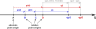

```cpp
inline constexpr struct A : absolute_point_origin<isq::distance> {} A;
inline constexpr struct B : relative_point_origin<A + 10 * m> {} B;
inline constexpr struct C : relative_point_origin<B + 10 * m> {} C;
inline constexpr struct D : relative_point_origin<A + 30 * m> {} D;

quantity qp1 = C + 100 * m;
quantity qp2 = D + 120 * m;

assert(qp2 - qp1 == 30 * m);           // Compatible: both relative to A
assert(qp1.delta_from(C) == 100 * m);
assert(qp1.delta_from(A) == 120 * m);
assert(B - A == 10 * m);               // Can subtract relative from absolute
assert(C - B == 10 * m);               // Can subtract relative origins
// assert(A - A == 0 * m);             // Compile-time error
```

#### Converting between different representations of the same _point_

The same point can be represented with deltas from various origins:


```cpp
quantity<point<si::metre, C>> qp2C = qp2;         // converting constructor
quantity qp2B = qp2.point_for(B);                 // conversion interface

assert(qp2 == qp2C);  // Same point, different representation
assert(qp2 == qp2B);
```

Conversions are only allowed between origins sharing the same
`absolute_point_origin` base. This proposal provides no way to express relationships between
distinct absolute origins. Custom conversion functions are required for such cases.

#### Temperature support

_Temperature_ is an example of relative point origins with stacked hierarchies:

```cpp
namespace si {

inline constexpr struct absolute_zero : absolute_point_origin<isq::thermodynamic_temperature> {} absolute_zero;
inline constexpr struct ice_point : relative_point_origin<point<milli<kelvin>>(273'150)> {} ice_point;

}

namespace usc {

inline constexpr struct fahrenheit_zero :
  relative_point_origin<point<mag_ratio<5, 9> * si::degree_Celsius>(-32)> {} fahrenheit_zero;

}
```

Origins stack hierarchically (°F → °C → K), and units embed their origins:

```cpp
namespace si {

inline constexpr struct kelvin : named_unit<"K", kind_of<isq::thermodynamic_temperature>, absolute_zero> {} kelvin;
inline constexpr struct degree_Celsius : named_unit<{u8"°C", "`C"}, kelvin, ice_point> {} degree_Celsius;

}
```

Construction syntax flexibility (all produce the same type):

```cpp
quantity<point<si::degree_Celsius, si::ice_point>> q1 = si::ice_point + delta<deg_C>(20.5);
quantity<point<deg_C>> q2{delta<deg_C>(20.5)};
quantity q3 = point<deg_C>(20.5);
```

Custom temperature references enable domain-specific applications:


```cpp
constexpr struct room_reference_temp : relative_point_origin<point<deg_C>(21)> {} room_reference_temp;
using room_temp = quantity<point<isq::thermodynamic_temperature[deg_C], room_reference_temp>>;

constexpr auto step_delta = delta<isq::thermodynamic_temperature[deg_C]>(0.5);
constexpr int number_of_steps = 6;

room_temp room_ref{};
room_temp room_low = room_ref - number_of_steps * step_delta;
room_temp room_high = room_ref + number_of_steps * step_delta;

auto std_ref = room_ref.point_for(si::ice_point).in(deg_C);
std::println("Room reference temperature: {} ({}, {::N[.2f]})\n",
             std_ref, std_ref.in(deg_F), std_ref.in(K));

std::println("| {:<18} | {:^18} | {:^18} | {:^18} |",
             "Temperature delta", "Room reference", "Ice point", "Absolute zero");
std::println("|{0:=^20}|{0:=^20}|{0:=^20}|{0:=^20}|", "");

auto print_temp = [&](std::string_view label, auto v) {
  std::println("| {:<18} | {:^18} | {:^18} | {:^18:N[.2f]} |", label,
               v - room_reference_temp, (v - si::ice_point).in(deg_C), (v - si::absolute_zero).in(deg_C));
};

print_temp("Lowest", room_low);
print_temp("Default", room_ref);
print_temp("Highest", room_high);
```

The above prints:

```text
Room reference temperature: 21 °C (69.8 °F, 294.15 K)

| Temperature delta  |   Room reference   |     Ice point      |   Absolute zero    |
|====================|====================|====================|====================|
| Lowest             |        -3 °C        |        18 °C        |      291.15 °C      |
| Default            |        0 °C         |        21 °C        |      294.15 °C      |
| Highest            |        3 °C         |        24 °C        |      297.15 °C      |
```

More about temperatures can be found in the [Quantity Points] chapter.

## User-defined representation types

The library should work with any representation type for:

- Improved safety (overflow prevention, range restrictions).
- Additional information (measurement uncertainty).
- Linear algebra support.

By default, floating-point and integer types are treated as real scalars (`bool`, `char`,
`wchar_t`, `char8_t`, `char16_t`, and `char32_t` are not representation types).


# Representation Types

Every `quantity` has a **representation type** that stores the numerical value.
The library works with fundamental arithmetic types (except `bool` and the character
types other than `signed char` and `unsigned char`) and
`std::complex`, but custom representation types can also be used to model domain-specific
requirements, such as range-validated values, vectors, or specialized numeric types.

The representation type determines what mathematical operations are available and how the
quantity behaves in calculations. The library verifies at compile time that the
representation type has the capabilities required for the quantity's character.


## Representation Requirements

To be used as a representation type, a type must satisfy the `representation_of` concept.

The library verifies representation capabilities because one unit can serve physical concepts that
need different mathematical operations. For example:

- _speed_ (scalar, magnitude only) vs. _velocity_ (vector, magnitude and direction) both
  use m/s,
- _mass_ (scalar) uses kg while _weight force_ (vector, pointing downward) uses N.

The library tracks character in the quantity specification (what the quantity represents)
and verifies that the representation type provides the required capabilities. This prevents, for
example, using a scalar type where vector operations like cross product are needed.

The following table summarizes the requirements for different representation characters:

<!-- markdownlint-disable MD013 MD060 -->
| Requirement                                 |           Real Scalar           |                         Complex Scalar                        |                             Vector                             |                                    Tensor                                   |
|---------------------------------------------|:-------------------------------:|:-------------------------------------------------------------:|:--------------------------------------------------------------:|:---------------------------------------------------------------------------:|
| Copyable                                    |                ✅                |                               ✅                               |                               ✅                                |                                      ✅                                      |
| Addition/subtraction (`+`, `-`, unary `-`)  |                ✅                |                               ✅                               |                               ✅                                |                                      ✅                                      |
| `$UnitMagnitudeScalable$` (unit-conversion) |                ✅                |                               ✅                               |                               ✅                                |                                      ✅                                      |
| Self-scalable (`T * T`, `T / T`)            |                ✅                |                               ✅                               |                               -                                |                                      -                                      |
| Equality comparable (`==`)                  |                ✅                |                               ✅                               |                               ✅                                |                                      ✅                                      |
| Totally ordered (`<`, `>`, `<=`, `>=`)      |                ✅                |                               -                               |                               -                                |                                      -                                      |
| Not a quantity type itself                  |                ✅                |                               ✅                               |                               ✅                                |                                      ✅                                      |
| **Construction**                            |                -                |                        `T{real, imag}`                        |                               -                                |                                      -                                      |
| **Required CPOs**                           |                -                | `math::real()`, `math::imag()`, `math::modulus()`             |                 `math::magnitude()`                            |                        `math::magnitude()`                                  |
| **Field / order determined by**             | `numeric_field`, `tensor_order` |                `numeric_field`, `tensor_order`                |                `numeric_field`, `tensor_order`                 |                       `numeric_field`, `tensor_order`                       |
| **Opt-out mechanism**                       |   `disable_representation<T>`   |                  `disable_representation<T>`                  |                  `disable_representation<T>`                   |                         `disable_representation<T>`                         |
| **Examples**                                |  `int`, `double`, `long double` |                     `std::complex<double>`                    | `Eigen::Vector3d`, `cartesian_vector<double>`, `int`, `double` | `cartesian_tensor<double>`, `Eigen::Matrix3d`, `int`, `double` (degenerate) |
<!-- markdownlint-enable MD013 MD060 -->

_Note: `cartesian_vector` and `cartesian_tensor` are representation types of the utility library
of [@MP-UNITS]. This paper uses them in examples and doesn't propose them._

All representation types must be **weakly regular**, which means they satisfy the
`std::regular` concept except for the default-constructibility requirement. Specifically,
they must be:

- **Copyable** (`std::copyable`)
- **Equality comparable** (`std::equality_comparable`)

This ensures that representation types have value semantics suitable for use in
quantities. Default construction is not required, allowing types like range-validated
representations that may not have a meaningful default value.

Complex scalars **must** be constructible from real and imaginary parts:
`T{real_value, imag_value}`. This is essential for operations that combine
real-valued quantities into complex results. For example, combining _active power_
and _reactive power_ into _complex power_:

```cpp
quantity active = isq::active_power(100.0 * W);
quantity reactive = isq::reactive_power(50.0 * var);
// Library needs to construct: std::complex<double>{active.numerical_value_in(W),
//                                                  reactive.numerical_value_in(var)}
```

Well-designed complex-like types do not provide total ordering (`operator<`, etc.), since
there is no natural ordering for complex numbers. Even if a complex-like type does provide
ordering operators (for example, for use in containers), it is not misclassified as a real
scalar: the field axis is read from `numeric_field`, whose default reports _complex_ whenever
the type exposes the `real()`/`imag()` API, so `$RealScalar$`, which requires a real field, is
not satisfied regardless of ordering.

The different names reflect domain conventions: `modulus()` is traditional complex
analysis terminology, while `magnitude()` follows physics and engineering conventions
for vectors. [Relationship to algebraic structures] explains why the vector CPO is not named
`norm`, and [Customization Point Objects (CPOs)] lists the `norm`-named fallbacks that let types
from linear algebra libraries integrate without adaptation.

Arithmetic types like `int` and `double` satisfy requirements for multiple
characters: real scalar (primary use), 1-dimensional vector, and scalar tensor measures
like von Mises stress. Type safety comes from `quantity_character` matching in the quantity
specification:

```cpp
// All valid uses of double:
quantity mass = isq::mass(5.0 * kg);        // Scalar
quantity v = isq::velocity(10.0 * m/s);     // 1D vector
quantity sigma = isq::stress(100.0 * Pa);   // Degenerate (1×1) tensor
```

For the full second-order tensor, [@MP-UNITS] provides `cartesian_tensor` (a fixed 3×3
representation, not proposed in this paper), and third-party matrix types such as
`Eigen::Matrix3d` work directly as well. In practice, though, most engineering extracts scalar
measures from tensor fields rather than manipulating full 3×3 matrices (von Mises stress,
principal stresses, shear components, hydrostatic stress), which is why arithmetic types remain
useful as degenerate tensor representations for the tensor character.


## Concept Hierarchy

Most of the concepts described below are _exposition-only_: they capture how the library
classifies representation types internally and are not part of its public interface. The
only public concept in this chapter is `representation_of`. The building-block and
character concepts (`$Addable$`, `$ScalableWith$`, `$RealScalar$`, `$Vector$`, and the rest) exist
to define it and to explain how a representation type is recognized. As in the [Synopsis], their
names are shown in italics.

These concepts are **syntactic**: they constrain which operations are available and that
results have a common type with `T` (`std::common_with`). They do not
(and a C++ concept cannot) enforce the algebraic _laws_ (associativity,
commutativity, distributivity, existence of identities, compatibility of an order with the
arithmetic) that the corresponding mathematical structures require. This is the same
limitation `std::regular` and `std::totally_ordered` already accept. For this reason the
concepts are named for the _role_ a type plays rather than for the structure it resembles;
[Relationship to algebraic structures] below maps each one to the structure it approximates
and lists the laws left unchecked.

The requirements summarized in the table above map directly to a hierarchy of C++
concepts. The lowest-level building blocks are:

```cpp
template<typename T>
concept $WeaklyRegular$ = copyable<T> && equality_comparable<T>;

template<typename T>
concept $Addable$ = requires(const T a, const T b) {
  { -a } -> common_with<T>;
  { a + b } -> common_with<T>;
  { a - b } -> common_with<T>;
};

template<typename T, typename S>
concept $ScalableWith$ = requires(const T v, const S s) {
  { v * s / s } -> common_with<T>;
  { s * v / s } -> common_with<T>;
  { v / s * s } -> common_with<T>;
};
```

`$WeaklyRegular$` is `std::regular` without default-initialization. Default construction is
not required: some representation types cannot provide a meaningful
default-constructed value (see, e.g., [@P2993R0]) yet are otherwise well-behaved as quantity
representations.

`$Addable$` requires unary negation (`-a`) alongside `+` and `-`, so it models an additive
_group_. Inverses are required because the library forms
differences (of deltas, and of points); types that support only
accumulation are out of scope.

`$ScalableWith$<T, S>` constrains the _round-trip_ `v * s / s` rather than the
intermediate `v * s`. This lets types
whose `operator*`/`operator/` change the type (quantities being the canonical example)
still satisfy the concept, as long as scaling by `s` and back lands on a type with a common
type with `T`. The round-trip requirement also rejects irreversible type
promotion, where `operator*` decays to a type that has no common type with `T`
(e.g. a checked-integer wrapper without implicit conversions whose `operator*` returns a raw
arithmetic type). The
constraint is on the result _type_, not its value: over integer representations `v * s / s`
need not equal `v` (integer division truncates). Because the round-trip
divides by `s`, the scalar type `S` must itself be division-capable; scaling by
ring-only scalars that lack division is not expressible through this concept.

The result types of `+`, `-`, and the scaling round-trip are guarded with
`std::common_with<T>` rather than left unconstrained or pinned to a stronger concept, for these
reasons:

- A bare requirement (`{ a + b };`) is satisfied even by an `operator+` returning `void`, so
  some return check is needed.
- The natural ideal, requiring the result to be a scalar/vector _again_ (true closure,
  `{ a + b } -> $Scalar$`), is ill-formed: those character concepts
  are defined transitively through `$Addable$`/`$ScalableWith$`, so constraining their own
  results by them would make a concept depend on itself, which [basic.scope.pdecl]{.sref} forbids
  (and which would otherwise recurse without termination).
- Requiring `std::same_as<T>` is well-formed but too strong: it forbids the type-changing
  arithmetic the round-trip is designed to permit (expression templates, quantities).

`std::common_with<T>` is not recursive, and it rejects `void` and unrelated
return types while admitting any result that shares a common type with `T`. The standard's
cross-type comparison concepts (`std::equality_comparable_with`,
`std::three_way_comparable_with`) constrain with a common _reference_ relation,
because they relate operands that may be lvalues or proxy references. Here the constrained
expressions yield prvalues, so a common _value_ type is the meaningful requirement, and
`std::common_with` is the stronger relation anyway, entailing `common_reference_with` for the
corresponding `const` lvalue references ([concept.common]).

`std::common_with` is also _symmetric_, so it never accepts a lossy conversion: a
widening `a + b` (e.g. `int16_t + int16_t -> int`) is accepted because the result shares a
common type with `T`, not because the wide result can be narrowed back into `T`. The
_internal_ scaling concepts ([How Scaling Works]) make the opposite choice,
`std::constructible_from` rather than `std::common_with`, because there a
narrowing back to the stored type is the intended operation; the note there explains the
distinction.

These compose into the character-specific concepts:

```cpp
template<typename T>
concept $RegularAddable$ = $Addable$<T> && $WeaklyRegular$<T>;

// Scalars: self-scalable — T * T and T / T have a common type with T
template<typename T>
concept $BaseScalar$ = $RegularAddable$<T> && $ScalableWith$<T, T>;

// The field axis, read from the numeric_field trait (the single source of truth)
template<typename T>
concept $Real$ = (numeric_field<T> == quantity_field::real);

template<typename T>
concept $Complex$ = (numeric_field<T> == quantity_field::complex);

// Real scalar: a real, totally-ordered scalar
template<typename T>
concept $RealScalar$ = $Real$<T> && $BaseScalar$<T> && totally_ordered<T>;

// Complex scalar: constructible from real/imag parts; provides a modulus
template<typename T>
concept $ComplexScalar$ =
  $Complex$<T> && $BaseScalar$<T> &&
  requires(const T v, const T& ref) {
    requires constructible_from<T,
      decltype(math::real(ref)), decltype(math::imag(ref))>;
    math::modulus(v);
    requires $ScalableWith$<T, decltype(math::modulus(v))>;
  };

// A scalar is an order-0 representation of either field
template<typename T>
concept $Scalar$ = ($RealScalar$<T> || $ComplexScalar$<T>) && tensor_order<T> == 0;

// Exposes an L2 magnitude and is scalable by it — the container algebra a vector or tensor adds
template<typename T>
concept $HasMagnitude$ =
  requires(const T& v) {
    math::magnitude(v);
    requires $ScalableWith$<T, decltype(math::magnitude(v))>;
  };

// The order axis, rank-ordered through the tensor_order trait: a scalar is a degenerate vector,
// a vector a degenerate tensor. An order-n representation fills a slot of order >= n.
template<typename T>
concept $Vector$ = $Scalar$<T> || (tensor_order<T> == 1 && $RegularAddable$<T> && $HasMagnitude$<T>);

template<typename T>
concept $Tensor$ = $Vector$<T> || (tensor_order<T> == 2 && $RegularAddable$<T> && $HasMagnitude$<T>);
```

The key structural difference between `$BaseScalar$` and `$Vector$` reflects the underlying
mathematics. A scalar type must satisfy `$ScalableWith$<T, T>`. Multiplying two scalars
yields another scalar of the same kind. A vector type is only required to satisfy
`$ScalableWith$<T, decltype(math::magnitude(v))>`. It can be scaled by its magnitude (a scalar),
but vector × vector is not required and is typically not defined at all.

The concept is named `$Vector$` to match the `quantity_tensor_order::vector` it identifies, not to
assert that it models an arbitrary vector space. In the [@ISO80000] sense a vector quantity is
characterized by a magnitude and a direction, so the `math::magnitude(v)` requirement is intrinsic
to that character: the representation of a vector quantity
is meant to be an element of a normed space.

The order axis is **rank-ordered** through the `tensor_order` trait, which reports `0`, `1`, or `2`.
Because a tensor of order zero is a scalar and a tensor of order one is a vector ([@ISO80000]), a
lower-order representation may stand in for a higher-order quantity character: a real scalar satisfies
the scalar, vector, **and** tensor characters, and a vector representation additionally satisfies the
tensor character. The reverse never holds: a second-order tensor such as `cartesian_tensor`
has `tensor_order == 2`, so it is not a vector.

`$ComplexScalar$` takes `math::modulus(v)` to be the Euclidean modulus
$|z| = \sqrt{\operatorname{re}(z)^2 + \operatorname{im}(z)^2}$, the same quantity
`math::magnitude` computes for vectors, and _not_ the algebraic field norm $|z|^2$ (see
[Relationship to algebraic structures]).

Each character concept combines with `$RepresentationBaseline$`, the character-independent floor
shared by every representation, to form the representation concepts the library checks internally.
`$RepresentationBaseline$` requires that a type is not opted out (`disable_representation`) and that the
library can scale it by a unit magnitude (`$UnitMagnitudeScalable$`, described in [How Scaling Works]):

```cpp
template<typename T>
concept $RepresentationBaseline$ = !disable_representation<T> && $UnitMagnitudeScalable$<T>;

template<typename T>
concept $ScalarRepresentation$ = $RepresentationBaseline$<T> && $Scalar$<T>;

template<typename T>
concept $VectorRepresentation$ = $RepresentationBaseline$<T> && $Vector$<T>;

template<typename T>
concept $TensorRepresentation$ = $RepresentationBaseline$<T> && $Tensor$<T>;

// Rank-ordering makes every valid representation a (possibly degenerate) tensor representation
template<typename T>
concept $SomeRepresentation$ = $TensorRepresentation$<T>;
```

`$RepresentationBaseline$` comes first in each conjunction. Its `disable_representation` opt-out
defaults to rejecting any type that is, or whose elements are, a quantity or quantity-like type, so
a bare `quantity`, a `std::chrono::duration`, and a container of either are all excluded
(preventing inadvertent nesting of quantities), while a custom type bars itself with a one-line
specialization. Leading with the guard also rejects a quantity before any character concept (and
thus any of the quantity's own operators) is examined, which avoids a constraint-satisfaction cycle.

The top-level public concept is `representation_of<T, V>`. The character is matched on each of its
two axes separately: the order by rank, the field exactly. Both sides of each axis are described as
a _set_ of characters, and a match is a non-empty intersection: a representation contributes the
slots it can fill, and `V` contributes the characters it admits.

```cpp
// A character spelled directly: one axis, or both of them.
template<auto V>
concept $CharacterValue$ =   // exposition only
  same_as<remove_cvref_t<decltype(V)>, quantity_tensor_order> ||
  same_as<remove_cvref_t<decltype(V)>, quantity_field> ||
  same_as<remove_cvref_t<decltype(V)>, quantity_character>;

// What a character constraint may be: a quantity specification or a character.
template<auto V>
concept $CharacterConstraint$ =   // exposition only
  quantity_spec<decltype(V)> || $CharacterValue$<V>;

// What a quantity specification admits, as a set of values per axis (`.order` and `.field`): one
// value per axis for a concrete specification, and every value for a quantity kind.
template<quantity_spec QS>
consteval auto $admitted-character$(QS qs);   // exposition only

// Whether two sets of values of the same axis have a value in common.
template<typename Set>
consteval bool $overlaps$(Set lhs, Set rhs);   // exposition only

// The characters a representation can represent: on the order axis a scalar fills every slot, a
// vector fills vector and tensor, a tensor only tensor (a library rule generalizing clause 18 of
// ISO 80000-2:2019). The field has no such degeneracy, so a representation offers exactly its own.
template<typename T>
constexpr auto $representable-character$ = @_see below_@;   // exposition only

// What `V` admits: a quantity specification contributes its own character, a bare axis constrains
// that axis and leaves the other free, and a quantity kind admits everything.
template<auto V>
consteval auto $character-constraint$();   // exposition only

template<typename T, auto V>
concept representation_of =
  $SomeRepresentation$<T> && $CharacterConstraint$<V> &&
  $overlaps$($representable-character$<T>.order, $character-constraint$<V>().order) &&
  $overlaps$($representable-character$<T>.field, $character-constraint$<V>().field);
```

What each type of `V` admits is listed under `representation_of` in [Concepts](#concepts). How a
character set is represented is left to the implementation. The declarations above are expressed in
terms of what a specification _admits_, which is the only observable behaviour; nothing in the
interface exposes a set.


### Relationship to algebraic structures

Each concept above approximates a classical algebraic structure but is named for the role it
plays in the library rather than for that structure. We avoid the structural names (`Field`,
`OrderedField`, `VectorSpace`, …):

- A concept can only check that operations exist and that result types are stable; it cannot
  verify the defining laws. A concept named `Field` would promise associativity,
  distributivity, and inverses that the compiler never enforces.
- The library admits types that are _weaker_ than the named structure. `int` is
  not a field (it has no multiplicative inverses) yet must satisfy `$BaseScalar$`; `int` and
  `double` are accepted as one-dimensional vectors although they are not, in the usual sense,
  elements of a vector space. Role-oriented names ("scalar", "vector") communicate the
  intended use without making algebraic claims the type does not honor.

<!-- markdownlint-disable MD013 MD060 -->

| Concept               | Structure approximated                                               | Principal laws left unchecked                                                                                          |
|-----------------------|----------------------------------------------------------------------|------------------------------------------------------------------------------------------------------------------------|
| `$Addable$`           | additive group                                                       | associativity & commutativity of `+`, existence of `0`                                                                 |
| `$WeaklyRegular$`     | a set with value semantics (copy + equality)                         | —                                                                                                                      |
| `$RegularAddable$`    | a (regular) abelian group under addition                             | the group axioms above                                                                                                 |
| `$ScalableWith$<T,S>` | a scalar action of `S` on `T` (module / vector-space multiplication) | distributivity and associativity of the action; closure is approximated by round-trip type stability, not `v*s/s == v` |
| `$BaseScalar$`        | a field (commutative division ring)                                  | commutativity/associativity of `×`, distributivity, existence of `0` and `1`                                           |
| `$RealScalar$`        | an ordered field                                                     | compatibility of the order with `+` and `×` (`std::totally_ordered` is only a set order)                               |
| `$ComplexScalar$`     | the complex field `ℂ` (a 2-D real division algebra with modulus)     | field axioms; that `real`/`imag` genuinely coordinatize `ℂ`                                                            |
| `$Vector$`            | an element of a normed vector space                                  | the vector-space axioms and the norm axioms (homogeneity, triangle inequality)                                         |

<!-- markdownlint-enable MD013 MD060 -->

The word "norm" is overloaded across mathematics:

- the **algebraic (field) norm** $N(z) = z\bar{z} = |z|^2$, a multiplicative, quadratic form; and
- the **Euclidean ($L^2$) norm** $\lVert z\rVert = \sqrt{N(z)} = |z|$, the analytic norm
  satisfying the triangle inequality.

`std::norm(std::complex)` already exists and computes the _field_ norm $|z|^2$, not $|z|$. A new
customization point named `norm` returning $\lVert v\rVert$ would therefore collide with
`std::norm`, which already computes a different value. The library avoids the ambiguity by using:

- `math::modulus(z)` for the complex absolute value $|z|$ (the standard complex-analysis term), and
- `math::magnitude(v)` for the vector Euclidean norm $\lVert v\rVert$,

and by exposing no customization point for the field norm.

A complex scalar is a degenerate vector and tensor by rank-ordering, and the field axis
(`numeric_field`) keeps it classified as complex. The `math::magnitude`
CPO routes it through `math::modulus`, yielding $|z|$, and never reaches for `std::norm` on
a scalar (see [Customization Point Objects (CPOs)]).


## Customization Points

The library provides several customization mechanisms for representation types. These fall
into two categories: **Character determination** (what kind of representation type you
have) and **Behavior and values** (how the library interacts with your type).

### Character Determination

#### Customization Point Objects (CPOs)

The library uses several CPOs, declared in the nested namespace `std::math` (see
[Names that need a decision]), to support different representation types. Providing these
CPOs determines the **character** of the representation type. Each CPO checks for
implementations in the following priority order:

**`math::real(c)`** - Returns the real part of a complex number:

1. `c.real()` member function
2. `real(c)` free function found via ADL

**`math::imag(c)`** - Returns the imaginary part of a complex number:

1. `c.imag()` member function
2. `imag(c)` free function found via ADL

**`math::modulus(c)`** - Returns the modulus |z| of a complex number:

1. `c.modulus()` member function
2. `modulus(c)` free function found via ADL
3. `c.abs()` member function
4. `abs(c)` free function found via ADL

**`math::magnitude(v)`** - Returns the magnitude of a vector or tensor as a scalar:

1. `v.magnitude()` member function
2. `magnitude(v)` free function found via ADL
3. `v.norm()` member function
4. `norm(v)` free function found via ADL
5. For arithmetic types: `v` for unsigned arithmetic types, `std::abs(v)` otherwise
6. For complex scalar types: `math::modulus(v)` (a complex scalar is a degenerate 1-D complex vector,
   whose magnitude is its modulus `|z|`)
7. For real scalar types: `v.abs()` member function
8. For real scalar types: `abs(v)` free function found via ADL

Steps 3–4 are provided so that types from linear algebra libraries that follow the
`norm()` naming convention work without adaptation. They are guarded to only apply
when `T` is not a `$Scalar$` (i.e., neither a real nor a complex scalar): `std::norm` is
overloaded both for arithmetic types and for `std::complex`, returning |x|² rather than
|x| in either case, so scalar types are explicitly directed to the `abs` fallback below
instead.

For `modulus()`, `abs()` is accepted as a fallback for compatibility with `std::complex`
and similar types that use that name. For `magnitude()`, `abs()` enables arithmetic
types to serve as 1-dimensional vectors and scalar tensor measures.

---

#### `numeric_field<T>`

`numeric_field<T>` reports the **field axis** (`quantity_field::real` or
`quantity_field::complex`) and is the single source of truth for it. It reads the field off a
scalar _element_ of the representation rather than off the container's surface: for an order ≥ 1
type it recurses into one element reached by indexing, and for a scalar it tests the
`real()`/`imag()` API directly. The primary is left undefined; a specialization defines the field
for a type whose order is known:

```cpp
template<typename T>
  requires /* tensor_order<T> is defined, the type supports the indexing it implies, and a
              complex-element vector or tensor also exposes real()/imag() on its own surface */
constexpr quantity_field numeric_field<T> =
  /* complex if a scalar element of T exposes the real()/imag() API, real otherwise */;
```

Reading the _element_, rather than the container's `real()`/`imag()`, is what lets the
linear-algebra libraries be used with no field adapter at all: `Eigen` and `Blaze` expose
`real()`/`imag()` on their _real_ matrices and vectors too (a real value is a degenerate complex
one), which would fool a check made on the container, but the element of a real matrix is a plain
`double`, so it is classified as real. Because reaching the element needs the order, `numeric_field`
is defined only where `tensor_order` is: an ambiguous type without a specialization (see below) has
neither an order nor a field, so the two axes reject it together.

The element decides the field, with one consistency requirement in the other direction. A
container whose element is complex must also expose `real()`/`imag()` on its own surface, because
that is the API through which a complex representation is used (`Eigen` and `Blaze` complex matrices
provide it, as does `cartesian_vector<complex<double>>`). A complex-element container that does not
expose it cannot serve as a complex representation. `numeric_field` is left undefined for it,
because classifying it as real would select a Euclidean instead of a Hermitian magnitude,
exactly as `tensor_order` is left undefined for an ambiguous shape. The author then either exposes
`real()`/`imag()` or specializes `numeric_field` explicitly.

---

#### `tensor_order<T>`

`tensor_order<T>` reports the **order axis** as `0` (scalar), `1` (vector), or `2` (tensor). Its
primary is left undefined; a specialization detects the order structurally for a type that exposes
exactly one indexing shape. Two-index access (`t(i, j)` or the C++23 `t[i, j]`) is order 2,
single-index access (`t[i]`) is order 1, otherwise order 0:

```cpp
template<typename T>
  requires /* T exposes exactly one indexing shape */
constexpr size_t tensor_order<T> = /* 2 for t(i, j)/t[i, j], 1 for t[i], else 0 */;
```

This trait replaces the `disable_vector` and `disable_tensor` opt-outs of earlier revisions. With
the order known as a number, no type needs to opt out: `cartesian_tensor` has order 2, so it can't
fill a vector slot (see [Concept Hierarchy]). A type that exposes _both_ indexing shapes is
**ambiguous**. An `Eigen` column vector is an `N × 1` matrix that offers both `t[i]` and `t(i, j)`,
and only its compile-time extents can decide its order, so it has no default and must be
specialized, either by an integration adapter or by an ordinary full specialization:

```cpp
template<typename T>
  requires /* T is an Eigen type */
constexpr std::size_t std::tensor_order<T> =
  (T::RowsAtCompileTime == 1 || T::ColsAtCompileTime == 1) ? 1 : 2;
```

Until specified, an ambiguous type is not a valid representation. The rejection is SFINAE-friendly,
so forgetting the adapter gives a compile error instead of a misclassification
(guessing would also disagree with an adapter across translation units, an ODR hazard).

---

#### `disable_representation<T>`

`disable_representation<T>` is the single, character-agnostic opt-out: when `true`, `T` is not
accepted as a representation of any character. It replaces the former per-character `disable_real` /
`disable_vector` / `disable_tensor` knobs. The default rejects any type that is, or whose elements
are, a quantity or quantity-like type (so a bare `quantity`, a `std::chrono::duration`, and a
container of either are excluded), and additionally opts out `bool`, which is totally ordered and
arithmetic yet meaningless as a quantity representation. It also opts out `char`, `wchar_t`,
`char8_t`, `char16_t`, and `char32_t`, which hold characters rather than numbers. `signed char`
and `unsigned char` stay valid representation types, because programs use them for small numbers,
and `std::int8_t` and `std::uint8_t` usually name them:

```cpp
template<typename T>
constexpr bool disable_representation =
  /* true if T, or its element type, is a quantity or quantity-like type */;

template<>
inline constexpr bool disable_representation<bool> = true;
template<>
inline constexpr bool disable_representation<char> = true;
template<>
inline constexpr bool disable_representation<wchar_t> = true;
template<>
inline constexpr bool disable_representation<char8_t> = true;
template<>
inline constexpr bool disable_representation<char16_t> = true;
template<>
inline constexpr bool disable_representation<char32_t> = true;
```

A custom type that structurally satisfies a character but must never store a quantity bars itself in
one line:

```cpp
template<>
inline constexpr bool std::disable_representation<my_type> = true;
```

::: note
There is no `disable_complex` or any per-axis opt-out. The field is determined by `numeric_field`
and the order by `tensor_order`, so a type the structural detection would misclassify or leave
ambiguous resolves the offending _axis_ directly (the field follows the element, the order takes a
`tensor_order` specialization) instead of being globally disabled. `disable_representation` only
decides whether `T` is a representation at all.
:::

---

### Behavior and Values

#### `representation_underlying_type<T>` { #representation_underlying_type }

`representation_underlying_type<T>` is the extension point for exposing the underlying
arithmetic or element type of a representation to the library. It drives the scaling
factor type and the `treat_as_floating_point` check:

```cpp
template<typename T>
struct representation_underlying_type;  // primary — empty

template<typename T>
using representation_underlying_type_t = representation_underlying_type<T>::type;
```

The library provides partial specializations that detect the underlying type in order:

1. `T::value_type` or `T::element_type` member type (cv-qualification stripped)
2. `std::underlying_type_t<T>` for scoped enumerations (unscoped enumerations are
   excluded, as they already implicitly convert to their underlying type). This case is there
   for libraries that implement their number types as scoped enumerations with overloaded
   operators. For example, the safe integers of [@PSSIMPLESAFEINT] are `enum class` types,
   such as `psssint::si32`.
3. `T` itself as a fallback

If both `value_type` and `element_type` are present with differing underlying types, the
trait is empty and the library treats `T` as a leaf. Provide only `value_type` unless
there is a specific reason to expose both (e.g., satisfying iterator concepts), in which
case ensure they name the same underlying type.

A `value_type` member is the preferred form for types under the user's control:

```cpp
template<typename T>
class my_wrapper {
public:
  using value_type = T;
  // ...
};
```

When the source of a type cannot be modified, the trait may be specialized directly:

```cpp
// MyFloat wraps long double internally
template<>
struct std::representation_underlying_type<MyFloat> {
  using type = long double;
};
```

::: note
`std::indirectly_readable_traits` is not reused: that standard trait
answers "what does `*t` yield?" and is the extension point for iterators and smart
pointers, and specializing it for a non-iterator type is a semantic misuse.
:::

---

#### `representation_canonical_type<T>` { #representation_canonical_type }

`representation_canonical_type<T>` maps a representation _value type_ to the concrete type a
`quantity` should **store**. The primary template maps a type to itself. A `const`-qualified type
(mirroring `representation_underlying_type`) and a reference are forwarded to the unqualified type,
so a specialization handles only the unqualified type, and it applies also when an arithmetic
operator returns a `const` proxy or a reference to one:

```cpp
template<typename T>
struct representation_canonical_type {
  using type = T;
};

template<typename T>
struct representation_canonical_type<const T> : representation_canonical_type<T> {};

template<typename T>
struct representation_canonical_type<T&> : representation_canonical_type<T> {};

template<typename T>
struct representation_canonical_type<T&&> : representation_canonical_type<T> {};

template<typename T>
using representation_canonical_type_t = representation_canonical_type<T>::type;
```

The trait exists for **expression-template** representations. Linear algebra libraries such
as Eigen and Blaze evaluate lazily: their arithmetic operators return proxy types that hold
references to their operands rather than a materialized vector or matrix. Such a proxy must be
evaluated to a concrete type before being stored in a `quantity`; otherwise the `quantity`
would retain dangling references once the operands (often temporaries) go out of scope. The
`quantity` deduction guides, and the concepts that compute the representation type resulting
from an arithmetic operation (e.g. the result of `velocity * time`), consult this trait, so
an expression-template type for which the trait is specialized is stored as its materialized
concrete type.

For a type whose operators already return a concrete value (arithmetic types,
`cartesian_vector`, GLM), the default is correct and no specialization is needed. An
expression-template type is taught its evaluated type by specializing the trait, for example,
to `Eigen`'s `PlainObject` or `Blaze`'s `ResultType`:

```cpp
template<typename T>
  requires /* T is an Eigen expression */
struct std::representation_canonical_type<T> {
  using type = std::remove_cvref_t<typename T::PlainObject>;
};
```

This is the mechanism that lets a third-party linear algebra type be used **directly** as a
vector/tensor representation. This paper doesn't propose an integration with any linear algebra
library. [@MP-UNITS] provides opt-in headers (`<mp-units/integrations/eigen.h>`,
`<mp-units/integrations/glm.h>`, and `<mp-units/integrations/blaze.h>`) that specialize the
customization points for Eigen, GLM, and Blaze, so the vector and matrix types of those libraries
work as representations once the header is included. Armadillo can't be integrated this way: its
`operator==` returns an element-wise mask rather than a `bool`, so its types are not
`std::equality_comparable` and cannot satisfy the [weakly-regular](#representation-requirements)
requirement.

---

#### Scaling operators { #scaling-operators }

The library scales a representation value by calling `value * factor` and `value / factor`,
where `factor` is of type `representation_underlying_type_t<T>` (or a wider integer type
for the rational integer path, described in [How Scaling Works]). A type may
additionally provide `operator*(T, unit_magnitude)` to receive the full compile-time unit
magnitude; when present, this operator is called **first** and the factor-based operators
serve as a fallback. The magnitude-aware operator may return a **different type** (see
[Magnitude-aware scaling] for the full pattern).

These operators are found via ADL. Hidden friends are the preferred form for types under
the user's control; non-member operators placed in the type's namespace serve the same
role for third-party types:

```cpp
template<typename T>
class my_wrapper {
  T value_;
public:
  using value_type = T;
  constexpr explicit my_wrapper(T v) : value_(v) {}

  friend constexpr my_wrapper operator*(my_wrapper v, T factor) { return my_wrapper{v.value_ * factor}; }
  friend constexpr my_wrapper operator/(my_wrapper v, T factor) { return my_wrapper{v.value_ / factor}; }

  // Optional: magnitude-aware scaling (return type may differ from my_wrapper)
  // template<std::unit_magnitude M>
  // friend constexpr auto operator*(const my_wrapper& v, M m) { /* ... */ }
};
```

---

#### `treat_as_floating_point<Rep>` { #treat_as_floating_point }

A specializable variable template that tells the library whether a type should be treated
as floating-point for the purpose of allowing implicit conversions:

```cpp
template<typename Rep>
constexpr bool treat_as_floating_point = @_see below_@;
```

By default, the value is determined by applying `std::chrono::treat_as_floating_point_v`
(hosted) or `std::is_floating_point_v` (freestanding) to the recursively-unwrapped
underlying type of `Rep`. When `true`, implicit conversions are enabled; otherwise an
explicit `value_cast` is required (see [Value conversions]). A specialization is needed
when automatic detection yields an incorrect result:

```cpp
template<>
inline constexpr bool std::treat_as_floating_point<my_fixed_point_type> = true;
```

---

#### `implicitly_scalable<FromUnit, FromRep, ToUnit, ToRep>` { #implicitly_scalable }

A specializable variable template that controls **whether** a conversion from
`quantity<FromUnit, FromRep>` to `quantity<ToUnit, ToRep>` is implicit or requires an
explicit cast via `value_cast` or a conversion with a rounding policy. It is the layer on top of
`treat_as_floating_point`: the default formula derives the implicit-conversion decision
from it, and a specialization overrides that decision for types where the derived rule
is incorrect:

```cpp
template<unit auto FromUnit, typename FromRep, unit auto ToUnit, typename ToRep>
constexpr bool implicitly_scalable =
  treat_as_floating_point<ToRep> ||
  (!treat_as_floating_point<FromRep> && is_integral_scaling(FromUnit, ToUnit) &&
   $integer-rank-preserving$<FromRep, ToRep>);
```

`$integer-rank-preserving$<From, To>` is `true` unless `From` and `To` are both integer types
([basic.fundamental]{.sref}), `To` is not the type that `From` promotes to (`decltype(+From{})`,
[conv.prom]{.sref}), and either their signedness differs or the integer conversion rank of `To` is
lower than that of `From` ([conv.rank]{.sref}). `bool`, `char`, `wchar_t`, `char8_t`, `char16_t`,
and `char32_t` are integer types as well, but they are not valid representation types (see
[`disable_representation<T>`](#disable_representationt)), so the rule never applies to them.
`signed char` and `unsigned char` are integer types, and `std::int8_t` and `std::uint8_t` name a
signed and an unsigned integer type, so the rule covers them as well.

`is_integral_scaling(from, to)` is a `consteval` predicate that can also be
used in user specializations to distinguish the integral-factor case (e.g. `m → mm`
(×1000)) from fractional ones (e.g. `mm → m` (÷1000), `ft → m`, `deg → rad`).

The default follows `std::chrono::duration`: a conversion to a floating-point representation is
always implicit, a conversion between integer representations is implicit only when the unit ratio
is an integer multiplier (exact, no truncation), and all other cases require an explicit cast. It
differs in one respect: a conversion between integer representations also requires both types to
have the same signedness and the destination to have an integer conversion rank not lower than the
source's, or the destination to be the type the source promotes to. Either way, every value of the
source type fits in the destination type on every implementation. `quantity<m, std::int16_t>` from
`100'000 * m` therefore requires an explicit cast, while `duration<std::int16_t>` from
`duration<int>{100'000}` doesn't. [@INT-REP-CONV] explains why the rank of [conv.rank]{.sref} is
used instead of the type traits of [@P0870R8] and [@P2509R1].

The promotion case is needed because the sum of two `std::uint8_t` quantities is an `int` quantity,
and without it the operands could not convert to it. It is also the one case whose answer depends on
the widths of the types. `unsigned short` promotes to `int` where `int` can represent every
`unsigned short` value, and to `unsigned int` otherwise, so a conversion from `unsigned short` to
`int` is implicit on the first kind of implementation and needs an explicit cast on the second.

For example, a decimal fixed-point type that represents decimal ratios exactly can
permit all unit conversions implicitly:

```cpp
template<auto FromUnit, auto ToUnit>
constexpr bool std::implicitly_scalable<FromUnit, safe_decimal, ToUnit, safe_decimal> = true;
```

When precision is asymmetric between two types, the specialization can be directional:

```cpp
template<auto FromUnit, auto ToUnit>
constexpr bool std::implicitly_scalable<FromUnit, double, ToUnit, my_decimal> = true;

template<auto FromUnit, auto ToUnit>
constexpr bool std::implicitly_scalable<FromUnit, my_decimal, ToUnit, double> = false;
```

`is_integral_scaling` may be reused in a specialization to distinguish integral
from fractional unit ratios. See [Value conversions] for details.

---

#### `representation_values<Rep>` { #representation_values }

A specializable class template that provides the special values used by `quantity::zero()`,
`quantity::min()`, `quantity::max()`, mathematical rounding operations, and
division-by-zero checks:

```cpp
template<typename Rep>
struct representation_values {
  static constexpr Rep zero() noexcept;
  static constexpr Rep one() noexcept;
  static constexpr Rep min() noexcept;
  static constexpr Rep max() noexcept;
};
```

In hosted environments the primary specialization inherits `zero()`, `min()`, and `max()` from
`std::chrono::duration_values<Rep>`; `one()` is always defined in the struct itself, constrained to
`std::constructible_from<Rep, int>`. In freestanding environments all four methods are defined
directly, each guarded by its own `requires` clause: `zero()` and `one()` require
`std::constructible_from<Rep, int>`; `min()` requires `std::numeric_limits<Rep>::is_specialized` and
that `std::numeric_limits<Rep>::lowest()` returns `Rep`; `max()` requires
`std::numeric_limits<Rep>::is_specialized` and that `std::numeric_limits<Rep>::max()` returns `Rep`.
An explicit specialization is required for types that cannot satisfy those constraints or that need
non-standard special values:

```cpp
template<typename T>
struct std::representation_values<my_custom_type<T>> {
  static constexpr my_custom_type<T> zero() noexcept
  { return my_custom_type<T>{T{0}}; }

  static constexpr my_custom_type<T> one() noexcept
  { return my_custom_type<T>{T{1}}; }

  static constexpr my_custom_type<T> min() noexcept
  { return my_custom_type<T>{std::numeric_limits<T>::lowest()}; }

  static constexpr my_custom_type<T> max() noexcept
  { return my_custom_type<T>{std::numeric_limits<T>::max()}; }
};
```


## How Scaling Works

Every representation type must be **unit-conversion scalable**. The library must be able
to apply a unit magnitude ratio to it internally. This is captured by the `$UnitMagnitudeScalable$`
concept, which directly names the three built-in scaling paths:

```cpp
template<typename T>
concept $UnitMagnitudeScalable$ =
  $WeaklyRegular$<T> && ($UsesUnitMagnitudeAwareScaling$<T> || $UsesFloatingPointScaling$<T> || $UsesIntegerScaling$<T>);
```

`$UsesUnitMagnitudeAwareScaling$` is satisfied by any type that provides
`operator*(T, unit_magnitude)`, checked first by the scaling engine, before the two
built-in numeric paths. The full pattern is described in [Magnitude-aware scaling]:

```cpp
template<typename T>
concept $UsesUnitMagnitudeAwareScaling$ = requires(const T& v) { v * mag<1>; };
```

`$UsesFloatingPointScaling$` matches any type (or container thereof) whose underlying
type satisfies `treat_as_floating_point`, is constructible from `long double` (the
precision at which magnitude constants are evaluated), and supports `operator*` and
`operator/` with that underlying type, returning a result that `T` can be constructed from:

```cpp
template<typename T>
concept $UsesFloatingPointScaling$ =
  (treat_as_floating_point<T> || treat_as_floating_point<representation_underlying_type_t<T>>) &&
  constructible_from<representation_underlying_type_t<T>, long double> &&
  requires(T value, representation_underlying_type_t<T> f) {
    requires constructible_from<T, decltype(value * f)>;
    requires constructible_from<T, decltype(value / f)>;
  };
```

`$UsesIntegerScaling$` matches any type whose underlying type satisfies `detail::integral`
(the scaling engine uses `get_value<wider_t>`, `wider_int_for<element_t>`, and
`fixed_point<element_t>` internally, all of which require an integer element type).
Scaling is routed through the type's own `operator*` and `operator/`, so wrappers can
check for overflow and containers can scale element-wise. The factor type is
`wider_int_for<element_t>`, a wider integer of matching sign (e.g. `int64_t` for
`int16_t`, `uint64_t` for `uint16_t`), to prevent intermediate overflow in
rational-magnitude conversions:

```cpp
template<typename T>
concept $UsesIntegerScaling$ =
  detail::integral<representation_underlying_type_t<T>> &&
  requires(T value, wider_int_for<representation_underlying_type_t<T>> wf) {
    requires constructible_from<T, decltype(value * wf)>;
    requires constructible_from<T, decltype(value / wf)>;
  };
```

::: note
`detail::integral` is used rather than `std::integral` because on GCC in strict mode
(`-std=c++20`) `std::integral<__int128>` is `false`, as the standard traits are not
specialized for `__int128` outside GNU extensions. When the platform lacks
`__SIZEOF_INT128__` entirely, `int128_t` and `uint128_t` are software-emulation types
that also do not satisfy `std::integral`. `detail::integral` patches both gaps:

```cpp
template<typename T>
concept detail::integral =
  std::integral<T> ||
  std::same_as<std::remove_cv_t<T>, int128_t> ||
  std::same_as<std::remove_cv_t<T>, uint128_t>;
```

The scaling engine internals (`get_value`, `wider_int_for`, `fixed_point`) are all
specialized for `int128_t` / `uint128_t`, ensuring the full integer scaling pipeline
works correctly for 128-bit element types on all supported compilers.
:::

::: note
Both scaling concepts constrain the scaled result with `std::constructible_from<T, R>`
(can `T` be built from the result `R`?), in contrast to `$Addable$` / `$ScalableWith$`, which
use the symmetric `std::common_with<T>`. The asymmetry reflects two
different operations:

- The scaling engine materializes the result with `static_cast<To>` (direct-initialization),
  so `constructible_from` is exactly its precondition. This admits two
  important cases. First,
  **expression-template** results: `Eigen::Vector3d * double` yields a lazy proxy that is
  _constructible into_ `Eigen::Vector3d` but is not itself weakly-regular, so a `$WeaklyRegular$`
  result check would reject it; the proxy is
  evaluated to its concrete type before storage (see
  [`representation_canonical_type`](#representation_canonical_type)).
  Second, the integer path widens to a transient and narrows back, e.g.
  `safe_int<int> * std::int64_t` yields `safe_int<std::int64_t>`, which is narrowed to
  `safe_int<int>` via `static_cast`. Here the narrowing _is_ the intended operation.
- `$Addable$` / `$ScalableWith$` describe the representation's _public_ arithmetic, where a
  narrowing must not be accepted implicitly, so they use the symmetric `common_with` (see
  [Concept Hierarchy]).
:::

Most standard types satisfy `$UnitMagnitudeScalable$` automatically. See [Scaling operators]
for how to provide `operator*` and `operator/` for custom types.

### Built-in scaling algorithm

When two quantities of convertible units are combined or converted, the library applies the
unit magnitude `M` to the representation value via `scale_by_magnitude<To>(M, value)`. The
built-in decision tree is:

{.figure}

The magnitude-aware path (`operator*(T, unit_magnitude)`) is checked first, before any of
the built-in paths. If a representation type provides this operator, it has full control
over how scaling is performed and what type is returned. The built-in paths are only used
as a fallback.

The integer path (`$UsesIntegerScaling$`) never promotes values to floating-point, even for
the rational and irrational sub-paths. The user explicitly chose an
integer representation type, opting out of floating-point arithmetic. The platform may
lack FP hardware (embedded systems, DSPs), rely on software-emulated FP, or enforce a
no-FP policy.

The design preference order is **exact integer > exact rational > approximate irrational**:
integer multiplication keeps lossless conversions exact (`42 * m` → `42000 * mm` without
floating-point rounding); rational factors are applied as numerator × value ÷ denominator
entirely in integer arithmetic; and irrational factors (π/180, √2, …) are approximated by a
fixed-point constant computed at compile time and applied in integer arithmetic.

The rational path computes `value * numerator / denominator` entirely in integer
arithmetic using widened types to prevent intermediate overflow. For example, converting
feet to metres multiplies by 381 before dividing by 1250, which would overflow a 64-bit
integer for values above ~2.4×10¹⁶ without extra width:

| Source type                           | Widened to                                 |
|---------------------------------------|--------------------------------------------|
| Signed ≤ 32 bits (`int8_t`…`int32_t`) | `int64_t`                                  |
| Unsigned ≤ 32 bits                    | `uint64_t`                                 |
| `int64_t`                             | `__int128` or equivalent signed 128-bit    |
| `uint64_t`                            | `unsigned __int128` or equivalent unsigned |

Using `long double` instead would bring floating-point into the integer path and introduce rounding
(`0.3048` is not exactly representable in binary floating-point); on some platforms (MSVC,
Apple Silicon) `long double` is the same as `double` anyway, giving no extra range.

Double-width arithmetic avoids most UB during intermediate scaling, but cannot prevent
overflow in the final result when that result doesn't fit in the target type. Runtime
overflow detection requires a representation type that checks arithmetic operations.
A checked-integer wrapper (e.g., `safe_int<T>` from mp-units) satisfies `$UsesIntegerScaling$`
and will trap overflows in the final result.

Aggregate representation types that store multiple independently-scaled fields (e.g.,
`uncertain<T>` from mp-units, holding a central value and an error bound) implement `operator*` and
`operator/` to distribute scaling across all internal fields; the built-in integer and
floating-point paths invoke those operators on the aggregate as a unit.

#### Floating-point precision

For floating-point representation types (`$UsesFloatingPointScaling$`), the unit magnitude is reduced
to a single `constexpr` scalar (the ratio evaluated as a `long double` and then rounded to the
element type of the representation) and applied as a single multiplication, `value * factor`, or as
a single division when the inverse of the ratio is an integer (see [Magnitude-aware scaling]). This
matches what equivalent hand-written code would do, except that the factor passes through
`long double` first, so in rare cases it differs in the last bit from a literal written in the
element type. The library makes no stronger precision guarantee than the underlying floating-point
operations provide. In particular, it does not mandate any specific ULP bound. This is consistent
with the rest of the C++ standard library, including `std::chrono::duration`, which likewise leaves
floating-point conversion precision to the quality of the implementation.

A unit conversion never runs a chain of intermediate multiplications: the magnitude is always a
single compile-time constant representing the full unit ratio. The order of operations can still
differ from hand-written code where a value is multiplied by a constant. A [physical
constant](#physical-constants) is a unit, so `speed_of_light_in_vacuum * t` doesn't multiply by the
value of the constant where it is written. The value becomes part of the single conversion factor,
applied when the user converts the result to another unit. Hand-written code multiplies at each step
instead, so the two results can differ in the last bits, in either direction. A user who needs the
hand-written order converts at that step (`.in(m)`). This proposal doesn't provide a setting that
selects the order of operations, because the explicit conversion already gives that control.

For integer types, widened arithmetic (as described above) prevents intermediate overflow.
For floating-point types, implementations are encouraged to choose a representation of the
conversion factor that minimises precision loss, but this is a quality-of-implementation
concern, not a normative requirement.

### Magnitude-aware scaling { #magnitude-aware-scaling }

A type satisfies `$UsesUnitMagnitudeAwareScaling$` (see [How Scaling Works]) by providing
`operator*(T, unit_magnitude)`. Unlike the built-in numeric paths, this
operator receives the full compile-time unit magnitude and may return a **different type**.
For example, a range-validated representation can adjust its bounds during conversion:
constraining values to [-180, 180] in degrees should produce a type constrained to [-π, π]
when converted to radians, otherwise the bounds would be meaningless in the target unit:

```cpp
// Example custom type (not provided by the library)
template<typename T, auto Min, auto Max, typename Policy>
  requires std::treat_as_floating_point<T>
class bounded_value : /* ... */ {
public:
  template<std::unit_magnitude M>
  [[nodiscard]] friend constexpr auto operator*(const bounded_value& val, M m)
  {
    constexpr T new_lo = std::scale_by_magnitude<T>(M{}, T{Min});
    constexpr T new_hi = std::scale_by_magnitude<T>(M{}, T{Max});

    const T scaled = std::scale_by_magnitude<T>(m, val.value());

    if constexpr (new_lo <= new_hi)
      return bounded_value<T, new_lo, new_hi, Policy>(scaled);
    else
      return bounded_value<T, new_hi, new_lo, Policy>(scaled);
  }
};
```

When the inverse of the magnitude is an integer (e.g. millimetre to metre, whose inverse is 1000),
`scale_by_magnitude` divides by the inverse instead of multiplying, which avoids the rounding error
of the inexact factor 0.001.

The library calls `value * M{}` in `scale_by_magnitude()` before trying the built-in paths.
Because the return type may differ from the input, `quantity::in(unit)` propagates the
new representation type, and the resulting `quantity`, a delta or a
point, uses the scaled-bounds representation.

## Character-specific operations { #character-specific-operations }

This paper attaches a character to every quantity specification and checks that a representation
type can fill it (see [Quantity character]). The only character-specific operation on `quantity`
it proposes is the `magnitude()` member of a vector or tensor quantity.

A vector or tensor quantity needs more operations to be as safe as a scalar one. `*` is not
defined for two vectors, so _work_ is the scalar product of _force_ and _displacement_, and
_moment of force_ is the vector product of _position vector_ and _force_, in that order. The real
part, the imaginary part, and the modulus of a _complex power_ are an _active power_,
a _reactive power_, and an _apparent power_. [@MP-UNITS-SAFETY] describes these operations on
quantities and on quantity specifications, so that a definition such as
`named_quantity_spec<scalar_product(force, displacement)>` lets the library check how a quantity
was computed. [@MP-UNITS] does not implement them yet. They belong in a paper of their own, which
should go to SG6 first.

## Logarithmic quantities and units

Logarithmic quantities and units, such as the decibel or the neper, are not part of this proposal.
[@MP-UNITS-LOG] describes a design for them and asks for feedback on it. A quantity specification
`log<QS>` wraps the linear one, a level such as `10 dBm` is a point whose origin is its reference
level, and a gain such as `3 dB` is a delta. The log domain needs no other abstraction. The
conversions between a level and a linear quantity work with the absolute quantities of
[@P4185R2_PRE].

# Hello units

This chapter traces a minimal example from user code down through the library's layers, before
the detailed specifications that follow.

## The example

A _smoot_ is a unit of length equal to the height of Oliver Smoot (five feet and seven inches),
famously used to measure the Harvard Bridge in 1958. Adding it to the library takes exactly one
line:

```cpp
import std;

inline constexpr struct smoot : std::named_unit<"smoot", std::mag<67> * std::usc::inch> {} smoot;

int main()
{
  constexpr std::quantity dist = 364.4 * smoot;
  std::println("Harvard Bridge length = {::N[.1f]} ({::N[.1f]}, {::N[.2f]}) ± 1 εar",
               dist, dist.in(std::usc::foot), dist.in(std::si::metre));
}
```

Output:

```txt
Harvard Bridge length = 364.4 smoot (2034.6 ft, 620.14 m) ± 1 εar
```

The example defines a unit, creates a quantity, converts it, and formats the result. The sections
below examine each step.

## Units form a chain to a base unit

Every unit ultimately traces back to a _base unit_, a unit associated directly with a quantity
kind rather than being defined relative to another unit. The `named_unit<Symbol, kind_of<QS>>`
form is used for these coherent base units:

```cpp
// base unit — anchored to the length quantity kind
struct metre : named_unit<"m", kind_of<isq::length>> {} metre;
```

From there, US customary units are defined as a chain of scaled aliases using the
`named_unit<Symbol, Scale>` form, each expressed in terms of the one above:

```cpp
struct yard : named_unit<"yd", mag_ratio<9144, 10000> * si::metre> {} yard;  // 0.9144 m
struct foot : named_unit<"ft", mag_ratio<1, 3>        * yard>      {} foot;  // 1/3 yd
struct inch : named_unit<"in", mag_ratio<1, 12>       * foot>      {} inch;  // 1/12 ft
```

Both forms assign a name and symbol to the unit and propagate the quantity kind
down the chain. For example, `inch` is a unit of _length_ with no extra annotation.

## Exact compile-time magnitudes

The scaling factors `mag_ratio<N, D>` and `mag<N>` are exact compile-time rational numbers.
[@MP-UNITS] stores them as products of prime powers (see [Unit magnitudes]). Combining them
involves no floating-point arithmetic. When the library traverses the chain from `inch` to `metre`,
it multiplies the accumulated factors:

```text
1 inch = (1/12) × (1/3) × (9144/10000) m  =  127/5000 m  =  0.0254 m  (exact)
```

The conversion factor from `smoot` to `metre` is therefore:

```text
1 smoot = 67 × (127/5000) m  =  8509/5000 m  (exact rational)
```

This ratio is available entirely at compile time and applied to the stored value only when the
value is converted to another unit.

## Named units

The expression `mag<67> * usc::inch` produces a `scaled_unit<mag<67>, inch>`.
Wrapping it in `named_unit`:

```cpp
struct smoot : named_unit<"smoot", mag<67> * usc::inch> {} smoot;
```

does three things:

1. Records the symbol `"smoot"` for use in text output.
2. Inherits the `_base_type_` of the scaled unit, making `smoot` a unit of _length_.
3. Records the scaling so that `get_canonical_unit(smoot)` can recover the exact magnitude
   relative to `metre` without any additional bookkeeping.

## The `quantity` class template

The central type of the library is:

```cpp
template<quantity_reference auto R, representation_of<get_quantity_spec(R)> Rep = double>
class quantity {
public:
  Rep numerical_value_is_an_implementation_detail_;  // the only runtime datum

  static constexpr quantity_reference auto reference    = R;
  static constexpr std::quantity_spec auto quantity_spec = get_quantity_spec(R);    // kind_of<isq::length>
  static constexpr std::dimension auto dimension         = get_dimension(quantity_spec); // dim_length
  static constexpr std::unit auto unit                   = get_unit(R);             // smoot
  using rep = Rep;
};
```

The unit, quantity specification, and dimension are part of the **type**. Only the numerical
value is stored.

A bare unit with no point origin of its own, such as `smoot`, also satisfies the
`quantity_reference` concept (since the quantity specification can be recovered from it via
`get_quantity_spec`), so it can serve directly as the reference template argument.

## Creating a quantity

The expression `364.4 * smoot` invokes:

```cpp
template<typename FwdRep, $LinearReference$ R,
         representation_of<get_quantity_spec(R{})> Rep = remove_cvref_t<FwdRep>>
  requires(!$OffsetUnit$<decltype(get_unit(R{}))>)
constexpr quantity<R{}, Rep> operator*(FwdRep&& lhs, R) { return quantity{std::forward<FwdRep>(lhs), R{}}; }
```

The result is `quantity<smoot{}, double>`.

## Unit conversion

`.in(ToU)` checks at compile time that `ToU` is a valid unit for the same quantity
specification, then applies the conversion:

```cpp
template<unit_of<quantity_spec> ToU>
  requires $ImplicitScaling$<unit, ToU{}, rep>
constexpr quantity_of<quantity_spec> auto in(ToU) const;
```

Internally, the conversion ratio is computed entirely at compile time:

```cpp
constexpr unit_magnitude auto c_mag = get_canonical_unit(From::unit).mag / get_canonical_unit(To::unit).mag;
```

The exact rational `8509/5000` is then applied to the stored value at runtime. The fraction
is evaluated as a `long double` **at compile time** and stored as a constant of the
representation's element type, so the actual runtime operation for a `double` representation is a
single multiplication by a `double`:

```text
364.4 × 1.7018 ≈ 620.14
```

Scaling behaviour for other representation types (integers, fixed-point, custom types) is
discussed in [How Scaling Works].

The return type is `quantity<si::metre{}, double>` holding `620.14`. Attempting to convert to
an incompatible unit, for example `si::second`, is a compile-time error because `si::second`
does not satisfy `unit_of<isq::length>`.

## Formatting

The library provides a `std::formatter` specialization for `quantity`. The format-specification
grammar (described fully in [Text output]) gives independent control over the numerical part
and the unit symbol. For `dist.in(si::metre)` formatted with `{::N[.2f]}`, the `N[.2f]`
sub-spec is forwarded to the `Rep` formatter (producing `"620.14"`), after which the formatter
appends the unit symbol `"m"`, yielding `"620.14 m"`.

---

This is a minimal example. Many library features (quantity convertibility, generic
interfaces and concepts, the affine space, representation type constraints, mixed-unit
arithmetic, value casts, and more) are not used here and therefore not described. They are
covered in other chapters of this paper.


# Usage examples

This chapter demonstrates key safety features through examples.

## Basic quantity equations

Let's start with a really simple example presenting basic operations that every physical quantities
and units library should provide:

```cpp
import std;

using namespace std::si::unit_symbols;

// simple numeric operations
static_assert(10 * km / 2 == 5 * km);

// conversions to common units
static_assert(1 * h == 3600 * s);
static_assert(1 * km + 1 * m == 1001 * m);

// derived quantities
static_assert(1 * km / (1 * s) == 1000 * m / s);
static_assert(2 * km / h * (2 * h) == 4 * km);
static_assert(2 * km / (2 * km / h) == 1 * h);

static_assert(2 * m * (3 * m) == 6 * m2);

static_assert(10 * km / (5 * km) == 2);

static_assert(1000 / (1 * s) == 1 * kHz);
```

Try it in [the Compiler Explorer](https://godbolt.org/z/xKE7b81Yb).

## mp-units showcase

The next example serves as a showcase of various features available in the [@MP-UNITS] library.

```cpp
import std;

constexpr std::quantity_of<std::isq::speed> auto avg_speed(std::quantity_of<std::isq::length> auto d,
                                                            std::quantity_of<std::isq::time> auto t)
{
  return d / t;
}

int main()
{
  using namespace std::si::unit_symbols;
  using namespace std::yard_pound::unit_symbols;

  constexpr std::quantity v1 = 110 * km / h;
  constexpr std::quantity v2 = 70 * mph;
  constexpr std::quantity v3 = avg_speed(220. * std::isq::distance[km], 2 * h);
  constexpr std::quantity v4 = avg_speed(std::isq::distance(140. * mi), 2 * h);
  constexpr std::quantity v5 = v3.in(m / s);
  constexpr std::quantity v6 = value_cast<m / s>(v4);
  constexpr std::quantity v7 = value_cast<int>(v6);

  std::cout << v1 << '\n';                                        // 110 km/h
  std::cout << std::setw(10) << std::setfill('*') << v2 << '\n';  // ***70 mi/h
  std::cout << std::format("{:*^10}\n", v3);                      // *110 km/h*
  std::println("{:%N in %U of %D}", v4);                          // 70 in mi/h of LT⁻¹
  std::println("{::N[.2f]}", v5);                                 // 30.56 m/s
  std::println("{::N[.2f]U[dn]}", v6);                            // 31.29 m⋅s⁻¹
  std::println("{:%N}", v7);                                      // 31
}
```

Try it in [the Compiler Explorer](https://godbolt.org/z/1YfYxer7v).

## Storage tank

This example estimates the process of filling a storage tank with some contents. It presents:

- [The importance of supporting more than one distinct quantity of the same kind](https://mpusz.github.io/mp-units/2.0/users_guide/framework_basics/systems_of_quantities/#system-of-quantities-is-not-only-about-kinds),
- [faster-than-lightspeed constants](https://mpusz.github.io/mp-units/2.0/users_guide/framework_basics/faster_than_lightspeed_constants/),
- how easy it is to [add custom quantity types](https://mpusz.github.io/mp-units/2.0/users_guide/framework_basics/systems_of_quantities/#defining-quantities)
when needed, and
- [interoperability with `std::chrono::duration`](https://mpusz.github.io/mp-units/2.1/users_guide/framework_basics/concepts/#QuantityLike).

```cpp
import std;
#include <cassert>

namespace {

using namespace std::si::unit_symbols;

// add a custom quantity type of kind isq::length
inline constexpr struct horizontal_length : std::named_quantity_spec<std::isq::length> {} horizontal_length;

// add a custom derived quantity type of kind isq::area
// with a constrained quantity equation
inline constexpr struct horizontal_area : std::named_quantity_spec<horizontal_length * std::isq::width> {} horizontal_area;

inline constexpr auto g = 1 * std::codata::standard_gravity;
inline constexpr auto air_density = std::isq::mass_density(1.225 * kg / m3);

class StorageTank {
  std::quantity<horizontal_area[m2]> base_;
  std::quantity<std::isq::height[m]> height_;
  std::quantity<std::isq::mass_density[kg / m3]> density_ = air_density;
public:
  constexpr StorageTank(const std::quantity<horizontal_area[m2]>& base,
                        const std::quantity<std::isq::height[m]>& height) :
      base_(base), height_(height)
  {
  }

  constexpr void set_contents_density(const std::quantity<std::isq::mass_density[kg / m3]>& density)
  {
    assert(density > air_density);
    density_ = density;
  }

  [[nodiscard]] constexpr std::quantity_of<std::isq::weight> auto filled_weight() const
  {
    std::quantity volume = std::isq::volume(base_ * height_);
    const std::quantity_of<std::isq::mass> auto mass = density_ * volume;
    return std::isq::weight(mass * g);
  }

  [[nodiscard]] constexpr std::quantity<std::isq::height[m]> fill_level(const std::quantity<std::isq::mass[kg]>& measured_mass) const
  {
    return height_ * measured_mass * g / filled_weight();
  }

  [[nodiscard]] constexpr std::quantity<std::isq::volume[m3]> spare_capacity(const std::quantity<std::isq::mass[kg]>& measured_mass) const
  {
    return (height_ - fill_level(measured_mass)) * base_;
  }
};


class CylindricalStorageTank : public StorageTank {
public:
  constexpr CylindricalStorageTank(const std::quantity<std::isq::radius[m]>& radius, const std::quantity<std::isq::height[m]>& height) :
      StorageTank(std::quantity_cast<horizontal_area>(std::numbers::pi * pow<2>(radius)), height)
  {
  }
};

class RectangularStorageTank : public StorageTank {
public:
  constexpr RectangularStorageTank(const std::quantity<horizontal_length[m]>& length,
                                   const std::quantity<std::isq::width[m]>& width,
                                   const std::quantity<std::isq::height[m]>& height) :
      StorageTank(length * width, height)
  {
  }
};

}  // namespace


int main()
{
  const std::quantity height = std::isq::height(200 * mm);
  auto tank = RectangularStorageTank(horizontal_length(1'000 * mm), std::isq::width(500 * mm), height);
  tank.set_contents_density(1'000 * kg / m3);

  const auto duration = std::chrono::seconds{200};
  const std::quantity fill_time = std::value_cast<int>(std::quantity{duration});  // time since starting fill
  const std::quantity measured_mass = 20. * kg;                                   // measured mass at fill_time

  const std::quantity fill_level = tank.fill_level(measured_mass);
  const std::quantity spare_capacity = tank.spare_capacity(measured_mass);
  const std::quantity filled_weight = tank.filled_weight();

  const std::quantity_of<std::isq::mass_change_rate> auto input_flow_rate = measured_mass / fill_time;
  const std::quantity_of<std::isq::speed> auto float_rise_rate = fill_level / fill_time;
  const std::quantity_of<std::isq::time> auto fill_time_left = (height / fill_level - 1 * one) * fill_time;

  const std::quantity fill_ratio = fill_level / height;

  std::println("fill height at {} = {} ({} full)", fill_time, fill_level, fill_ratio.in(percent));
  std::println("fill weight at {} = {} ({})", fill_time, filled_weight, filled_weight.in(N));
  std::println("spare capacity at {} = {}", fill_time, spare_capacity);
  std::println("input flow rate = {}", input_flow_rate);
  std::println("float rise rate = {}", float_rise_rate);
  std::println("tank full E.T.A. at current flow rate = {}", fill_time_left.in(s));
}
```

The above code outputs:

```text
fill height at 200 s = 0.04 m (20 % full)
fill weight at 200 s = 100 g₀ kg (980.665 N)
spare capacity at 200 s = 0.08 m³
input flow rate = 0.1 kg/s
float rise rate = 2e-04 m/s
tank full E.T.A. at current flow rate = 800 s
```

Try it in [the Compiler Explorer](https://godbolt.org/z/Yzax3c3vs).

## Bridge across the Rhine

The following example codifies the history of a famous issue during the construction of a bridge across
the Rhine River between the German and Swiss parts of the town Laufenburg [@HOCHRHEINBRÜCKE].
It also nicely presents how [the Affine Space is being modeled in the library](https://mpusz.github.io/mp-units/latest/users_guide/framework_basics/the_affine_space/).

```cpp
import std;

using namespace std::si::unit_symbols;

inline constexpr struct amsterdam_sea_level : std::absolute_point_origin<std::isq::altitude> {
} amsterdam_sea_level;

inline constexpr struct mediterranean_sea_level : std::relative_point_origin<amsterdam_sea_level - 27 * cm> {
} mediterranean_sea_level;

using altitude_DE = std::quantity<std::point<std::isq::altitude[m], amsterdam_sea_level>>;
using altitude_CH = std::quantity<std::point<std::isq::altitude[m], mediterranean_sea_level>>;

template<auto R, typename Rep>
  requires(std::quantity<R, Rep>::point_origin == altitude_DE::point_origin)
std::ostream& operator<<(std::ostream& os, const std::quantity<R, Rep>& alt)
{
  return os << alt.delta_from(altitude_DE::point_origin) << " AMSL(DE)";
}

template<auto R, typename Rep>
  requires(std::quantity<R, Rep>::point_origin == altitude_CH::point_origin)
std::ostream& operator<<(std::ostream& os, const std::quantity<R, Rep>& alt)
{
  return os << alt.delta_from(altitude_CH::point_origin) << " AMSL(CH)";
}

template<auto R, typename Rep>
  requires(std::quantity<R, Rep>::point_origin == altitude_DE::point_origin)
struct std::formatter<std::quantity<R, Rep>> : std::formatter<typename std::quantity<R, Rep>::quantity_type> {
  template<typename FormatContext>
  auto format(const std::quantity<R, Rep>& alt, FormatContext& ctx) const
  {
    ctx.advance_to(std::formatter<typename std::quantity<R, Rep>::quantity_type>::format(
      alt.delta_from(altitude_DE::point_origin), ctx));
    return std::format_to(ctx.out(), " AMSL(DE)");
  }
};

template<auto R, typename Rep>
  requires(std::quantity<R, Rep>::point_origin == altitude_CH::point_origin)
struct std::formatter<std::quantity<R, Rep>> : std::formatter<typename std::quantity<R, Rep>::quantity_type> {
  template<typename FormatContext>
  auto format(const std::quantity<R, Rep>& alt, FormatContext& ctx) const
  {
    ctx.advance_to(std::formatter<typename std::quantity<R, Rep>::quantity_type>::format(
      alt.delta_from(altitude_CH::point_origin), ctx));
    return std::format_to(ctx.out(), " AMSL(CH)");
  }
};

int main()
{
  // expected bridge altitude in a specific reference system
  std::quantity expected_bridge_alt = amsterdam_sea_level + 330 * m;

  // some nearest landmark altitudes on both sides of the river
  // equal but not equal ;-)
  altitude_DE landmark_alt_DE = altitude_DE::point_origin + 300 * m;
  altitude_CH landmark_alt_CH = altitude_CH::point_origin + 300 * m;

  // artificial deltas from landmarks of the bridge base on both sides of the river
  std::quantity delta_DE = std::isq::altitude(3 * m);
  std::quantity delta_CH = std::isq::altitude(-2 * m);

  // artificial altitude of the bridge base on both sides of the river
  std::quantity bridge_base_alt_DE = landmark_alt_DE + delta_DE;
  std::quantity bridge_base_alt_CH = landmark_alt_CH + delta_CH;

  // artificial height of the required bridge pillar height on both sides of the river
  std::quantity bridge_pillar_height_DE = expected_bridge_alt - bridge_base_alt_DE;
  std::quantity bridge_pillar_height_CH = expected_bridge_alt - bridge_base_alt_CH;

  std::println("Bridge pillars height:");
  std::println("- Germany:     {}", bridge_pillar_height_DE);
  std::println("- Switzerland: {}", bridge_pillar_height_CH);

  // artificial bridge altitude on both sides of the river in both systems
  std::quantity bridge_road_alt_DE = bridge_base_alt_DE + bridge_pillar_height_DE;
  std::quantity bridge_road_alt_CH = bridge_base_alt_CH + bridge_pillar_height_CH;

  std::println("Bridge road altitude:");
  std::println("- Germany:     {}", bridge_road_alt_DE);
  std::println("- Switzerland: {}", bridge_road_alt_CH);

  std::println("Bridge road altitude relative to the Amsterdam Sea Level:");
  std::println("- Germany:     {}", bridge_road_alt_DE.delta_from(amsterdam_sea_level));
  std::println("- Switzerland: {}", bridge_road_alt_CH.delta_from(amsterdam_sea_level));
}
```

The above provides the following text output:

```text
Bridge pillars height:
- Germany:     27 m
- Switzerland: 3227 cm
Bridge road altitude:
- Germany:     330 m AMSL(DE)
- Switzerland: 33027 cm AMSL(CH)
Bridge road altitude relative to the Amsterdam Sea Level:
- Germany:     330 m
- Switzerland: 33000 cm
```

Try it in [the Compiler Explorer](https://godbolt.org/z/sG8K6Y4Tv).


## Hardware voltage measurement readout

Every measurement can (and probably should) be modeled as a point and this is
a perfect example of such a use case.

This example implements a simplified scenario of measuring voltage read from hardware through
a mapped 16-bits register. The actual voltage range of [-10 V, 10 V] is mapped to [0, 65534]
on hardware and the value 65535 is used for error reporting. Translation of the value requires
not only scaling of the value but also applying of an offset.

```cpp
import std;

// real voltage range
inline constexpr int min_voltage = -10;
inline constexpr int max_voltage = 10;
inline constexpr int voltage_range = max_voltage - min_voltage;

// hardware encoding of voltage
using voltage_hw_t = std::uint16_t;
inline constexpr voltage_hw_t voltage_hw_error = std::numeric_limits<voltage_hw_t>::max();
inline constexpr voltage_hw_t voltage_hw_min = 0;
inline constexpr voltage_hw_t voltage_hw_max = voltage_hw_error - 1;
inline constexpr voltage_hw_t voltage_hw_range = voltage_hw_max - voltage_hw_min;
inline constexpr voltage_hw_t voltage_hw_zero = voltage_hw_range / 2;

inline constexpr struct hw_voltage_origin :
  std::relative_point_origin<std::point<std::si::volt>(min_voltage)> {} hw_voltage_origin;

inline constexpr struct hw_voltage_unit :
  std::named_unit<"hwV", std::mag_ratio<voltage_range, voltage_hw_range> * std::si::volt, hw_voltage_origin> {} hw_voltage_unit;

using hw_voltage_quantity_point = std::quantity<std::point<hw_voltage_unit, hw_voltage_origin>, voltage_hw_t>;

// mapped HW register
volatile voltage_hw_t hw_voltage_value;

std::optional<hw_voltage_quantity_point> read_hw_voltage()
{
  voltage_hw_t local_copy = hw_voltage_value;
  if (local_copy == voltage_hw_error) return std::nullopt;
  return std::point<hw_voltage_unit>(local_copy);
}

void print(std::point_quantity auto qp)
{
  std::println("{:10} ({:5})", qp,
               std::value_cast<double, std::si::volt>(qp)
                 .delta_from(std::natural_point_origin<std::isq::voltage>)
                 .in(std::si::volt));
}

int main()
{
  // simulate reading of 3 values from the hardware
  hw_voltage_value = voltage_hw_min;
  std::quantity qp1 = read_hw_voltage().value();
  hw_voltage_value = voltage_hw_zero;
  std::quantity qp2 = read_hw_voltage().value();
  hw_voltage_value = voltage_hw_max;
  std::quantity qp3 = read_hw_voltage().value();

  print(qp1);
  print(qp2);
  print(qp3);
}
```

The above prints:

```text
     0 hwV (-10 V)
 32767 hwV (  0 V)
 65534 hwV ( 10 V)
```

Try it in [the Compiler Explorer](https://godbolt.org/z/ME8xrGq8d).


## User defined quantities and units

Users can easily define new quantities and units for domain-specific use-cases. This example from
digital signal processing domain will show how to define custom strongly typed dimensionless
quantities, units for them, and how they can be converted to time measured in milliseconds:

```cpp
import std;

namespace ni {

// quantities
inline constexpr struct SampleCount : std::named_quantity_spec<std::dimensionless, std::subkind> {} SampleCount;
inline constexpr struct SampleDuration : std::named_quantity_spec<std::isq::period_duration> {} SampleDuration;
inline constexpr struct SamplingRate :
  std::named_quantity_spec<std::isq::frequency, SampleCount / SampleDuration> {} SamplingRate;

inline constexpr struct UnitSampleAmount : std::named_quantity_spec<std::dimensionless, std::subkind> {} UnitSampleAmount;
inline constexpr auto Amplitude = UnitSampleAmount;
inline constexpr auto Level = UnitSampleAmount;
inline constexpr struct Power : std::named_quantity_spec<Level * Level> {} Power;

inline constexpr struct MIDIClock : std::named_quantity_spec<std::dimensionless, std::subkind> {} MIDIClock;

inline constexpr struct BeatCount : std::named_quantity_spec<std::dimensionless, std::subkind> {} BeatCount;
inline constexpr struct BeatDuration : std::named_quantity_spec<std::isq::period_duration> {} BeatDuration;
inline constexpr struct Tempo : std::named_quantity_spec<std::isq::frequency, BeatCount / BeatDuration> {} Tempo;

// units
inline constexpr struct Sample : std::named_unit<"Smpl", std::one, std::kind_of<SampleCount>> {} Sample;
inline constexpr struct SampleValue : std::named_unit<"PCM", std::one, std::kind_of<UnitSampleAmount>> {} SampleValue;
inline constexpr struct MIDIPulse : std::named_unit<"p", std::one, std::kind_of<MIDIClock>> {} MIDIPulse;

inline constexpr struct QuarterNote : std::named_unit<"q", std::one, std::kind_of<BeatCount>> {} QuarterNote;
inline constexpr struct HalfNote : std::named_unit<"h", std::mag<2> * QuarterNote> {} HalfNote;
inline constexpr struct DottedHalfNote : std::named_unit<"h.", std::mag<3> * QuarterNote> {} DottedHalfNote;
inline constexpr struct WholeNote : std::named_unit<"w", std::mag<4> * QuarterNote> {} WholeNote;
inline constexpr struct EighthNote : std::named_unit<"8th", std::mag_ratio<1, 2> * QuarterNote> {} EighthNote;
inline constexpr struct DottedQuarterNote : std::named_unit<"q.", std::mag<3> * EighthNote> {} DottedQuarterNote;
inline constexpr struct QuarterNoteTriplet : std::named_unit<"qt", std::mag_ratio<1, 3> * HalfNote> {} QuarterNoteTriplet;
inline constexpr struct SixteenthNote : std::named_unit<"16th", std::mag_ratio<1, 2> * EighthNote> {} SixteenthNote;
inline constexpr struct DottedEighthNote : std::named_unit<"q.", std::mag<3> * SixteenthNote> {} DottedEighthNote;

inline constexpr auto Beat = QuarterNote;

inline constexpr struct BeatsPerMinute : std::named_unit<"bpm", Beat / std::si::minute> {} BeatsPerMinute;
inline constexpr struct MIDIPulsePerQuarter : std::named_unit<"ppqn", MIDIPulse / QuarterNote> {} MIDIPulsePerQuarter;

namespace unit_symbols {

inline constexpr auto Smpl = Sample;
inline constexpr auto pcm = SampleValue;
inline constexpr auto p = MIDIPulse;

inline constexpr auto n_wd = std::mag<3> * HalfNote;
inline constexpr auto n_w = WholeNote;
inline constexpr auto n_hd = DottedHalfNote;
inline constexpr auto n_h = HalfNote;
inline constexpr auto n_qd = DottedQuarterNote;
inline constexpr auto n_q = QuarterNote;
inline constexpr auto n_qt = QuarterNoteTriplet;
inline constexpr auto n_8thd = DottedEighthNote;
inline constexpr auto n_8th = EighthNote;
inline constexpr auto n_16th = SixteenthNote;

}

std::quantity<BeatsPerMinute, float> GetTempo()
{
  return 110 * BeatsPerMinute;
}

std::quantity<MIDIPulsePerQuarter, unsigned> GetPPQN()
{
  return 960u * MIDIPulse / QuarterNote;
}

std::quantity<MIDIPulse, unsigned> GetTransportPos()
{
  return 15'836u * MIDIPulse;
}

std::quantity<SamplingRate[std::si::hertz], float> GetSampleRate()
{
  return 44'100.f * std::si::hertz;
}

}

int main()
{
  using namespace ni::unit_symbols;
  using namespace std::si::unit_symbols;

  const std::quantity sr1 = ni::GetSampleRate();
  const std::quantity sr2 = 48'000.f * Smpl / s;

  const std::quantity samples = 512 * Smpl;

  const std::quantity sampleTime1 = (samples.in<float>() / sr1).in(s);
  const std::quantity sampleTime2 = (samples.in<float>() / sr2).in(ms);

  const std::quantity sampleDuration1 = std::inverse<ms>(sr1);
  const std::quantity sampleDuration2 = std::inverse<ms>(sr2);

  const std::quantity rampTime = 35.f * ms;
  const std::quantity rampSamples1 = ni::SampleCount((rampTime * sr1).in(std::one)).in<int>(Smpl, std::rounded);
  const std::quantity rampSamples2 = (rampTime * sr2).in<int>(Smpl, std::rounded);

  std::println("Sample rate 1 is: {}", sr1);
  std::println("Sample rate 2 is: {}", sr2);

  std::println("{} @ {} is {::N[.5f]}", samples, sr1, sampleTime1);
  std::println("{} @ {} is {::N[.5f]}", samples, sr2, sampleTime2);

  std::println("One sample @ {} is {::N[.5f]}", sr1, sampleDuration1);
  std::println("One sample @ {} is {::N[.5f]}", sr2, sampleDuration2);

  std::println("{} is {} @ {}", rampTime, rampSamples1, sr1);
  std::println("{} is {} @ {}", rampTime, rampSamples2, sr2);

  const std::quantity sampleValue = -0.4f * pcm;
  const std::quantity power1 = sampleValue * sampleValue;
  const std::quantity power2 = -0.2 * pow<2>(pcm);

  const std::quantity tempo = ni::GetTempo();
  const std::quantity reverbBeats = 1 * n_qd;
  const std::quantity reverbTime = reverbBeats / tempo;

  const std::quantity pulsePerQuarter = std::value_cast<float>(ni::GetPPQN());
  const std::quantity transportPosition = ni::GetTransportPos();
  const std::quantity transportBeats = (transportPosition / pulsePerQuarter).in(n_q);
  const std::quantity transportTime = (transportBeats / tempo).in(s);

  std::println("SampleValue is: {}", sampleValue);
  std::println("Power 1 is: {}", power1);
  std::println("Power 2 is: {}", power2);

  std::println("Tempo is: {}", tempo);
  std::println("Reverb Beats is: {}", reverbBeats);
  std::println("Reverb Time is: {}", reverbTime.in(s));
  std::println("Pulse Per Quarter is: {}", pulsePerQuarter);
  std::println("Transport Position is: {}", transportPosition);
  std::println("Transport Beats is: {}", transportBeats);
  std::println("Transport Time is: {}", transportTime);

  // auto error = 1 * Smpl + 1 * pcm + 1 * p + 1 * Beat;  // Compile-time error
}
```

The above code outputs:

```text
Sample rate 1 is: 44100 Hz
Sample rate 2 is: 48000 Smpl/s
512 Smpl @ 44100 Hz is 0.01161 s
512 Smpl @ 48000 Smpl/s is 10.66667 ms
One sample @ 44100 Hz is 0.02268 ms
One sample @ 48000 Smpl/s is 0.02083 ms
35 ms is 1544 Smpl @ 44100 Hz
35 ms is 1680 Smpl @ 48000 Smpl/s
SampleValue is: -0.4 PCM
Power 1 is: 0.16000001 PCM²
Power 2 is: -0.2 PCM²
Tempo is: 110 bpm
Reverb Beats is: 1 q.
Reverb Time is: 0.8181818 s
Pulse Per Quarter is: 960 ppqn
Transport Position is: 15836 p
Transport Beats is: 16.495832 q
Transport Time is: 8.997726 s
```

Try it in [the Compiler Explorer](https://godbolt.org/z/eYx79sxzz).

_Note: More about this example can be found in
["Exploration of Strongly-typed Units in C++: A Case Study from Digital Audio"](https://www.youtube.com/watch?v=oxnCdIfC4Z4)
CppCon 2023 talk by Roth Michaels._


# Why do we need typed quantities?

## Limitations of units-only solutions

Units-only is not a good design for a quantities and units library. It works to some extent, but
plenty of use cases can't be addressed, and for those that somehow work, we miss important safety
improvements provided by additional abstractions in this chapter. But before we talk about those
extensions, let's first discuss some limitations of the units-only solution.

_Note: The issues described below do not apply to the proposed library, because with the proposed
interfaces, even if we decide to only use units, they are still backed up by quantity kinds under
the framework's hood._

### No way to specify a quantity type in generic interfaces

A common requirement in the domain is to write unit-agnostic generic interfaces. For example,
let's try to implement a generic `avg_speed` function template that takes a quantity of any
unit and produces the result. So if we call it with _distance_ in `km` and _time_ in `h`, we will
get `km / h` as a result, but if we call it with `mi` and `h`, we expect `mi / h` to be returned.

```cpp
template<unit auto U1, typename Rep1, unit auto U2, typename Rep2>
auto avg_speed(quantity<U1, Rep1> distance, quantity<U2, Rep2> time)
{
  return distance / time;
}

quantity speed = avg_speed(120 * km, 2 * h);
```

This function works but does not provide any type safety to the users. The function arguments
can be easily reordered on the call site. Also, we do not get any information about the
return type of the function and any safety to ensure that the function logic actually returns
a quantity of _speed_.

To improve safety, with a units-only library, we have to write the function in the following way:

```cpp
quantity<si::metre / si::second, int> avg_speed(quantity<si::metre, int> distance,
                                                quantity<si::second, int> time)
{
  return distance / time;
}

avg_speed(120 * km, 2 * h).in(km / h);
```

Despite being safer, the above code decreased the performance because we always pay for the
conversion at the function's input and output.

Moreover, in a good library, the above code should not compile. The reason for this is that
even though the conversion from `km` to `m` and from `h` to `s` is considered value-preserving,
it is not true in the opposite direction. When we will try to convert the result stored in an
integral type from the unit of `m/s` to `km/h` we will inevitably lose some data.

We could try to provide concepts like `ScaledUnitOf<si::metre>` that would take a set of units
while trying to constrain them somehow, but it leads to even more problems with the unit
definitions. For example, are `Hz` and `Bq` just scaled versions of `1/s`? If we constrain the
interface to just prefixed units, then litre and a cubic metre or kilometre and mile will be
incompatible. What about radian and steradian or a litre per 100 kilometre (popular unit of
a fuel consumption) and a squared metre? Should those be compatible?

### Disjoint units of the same quantity type do not work

Sometimes, we need to define several units describing the same quantity but which should not
convert to each other in the library's framework. A typical example here is currency. A user
may want to define EURO and USD as units of currency, so both of them can be used for such
quantities. However, it is impossible to predefine one fixed conversion factor for those,
as a currency exchange rate varies over time, and the library's framework can't provide such
an information as an input to the built-in conversion function. User's application may have more
information in this domain and handle such a conversion at runtime with custom logic
(e.g., using an additional time point function argument). If we would like to model that
in a unit-only solution, how can we specify that EURO and USD are units of quantities of
currency, but are not convertible to each other?

## Dimensions to the rescue?

To prevent the above issues, most of the libraries on the market introduce dimension abstraction.
Thanks to that, we could solve the first issue of the previous chapter with:

```cpp
quantity_of<dim_speed> auto avg_speed(quantity_of<dim_length> auto distance,
                                      quantity_of<dim_time> auto time)
{
  return distance / time;
}
```

and the second one by specifying that both EURO and USD are units of `dim_currency`. This is
a significant improvement but still has some issues.

### Limitations of dimensions

Let's first look again at the above solution. A domain expert seeing this code will immediately
say there is no such thing as a speed dimension. The ISQ specifies only 7 dimensions with
unique symbols assigned, and the dimensions of all the ISQ quantities are created as
products of powers of those. For example, a quantity of _speed_ has a dimension of $L^1T^{-1}$.
So, to be physically correct, the above code should be rewritten as:

```cpp
quantity_of<dim_length / dim_time> auto avg_speed(quantity_of<dim_length> auto distance,
                                                  quantity_of<dim_time> auto time)
{
  return distance / time;
}
```

Most of the libraries on the market ignore this fact and try to model distinct quantities through
their dimensions, giving a false sense of safety. A dimension is not enough to describe a quantity.
This has been known for a long time now. The [@MSRMT_DATA] report from 1996 says explicitly,
"Dimensional analysis does not adequately model the semantics of measurement data".

In the following chapters, we will see a few use cases that can't be solved with an approach
that only relies on units or dimensions.

### SI units of quantities of the same dimension but different kinds

The [@SI] provides several units for distinct quantities of the same dimension but different kinds.
For example:

- hertz (Hz) is a unit of _frequency_ and becquerel (Bq) is a unit of _activity_.
  Both are defined as $s^{-1}$, and have the same dimension of $T^{-1}$.
- gray (Gy) is a unit of _absorbed dose_ and sievert (Sv) is a unit of _dose equivalent_.
  Both are defined as $m^2 s^{-2}$, and have the same dimension of $L^2T^{-2}$
- radian (rad) is a unit of _plane angle_ defined as $m/m$, and
  steradian (sr) is a unit of _solid angle_ defined as $m^2/m^2$.
  Both are quantities of dimension one, which also has its own units like one (1) and percent (%).

There are many more similar examples in [@ISO80000]. For example, _storage capacity_
quantity can be measured in units of one, bit, octet, and byte.

The above conflicts can't be solved with dimensions, and they yield many safety issues. For example,
we can ask ourselves what should be the result of the following:

1. `quantity q = 1 * Hz + 1 * Bq;`
2. `quantity<Gy> q = 42 * Sv;`
3. `bool b = (1 * rad + 1 * bit) == 2 * sr;`

None of the above code should compile, but most of the libraries on the market happily accept it
and provide meaningless results. Some of them decide not to define one or more of the above
units at all to avoid potential safety issues. For example,
[the [@AU] library does not define `Sv` to avoid mixing it up with Gy](https://github.com/aurora-opensource/au/pull/157).

### Derived quantities of the same dimension but different kinds

Even if some quantities do not have a specially assigned unit, they may still have a totally
different physical meaning even if they share the same dimension:

- _work_ vs. _moment of force_ both of the same dimension $L^2MT^{-2}$
- _fuel consumption_ expressed in $\frac{l}{100\;km}$ vs. _area_ expressed in $m^2$ both of the same
  dimension $L^2$

Again, we don't want to accidentally mix those.

### Various quantities of the same dimension and kinds

Even if we somehow address all the above, there are plenty of use cases that still can't be safely
implemented with such abstractions.

Let's consider that we want to implement a freight transport application to position cargo in the
container. In majority of the products on the market we will end up with something like:

```cpp
class Box {
  length length_;
  length width_;
  length height_;
public:
  Box(length l, length w, length h): length_(l), width_(w), height_(h) {}
  area floor() const { return length_ * width_; }
  // ...
};
```

```cpp
Box my_box(2 * m, 3 * m, 1 * m);
```

Such interfaces are not much safer than just using plain fundamental types (e.g., `double`). One
of the main reasons of using a quantities and units library was to introduce strong-type interfaces
to prevent such issues. In this scenario, we need to be able to discriminate between _length_,
_width_, and _height_ of the package.

A similar but also really important use case is in aviation. The current _altitude_ is a totally
different quantity than the _distance_ to the destination. The same is true for _forward speed_
and _sink rate_. We do not want to accidentally mix those.

When we deal with _energy_, we should be able to implicitly construct it from a proper product of
any _mass_, _length_, and _time_. However, when we want to calculate _gravitational potential energy_,
we may not want it to be implicitly initialized from any expression of matching dimensions.
Such an implicit construction should be allowed only if we multiply a _mass_ with
_acceleration of free fall_ and _height_. All other conversions should have an explicit annotation
to make it clear that something potentially unsafe is being done in the code. Also, we should not
be able to assign a _potential energy_ to a quantity of _kinetic energy_. However, both of them
(possibly accumulated with each other) should be convertible to a _mechanical energy_ quantity.

```cpp
mass m1 = 1 * kg;
length l = 1 * m;
time t = 1 * s;
acceleration_of_free_fall g = 9.81 * m / s2;
height h = 1 * m;
speed v = 1 * m / s;
energy e = m1 * pow<2>(l) / pow<2>(t);                    // OK
potential_energy ep1 = e;                                 // should not compile
potential_energy ep2 = static_cast<potential_energy>(e);  // OK
potential_energy ep3 = m1 * g * h;                        // OK
kinetic_energy ek1 = m1 * pow<2>(v) / 2;                  // OK
kinetic_energy ek2 = ep3 + ek1;                           // should not compile
mechanical_energy me = ep3 + ek1;                         // OK
```

Yet another example comes from the audio industry. In the audio software, we want to treat specific
counts (e.g., _beats_, _samples_) as separate quantities. We could assign dedicated base dimensions
to them. However, if we divide them by _duration_, we should obtain a quantity convertible to
_frequency_ and even be able to express the result in a unit of `Hz`. With the dedicated dimensions
approach, this wouldn't work as the dimension of frequency is just $T^{-1}$, which would not match
the results of our dimensional equations. This is why we can't assign dedicated dimensions to such
counts.

The last example that we want to mention here comes from finance. This time, we need to model
_currency volume_ as a special quantity of _currency_. _currency volume_ can be obtained by
multiplying _currency_ by the dimensionless _market quantity_. Of course, both _currency_ and
_currency volume_ should be expressed in the same units (e.g., USD).

None of the above scenarios can be addressed with just units and dimensions. We need a better
abstraction to safely implement them.


# Systems of quantities and units

<!--
flowchart TD
    system_of_quantities["System of Quantities"]
    system_of_quantities --- system_of_units1[System of Units #1]
    system_of_quantities --- system_of_units2[System of Units #2]
    system_of_quantities --- system_of_units3[System of Units #3]
 -->


A [system of quantities](https://jcgm.bipm.org/vim/en/1.3.html) is a set of quantities together with
a set of noncontradictory equations relating those quantities.

The [International System of Quantities (ISQ)](https://jcgm.bipm.org/vim/en/1.6.html) is a
system of quantities based on the seven base quantities: _length_, _mass_, _time_, _electric current_,
_thermodynamic temperature_, _amount of substance_, and _luminous intensity_. This system of quantities
is published in [@ISO80000], "Quantities and units".

A [system of units](https://jcgm.bipm.org/vim/en/1.13.html) is a set of base units and derived units,
together with their multiples and submultiples, defined in accordance with given rules, for a given
system of quantities.

The [International System of Units (SI)](https://jcgm.bipm.org/vim/en/1.16.html) is a system of units,
based on the International System of Quantities, their names and symbols, including a series of
prefixes and their names and symbols, together with rules for their use, adopted by the General
Conference on Weights and Measures (CGPM).

## Systems of quantities

The physical units libraries on the market typically only focus on modeling one or more
systems of units. However, this is not the only system kind to model. Another, and maybe
even more important, is a system of quantities. The most important example here is
the International System of Quantities (ISQ) defined by [@ISO80000].

As a rule, the identifier of an ISQ quantity is its English name in [@ISO80000], in lower case,
with spaces and hyphens replaced by underscores (_thermodynamic temperature_ is
`isq::thermodynamic_temperature`). A proper name keeps its capital letter and loses its
diacritics, as _Debye temperature_ and _Grüneisen parameter_ become `isq::Debye_temperature` and `isq::Gruneisen_parameter`.

### Quantities of the same kind

As it was described in [Limitations of dimensions], dimension is not enough to describe a quantity.
We need a better abstraction to provide safety to our calculations.

The [@ISO-GUIDE] says:

- Quantities may be grouped together into categories of quantities that are **mutually comparable**
- Mutually comparable quantities are called **quantities of the same kind**
- Two or more quantities **cannot be added or subtracted unless they belong to the same category
  of mutually comparable quantities**
- Quantities of the **same kind** within a given system of quantities **have the same quantity
  dimension**
- Quantities of the **same dimension are not necessarily of the same kind**

[@ISO80000] also explicitly notes:

> **Measurement units of quantities of the same quantity dimension may be designated by the same name
> and symbol even when the quantities are not of the same kind**. For example, joule per kelvin and J/K
> are respectively the name and symbol of both a measurement unit of heat capacity and a measurement
> unit of entropy, which are generally not considered to be quantities of the same kind. **However,
> in some cases special measurement unit names are restricted to be used with quantities of specific
> kind only**. For example, the measurement unit ‘second to the power minus one’ (1/s) is called hertz
> (Hz) when used for frequencies and becquerel (Bq) when used for activities of radionuclides. As
> another example, the joule (J) is used as a unit of energy, but never as a unit of moment of force,
> i.e. the newton metre (N · m).

Those provide answers to all the issues mentioned above. More than one quantity may be defined for
the same dimension:

- quantities of different kinds (e.g., _frequency_, _modulation rate_, _activity_)
- quantities of the same kind (e.g., _length_, _width_, _altitude_, _distance_, _radius_,
  _wavelength_, _position vector_)

Two quantities can't be added, subtracted, or compared unless they belong to the same quantity kind.

### System of quantities is not only about kinds

[@ISO80000] specifies hundreds of different quantities. Plenty of various kinds are provided,
and often, each kind contains more than one quantity. It turns out that such quantities form
a hierarchy of quantities of the same kind.

For example, here are all quantities of the kind _length_ provided in [@ISO80000] (part 1):

{.figure}

Each of the above quantities expresses some kind of _length_, and each can be measured with meters,
which is the unit defined by the [@SI] for quantities of _length_. However, each has different
properties, usage, and sometimes even a different character (_position vector_ and _displacement_
are vector quantities).

The below presents how such a hierarchy tree can be defined in the library:

```cpp
inline constexpr struct dim_length : base_dimension<"L"> {} dim_length;

inline constexpr struct length : named_quantity_spec<dim_length> {} length;
inline constexpr struct width : named_quantity_spec<length> {} width;
inline constexpr auto breadth = width;
inline constexpr struct altitude : named_quantity_spec<length> {} altitude;
inline constexpr struct height : named_quantity_spec<altitude> {} height;
inline constexpr struct thickness : named_quantity_spec<width> {} thickness;
inline constexpr struct diameter : named_quantity_spec<width> {} diameter;
inline constexpr struct radius : named_quantity_spec<width> {} radius;
inline constexpr struct radius_of_curvature : named_quantity_spec<radius> {} radius_of_curvature;
inline constexpr struct path_length : named_quantity_spec<length> {} path_length;
inline constexpr auto arc_length = path_length;
inline constexpr struct distance : named_quantity_spec<path_length> {} distance;
inline constexpr struct radial_distance : named_quantity_spec<distance> {} radial_distance;
inline constexpr struct wavelength : named_quantity_spec<length> {} wavelength;
inline constexpr struct displacement : named_quantity_spec<length, quantity_tensor_order::vector> {} displacement;
inline constexpr struct position_vector : named_quantity_spec<displacement> {} position_vector;
```

In the above code:

- `length` takes the base dimension to indicate that we are creating a base quantity that will serve
  as a root for a tree of quantities of the same kind,
- `width` and following quantities are branches and leaves of this tree with the parent always
  provided as the first argument to `named_quantity_spec` class template,
- `breadth` is an alias name for the same quantity as `width`,
- `altitude` is a signed vertical coordinate, and `height` is a non-negative vertical extent.
  `height` is a child of `altitude` so that a _height_ converts implicitly to an _altitude_, e.g.,
  when it is added to a point of _altitude_. The diagram above shows _height_, _depth_, and
  _altitude_ as one quantity with three names, as [@ISO80000] does. The library does not define
  `depth`.

Please note that some quantities may be specified by [@ISO80000] as vector or tensor quantities
(e.g., `displacement`).

### Converting between quantities of the same kind

Quantity conversion rules can be defined based on the same hierarchy of quantities of kind length.

1. **Implicit conversions**

    - Every _width_ is a _length_.
    - Every _radius_ is a _width_.

    ```cpp
    static_assert($implicitly-convertible$(isq::width, isq::length));
    static_assert($implicitly-convertible$(isq::radius, isq::length));
    static_assert($implicitly-convertible$(isq::radius, isq::width));
    ```

    Implicit conversions are allowed on copy-initialization:

    ```cpp
    void foo(quantity<isq::length[m]> q);
    ```

    ```cpp
    quantity<isq::width[m]> q1 = 42 * m;
    quantity<isq::length[m]> q2 = q1;  // implicit quantity conversion
    foo(q1);                           // implicit quantity conversion
    ```

2. **Explicit conversions**

    - Not every _length_ is a _width_.
    - Not every _width_ is a _radius_.

    ```cpp
    static_assert(!$implicitly-convertible$(isq::length, isq::width));
    static_assert(!$implicitly-convertible$(isq::length, isq::radius));
    static_assert(!$implicitly-convertible$(isq::width, isq::radius));
    static_assert($explicitly-convertible$(isq::length, isq::width));
    static_assert($explicitly-convertible$(isq::length, isq::radius));
    static_assert($explicitly-convertible$(isq::width, isq::radius));
    ```

    Explicit conversions are forced by passing the quantity to a call operator of a `quantity_spec`
    type or by calling `quantity`'s explicit constructor:

    ```cpp
    void foo(quantity<isq::height[m]> q);
    ```

    ```cpp
    quantity<isq::length[m]> q1 = 42 * m;
    quantity<isq::height[m]> q2 = isq::height(q1);  // explicit quantity conversion
    quantity<isq::height[m]> q3(q1);                // direct initialization
    foo(isq::height(q1));                           // explicit quantity conversion
    ```

3. **Explicit casts**

    - _height_ is never a _width_, and vice versa.
    - Both _height_ and _width_ are quantities of kind _length_.

    ```cpp
    static_assert(!$implicitly-convertible$(isq::height, isq::width));
    static_assert(!$explicitly-convertible$(isq::height, isq::width));
    static_assert($castable$(isq::height, isq::width));
    ```

    Explicit casts are forced with a dedicated `quantity_cast` function:

    ```cpp
    void foo(quantity<isq::height[m]> q);
    ```

    ```cpp
    quantity<isq::width[m]> q1 = 42 * m;
    quantity<isq::height[m]> q2 = quantity_cast<isq::height>(q1);  // explicit quantity cast
    foo(quantity_cast<isq::height>(q1));                           // explicit quantity cast
    ```

4. **No conversion**

    - _time_ has nothing in common with _length_.

    ```cpp
    static_assert(!$implicitly-convertible$(isq::time, isq::length));
    static_assert(!$explicitly-convertible$(isq::time, isq::length));
    static_assert(!$castable$(isq::time, isq::length));
    ```

    Even the explicit casts will not force such a conversion:

    ```cpp
    void foo(quantity<isq::length[m]>);
    ```

    ```cpp
    quantity<isq::length[m]> q1 = 42 * s;    // Compile-time error
    foo(quantity_cast<isq::length>(42 * s)); // Compile-time error
    ```

### Comparing, adding, and subtracting quantities of the same kind

[@ISO-GUIDE] explicitly states that _width_ and _height_ are quantities of the same kind and as such
they:

- are mutually comparable, and
- can be added and subtracted.

If we take the above for granted, the only reasonable result of `1 * width + 1 * height` is `2 * length`,
where the result of `length` is known as a common quantity type. A result of such an equation is always
the first common node in a hierarchy tree of the same kind. For example:

```cpp
static_assert((isq::width(1 * m) + isq::height(1 * m)).quantity_spec == isq::length);
static_assert((isq::thickness(1 * m) + isq::radius(1 * m)).quantity_spec == isq::width);
static_assert((isq::distance(1 * m) + isq::path_length(1 * m)).quantity_spec == isq::path_length);
```

One could argue that allowing to add or compare quantities of _height_ and _width_ might be a safety
issue, but we need to be consistent with the requirements of [@ISO80000]. Moreover, from our
experience, disallowing such operations and requiring an explicit cast to a common quantity
in every single place makes the code so cluttered with casts that it nearly renders the library
unusable.

Fortunately, the above-mentioned conversion rules make the code safe by construction anyway.
Let's analyze the following example:

```cpp
inline constexpr struct horizontal_length : named_quantity_spec<isq::length> {} horizontal_length;

namespace christmas {

struct gift {
  quantity<horizontal_length[m]> length;
  quantity<isq::width[m]> width;
  quantity<isq::height[m]> height;
};

std::array<quantity<isq::length[m]>, 2> gift_wrapping_paper_size(const gift& g)
{
  quantity dim1 = 2 * g.width + 2 * g.height + 0.5 * g.width;
  quantity dim2 = g.length + 2 * 0.75 * g.height;
  return { dim1, dim2 };
}

}  // namespace christmas

int main()
{
  const christmas::gift lego = { horizontal_length(40 * cm), isq::width(30 * cm), isq::height(15 * cm) };
  auto paper = christmas::gift_wrapping_paper_size(lego);

  std::cout << "Paper needed to pack a lego box:\n";
  std::cout << "- " << paper[0] << " X " << paper[1] << "\n";  // - 1.05 m X 0.625 m
  std::cout << "- area = " << paper[0] * paper[1] << "\n";     // - area = 0.65625 m²
}
```

In the beginning, we introduce a custom quantity `horizontal_length` of a kind _length_, which then,
together with `isq::width` and `isq::height`, are used to define the dimensions of a Christmas gift.
Next, we provide a function that calculates the dimensions of a gift wrapping paper with some
wraparound. The result of both those expressions is a quantity of `isq::length`, as this is
the closest common quantity for the arguments used in this quantity equation.

Regarding safety, it is important to mention here, that thanks to the conversion rules provided above,
it would be impossible to accidentally do the following:

```cpp
void foo(quantity<horizontal_length[m]> q);

quantity<isq::width[m]> q1 = dim1;  // Compile-time error
quantity<isq::height[m]> q2 = dim1; // Compile-time error
foo(dim1);                          // Compile-time error
```

The reason of compilation errors above is the fact that `isq::length` is not implicitly convertible
to the quantities defined based on it. To make the above code compile, an explicit conversion of
a quantity type is needed:

```cpp
void foo(quantity<horizontal_length[m]> q);

quantity<isq::width[m]> q1 = isq::width(dim1);
quantity<isq::height[m]> q2{isq::height(dim1)};
foo(horizontal_length(dim1));
```

To summarize, rules for addition, subtraction, and comparison of quantities improve the library
usability, while the conversion rules enhance the safety of the library compared to the
libraries that do not model quantity kinds.

### Hierarchies of derived quantities

The same rules propagate to derived quantities. For example, we can define strongly typed horizontal
length and area:

```cpp
inline constexpr struct horizontal_length : named_quantity_spec<isq::length> {} horizontal_length;
inline constexpr struct horizontal_area : named_quantity_spec<isq::area, horizontal_length * isq::width> {} horizontal_area;
```

The first definition says that a `horizontal_length` is a more specialized quantity than
`isq::length` and belongs to the same quantity kind. The second line defines a `horizontal_area`,
which is a more specialized quantity than `isq::area`, so it has a more constrained recipe as well.
Thanks to that:

```cpp
static_assert($implicitly-convertible$(horizontal_length, isq::length));
static_assert(!$implicitly-convertible$(isq::length, horizontal_length));
static_assert($explicitly-convertible$(isq::length, horizontal_length));

static_assert($implicitly-convertible$(horizontal_area, isq::area));
static_assert(!$implicitly-convertible$(isq::area, horizontal_area));
static_assert($explicitly-convertible$(isq::area, horizontal_area));

static_assert($implicitly-convertible$(isq::length * isq::length, isq::area));
static_assert(!$implicitly-convertible$(isq::length * isq::length, horizontal_area));
static_assert($explicitly-convertible$(isq::length * isq::length, horizontal_area));

static_assert($implicitly-convertible$(horizontal_length * isq::width, isq::area));
static_assert($implicitly-convertible$(horizontal_length * isq::width, horizontal_area));
```

Unfortunately, derived quantity equations often do not automatically form a hierarchy tree.
This is why sometimes it is not obvious what such a tree should look like. Also, the [@ISO-GUIDE]
explicitly states:

> The division of ‘quantity’ according to ‘kind of quantity’ is, to some extent, arbitrary.

The below presents some arbitrary hierarchy of derived quantities of kind _energy_:

{.figure}

Notice, that even though all of those quantities have the same dimension and can be expressed
in the same units, they have different quantity equations used to create them implicitly:

- `energy` is the most generic one and thus can be created from base quantities of `mass`,
  `length`, and `time`. As those are also the roots of quantities of their kinds and all other
  quantities are implicitly convertible to them, it means that an `energy` can be implicitly
  constructed from any quantity having proper powers of _mass_, _length_, and _time_, unless a
  declared kind would be lost (see [Quantity specification conversions]).

    ```cpp
    static_assert($implicitly-convertible$(isq::mass * pow<2>(isq::length) / pow<2>(isq::time), isq::energy));
    static_assert($implicitly-convertible$(isq::mass * pow<2>(isq::height) / pow<2>(isq::time), isq::energy));
    ```

- `mechanical_energy` is a more "specialized" quantity than `energy` (not every `energy` is a
  `mechanical_energy`). It is why an explicit conversion is needed to convert from `energy`.
  However, `mechanical_energy` defines the same quantity equation itself (its parent
  `mechanical_work` is defined as `force * displacement`), so the result of that equation converts
  to it implicitly.

    ```cpp
    static_assert(!$implicitly-convertible$(isq::energy, isq::mechanical_energy));
    static_assert($explicitly-convertible$(isq::energy, isq::mechanical_energy));
    static_assert($implicitly-convertible$(isq::mass * pow<2>(isq::length) / pow<2>(isq::time), isq::mechanical_energy));
    ```

- `gravitational_potential_energy` is not only even more specialized one but additionally,
  it is special in a way that it provides its own "constrained" quantity equation. Maybe not every
  `mass * pow<2>(length) / pow<2>(time)` is a `gravitational_potential_energy`, but every
  `mass * acceleration_of_free_fall * height` is.

    ```cpp
    inline constexpr struct gravitational_potential_energy
        : named_quantity_spec<isq::potential_energy, isq::mass * isq::acceleration_of_free_fall * isq::height> {
    } gravitational_potential_energy;

    static_assert(!$implicitly-convertible$(isq::energy, gravitational_potential_energy));
    static_assert($explicitly-convertible$(isq::energy, gravitational_potential_energy));
    static_assert(!$implicitly-convertible$(isq::mass * pow<2>(isq::length) / pow<2>(isq::time), gravitational_potential_energy));
    static_assert($explicitly-convertible$(isq::mass * pow<2>(isq::length) / pow<2>(isq::time), gravitational_potential_energy));
    static_assert($implicitly-convertible$(isq::mass * isq::acceleration_of_free_fall * isq::height, gravitational_potential_energy));
    ```

### Modeling a quantity kind

In the physical units library, we also need an abstraction describing an entire family of
quantities of the same kind. Such quantities have not only the same dimension but also
can be expressed in the same units.

To annotate a quantity to represent its kind (and not just a hierarchy tree's root quantity),
we introduced a `kind_of<>` specifier. For example, to express any quantity of _length_, we need to
specify `kind_of<isq::length>`. That entity behaves as any quantity of its kind. This means that
it is implicitly convertible to any quantity in a tree:

```cpp
static_assert(!$implicitly-convertible$(isq::length, isq::height));
static_assert($implicitly-convertible$(kind_of<isq::length>, isq::height));
```

Additionally, the result of operations on quantity kinds is also a quantity kind:

```cpp
static_assert(same_type<kind_of<isq::length> / kind_of<isq::time>, kind_of<isq::length / isq::time>>);
```

When a kind meets a typed quantity in one equation, the typed factor stays typed, and the kind
factor stays a kind, spelled `kind_of_<...>` inside the derived quantity:

```cpp
static_assert(!same_type<kind_of<isq::length> / isq::time, kind_of<isq::length / isq::time>>);
static_assert(!same_type<kind_of<isq::length> / isq::time, isq::length / isq::time>);
// the type of `kind_of<isq::length> / isq::time` is
// `derived_quantity_spec<kind_of_<isq::length>, $per$<isq::duration>>`
```

Each factor then converts on its own. `42 * m / isq::time(2 * s)` may become a _rate of climb_
because its _length_ is a kind and a _height_ is a _length_, while `isq::height(42 * m) / (2 * s)`
is never a _horizontal speed_ implicitly:

```cpp
inline constexpr struct rate_of_climb : named_quantity_spec<isq::speed, isq::height / isq::time> {} rate_of_climb;
inline constexpr struct horizontal_speed : named_quantity_spec<isq::speed, isq::width / isq::time> {} horizontal_speed;

static_assert($implicitly-convertible$((42 * m / isq::time(2 * s)).quantity_spec, rate_of_climb));
static_assert($implicitly-convertible$((isq::height(42 * m) / (2 * s)).quantity_spec, rate_of_climb));
static_assert(!$implicitly-convertible$((isq::height(42 * m) / (2 * s)).quantity_spec, horizontal_speed));
```

A kind factor and a typed factor of the same tree are different factors, like `isq::width` and
`isq::length`, so `isq::time(2 * s) / (1 * s)` is a ratio of two _times_, which converts to
`dimensionless` implicitly.

Please note that only a root quantity from the hierarchy tree or the one marked with `subkind`
specifier in the `named_quantity_spec` definition can be put as a template parameter to the `kind_of`
specifier. For example, `kind_of<isq::width>` will fail to compile. However, we can call
`get_kind(q)` to obtain a kind of any quantity:

```cpp
static_assert(get_kind(isq::width) == kind_of<isq::length>);
```

### Creating distinct quantity kinds with `subkind`

The `subkind` specifier creates
distinct quantity types within a hierarchy that cannot be mixed despite sharing dimension and
parent quantity properties.

The `subkind` specifier addresses cases where multiple incompatible concepts must share a parent
quantity's properties (unit, quantity type) while remaining isolated from each other. Examples are
_angular measure_ (rad), _solid angular measure_ (sr), and _storage capacity_ (bit), which are
subkinds of _dimensionless_, and _fluid head_ and _water head_ in hydraulic engineering, which are
subkinds of _height_ (dimension of _length_).

The `subkind` specifier creates subkinds within an existing quantity hierarchy tree, not
independent trees. Subkinds inherit the unit of measure of their parent (_fluid head_ and _water
head_ inherit metre from _height_, and _angular measure_ inherits one from _dimensionless_) and its
quantity type. The latter is essential when they appear in derived quantities, e.g., _sampling
rate_ and _tempo_ can use Hz because they model a dimensionless component divided by
_duration_. For completely independent quantities with different quantity hierarchies, separate root
quantities should be defined instead (e.g., _frequency_ and _activity_ are independent roots, not
subkinds).

A distinct quantity kind is defined by adding `subkind` to the `named_quantity_spec` definition:

```cpp
inline constexpr struct fluid_head : named_quantity_spec<isq::height, subkind> {} fluid_head;
inline constexpr struct water_head : named_quantity_spec<isq::height, subkind> {} water_head;
```

Both `fluid_head` and `water_head` are subkinds of _height_ (inheriting dimension of _length_
and unit of metre), but `subkind` makes them distinct incompatible kinds. There is no implicit or
explicit conversion between them:

```cpp
static_assert(!$implicitly-convertible$(fluid_head, water_head));
static_assert(!$explicitly-convertible$(fluid_head, water_head));
static_assert(!$castable$(fluid_head, water_head));
```

Arithmetic operations and comparisons between them don't compile either:

```cpp
quantity h_fluid = fluid_head(2 * m);
quantity h_water = water_head(10 * m);

// auto sum = h_fluid + h_water;  // Compile-time error
// bool cmp = h_fluid < h_water;  // Compile-time error
```

A generic operation requires an explicit conversion to the base quantity:

```cpp
quantity h1 = isq::height(h_fluid);
quantity h2 = isq::height(h_water);
quantity sum = h1 + h2;  // OK: both are isq::height
```

An implicit conversion from a `subkind` quantity to its base is not allowed:

```cpp
quantity<isq::height[m]> h = h_fluid;  // Compile-time error
```

Each such quantity is a kind of its own, as `kind_of` introspection shows:

```cpp
static_assert(get_kind(fluid_head) == kind_of<fluid_head>);
static_assert(get_kind(water_head) == kind_of<water_head>);
static_assert(get_kind(isq::height) == kind_of<isq::length>);

static_assert(get_kind(fluid_head) != get_kind(water_head));
static_assert(get_kind(fluid_head) != get_kind(isq::height));
```

## Systems of units

Modeling a system of units is a core feature and a selling point of every
physical units library. Thanks to that, the library can protect users from performing invalid
operations on quantities and provide automated conversion factors between various compatible units.

Probably all the libraries in the wild model the [@SI] or at least most of it (refer to
[SI units of quantities of the same dimension but different kinds] for more details) and
many of them provide support for additional units belonging to various other systems
(e.g., imperial).

### Systems of units are based on systems of quantities

Systems of quantities specify a set of quantities and equations relating to those quantities.
Those equations do not take any unit or a numerical representation into account at all. In order
to create a quantity, we need to add those missing pieces of information. This is where
a system of units kicks in.

The [@SI] is explicitly stated to be based on the ISQ. Among others, it defines seven base units,
one for each base quantity. In the library, this is expressed by associating a quantity kind to
a unit being defined:

```cpp
inline constexpr struct metre : named_unit<"m", kind_of<isq::length>> {} metre;
```

The `kind_of<isq::length>` above states explicitly that this unit has an associated quantity
kind. In other words, `si::metre` (and scaled units based on it) can be used to express
the amount of any quantity of kind _length_.

### Units compose

One of the strongest points of the [@SI] system is that its units compose. This allows providing
thousands of different units for hundreds of various quantities with a really small set of
predefined units and prefixes. For example, one can write:

```cpp
quantity<si::metre / si::second> q;
```

to express a quantity of speed. The resulting quantity type is implicitly inferred from
the unit equation by repeating exactly the same operations on the associated quantity kinds.

As units are regular values, we can easily provide a helper ad-hoc unit with:

```cpp
constexpr auto mps = si::metre / si::second;
quantity<mps> q;
```

### Many shades of the same unit

The [@SI] provides the names for 22 common coherent units of 22 derived quantities.

Each such named derived unit is a result of a specific predefined unit equation.
For example, a unit of power quantity is defined as:

```cpp
inline constexpr struct watt : named_unit<"W", joule / second> {} watt;
```

However, a power quantity can be expressed in other units as well. For example,
the following:

```cpp
auto q1 = 42 * W;
std::cout << q1 << "\n";
std::cout << q1.in(J / s) << "\n";
std::cout << q1.in(N * m / s) << "\n";
std::cout << q1.in(kg * m2 / s3) << "\n";
```

prints:

```text
42 W
42 J/s
42 m N/s
42 kg m²/s³
```

All of the above quantities are equivalent and mean exactly the same.

### Constraining a derived unit to work only with a specific derived quantity

Some derived units are valid only for specific derived quantities. For example, [@SI] specifies
both hertz and becquerel derived units with the same unit equation $s^{-1}$. However, it also
explicitly states:

> The hertz shall only be used for periodic phenomena and the becquerel shall only be used for
> stochastic processes in activity referred to a radionuclide.

This is why it is important for the library to allow constraining such units to be used only with
a specific quantity kind:

```cpp
inline constexpr struct hertz : named_unit<"Hz", one / second, kind_of<isq::frequency>> {} hertz;
inline constexpr struct becquerel : named_unit<"Bq", one / second, kind_of<isq::activity>> {} becquerel;
```

With the above, `hertz` can only be used for _frequencies_, while `becquerel` should only be used for
quantities of _activity_. This means that the following equation will not compile, improving
the type-safety of the library:

```cpp
auto q = 1 * Hz + 1 * Bq;   // Fails to compile
```

The library constrains a unit this way where the [@SI] brochure reserves its name for particular
quantities, hertz, becquerel, gray, sievert, and katal, and where it needs the distinction itself:
the radian and the steradian, the base units, the photometric units, and the var, bit, baud, and
erlang of [@ISO80000] parts 6 and 13. The gray is reserved for _absorbed dose_ and _kerma_, so
[@MP-UNITS] defines _kerma_ and _specific energy imparted_ as children of _absorbed dose_, and
`kind_of<isq::absorbed_dose>` covers all three. The joule is a plain `N * m`. ISO 80000-1:2009 notes
that the joule is never used for a _moment of force_. The library leaves that convention to the
author rather than refusing `quantity<isq::torque[J]>`, since the numerical value is the same. A
unit kept apart from the others of its dimension would also refuse the next quantity someone defines
on that dimension.

### Prefixed units

Besides named units, the [@SI] specifies also 24 prefixes
(all being a power of `10`) that can be prepended to all named units to obtain various scaled
versions of them.

Implementation of `std::ratio` provided by all major compilers is able to express only 16 of them.
This is why, we had to find an alternative way to represent a unit's magnitude in a more flexible
way.

Each prefix is implemented as:

```cpp
template<prefixable_unit U> struct quecto_ : prefixed_unit<"q", mag_power<10, -30>, U{}> {};
template<prefixable_unit auto U> constexpr quecto_<decltype(U)> quecto;
```

and then a unit can be prefixed in the following way:

```cpp
inline constexpr auto qm = quecto<metre>;
```

The usage of `mag_power` not only enables providing support for SI prefixes, but it can also
efficiently represent any rational magnitude. For example, [@ISO80000] (part 13) prefixes used in
the IT industry can be implemented as:

```cpp
template<prefixable_unit U> struct yobi_ : prefixed_unit<"Yi", mag_power<2, 80>, U{}> {};
template<prefixable_unit auto U> constexpr yobi_<decltype(U)> yobi;
```

_Please note that to improve the readability of generated types that are exposed in compiler errors
and debugger, the variable template takes an NTTP and converts it to its type before passing the
argument to the associated class template._

### Scaled units

In the [@SI], all units are either base or derived units or prefixed versions of those.
However, those are not the only options possible.

For example, there is a list of off-system units accepted for use with [@SI]. Many of those
are scaled versions of the [@SI] units with ratios that can't be explicitly expressed with
predefined SI prefixes. Those include units like minute, hour, or electronvolt:

```cpp
inline constexpr struct minute : named_unit<"min", mag<60> * si::second> {} minute;
inline constexpr struct hour : named_unit<"h", mag<60> * minute> {} hour;
inline constexpr struct electronvolt : named_unit<"eV",
    mag_ratio<1'602'176'634, 1'000'000'000> * mag_power<10, -19> * si::joule> {} electronvolt;
```

Also, units of other systems of units are often defined in terms of scaled versions of other
(often SI) units. For example, the international yard is defined as:

```cpp
inline constexpr struct yard : named_unit<"yd", mag_ratio<9'144, 10'000> * si::metre> {} yard;
```

and then a `foot` can be defined as:

```cpp
inline constexpr struct foot : named_unit<"ft", mag_ratio<1, 3> * yard> {} foot;
```

For some units, a magnitude might also be irrational. The best example here is a `degree` which
is defined using a floating-point magnitude having a factor of the number π (Pi):

```cpp
inline constexpr struct $pi-c$ : mag_constant<{u8"π" /* U+03C0 GREEK SMALL LETTER PI */, "pi"}, numbers::pi_v<long double>> {} $pi-c$;  // exposition only
inline constexpr struct pi : named_constant<symbol_text{u8"π" /* U+03C0 GREEK SMALL LETTER PI */, "pi"}, mag<$pi-c$> * one> {} pi;
inline constexpr auto π /* U+03C0 GREEK SMALL LETTER PI */ = pi;
```

```cpp
inline constexpr struct degree : named_unit<{u8"°", "deg"}, mag_ratio<1, 180> * π * si::radian> {} degree;
```

### Common units

Adding, subtracting, or comparing two quantities of different units will force the library to
find a common unit for those. This is to prevent data truncation. For the cases when one of the
units is an integral multiple of the other, the resulting quantity will use a "smaller" one in
its result. For example:

```cpp
static_assert((1 * kg + 1 * g).unit == g);
static_assert((1 * km + 1 * mm).unit == mm);
static_assert((1 * yd + 1 * mi).unit == yd);
```

However, in many cases an arithmetic operation on quantities of different units will result in a yet
another unit. This happens when neither of the source units divides the other. In such cases, the
library returns a special type that denotes that we are dealing with a common unit of such an
equation:

```cpp
quantity q1 = 1 * km + 1 * mi; // quantity<common_unit<si::kilo_<struct si::metre>, struct yard_pound::mile>{}, int>
quantity q2 = 1. * rad + 1. * deg; // quantity<common_unit<struct non_si::degree, struct si::radian>{}, double>
```

The above is to not privilege any unit in the library:

- we shouldn't introduce an unmentioned unit into computations
  (e.g., converting a `1 * mi + 1 * nmi` computation to `m` because `m` could be the privileged
  SI base unit),
- we shouldn't go looking for specific units (e.g., converting a `1 * m + 1 * cm` computation to
  `m` because `m` is the privileged SI base unit).

`get_common_unit` finds the common unit of its arguments in six steps. The figure follows
`get_common_unit(km, m, mi)` through them:

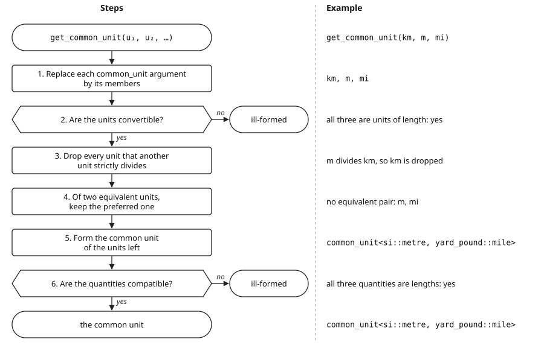{.figure}&nbsp;

1. Each argument that is a `common_unit` is replaced by its members. A `common_unit` inside a
   derived unit, such as `(km + mi) / s`, is an ordinary factor there and stays.
2. The units have to be convertible, which means that their canonical forms have the same
   reference unit. Otherwise, the call is ill-formed.
3. Every unit that another unit _strictly divides_ is dropped. `a` divides `b` when the magnitude
   of `b` is the magnitude of `a` times a product of non-negative rational powers of positive
   integers and of magnitude constants such as π. For rational magnitudes, this means that `b` is
   an integer multiple of `a`. So `si::radian` divides `mag<2> * π * si::radian`, a revolution,
   while `si::radian` and `non_si::degree` don't divide each other. `a` strictly divides `b` when
   it divides `b` and the two aren't equivalent.
4. Of two units whose magnitudes differ only in sign, the one with the positive magnitude is kept,
   and the sign goes into the conversion factor: the common unit of `si::metre` and
   `mag<-1> * si::metre` is `si::metre`. Of two equivalent units, the preferred one is kept. A unit
   defined in terms of the other wins (`Hz` over `1 / s`, `kg` over `mag<1000> * g`, `°C` over
   `K`), then a named unit over an unnamed one (`J` over `kg m²/s²`), and then the unnamed unit
   spelled with fewer factors (`N m` over `kg m²/s²`). When neither is preferred, as for two
   independent definitions of one unit, both are kept: `1 * B + 1 * o` has the unit
   `common_unit<iec::byte, iec::octet>`.
5. One unit left is the common unit. If every unit left is an unnamed scaled unit, the common
   unit is their common scaled unit (`mag_ratio<1, 20> * si::kelvin` and
   `mag_ratio<1, 9> * si::kelvin` give `mag_ratio<1, 180> * si::kelvin`). Otherwise, the units
   left form a `common_unit` ordered by increasing magnitude, so `si::metre` comes before
   `yard_pound::mile` in `common_unit<si::metre, yard_pound::mile>`. Units of one magnitude are
   ordered by their symbols.
6. The quantities have to be compatible, which means explicitly convertible in one direction or the
   other. Both directions are tried so that the check, and with it the common unit, doesn't depend
   on the order of the arguments. Two units are checked against each other. With three or more,
   every unit is checked against the common unit of all of them. If the check fails, the call is
   ill-formed.
   `Hz` and `Bq` are both `1 / s`, but a _frequency_ and an _activity_ are different kinds, so their
   quantities are not compatible, and adding them is ill-formed. An angle unit and a unit of a pure
   number are compatible, and the quantity specification of their common unit is the angle's kind:
   `get_quantity_spec(get_common_unit(deg, percent))` is `kind_of<isq::angular_measure>`. This is
   why `percent` and `steradian` have a common unit, `percent`, while
   `get_common_unit(percent, sr, deg)` is ill-formed: with `deg`, the common unit is an angle, and a
   steradian is not an angle.

_Note: [@MP-UNITS] compares two magnitudes through their quotient. The comparison is exact when
the quotient is a rational number whose numerator and denominator fit in `uintmax_t`, and uses the
`long double` value of the quotient otherwise, so magnitudes closer than that precision are
ordered by their symbols._

A `common_unit` is a unit of its own, and the numerical value of a quantity in it counts
multiples of its magnitude. That magnitude is the greatest common divisor of the magnitudes of its
members, which is the magnitude that divides all of them and that every other such magnitude
divides. For `km` and `mi`, which are
`1000 m` and `1609.344 m`, it is `8/125 m`, so `1 * km + 1 * mi` stores `15625 + 25146`, which is
`40771` (see [Symbols of common units]).

The result does not depend on the order or grouping of the arguments:
`get_common_unit(km, get_common_unit(mi, nmi))` and `get_common_unit(nmi, mi, km)` are the same
type.

Please note, that a user should never explicitly instantiate a `common_unit` class template.
The library's framework will do it based on the provided quantity equation.

### Unit symbols

Units are available via their full names or through their short symbols.
To use a long version, it is enough to type:

```cpp
quantity q1 = 42 * si::metre / si::second;
quantity q2 = 42 * si::kilo<si::metre> / si::hour;
```

To simplify how we spell it a short, user-friendly symbols are provided in a dedicated
subnamespace in systems definitions:

```cpp
namespace si::unit_symbols {

constexpr auto m = si::metre;
constexpr auto km = si::kilo<si::metre>;
constexpr auto s = si::second;
constexpr auto h = si::hour;

}
```

Unit symbols introduce a lot of short identifiers into the current namespace. This is why they
are opt-in. A user has to explicitly "import" them from a dedicated `unit_symbols` namespace:

```cpp
using namespace si::unit_symbols;

quantity q1 = 42 * m / s;
quantity q2 = 42 * km / h;
```

or:

```cpp
using si::unit_symbols::m;
using si::unit_symbols::km;
using si::unit_symbols::s;
using si::unit_symbols::h;

quantity q1 = 42 * m / s;
quantity q2 = 42 * km / h;
```

Thanks to [@P1949R7] we also provide alternative object identifiers using Unicode characters in
their names for most unit symbols. The code using Unicode looks nicer, but it is harder to type
on the keyboard. This is why we provide both versions of identifiers for such units.

::: cmptable

#### Portable only

```cpp
quantity resistance = 60 * kohm;
quantity capacitance = 100 * uF;
```

#### With Unicode characters

```cpp
quantity resistance = 60 * kΩ;
quantity capacitance = 100 * µF;
```

:::

It is worth noting that not all such units may get Unicode identifiers. Some of them do not have
the XID_Start property. For example:

- °C (degree Celsius),
- ° (degree)
- ′ (minute)
- ″ (second)


# Text output

A quantity value contains a numerical value and a unit. Both of them may have various text
representations. Not only numbers but also units can be formatted in many different ways.
Additionally, every dimension can be represented as a text as well.

This chapter will discuss the different options we have here.

_Note: For now, there is no standardized way to handle formatted text input in the C++ standard
library, so this paper does not propose any approach to convert text to quantities. If
[@P1729R5] will be accepted by the LEWG, then we will add a proper "Text input" chapter as well._

## Symbols

The definitions of dimensions, units, prefixes, and constants require unique text symbols to be
assigned for each entity. Those symbols can be composed to express dimensions and units of base and
derived quantities.

### Symbol definition examples

_Note: The below code examples are based on the latest version of the [@MP-UNITS] library and
might not be the final version proposed for standardization._

Dimensions:

```cpp
inline constexpr struct dim_length : base_dimension<"L"> {} dim_length;
inline constexpr struct dim_mass : base_dimension<"M"> {} dim_mass;
inline constexpr struct dim_time : base_dimension<"T"> {} dim_time;
inline constexpr struct dim_electric_current : base_dimension<"I"> {} dim_electric_current;
inline constexpr struct dim_thermodynamic_temperature : base_dimension<{u8"Θ", "O"}> {} dim_thermodynamic_temperature;
inline constexpr struct dim_amount_of_substance : base_dimension<"N"> {} dim_amount_of_substance;
inline constexpr struct dim_luminous_intensity : base_dimension<"J"> {} dim_luminous_intensity;
```

Units:

```cpp
inline constexpr struct second : named_unit<"s", kind_of<isq::time>> {} second;
inline constexpr struct metre : named_unit<"m", kind_of<isq::length>> {} metre;
inline constexpr struct gram : named_unit<"g", kind_of<isq::mass>> {} gram;
inline constexpr auto kilogram = kilo<gram>;

inline constexpr struct newton : named_unit<"N", kilogram * metre / square(second)> {} newton;
inline constexpr struct joule : named_unit<"J", newton * metre> {} joule;
inline constexpr struct watt : named_unit<"W", joule / second> {} watt;
inline constexpr struct coulomb : named_unit<"C", ampere * second> {} coulomb;
inline constexpr struct volt : named_unit<"V", watt / ampere> {} volt;
inline constexpr struct farad : named_unit<"F", coulomb / volt> {} farad;
inline constexpr struct ohm : named_unit<{u8"Ω", "ohm"}, volt / ampere> {} ohm;
```

Prefixes:

```cpp
template<prefixable_unit U> struct micro_ : prefixed_unit<{u8"µ", "u"}, mag_power<10, -6>, U{}> {};
template<prefixable_unit U> struct milli_ : prefixed_unit<"m", mag_power<10, -3>, U{}> {};
template<prefixable_unit U> struct centi_ : prefixed_unit<"c", mag_power<10, -2>, U{}> {};
template<prefixable_unit U> struct deci_  : prefixed_unit<"d", mag_power<10, -1>, U{}> {};
template<prefixable_unit U> struct deca_  : prefixed_unit<"da", mag_power<10, 1>, U{}> {};
template<prefixable_unit U> struct hecto_ : prefixed_unit<"h", mag_power<10, 2>, U{}> {};
template<prefixable_unit U> struct kilo_  : prefixed_unit<"k", mag_power<10, 3>, U{}> {};
template<prefixable_unit U> struct mega_  : prefixed_unit<"M", mag_power<10, 6>, U{}> {};
```

Constants:

```cpp
inline constexpr struct hyperfine_structure_transition_frequency_of_cs :
  named_constant<{u8"Δν_Cs", "dv_Cs"}, mag<9'192'631'770> * hertz> {} hyperfine_structure_transition_frequency_of_cs;
inline constexpr struct speed_of_light_in_vacuum :
  named_constant<"c", mag<299'792'458> * metre / second> {} speed_of_light_in_vacuum;
inline constexpr struct planck_constant :
  named_constant<"h", mag_ratio<662'607'015, 100'000'000> * mag_power<10, -34> * joule * second> {} planck_constant;
inline constexpr struct elementary_charge :
  named_constant<"e", mag_ratio<1'602'176'634, 1'000'000'000> * mag_power<10, -19> * coulomb> {} elementary_charge;
inline constexpr struct boltzmann_constant :
  named_constant<"k", mag_ratio<1'380'649, 1'000'000> * mag_power<10, -23> * joule / kelvin> {} boltzmann_constant;
inline constexpr struct avogadro_constant :
  named_constant<"N_A", mag_ratio<602'214'076, 100'000'000> * mag_power<10, 23> / mole> {} avogadro_constant;
inline constexpr struct luminous_efficacy :
  named_constant<"K_cd", mag<683> * lumen / watt> {} luminous_efficacy;
```

_Note: Two symbols always have to be provided if the primary symbol contains characters outside of
the [basic character set](https://en.cppreference.com/w/cpp/language/charset).
The first must be provided as a UTF-8 literal and may contain any Unicode characters.
The second one must provide an alternative spelling and only use characters from within of
[basic character set](https://en.cppreference.com/w/cpp/language/charset)._

### Lack of Unicode subscript characters

Unicode provides only a minimal set of characters available as subscripts, which are often used to
differentiate various constants and quantities of the same kind. To workaround this issue,
[@MP-UNITS] uses `'_'` character to specify that the following characters should be considered
a subscript of the symbol.

### Symbols for quantity types

Although the ISQ defined in [@ISO80000] provides symbols for each quantity type, there is little use
for them in the C++ code. In the [@MP-UNITS] project, we never had a request to provide such symbol
definitions. Even though having them for completeness could be nice, they seem to not be required
by the domain experts for their daily jobs. Also, it is worth noting that providing those raises
some additional standardization and implementation challenges.

If we decide to provide symbols, the rest of this chapter provides the domain information to assess
the complexity and potential issues with standardization and implementation of those.

All ISQ quantities have an official symbol assigned in their definitions, and how those
should be printed is exactly specified. [@ISO80000] explicitly states:

> The quantity symbols shall be written in italic (sloping) type, irrespective of the type used
> in the rest of the text.

Additionally, [@ISO80000] provides additional requirements for printing quantities of vector
and tensor characters:

- vectors should be printed with a boldface type or have a right arrow above the letter symbol
  (e.g., **_a_** or $\mathit{\overrightarrow{a}}$),
- tensors should use either boldface sans serif type or have two arrows above the letter symbol
  (e.g., **_T_** or $\overrightarrow{\overrightarrow{T}}$).

_Note: In the above examples, the second symbol with arrows above should also use letters written
       in italics. The author could not find a way to format it properly in this document._

There are also a few requirements for printing subscripts of quantity types.
[@ISO80000] states:

<blockquote>

The following principles for the printing of subscripts apply:

- A subscript that represents a physical quantity or a mathematical variable, such as a running
  number, is printed in italic (sloping) type.
- Other subscripts, such as those representing words or fixed numbers, are printed in roman
  (upright) type.

</blockquote>

It is worth noting that only a limited set of Unicode characters are available as subscripts.
Those are often used to differentiate various quantities of the same kind.

For example, it is impossible to encode the symbols of the following quantities:

- _μ_<sub>JT</sub> - _Joule-Thomson coefficient_,
- _w_<sub>H<sub>2</sub>O</sub> - _mass fraction of water_,
- _σ_<sub>Ω,E</sub> - _direction and energy distribution of cross section_,
- _d_<sub>1/2</sub> - _half-value thickness_,
- _Φ_<sub>e,λ</sub> - _spectral radiant flux_.

It is important to state that the same issues are related to constant definitions. For them,
in the [Symbol definition examples] chapter, we proposed to use the `'_'` character instead, as
stated in [Lack of Unicode subscript characters]. We could use the same practice here.

Another challenge here might be related to the fact that [@ISO80000] often provides more than
one symbol for the same quantity. For example:

- _frequency_ can use _f_ or _ν_,
- _time constant_ can use _τ_ or _T_ (_T_ is also the only symbol provided for the
  _period duration_ quantity),
- _thickness_ can use _d_ or _δ_,
- _diameter_ can use _d_ or _D_ (which again conflicts with the _thickness_ symbol).

Last but not least, it is worth noting that symbols of ISQ base quantities are not necessary
the same as official dimension symbols of those quantities:

| Quantity type               |  Quantity type symbol  | Dimension symbol |
|-----------------------------|:----------------------:|:----------------:|
| _length_                    |        _l_, _L_        |        L         |
| _mass_                      |          _m_           |        M         |
| _time_                      |          _t_           |        T         |
| _electric current_          |        _I_, _i_        |        I         |
| _thermodynamic temperature_ |        _T_, _Θ_        |        Θ         |
| _amount of substance_       |         _n_(X)         |        N         |
| _luminous intensity_        | _I_<sub>v</sub>, (_I_) |        J         |

Founding a way to define, use, and print named quantity types is not enough. What should also
be covered here is the text output of derived quantities. There are plenty of operations that one
might do on scalar, vector, and tensor quantities, and all of them result in another quantity type,
which should also be able to be printed in the console text output.

Taking all the challenges and issues mentioned above, we do not propose providing quantity type
symbols in their definitions and any text input/output support for those.

### `fixed_string`

As shown above, symbols are provided as class NTTPs in the library. This means that the string
type used for such a purpose has to satisfy the structural type requirements of the C++ language.
One of such requirements is to expose all the data members publicly. So far, none of the existing
string types in the C++ standard library satisfies such requirements. This is why we need to
introduce a new type.

Such type should:

- satisfy structural type requirements,
- be equality comparable and potentially totally ordered,
- store and provide concatenation support for zero-ended strings,
- provide storage that, if set at compile time, would also be available for read-only access at
  runtime,
- provide at least read-only access to the contained storage.

Such a type does not need to expose a string-like interface. In case its interface is immutable, we
can easily wrap it with `std::string_view` to get such an interface for free.

This type is being proposed separately in [@P3094R6].

### `symbol_text`

Many symbols of units, prefixes, and constants require using a Unicode character set.
For example:

- Θ - thermodynamic temperature dimension
- µ - micro
- Ω - ohm
- °C - degree Celsius
- °F - degree Fahrenheit
- ° - degree
- ′ - arcminute
- ″ - arcsecond
- ᵍ - gradian
- Å - angstrom
- M_☉ - solar mass
- Δν_Cs - hyperfine structure transition frequency of Cs
- g₀ - standard gravity
- μ₀ - magnetic constant
- c₀ - speed of light
- H₀ - hubble constant

The library should provide such Unicode output by default to be consistent with official systems'
specifications.

On the other hand, plenty of terminals do not support Unicode characters. Also, general engineering
experience shows that people often prefer to work with a basic literal character set. This is why
all such entities should provide an alternative spelling in their definitions.

This is where `symbol_text` comes into play. It is a simple wrapper over the two `fixed_string`
objects:

```cpp
template<size_t N, size_t M>
class symbol_text {
public:
  fixed_u8string<N> utf8_;    // exposition only
  fixed_string<M> portable_;  // exposition only

  constexpr explicit(false) symbol_text(char ch);
  consteval explicit(false) symbol_text(const char (&txt)[N + 1]);
  constexpr explicit(false) symbol_text(const fixed_string<N>& txt);
  consteval symbol_text(const char8_t (&u)[N + 1], const char (&a)[M + 1]);
  constexpr symbol_text(const fixed_u8string<N>& u, const fixed_string<M>& a);

  constexpr const auto& utf8() const;
  constexpr const auto& portable() const;

  constexpr bool empty() const;

  template<size_t N2, size_t M2>
  constexpr friend symbol_text<N + N2, M + M2> operator+(const symbol_text& lhs, const symbol_text<N2, M2>& rhs);

  template<size_t N2, size_t M2>
  friend constexpr auto operator<=>(const symbol_text& lhs, const symbol_text<N2, M2>& rhs) noexcept;

  template<size_t N2, size_t M2>
  friend constexpr bool operator==(const symbol_text& lhs, const symbol_text<N2, M2>& rhs) noexcept;
};

symbol_text(char) -> symbol_text<1, 1>;

template<size_t N>
symbol_text(const char (&)[N]) -> symbol_text<N - 1, N - 1>;

template<size_t N>
symbol_text(const fixed_string<N>&) -> symbol_text<N, N>;

template<size_t N, size_t M>
symbol_text(const char8_t (&)[N], const char (&)[M]) -> symbol_text<N - 1, M - 1>;

template<size_t N, size_t M>
symbol_text(const fixed_u8string<N>&, const fixed_string<M>&) -> symbol_text<N, M>;
```

SG16 review of [@P3045R9] discussed how a symbol reaches each character type. One objection raised
there was that deriving the UTF-8 form from the basic form would make implementations transcode text
from the literal encoding to UTF-8 at compile time, a facility the standard does not otherwise
require. The design above already avoids that: the UTF-8 form of a symbol is an explicit argument,
and the basic form is the transliteration that the author of the unit chose, so neither has to be
derived from the other. A `symbol_text` constructed from a `char` string alone is required to use
only characters of the basic character set, and its UTF-8 form is obtained from them by a fixed
mapping of that set.

This is why we propose that a symbol is written to the output character type `CharT` as follows:

- `char8_t`, `char16_t`, and `char32_t`: `character_set::unicode` writes the UTF-8 form, transcoded
  to UTF-16 or UTF-32 for the last two, and `character_set::basic` writes the basic form,
- `char`: `character_set::unicode` writes the UTF-8 form when the ordinary literal encoding is
  UTF-8, and the basic form otherwise, and `character_set::basic` writes the basic form,
- `wchar_t`: `character_set::unicode` writes the UTF-8 form, transcoded, when the wide literal
  encoding is a form of UTF-16 or UTF-32 (UCS-2 suffices when every character of the symbol is in
  the Basic Multilingual Plane), and the basic form otherwise, and `character_set::basic` writes
  the basic form.

The basic form is written in the literal encoding associated with `CharT`, which can represent
every character of the basic character set as a single code unit ([lex.charset]{.sref}/5).
Transcoding UTF-8 to UTF-16 or
UTF-32 is ordinary `constexpr` computation on code units, and converting the basic form needs only
a fixed table for one character set, so the whole procedure is available at compile time. The
symbol interfaces accept only `char`, `wchar_t`, `char8_t`, `char16_t`, and `char32_t` as `CharT`.

_Note: [@MP-UNITS] implements the rules for `char` and for `char8_t` with `character_set::unicode`,
and rejects the other combinations for now. It also converts a `char` string to its UTF-8 form
with a `static_cast` of each code unit, which holds only when the ordinary literal encoding gives
each character of the basic character set its ASCII value._

### Symbols for derived entities

#### `character_set`

ISQ and [@SI] specify symbols that need characters from outside the basic character set
([lex.charset]{.sref}), such as `Ω`, `µ`, `°`, and `′`. This is why Unicode is the default and
primary target for text output. However, in some applications or environments, output limited to
the basic character set can be preferred by users.

This is why the library lets the user select the character set a symbol is rendered in:

```cpp
enum class character_set {
  unicode,  // µs; m³;  L²MT⁻³
  basic     // us; m^3; L^2MT^-3
};
```

The enumerators name a **character set**. They say which characters a symbol may use and leave how
they are encoded to the output type, which is why they are not spelled after an encoding: UTF-8 is
one encoding of Unicode, and it is not the only one a `unicode` symbol may end up
in.[^basic-charset]

Selecting `unicode` does not guarantee Unicode output. Where the target cannot represent the
characters, the implementation falls back to the basic spelling, as described in [`symbol_text`].

[^basic-charset]: The basic character set is a fixed repertoire, but its encoding is not. The
standard requires each of its elements to be a single distinct code unit in the literal encoding
and in the locale-specific encoding ([lex.charset]{.sref}), without requiring the two to agree on
the values. The `basic` output in this chapter uses `^`, `[`, and `]`, which are among the
characters that vary between EBCDIC code pages, so `basic` output uses a portable set of characters,
but not portable byte values.

_Note: Which of the two should be the default is an open question. SG16 review of [@P3045R9] was
divided: some argued that `basic` output is the safe choice that a user opts out of, citing field
experience of operators forcing the C locale to keep UTF-8 out of logs, and others that
`unicode` is what the ISQ and [@SI] actually specify and what most users expect. The closest
precedent differs from both: [time.duration.io]{.sref} leaves it implementation-defined whether the
microseconds suffix is `µs` or `us` ([LWG 3094](https://cplusplus.github.io/LWG/issue3094)), and
implementations do diverge, libstdc++ printing `us` where libc++ prints `µs`. That resolution was
raised in review as a model this library could follow. This paper proposes `unicode`._

#### Symbols of derived dimensions

##### `dimension_symbol_formatting`

`dimension_symbol_formatting` is a data type describing the configuration of the symbol generation
algorithm.

```cpp
struct dimension_symbol_formatting {
  character_set char_set = character_set::unicode;
};
```

##### `dimension_symbol()`

Returns a `std::basic_string_view<CharT>` with the symbol of a dimension for the provided
configuration:

```cpp
template<dimension_symbol_formatting fmt = dimension_symbol_formatting{}, typename CharT = char, dimension D>
consteval basic_string_view<CharT> dimension_symbol(D);
```

_Note: It could be refactored to `dimension_symbol(D, fmt)` when [@P1045R1] is available._

For example:

```cpp
static_assert(dimension_symbol<{.char_set = character_set::basic}>(get_dimension(isq::power)) == "L^2MT^-3");
```

##### `dimension_symbol_to()`

Inserts the generated dimension symbol into the output text iterator at runtime.

```cpp
template<typename CharT = char, output_iterator<CharT> Out, dimension D>
constexpr Out dimension_symbol_to(Out out, D d,
                                  const dimension_symbol_formatting& fmt = dimension_symbol_formatting{});
```

For example:

```cpp
std::string txt;
dimension_symbol_to(std::back_inserter(txt), get_dimension(isq::power), {.char_set = character_set::basic});
std::cout << txt << "\n";
```

The above prints:

```text
L^2MT^-3
```

#### Symbols of derived units

##### `unit_symbol_formatting`

`unit_symbol_formatting` is a data type describing the configuration of the symbol generation
algorithm. It contains three orthogonal fields, each with a default value.

```cpp
enum class unit_symbol_solidus {
  one_denominator,  // m/s;   kg m⁻¹ s⁻¹
  always,           // m/s;   kg/(m s)
  never             // m s⁻¹; kg m⁻¹ s⁻¹
};

enum class unit_symbol_separator {
  space,          // kg m²/s²
  half_high_dot   // kg⋅m²/s²  (valid only for the `unicode` character set)
};

struct unit_symbol_formatting {
  character_set char_set = character_set::unicode;
  unit_symbol_solidus solidus = unit_symbol_solidus::one_denominator;
  unit_symbol_separator separator = unit_symbol_separator::space;
};
```

`unit_symbol_solidus` impacts how the division of unit symbols is being presented in the text
output. By default, the '/' will be printed if only one unit component is in the
denominator. Otherwise, the exponent syntax will be used.

`unit_symbol_separator` specifies how multiple multiplied units should be separated from each
other. By default, the space (' ') will be used as a separator.

##### `unit_symbol()`

Returns a `std::basic_string_view<CharT>` with the symbol of a unit for the provided
configuration:

```cpp
template<unit_symbol_formatting fmt = unit_symbol_formatting{}, typename CharT = char, unit U>
consteval basic_string_view<CharT> unit_symbol(U);
```

_Note: It could be refactored to `unit_symbol(U, fmt)` when [@P1045R1] is available._

For example:

```cpp
static_assert(unit_symbol<{.solidus = unit_symbol_solidus::never,
                           .separator = unit_symbol_separator::half_high_dot}>(kg * m / s2) == "kg⋅m⋅s⁻²");
```

##### `unit_symbol_to()`

Inserts the generated unit symbol into the output text iterator at runtime.

```cpp
template<typename CharT = char, output_iterator<CharT> Out, unit U>
constexpr Out unit_symbol_to(Out out, U u, const unit_symbol_formatting& fmt = unit_symbol_formatting{});
```

For example:

```cpp
std::string txt;
unit_symbol_to(std::back_inserter(txt), kg * m / s2,
               {.solidus = unit_symbol_solidus::never, .separator = unit_symbol_separator::half_high_dot});
std::cout << txt << "\n";
```

The above prints:

```text
kg⋅m⋅s⁻²
```

### Symbols of scaled units

Here are a few examples of scaled unit text output in action:

```cpp
inline constexpr unit auto my_unit_1 = mag_ratio<1, 4> * si::second;
inline constexpr unit auto my_unit_2 = mag_power<10, 4> * si::metre;
inline constexpr unit auto my_unit_3 = mag<25> * mag_power<10, 4> * si::metre;

std::cout << 100 * my_unit_1 << "\n";
std::cout << 100 * my_unit_2 << "\n";
std::cout << 100 * my_unit_3 << "\n";
```

The above prints:

```text
100 (1/4 s)
100 (10⁴ m)
100 (25 × 10⁴ m)
```

As we can see a scaled unit has a magnitude and a reference unit. To denote the scope of such
a unit, we currently enclose it in `(...)`.

In most cases scaled units are hidden behind named units so the above outputs are a bit artifical.
However, there are a few real-life where a user directly faces a scaled unit. For example:

```cpp
inline constexpr unit auto L_per_100km = L / (mag<100> * km);
```

The above is a derived unit of litre divided by a scaled unit of `100` kilometers. For example,
the following:

```cpp
std::cout << 6.7 * L_per_100km << "\n";
```

prints:

```text
6.7 L/(100 km)
```

The current output of the fuel consumption unit is only one of the options here. It favors a derived
unit over a scaled unit (i.e., the resulting type is
`derived_unit<non_si::litre, $per$<scaled_unit<{some magnitude representing 100}, si::kilo<si::metre>>>>`).
Another option would be to prefer a scaled unit so the result would be
`scaled_unit<{some magnitude representing 1/100}, derived_unit<non_si::litre, $per$<si::kilo<si::metre>>>`
and the output would look like:

```text
6.7 (1/100 L/km)
```

The output could also look like this:

```text
6.7 × 10⁻² L/km
```

but this, even though it is mathematically correct, is the poorest to express the intent here.
The unit we use daily is the number of liters consumed for `100 km`, and not for a single `km`,
which the last output suggests (i.e., "6.7 hundredths of a liter per kilometer").

This is why we initially proposed the first version. However, on one of the meetings it was brought
that this approach also leads to some issues in case of other quantities.

According to the current rules, the following code:

```cpp
std::cout << 10 * L_per_100km * (20 * km) << "\n";
```

prints the following output:

```text
200 L km/(100 km)
```

At least for now, the units do not simplify which may look suprising.

Another thing worth noting here is that in case a value of a numerator or denumerator
is greater or equal `1000` we use an exponential notation:

```cpp
inline constexpr unit auto L_per_1000km = L / (mag<1000> * km);
std::cout << 10 * L_per_1000km << "\n";
```

prints:

```text
10 L/(10³ km)
```

A motivation for that is that typically, for a value of `1000` or greater, a user could use
a larger SI prefix (even though it would not make sense for kilometers).

All of the above are the inputs for a discussion and we are open to fine-tuning this behavior
according to the LEWG guidelines.

### Symbols of common units

Some common units expressed with a specialization of the `common_unit` class template need special
printing rules for their symbols. As they represent a minimum set of equivalent common units
resulting from the addition or subtraction of multiple quantities, we print all of them as a scaled
version of the source unit. For example, the following:

```cpp
std::cout << 1 * km + 1 * mi << "\n";
std::cout << 1 * nmi + 1 * mi << "\n";
std::cout << 1 * km / h + 1 * m / s << "\n";
std::cout << 1. * rad + 1. * deg << "\n";
```

prints:

```text
40771 [(1/15625 km), (1/25146 mi)]
108167 [(1/50292 mi), (1/57875 nmi)]
23 [(1/5 km/h), (1/18 m/s)]
183.142 [(1/π°), (1/180 rad)]
```

Thanks to the above, it might be easier for the user to reason about the magnitude of the resulting
unit and its impact on the value stored in the quantity.

It is important to note that this output is provided only for intermediate results of the equations,
as shown above. A user usually knows which unit should be used, and explicit conversion can be made
to achieve that. For example:

```cpp
std::cout << (1 * km + 1 * mi).in<double>(km) << "\n";
```

prints:

```text
2.60934 km
```

### Unicode characters and their basic character set replacements

Library's framework requires some Unicode characters for text output. The below table lists all
of them together with the recommended replacements from the basic character set:

| Name                  | Symbol |   C++ code   | Basic alternative |
|-----------------------|:------:|:------------:|:-----------------:|
| SUPERSCRIPT ZERO      |   ⁰    | `u8"\u2070"` |       `"0"`       |
| SUPERSCRIPT ONE       |   ¹    | `u8"\u00b9"` |       `"1"`       |
| SUPERSCRIPT TWO       |   ²    | `u8"\u00b2"` |       `"2"`       |
| SUPERSCRIPT THREE     |   ³    | `u8"\u00b3"` |       `"3"`       |
| SUPERSCRIPT FOUR      |   ⁴    | `u8"\u2074"` |       `"4"`       |
| SUPERSCRIPT FIVE      |   ⁵    | `u8"\u2075"` |       `"5"`       |
| SUPERSCRIPT SIX       |   ⁶    | `u8"\u2076"` |       `"6"`       |
| SUPERSCRIPT SEVEN     |   ⁷    | `u8"\u2077"` |       `"7"`       |
| SUPERSCRIPT EIGHT     |   ⁸    | `u8"\u2078"` |       `"8"`       |
| SUPERSCRIPT NINE      |   ⁹    | `u8"\u2079"` |       `"9"`       |
| SUPERSCRIPT MINUS     |   ⁻    | `u8"\u207b"` |       `"-"`       |
| MULTIPLICATION SIGN   |   ×    | `u8"\u00d7"` |       `"x"`       |
| GREEK SMALL LETTER PI |   π    | `u8"\u03c0"` |      `"pi"`       |
| DOT OPERATOR          |   ⋅    | `u8"\u22C5"` |   `<none>`[^1]    |

[^1]: Users should not select `unit_symbol_separator::half_high_dot` and `character_set::basic`
at the same time. This symbol is not in the basic character set. Otherwise, we propose to throw
an exception during the unit symbol string processing. We could also ignore the
`unit_symbol_separator::half_high_dot` option and use space " ", like this is the case for
`character_set::basic`.

Here is an example of how the above are being used in a code:

```cpp
static_assert(unit_symbol(kilogram * metre / square(second)) == "kg m/s²");
static_assert(unit_symbol<usf{.separator = half_high_dot}>(kilogram * metre / square(second)) == "kg⋅m/s²");
static_assert(unit_symbol<usf{.char_set = basic}>(kilogram * metre / square(second)) == "kg m/s^2");
static_assert(unit_symbol<usf{.solidus = never}>(kilogram * metre / square(second)) == "kg m s⁻²");
static_assert(unit_symbol<usf{.char_set = basic, .solidus = never}>(kilogram * metre / square(second)) == "kg m s^-2");

static_assert(unit_symbol(mag_ratio<1, 18000> * metre / second) == "(1/18 × 10⁻³ m)/s");
static_assert(unit_symbol<usf{.char_set = basic}>(mag_ratio<1, 18000> * metre / second) == "(1/18 x 10^-3 m)/s");

static_assert(unit_symbol(mag<1> / (mag<2> * mag<$pi-c$>)*metre) == "(2⁻¹ π⁻¹ m)");
static_assert(unit_symbol<usf{.solidus = always}>(mag<1> / (mag<2> * mag<$pi-c$>)*metre) == "(1/(2 π) m)");
static_assert(unit_symbol<usf{.char_set = basic, .solidus = always}>(mag<1> / (mag<2> * mag<$pi-c$>) * metre) ==
              "(1/(2 pi) m)");
```

Additionally, if we decide to provide `per_mille` unit together with the framework (next to `one`,
`percent`, and `parts_per_million`) we will need a symbol for it as well:

| Name           | Symbol |  C++ code  | Basic alternative |
|----------------|:------:|:----------:|:-----------------:|
| PER MILLE SIGN |   ‰    | u8"\u2030" |        ???        |

There is no good choice for a basic character set replacement here. We may try to be brief and use "%o"
([Wikipedia uses this symbol as a redirect for per mille](https://en.wikipedia.org/wiki/Per_mille))
or provide a longer textual string. The problem is that there is more than one option to chose from
here ([names mentioned in Wikipedia](https://en.wikipedia.org/wiki/Per_mille)):

- "per mille" (even though it is consistent with the official name it is not a good option here
  as it looks like multiplication of two symbols),
- "per mil" and "per mill" (same as above),
- "permil", "permill", and "permille" (how to spell it correctly?).


## `space_before_unit_symbol` customization point

The [@SI] says:

> The numerical value always precedes the unit and a space is always used to separate the unit from
> the number. ... The only exceptions to this rule are for the unit symbols for degree, minute and
> second for plane angle, `°`, `′` and `″`, respectively, for which no space is left between the
> numerical value and the unit symbol.

There are more units with such properties. For example, per mille(`‰`).

To support the above, the library exposes `space_before_unit_symbol` customization point.
By default, its value is `true` for all the units. This means that a number and a unit will be
separated by the space in the output text. To change this behavior, a user should provide
a explicit specialization for a specific unit:

```cpp
template<>
constexpr bool space_before_unit_symbol<non_si::degree> = false;
```

The above works only for the default formatting or for the format strings that use `%?` placement
field (`std::format("{}", q)` is equivalent to `std::format("{:%N%?%U}", q)`).

In case a user provides custom format specification (e.g., `std::format("{:%N %U}", q)`),
the library will always obey this specification for all the units (no matter what the actual
value of the `space_before_unit_symbol` customization point is) and the separating space will always
be used in this case.

_Note: SG16 review of [@P3045R9] questioned whether this belongs in a separate variable template at
all, rather than being stated with the unit itself. See [`space_before_unit_symbol` alternatives],
which now also has to account for the fact that `named_unit`'s optional parameters are supplied by
partial specializations, and a partial specialization may not carry default template arguments
([temp.spec.partial.general]{.sref}), so the flag cannot simply be defaulted onto the end of the
parameter list._


## Output streams

The easiest way to print a dimension, unit, or quantity is to provide its object to the output
stream:

```cpp
const quantity v1 = avg_speed(220. * km, 2 * h);
const quantity v2 = avg_speed(140. * mi, 2 * h);
std::cout << v1 << '\n';            // 110 km/h
std::cout << v2 << '\n';            // 70 mi/h
std::cout << v2.unit << '\n';       // mi/h
std::cout << v2.dimension << '\n';  // LT⁻¹
```

The text output will always print the value using the default formatting for this entity.

### Output stream formatting

Only basic formatting can be applied for output streams. It includes control over width, fill,
and alignment.

The numerical value of the quantity will be printed according to the current stream state and standard
manipulators may be used to customize that (assuming that the underlying representation type
respects them).

```cpp
std::cout << "|" << std::setw(10) << 123 * m << "|\n";                       // |     123 m|
std::cout << "|" << std::setw(10) << std::left << 123 * m << "|\n";          // |123 m     |
std::cout << "|" << std::setw(10) << std::setfill('*') << 123 * m << "|\n";  // |123 m*****|
```

Detailed formatting of any entity may be obtained with `std::format()` usage and then provided
to the stream output if needed.

_Note: Custom stream manipulators may be provided to control a dimension and unit symbol output
if requested by WG21._


## Text formatting

The library provides custom formatters for `std::format` facility, which allows fine-grained control
over what and how it is being printed in the text output.

### Controlling width, fill, and alignment

Formatting grammar for all the entities provides control over width, fill, and alignment. The C++
standard grammar tokens `fill-and-align` and `width` are being used. They treat the entity as
a contiguous text to be aligned. For example, here are a few examples of the quantity numerical
value and symbol formatting:

```cpp
std::println("|{:10}|", 123 * m);    // |     123 m|
std::println("|{:<10}|", 123 * m);   // |123 m     |
std::println("|{:>10}|", 123 * m);   // |     123 m|
std::println("|{:^10}|", 123 * m);   // |  123 m   |
std::println("|{:*<10}|", 123 * m);  // |123 m*****|
std::println("|{:*>10}|", 123 * m);  // |*****123 m|
std::println("|{:*^10}|", 123 * m);  // |**123 m***|
```

It is important to note that in the second line above, the quantity text is aligned to the right
by default, which is consistent with the formatting of numeric types. Units and dimensions behave
as text and, thus, are aligned to the left by default.

### Dimension formatting

```ebnf
dimension-format-spec = [fill-and-align], [width], [dimension-spec];
dimension-spec        = [character-set];
character-set         = 'U' | 'P';
```

In the above grammar:

- `fill-and-align` and `width` tokens are defined in the [format.string.std]{.sref}
  chapter of the C++ standard specification,
- `character-set` token selects the character set the symbol is rendered in:
    - `U` (default) uses the **Unicode** symbols defined by [@ISO80000] (e.g., `LT⁻²`),
    - `P` restricts output to the **basic** character set (e.g., `LT^-2`).

Dimension symbols of some quantities are specified to use Unicode signs by the ISQ (e.g., `Θ`
symbol for the _thermodynamic temperature_ dimension). The library follows this by default.
From the engineering point of view, sometimes Unicode text might not be the best solution
as terminals of many (especially embedded) devices can output only letters from the basic
literal character set only. In such a case, the dimension symbol can be forced to be printed
using such characters thanks to `character-set` token:

```cpp
std::println("{}", isq::dim_thermodynamic_temperature);   // Θ
std::println("{:P}", isq::dim_thermodynamic_temperature); // O
std::println("{}", get_dimension(isq::power));            // L²MT⁻³
std::println("{:P}", get_dimension(isq::power));          // L^2MT^-3
```


### Unit formatting

```ebnf
unit-format-spec      = [fill-and-align], [width], [unit-spec];
unit-spec             = [character-set], [unit-symbol-solidus], [unit-symbol-separator], [L]
                      | [character-set], [unit-symbol-separator], [unit-symbol-solidus], [L]
                      | [unit-symbol-solidus], [character-set], [unit-symbol-separator], [L]
                      | [unit-symbol-solidus], [unit-symbol-separator], [character-set], [L]
                      | [unit-symbol-separator], [character-set], [unit-symbol-solidus], [L]
                      | [unit-symbol-separator], [unit-symbol-solidus], [character-set], [L];
unit-symbol-solidus   = '1' | 'a' | 'n';
unit-symbol-separator = 's' | 'd';
```

In the above grammar:

- `fill-and-align` and `width` tokens are defined in the [format.string.std]{.sref}
  chapter of the C++ standard specification,
- `unit-symbol-solidus` token specifies how the division of units should look like:
    - '1' (default) outputs `/` only when there is only **one** unit in the denominator, otherwise
      negative exponents are printed (e.g., `m/s`, `kg m⁻¹ s⁻¹`)
    - 'a' **always** uses solidus (e.g., `m/s`, `kg/(m s)`)
    - 'n' **never** prints solidus, which means that negative exponents are always used
      (e.g., `m s⁻¹`, `kg m⁻¹ s⁻¹`)
- `unit-symbol-separator` token specifies how multiplied unit symbols should be separated:
    - 's' (default) uses **space** as a separator (e.g., `kg m²/s²`)
    - 'd' uses half-high **dot** (`⋅`) as a separator (e.g., `kg⋅m²/s²`) (requires the `unicode`
      character set)
- 'L' is reserved for possible future localization use in case C++ standard library gets access to
  the ICU-like database.

_Note: The intent of the above grammar was that the elements of `unit-spec` can appear in
any order as they have unique characters. Users shouldn't have to remember the order of those tokens
to control the formatting of a unit symbol._

The above grammar for `unit-symbol-solidus` is consistent with the current state of [@MP-UNITS].
However, a few aternatives are possible:

```ebnf
unit-symbol-solidus   = '1' | 'a' | 'n';
unit-symbol-solidus   = 'o' | 'a' | 'n';
unit-symbol-solidus   = '1' | '*' | '0';
unit-symbol-solidus   = '1' | '*' | '-';
unit-symbol-solidus   = '1' | '+' | '-';
```

Unit symbols of some quantities are specified to use Unicode signs by the [@SI] (e.g., `Ω` symbol
for the _resistance_ quantity). The library follows this by default. From the engineering point of
view, sometimes Unicode text might not be the best solution as terminals of many (especially
embedded) devices can output only letters from the basic literal character set only. In such a case,
the unit symbol can be forced to be printed using such characters thanks to `character-set` token:

```cpp
std::println("{}", si::ohm);      // Ω
std::println("{:P}", si::ohm);    // ohm
std::println("{}", us);           // µs
std::println("{:P}", us);         // us
std::println("{}", m / s2);       // m/s²
std::println("{:P}", m / s2);     // m/s^2
```

Additionally, both [@ISO80000] and [@SI] leave some freedom on how to print unit symbols.
This is why two additional tokens were introduced.

`unit-symbol-solidus` specifies how the division of units should look like. By default,
`/` will be used only when the denominator contains only one unit. However, with the 'a' or 'n'
options, we can force the facility to print the `/` character always (even when there are more units
in the denominator, in which case parentheses enclose all denominator units), or never, in which
case negative exponents are used.

```cpp
std::println("{}", m / s);          // m/s
std::println("{}", kg / m / s2);    // kg m⁻¹ s⁻²
std::println("{:a}", m / s);        // m/s
std::println("{:a}", kg / m / s2);  // kg/(m s²)
std::println("{:n}", m / s);        // m s⁻¹
std::println("{:n}", kg / m / s2);  // kg m⁻¹ s⁻²
```

The `unit-symbol-separator` token allows us to obtain the following outputs:

```cpp
std::println("{}", kg * m2 / s2);    // kg m²/s²
std::println("{:d}", kg * m2 / s2);  // kg⋅m²/s²
```

_Note: 'd' requires the `unicode` character set._


### Quantity formatting

```ebnf
quantity-format-spec        = [fill-and-align], [width], [quantity-specs], [defaults-specs];
quantity-specs              = conversion-spec
                            | quantity-specs, conversion-spec
                            | quantity-specs, literal-char;
literal-char                = ? any character other than '{', '}', or '%' ?;
conversion-spec             = '%', placement-type;
placement-type              = subentity-id | '?' | '%';
defaults-specs              = ':', default-spec-list;
default-spec-list           = default-spec
                            | default-spec-list, default-spec;
default-spec                = subentity-id, '[' format-spec ']';
subentity-id                = 'N' | 'U' | 'D';
format-spec                 = ? as specified by the formatter for the argument type ?;
```

In the above grammar:

- `fill-and-align` and `width` tokens are defined in the [format.string.std]{.sref}
  chapter of the C++ standard specification,
- `placement-type` token specifies which entity should be put and where:
    - 'N' inserts a default-formatted numerical value of the quantity,
    - 'U' inserts a default-formatted unit of the quantity,
    - 'D' inserts a default-formatted dimension of the quantity,
    - '?' inserts an optional separator between the number and a unit based on the value of
      `space_before_unit_symbol` for this unit,
    - '%' just inserts '%' character.
- `defaults-specs` token allows overwriting defaults for the underlying formatters with the custom
  format string. Each override starts with a subentity identifier ('N', 'U', or 'D') followed by
  the format string enclosed in square brackets.

#### Two levels of format specification

The grammar above has two levels of format specification. A `quantity` is a wrapper over a numerical
value tagged with a unit (and, indirectly, a dimension). When formatting it, there are two
independent concerns, and each `:` delimiter opens the section that addresses one of them:

- The first `:` (as in any `std::format` replacement field) starts the **quantity-level** format
  specification. Here we provide `fill-and-align` and `width` that treat the entire quantity output
  as one contiguous piece of text, and `quantity-specs`, a small layout language built from the
  `%N`, `%U`, `%D`, `%?`, and `%%` placeholders, which decides _which_ components (numerical value,
  unit, dimension) are printed and _how_ they are arranged.
- The second `:` starts the **component-level** format specifications (`defaults-specs`). A
  `quantity` is only a numerical wrapper. It does not (and should not) assume any knowledge about
  the format-spec grammar of the representation type it stores. This is why the specs provided in
  `N[...]`, `U[...]`, and `D[...]` are not interpreted by the quantity formatter beyond finding the
  matching `]`. They are forwarded verbatim to the formatters of the respective components and
  processed there.

A component spec may contain a nested replacement field, as the precision in `{} {::N[.{}f]}`
does. Its automatic argument id has to continue the numbering of the enclosing format string, so
that this field takes the third argument. A `basic_format_parse_context` can't be narrowed to the
spec today, and a newly constructed one starts the numbering again from zero. [@COMPOSE-FMT]
proposes `set_end()` for this, and [@MP-UNITS] uses such a member when the parse context has one.

We deliberately chose _not_ to follow the `%Q`/`%q` convention that `std::chrono::duration` uses for
its value and unit suffix. Those identifiers are easy to confuse with one another and do not hint at
what they stand for. Also, as lower- and upper-case variants of the same letter, they leave no room
for a third placeholder that would be easy to remember. A `quantity` additionally exposes its
_dimension_, which the `chrono` grammar has no concept of and therefore no placeholder for. This is
why we use `%N` (numerical value), `%U` (unit), and `%D` (dimension) instead, where each letter is
the first letter of the component it inserts.

Separating the two concerns means that overriding how a single component is formatted does not force
us to respell the default quantity layout. For example, to round the number to two decimal places
while keeping the default arrangement of the components intact, it is enough to leave the
quantity-level spec empty and provide only the component-level override:

```cpp
std::println("{::N[.2f]}", 100. * km / (3 * h));  // 33.33 km/h
```

Had numerical-value modifiers been embedded directly in the quantity format-spec (as is the case for
`std::chrono::duration`), every such customization would have required repeating the entire default
format string verbatim.

The C++ standard library already uses this two-level `{::...}` shape to format the elements of a
range. For a range, the first `:` opens the range's own format spec, and the optional
second `:` introduces a format spec that is forwarded to the formatter of each element:

```cpp
std::vector v{1.2345, 2.3456, 3.4567};
std::println("{}", v);        // [1.2345, 2.3456, 3.4567]
std::println("{::.2f}", v);   // [1.23, 2.35, 3.46]
std::println("{:n:.2f}", v);  // 1.23, 2.35, 3.46
```

Here `.2f` after the second `:` is not interpreted by the range formatter. It is handed unchanged to
the `double` formatter used for every element.

#### Default formatting

To format `quantity` values, the formatting facility uses `quantity-format-spec`. If left empty,
the default formatting is applied. The same default formatting is also applied to the output streams.
This is why the following code lines produce the same output:

```cpp
std::cout << "Distance: " << 123 * km << "\n";
std::cout << std::format("Distance: {}\n", 123 * km);
std::cout << std::format("Distance: {:%N%?%U}\n", 123 * km);
```

Please note that for some quantities the `{:%N %U}` format may provide a different output than
the default one, as some units have `space_before_unit_symbol` customization point explicitly
set to `false` (e.g., `°`, `′`, and `″`).

#### Quantity numerical value, unit symbol, or both?

Thanks to the grammar provided above, the user can easily decide to either:

- print a whole quantity:

    ```cpp
    std::println("Speed: {}", 120 * km / h);
    ```

    ```text
    Speed: 120 km/h
    ```

- provide custom quantity formatting:

    ```cpp
    std::println("Speed: {:%N in %U}", 120 * km / h);
    ```

    ```text
    Speed: 120 in km/h
    ```

- provide custom formatting for components:

    ```cpp
    std::println("Speed: {::N[.2f]U[n]}", 100. * km / (3 * h));
    ```

    ```text
    Speed: 33.33 km h⁻¹
    ```

- print only specific components (numerical value, unit, or dimension):

    ```cpp
    std::println("Speed:\n- number: {0:%N}\n- unit: {0:%U}\n- dimension: {0:%D}", 120 * km / h);
    ```

    ```text
    Speed:
    - number: 120
    - unit: km/h
    - dimension: LT⁻¹
    ```

`placement-type` greatly simplify element access to the elements of the quantity. Without them
the second case above would require the following:

```cpp
const quantity q = 120 * km / h;
std::println("Speed:\n- number: {}\n- unit: {}\n- dimension: {}",
             q.numerical_value_ref_in(q.unit), q.unit, q.dimension);
```

`default-spec` is crutial to provide formatting of user-defined representation types. Initially,
[@MP-UNITS] library was providing numerical value modifiers inplace of its format specification
similarly to `std::chrono::duration` formatter. However, it:

- worked only with fundamental arithmetic types and was not able to adjust to different format
  specifications of custom representation types,
- was quite hard to parse and format everything in a 100% compatible way with the formatting
  specified in the C++ standard and already implemented in the underlying standard library.

#### Formatting of the quantity numerical value

The representation type used as a numerical value of a quantity must provide its own formatter
specialization. It will be called by the quantity formatter with the format-spec provided
by the user in the `N` defaults specification.

In case we use C++ fundamental arithmetic types with our quantities the standard formatter
specified in [format.string.std](https://wg21.link/format.string.std) will be used. The rest
of this chapter assumes that it is the case and provides some usage examples.

`sign` token allows us to specify how the value's sign is being printed:

```cpp
std::println("{0},{0::N[+]},{0::N[-]},{0::N[ ]}", 1 * m);   // 1 m,+1 m,1 m, 1 m
std::println("{0},{0::N[+]},{0::N[-]},{0::N[ ]}", -1 * m);  // -1 m,-1 m,-1 m,-1 m
```

where:

- `+` indicates that a sign should be used for both non-negative and negative numbers,
- `-` indicates that a sign should be used for negative numbers and negative zero only
  (this is the default behavior),
- `<space>` indicates that a leading space should be used for non-negative numbers other
  than negative zero, and a minus sign for negative numbers and negative zero.

`precision` token is allowed only for floating-point representation types:

```cpp
std::println("{::N[.0]}", 1.2345 * m);   // 1 m
std::println("{::N[.1]}", 1.2345 * m);   // 1 m
std::println("{::N[.2]}", 1.2345 * m);   // 1.2 m
std::println("{::N[.3]}", 1.2345 * m);   // 1.23 m
std::println("{::N[.0f]}", 1.2345 * m);  // 1 m
std::println("{::N[.1f]}", 1.2345 * m);  // 1.2 m
std::println("{::N[.2f]}", 1.2345 * m);  // 1.23 m
```

`type` specifies how a value of the representation type is being printed.
For integral types:

```cpp
std::println("{::N[b]}", 42 * m);    // 101010 m
std::println("{::N[B]}", 42 * m);    // 101010 m
std::println("{::N[d]}", 42 * m);    // 42 m
std::println("{::N[o]}", 42 * m);    // 52 m
std::println("{::N[x]}", 42 * m);    // 2a m
std::println("{::N[X]}", 42 * m);    // 2A m
```

The above can be printed in an alternate version thanks to the `#` token:

```cpp
std::println("{::N[#b]}", 42 * m);   // 0b101010 m
std::println("{::N[#B]}", 42 * m);   // 0B101010 m
std::println("{::N[#o]}", 42 * m);   // 052 m
std::println("{::N[#x]}", 42 * m);   // 0x2a m
std::println("{::N[#X]}", 42 * m);   // 0X2A m
```

For floating-point values, the `type` token works as follows:

```cpp
std::println("{::N[a]}",   1.2345678 * m);      // 1.3c0ca2a5b1d5dp+0 m
std::println("{::N[.3a]}", 1.2345678 * m);      // 1.3c1p+0 m
std::println("{::N[A]}",   1.2345678 * m);      // 1.3C0CA2A5B1D5DP+0 m
std::println("{::N[.3A]}", 1.2345678 * m);      // 1.3C1P+0 m
std::println("{::N[e]}",   1.2345678 * m);      // 1.234568e+00 m
std::println("{::N[.3e]}", 1.2345678 * m);      // 1.235e+00 m
std::println("{::N[E]}",   1.2345678 * m);      // 1.234568E+00 m
std::println("{::N[.3E]}", 1.2345678 * m);      // 1.235E+00 m
std::println("{::N[g]}",   1.2345678 * m);      // 1.23457 m
std::println("{::N[g]}",   1.2345678e8 * m);    // 1.23457e+08 m
std::println("{::N[.3g]}", 1.2345678 * m);      // 1.23 m
std::println("{::N[.3g]}", 1.2345678e8 * m);    // 1.23e+08 m
std::println("{::N[G]}",   1.2345678 * m);      // 1.23457 m
std::println("{::N[G]}",   1.2345678e8 * m);    // 1.23457E+08 m
std::println("{::N[.3G]}", 1.2345678 * m);      // 1.23 m
std::println("{::N[.3G]}", 1.2345678e8 * m);    // 1.23E+08 m
```

#### Extensions to `std-format-spec`

Both [@ISO80000] and [@SI] recommend printing numbers separated into groups of three.
The text below is quoted from the committee draft of IEC 80000-16, 4.5.3, which, like [@SI] and
unlike ISO 80000-1:2022, adds the four-digit exception:

<blockquote>

To facilitate the reading of numbers with many digits, these may be separated into groups of
three, counting from the decimal sign towards the left and the right. In the case where there
is no decimal part (and thus no decimal marker), the counting shall be from the right-most digit,
towards the left. No group shall contain more than three digits, except that when there are only
four digits before or after the decimal marker it is customary not to use a space to isolate
a single digit. Where such separation into groups of three is used, the groups shall be separated
by a small space and not by a point or a comma or by any other means.

EXAMPLE 1: 12 345  
EXAMPLE 2: 1 234 or 1234  
EXAMPLE 3: 1 234,567 8 or 1234,5678  

The practice of grouping digits in this way is a matter of choice. It is not always followed in
certain specialized applications such as engineering drawings and scripts to be read by a
computer. The separation into groups of three should not be used for ordinal numbers used as
reference numbers. A year, when given by four digits, shall always be written without a space
between the digits.

</blockquote>

As of today, no flag in `std-format-spec` would force it. Similar output may be obtained thanks
to localization, but international standards mentioned above recommend that for every user,
no matter what localization option is being used. [@DIGIT-GROUP] proposes a locale-independent
`'` option for this, so that `{::N['.2f]}` would print the numerical value of a quantity with
its digits grouped.

#### Inconsistencies with `std::chrono::duration`

This library prints the quantities and their units according to specific ISO specifications.
Unfortunately, this is not the case for `std::chrono::duration`:

```cpp
using my_duration = std::chrono::duration<int, std::ratio<1, 4>>;

inline constexpr unit auto my_unit = mag_ratio<1, 4> * si::second;

std::println("{}", std::chrono::seconds(42));
std::println("{}", 42 * s);
std::println("{}", my_duration(100));
std::println("{}", 100 * my_unit);
```

The above prints:

```text
42s
42 s
100[1/4]s
100 (1/4 s)
```

We are unsure if that is a problem that we should be worried about. If so, we could consider
adding ISO-compatible formatting to `std::chrono` abstractions, but it is not planned in the
scope of this paper.


## Quantity point text output

Text output is provided for a point when its point origin equals
`default_point_origin(R)`, the library-chosen default for the given reference:

- For references without an offset unit (e.g., `quantity<point<isq::length[m]>>`),
  `default_point_origin` is `natural_point_origin<QuantitySpec>`, the mathematical zero.
  The stored quantity is unambiguous and can be printed directly:

  ```cpp
  quantity qp = point<m>(42);
  std::println("{}", qp);          // "42 m"
  ```

- For references whose unit carries a built-in origin (e.g., `quantity<point<deg_C>>`),
  `default_point_origin` is the unit's canonical reference point (`si::ice_point`). The
  output matches the conventional notation:

  ```cpp
  quantity temp = point<deg_C>(20.);
  std::println("{}", temp);        // "20 °C"
  ```

Text output is **not** provided when a non-default origin is used. The stored value is a
delta from a domain-specific reference whose name the library cannot know. The same
numeric value can describe entirely different physical locations depending on the origin:
`42 m` above sea level, above a mountain top, or from the centre of Mars are all distinct points.

One physical point can also be stored relative to many origins. The room temperature
controller from [Temperature support] stores its points relative to
`room_reference_temp` (21 °C). A point 2 °C below that reference is the same temperature as
`point<deg_C>(19)` and `point<K>(292.15)`, yet its stored value is `-2 °C`. Printing it would
report a temperature below freezing, because a reader takes a temperature point printed in °C
as measured from the ice point. This is why text output is limited to the default origin.

A timestamp stored relative to the Unix or GPS epoch is expected to print as a calendar date.
That requires calendar arithmetic, which belongs in `std::chrono`. `std::chrono` itself provides
no output for time points of clocks without a calendar mapping, such as `steady_clock`.

For points at non-default origins, the delta should be extracted explicitly, with an
application-defined label added to make the value unambiguous:

```cpp
std::cout << altitude.delta_from(sea_level) << " AMSL";  // "42 m AMSL"
```

For a point type used throughout a program, we recommend that its domain provides a
`std::formatter`. It takes a few lines on top of the formatter of the delta, as in
[Bridge across the Rhine], and the format specification of the delta still applies: with a `double`
representation, `{::N[.1f]}` prints the German road altitude of that example as
`330.0 m AMSL(DE)`. A width pads only the delta, and `%N` drops the unit but not the label.

We don't propose a library facility for the text output of points at non-default origins,
because how the annotation is written is domain-specific. A countdown writes it before the value
(`T-10 s`), a flight level replaces the unit and prints the altitude in hundreds of feet
(`FL350`), and a depth may be printed with its sign removed (`10 m below sea level`). A prefix or
a suffix string on an origin can't express the last two, and a hook that could express all three
would be a formatter.

A later revision could still add origin base classes that take additional template parameters,
such as a label, or a trait that an origin may specialize, without breaking the origins defined
against this one. For the reason above, such an addition would not replace the formatter of the
domain.


## Marking a delta in an offset unit

The proposed text output doesn't show whether a value is a delta or a point: `42 * m`,
`delta<m>(42)`, and `point<m>(42)` all print `42 m`, and `delta<deg_C>(9.)` prints `9 °C`, the
same text as `point<deg_C>(9.)`. This follows the [@SI] brochure, which writes a Celsius
temperature and a difference of Celsius temperatures with the same unit symbol.

We don't propose a marker such as the `Δ` that [@PINT] adds to a difference of Celsius
temperatures (`Δ°C`):

- under this proposal almost every quantity in a program is a delta, so a marker on all of them
  would clutter nearly every line of output,
- a formatter for points, as recommended in [Quantity point text output], is built on the
  formatter of the delta and adds its own annotation, so it would first have to strip a marker
  that the delta printed,
- a marker only on offset units (`K`, °C, and °F) would mark every temperature difference but no
  unit derived from them, since `K / s` and `J / K` are plain delta units, and `basic` output would
  need a spelling for `Δ`.


# Core Library Framework scope

After a rough introduction of most of the features and abstractions in the library, it might be
good to discuss the scope for the Core Library Framework.

We have several significant features to consider here:

- **Core library**: `quantity`, symbolic expressions, dimensions, units, references, and concepts
 for them,
- **Quantity kinds**: support quantities of the same dimension that should be distinct,
 e.g., _frequency_, _activity_, and _modulation_rate_, or _energy_ and _moment_of_force_
- **Various quantities of the same kind**: support quantities of the same kind that should be distinct,
 e.g., _width_, _height_, _wavelength_ (all of the kind _length_),
- **The affine space**: points (`quantity<point<R, PO>, Rep>`), point origins, and concepts for them,
- **Text output**: for `quantity`, units, and dimensions,

Please note that the above only lists the features present in this proposal. Additional features,
like definitions of specific systems of quantities and units, math utilities, and other extensions,
may be provided in the follow-up papers. We chose not to include those features here because
they can be separately added later. This also means that we believe that all of the features listed
above should be provided in the first release of the library. The [Synopsis] chapter lists the
declarations that make up this scope.

To prove that, let's try to identify possible problems if a specific feature is excluded from the
MVP scope:

1. **Core library**

   It just has to be there with all of the components listed. Otherwise, nothing works.

2. **Quantity kinds**

   If we remove this feature, we would not be able to make a distinction between `Hz`, `Bq`, and `Bd`,
   or `rad`, `sr` and `bit`, or `Gy` and `Sv` as the quantities associated with those units have
   the same dimensions. It is not only about units. It also means that we will be able to pass
   a quantity of _solid angular measure_ to a function that takes `angular measure`. Users will also
   not be able to model their own distinct abstractions like we showed in the case of the audio
   example (samples, beats, etc.). We also need to note that we need that feature to be able to
   model the International System of Quantities (ISQ). Skipping it is a serious usability and safety
   issue that we should prevent.

   Deciding to postpone this feature will block us from providing proper SI definitions, as the
   units of this system should be properly constrained for specific quantity kinds (possibly of the
   same dimension).

3. **Various quantities of the same kind**

   This might look like a less important use case. However, we already have feedback from production
   that this feature prevents many bugs in the production software. Just
   consider a warehouse robot that will misinterpret the dimensions of the box or a flight computer
   that will pass _forward velocity_ to a function getting _sink rate_. Being able to pass a
   _kinetic energy_ to a function that expects a _potential energy_ can also have fatal
   consequences.

   It is not only about the convertibility of the quantities themselves but also about the
   construction of derived quantities from their components. Without this feature, we will not be
   able to say that the _kinetic energy_ should not be implicitly convertible from the `m g h`
   quantity equation (recipe for the _gravitational potential energy_).

   Without hierarchies, we cannot:
   - Distinguish specific _lengths_ (_width_, _height_, _radius_), _energies_ (_kinetic_, _potential_,
     _thermal_, _enthalpy_), or custom dimensions
   - Validate specific _energy_ ingredients (e.g., _height_ for _gravitational potential energy_)
   - Discriminate between ratios, storage capacities, or algorithmic complexities
   - Support quantity characters (scalar vs. vector operations, character-specific operations)
   - Model physical systems like _water head_, _mass density_ specializations, or audio examples
     (samples, beats, sounds)
   - Provide strongly-typed counts extending the dimensionless tree without custom dimension overhead

   Also, deciding to skip this feature will prevent us from modeling the International System
   of Quantities (ISQ) in the future.

   Again, if we decide to postpone this feature, then it will affect how the SI system is modeled.
   If we provide a collection of the SI units without this feature, then it will never be possible
   to improve them later.

4. **The affine space**

   This looks like a feature that can be added later, and it is partially true. However, the lack of
   this feature will prevent us from modeling temperatures correctly, which means that we will have
   big problems defining SI units as the degree Celsius unit needs an offset to kelvin.
   If we postpone and release SI first, then we will not be able to improve the degree Celsius
   definition later on.

   Skipping this feature also means that we will lack very important building block in modeling many
   problems in engineering. Those abstractions are considered so important that the BSI (British
   Standards Institution) already voted that they would strongly oppose a library not having this
   feature.

   Also, without it, we will not be able to provide proper `std::chrono` compatibility.

5. **Text output**

   Again, this looks like a purely additive feature, but if we never decide to standardize it, then
   all the symbols provided in unit and dimension definitions will be useless. If we do not intend
   to have text output, we should remove symbol text from the core framework class templates.
   This is why we should take that decision now.


# Safety

None of the features below adds runtime overhead over raw code doing the same thing, except for the
widened integer arithmetic that unit conversions use to prevent intermediate overflow (see
[Built-in scaling algorithm]).

## Overview of safety levels

This library provides six distinct safety levels:

1. **Dimension Safety** - Prevents mixing incompatible dimensions (e.g., adding _length_ to _time_)
2. **Unit Safety** - Prevents unit mismatches and eliminates manual scaling factors
3. **Representation Safety** - Protects against overflows and precision loss
4. **Quantity Kind Safety** - Prevents arithmetic on quantities of different kinds (e.g., `Hz` vs `Bq`)
5. **Quantity Safety** - Enforces correct quantity relationships and equation ingredients
6. **Mathematical Space Safety** - Distinguishes points (positions relative to an origin) from
   deltas (differences)

All major C++ units libraries provide dimension safety (level 1) and unit safety (level 2).
Some provide representation safety (level 3) and mathematical space safety (level 6). However,
[@MP-UNITS] is the only C++ library implementing quantity kind safety (level 4) and quantity safety
(level 5).

## Dimension safety

Dimension safety prevents mixing quantities with incompatible dimensions through automatic dimensional
analysis:

```cpp
quantity<si::metre / si::second> speed = 100 * km / h;  // OK: km/h is speed (same as m/s)
quantity<si::second> time = 2 * h;                      // OK: hour is time (same as second)
quantity<si::metre> distance = speed * time;            // OK: length
// quantity<si::metre> distance = 2 * h;                // Error: incompatible dimensions!
// quantity<si::metre> distance = speed / time;         // Error: wrong dimension!
// auto result = distance + time;                       // Error: cannot add length and time!
```

## Unit safety

Unit safety ensures compatible units at interface boundaries (function arguments, return types,
component integration).

```cpp
// Function accepts any length and time units
quantity<si::metre / si::second> avg_speed(quantity<si::metre> d, quantity<si::second> t)
{
  return d / t;
}

quantity distance = 220 * km;
quantity time = 2 * h;
quantity<km / h> speed = avg_speed(distance, time);  // 110 km/h - automatic conversion
```

Unit conversions are automated and checked at compile-time:

```cpp
auto q1 = 5 * km;
std::cout << q1.in(m) << '\n';           // prints: 5000 m
quantity<si::metre, int> q2 = q1;        // OK: km → m
```

Unlike `std::chrono::duration` which uses `std::ratio`, this library supports conversion factors
that `std::ratio` cannot express, including irrational numbers (π for radians/degrees) and extreme
ratios (electronvolt: 1 eV = 1.602176634×10⁻¹⁹ J).

### Safe quantity numerical value getters

Legacy APIs often require raw numerical values. Always specify the unit explicitly:

```cpp
void legacy_func(std::int64_t seconds);
```

**Bad** (like `std::chrono::duration::count()` - doesn't specify unit):

```cpp
struct X {
  std::vector<std::chrono::milliseconds> vec;
};

X x;
x.vec.emplace_back(42s);
legacy_func(x.vec[0].count());  // Wrong if storage does not match seconds!
```

**Good** (explicit unit specification):

```cpp
struct X {
  std::vector<quantity<si::milli<si::second>, std::int64_t>> vec;
};

X x;
x.vec.emplace_back(42 * s);
legacy_func(x.vec[0].numerical_value_in(si::second));             // Compile-time error (truncation)
legacy_func(x.vec[0].numerical_value_in(si::second, truncated));  // If truncation OK
```

The member function `numerical_value_ref_in(Unit)` enables direct access without conversion or
copying:

```cpp
void legacy_func(const int& joules);

quantity q1 = 42 * J;
quantity q2 = 42 * N * (2 * m);
quantity q3 = 42 * kJ;

legacy_func(q1.numerical_value_ref_in(si::joule));  // OK
legacy_func(q2.numerical_value_ref_in(si::joule));  // OK (equivalent unit)
legacy_func(q3.numerical_value_ref_in(si::joule));  // Compile-time error (different magnitude)
legacy_func((4 * J + 2 * J).numerical_value_ref_in(si::joule));  // Compile-time error (rvalue)
```

This prevents most dangling references, although a value category is not the same as a lifetime
(see [@VCINL]).

SG23 and SG18 (LEWG Incubator) left this policy to LEWG.

**Proposed poll for LEWG:** _`numerical_value_ref_in` called on an rvalue `quantity` should be
ill-formed, as proposed in this paper._

## Representation safety

Representation safety protects against overflow and truncation in unit and representation
conversions.

### Truncation prevention

Conversions that would lose precision with integral types are prevented at compile-time:

```cpp
quantity q1 = 5 * m;
std::cout << q1.in(km) << '\n';              // Compile-time error
quantity<si::kilo<si::metre>, int> q2 = q1;  // Compile-time error
```

Converting 5 meters to kilometers with `int` would truncate to 0. To allow such conversions,
use floating-point types or explicit casts:

```cpp
quantity q1 = 5. * m;                        // double representation
std::cout << q1.in(km) << '\n';              // OK: prints 0.005 km
```

```cpp
quantity q1 = 5 * m;                         // int representation  
std::cout << q1.in<double>(km) << '\n';      // OK: explicit conversion to double
std::cout << q1.in(km, truncated) << '\n';   // OK: rounds towards zero (prints 0 km)
std::cout << q1.in(km, rounded) << '\n';     // OK: rounds to nearest (prints 0 km)
quantity<si::kilo<si::metre>, int> q2 = value_cast<km>(q1);  // OK: explicit cast
```

The same protection applies to representation type conversions:

```cpp
quantity q1 = 2.5 * m;
quantity<si::metre, int> q2 = q1;                        // Compile-time error
quantity<si::metre, int> q3 = q1.in<int>(rounded);       // OK: 2 m (ties to even)
quantity<si::metre, int> q4 = value_cast<int>(q1);       // OK: explicit truncation
```

Combined conversions (unit + representation) are supported for deltas and points alike to prevent
intermediate overflow:

```cpp
value_cast<Unit, Representation>(q);
value_cast<Representation, Unit>(q);
q.in<Representation>(Unit, $RoundingPolicy$);
```

### Scaling overflow prevention

Converting small integral types between units can overflow even for the value `1`:

```cpp
quantity q1 = std::int8_t(1) * km;
quantity q2 = q1.in(m, truncated);  // Compile-time error (factor 1'000 > max int8_t)
if(q1 != std::int8_t(1) * m) { /* ... */ }  // Compile-time error
```

The conversion factor (1000) exceeds `std::int8_t` range, so the library prevents the conversion
even though `0 * km` would technically work. See [Integer overflow] for details.

_Note: No library can prevent runtime arithmetic overflow at compile time (e.g., `quantity * 2`), nor
can they prevent floating-point overflow/underflow. For such cases, use custom representation types
with runtime checks._

### `explicit` is not explicit enough

Consider:

```cpp
struct X {
  std::vector<std::chrono::milliseconds> vec;
};
X x;
x.vec.emplace_back(42);  // Compiles but fragile!
```

If someone changes `milliseconds` to `microseconds`, the code still compiles but calculations are
wrong by 1000×. To prevent this, `quantity` requires both the number and the unit:

```cpp
struct X {
  std::vector<quantity<si::milli<si::second>>> vec;
};
X x;
x.vec.emplace_back(42);       // Compile-time error
x.vec.emplace_back(42 * ms);  // OK
```

Similarly, a point at a non-default origin requires explicit origin association (unlike
`std::chrono::time_point`):

```cpp
quantity qp1 = mean_sea_level + 42 * m;
quantity qp2 = default_ac_temperature + delta<deg_C>(2);
```

## Quantity kind safety

Quantity kind safety distinguishes quantities of the same dimension that are of different kinds.

What should `1 * Hz + 1 * Bq + 1 * Bd` equal? Several leading libraries disagree:

- [@BOOST-UNITS] claims the answer to be 2 Hz (bauds not supported),
- [@NHOLTHAUS-UNITS] claims it is 2 s<sup>-1</sup> (bauds not supported),
- [@PINT] library in Python claims the result is 3.0 Hz,
- [@JSR-385] library in Java throws an exception saying that we can't add those quantities.

[@ISO-GUIDE] states:

- Quantities may be grouped into categories that are **mutually comparable**
- Mutually comparable quantities are **quantities of the same kind**
- Quantities **cannot be added or subtracted unless they belong to the same category**
- Quantities of the **same kind** have the **same dimension**
- Quantities of the **same dimension are not necessarily of the same kind**

[@ISO80000] explicitly notes:

> Measurement units of quantities of the same quantity dimension may be designated by the same name
> and symbol even when the quantities are not of the same kind. For example, joule per kelvin and J/K
> are respectively the name and symbol of both a measurement unit of heat capacity and a measurement
> unit of entropy, which are generally not considered to be quantities of the same kind. **However,
> in some cases special measurement unit names are restricted to be used with quantities of specific
> kind only**. For example, the measurement unit 'second to the power minus one' (1/s) is called hertz
> (Hz) when used for frequencies and becquerel (Bq) when used for activities of radionuclides.

To summarize the above, [@ISO80000] explicitly states that _frequency_ is measured in Hz and
_activity_ is measured in Bq, which are quantities of different kinds. As such, they should not be
able to be compared, added, or subtracted. So, the only library from the above that was correct was
[@JSR-385]. Allowing such operations leads to safety issues when unrelated quantities of the same
dimension are accidentally added or assigned:

```cpp
quantity absorbed_dose = 1.5 * Gy;
quantity dose_equivalent = 2.0 * Sv;

// auto result = absorbed_dose + dose_equivalent;           // Compile-time error!
// Error: cannot add absorbed dose and dose equivalent (both L²T⁻², but different kinds)

// quantity_of<isq::absorbed_dose> auto d = 2.5 * Sv;       // Compile-time error!
// Error: cannot initialize absorbed dose with dose equivalent
```

_[@MP-UNITS] distinguishes SI quantity kinds including Gy/Sv, Hz/Bq, and rad/sr._

## Quantity safety

Quantity safety ensures semantic correctness through:

1. **Quantity Type Correctness** - Hierarchies, conversions, and quantity equation ingredient validation
2. **Quantity Character Correctness** - Representation types and character-specific operations

### Quantity hierarchies

Dimension-only libraries can't distinguish between different quantities of the same kind:

```cpp
class Box {
  quantity<isq::area[m2]> base_;
  quantity<isq::length[m]> height_;  // Can't distinguish length, width, height!
public:
  Box(quantity<isq::length[m]> l, quantity<isq::length[m]> w, quantity<isq::length[m]> h)
    : base_(l * w), height_(h) {}
};
```

[@ISO80000] defines hierarchies: _width_, _height_, _radius_ are distinct but all are _lengths_.
This library models these hierarchies to prevent errors:

```cpp
// Quantity Type: Hierarchy prevents mixing energy types
void process_kinetic(quantity<isq::kinetic_energy[J]> ke) { /* ... */ }

quantity pe = isq::potential_energy(100 * J);
// process_kinetic(pe);                                                   // Compile-time error!
// Error: cannot pass potential_energy where kinetic_energy is required

// Quantity Type: Ingredient validation requires specific quantity types
quantity<isq::frequency[Hz]> f = 1. / isq::period_duration(2 * s);
// quantity<isq::frequency[Hz]> wrong = 1. / isq::time(2 * s);  // Compile-time error!
// Error: a frequency is defined over a period duration, not any time
```

See [Systems of quantities] for details.

### Safe operations of vector and tensor quantities

While talking about quantities and units libraries, everyone expects that the library will protect
(preferably at compile-time) from accidentally replacing multiplication with division operations
or vice versa. Everyone knows and expects that the multiplication of _length_ and _time_ should not
result in _speed_. It does not mean that such a quantity equation is invalid. It just results in
a quantity of a different type.

If we expect the above protection for scalar quantities, we should also strive to provide similar
guarantees for vector and tensor quantities. First, the multiplication or division of two vectors
or tensors is not even mathematically defined. Such operations should be impossible on quantities
using vector or tensor representation types.

What multiplication and division are for scalars, the dot and cross products are for vector
quantities. The result of the first one is a scalar. The second one results in a vector
perpendicular to both vectors passed as arguments. A good quantities and units library should
protect the user from making such an error of accidentally replacing those operations.

Vector and tensor quantities can be implemented in two ways:

1. Encapsulating multiple quantities into a homogeneous vector or tensor representation type

    This solution is the most common in the C++ market. It requires the quantities library to provide
    only basic arithmetic operations (addition, subtraction, multiplication, and division) which
    are being used to calculate the result of linear algebra math. However, this solution can't
    provide any compile-time safety described above, and will also crash when someone passes
    a proper vector and tensor representation type to a quantity, expecting it to work.

2. Encapsulating a vector or tensor as a representation type of a quantity

    This provides all the required type safety, but requires the library to implement more operations
    on quantities and properly constrain them so they are selectively enabled when needed. Besides
    [@MP-UNITS], the only library that supports such an approach is [@PINT]. Such a solution requires
    the following operations to be exposed for quantity types
    (note that character refers to the algebraic structure of either scalar, vector and tensor):

    - `a + b` - addition where both arguments should be of the same quantity kind and character
    - `a - b` - subtraction where both arguments should be of the same quantity kind and character
    - `a % b` - modulo where both arguments should be of the same quantity kind and character
    - `a * b` - multiplication where one of the arguments has to be a scalar
    - `a / b` - division where the divisor has to be scalar
    - `a ⋅ b` - dot product of two vectors
    - `a × b` - cross product of two vectors
    - `|a|` - magnitude (norm) of a vector, i.e., `magnitude(a)`
    - `a ⊗ b` - tensor product of two vectors or tensors
    - `a ⋅ b` - inner product of two tensors
    - `a ⋅ b` - inner product of tensor and vector
    - `a : b` - scalar product of two tensors

Additionally, the library knows the expected quantity character, which is provided (implicitly
or explicitly) in the definition of each quantity type. Thanks to that, it prevents the user,
for example, from providing a vector representation type for _speed_.

```cpp
quantity q1 = isq::speed(60 * km / h);                       // OK
quantity q2 = isq::speed(la_vector{0, 0, -60} * km / h);     // Compile-time error
quantity q3 = isq::velocity(60 * km / h);                    // OK
quantity q4 = isq::velocity(la_vector{0, 0, -60} * km / h);  // OK
```

_Note: Under the absolute quantities of [@P4185R2_PRE], a quantity of vector character is never
an absolute, so `q3` and `q4` stay deltas, and `quantity<isq::velocity[km / h], int>` names a delta
there, as it does here._

As we can see above, such features additionally improves the compile-time safety of the library
by ensuring that quantities are created with proper quantity equations and are using correct
representation types.

### Complex quantities

Complex quantities enforce domain-specific construction rules. Example: _complex power_ requires
_active power_ and _reactive power_ in correct order:

```cpp
quantity<isq::complex_power[V * A], std::complex<double>> complex = get_power();
quantity<isq::active_power[W]> active = complex.real();
quantity<isq::reactive_power[var]> reactive = complex.imag();
quantity<isq::apparent_power[V * A]> apparent = complex.modulus();
```

_Note: This proposal does not provide the `real()`, `imag()`, and `modulus()` member functions of
`quantity` used above. The example is a sketch (see [Character-specific operations])._

## Mathematical space safety

Mathematical space safety distinguishes between **points** (positions relative to an origin) and
**deltas** (differences between two points). A delta is a `quantity<R, Rep>`, and a point is a
`quantity<point<R, PO>, Rep>` that carries its point origin `PO` in the reference. This
prevents nonsensical operations:

The following operations are forbidden:

- Adding two points: `home + airport` (what is "Boston + New York"?)
- Subtracting a point from a delta: `distance - airport`
- Scaling points: `2 * airport`
- Mixing incompatible point origins

The following operations are allowed:

- Subtracting points yields a delta: `airport - home` → distance
- Adding a delta to a point: `home + distance` → new location
- Scaling deltas: `2 * distance`

Example with temperature: _Temperatures_ are points on a scale with an origin, and
_temperature changes_ are deltas. Two _temperature changes_ can be added, but two
_temperatures_ cannot:

```cpp
// Points: Positions on a scale with an origin
quantity room_temp = point<deg_C>(20.);
quantity outside_temp = point<deg_C>(5.);

quantity temp_diff = room_temp - outside_temp;      // OK: 15 °C (delta)
// auto temp_sum = room_temp + outside_temp;        // Compile-time error!
// Error: cannot add points (meaningless: what is 20 °C + 5 °C?)

// Deltas: Differences between values
quantity temp_change = delta<K>(10);
quantity new_temp = room_temp + temp_change;        // OK: point + delta = 30 °C
quantity total_change = temp_change + temp_change;  // OK: delta + delta = 20 K

// auto wrong = temp_change - room_temp;            // Compile-time error!
// Error: cannot subtract point from delta (meaningless: what is 10 K - 20 °C?)
```

_Timestamps_, GPS positions, and _altitudes_ are points too: two of them can't be added, but they
can be subtracted.

## Safety pitfalls

### Integer division

If we expect `120 * km / (2 * h)` to return `60 km / h`, we have to agree with the fact that
`5 * km / (24 * h)` returns `0 km/h`. We can't do a range check at runtime to dynamically adjust scales
and types based on the values of provided function arguments.

The same applies to:

```cpp
static_assert(5 * h / (120 * min) == 0 * one);
```

We may consider adding a special mode to detect the above cases at compile-time and try to bring the
unit to a common unit before doing the operation. However, it will make it inconsistent with the
following code:

```cpp
static_assert(2 * m * (5 * h) / (120 * min) == 0 * m);
```

If we decide to change the current behavior, it would:

- make generic programming harder,
- should be enabled only for integers (inconsistent resulting units with floating-point mode),
- would make it harder to express ratios of hugely different units of the same dimension
  (e.g., Hubble constant is expressed in `km/s/Mpc`).

This is why floating-point representation types are recommended as a default to store the numerical
value of a quantity. Some popular physical units libraries even
[forbid integer division of quantities whose units differ](https://aurora-opensource.github.io/au/main/troubleshooting/#integer-division-forbidden).

_Note: [@INT-DIV] revisits this behavior, and a later revision of this paper may change it._

### Integer overflow

Unit conversions multiply by hidden factors. Comparing `11 * m > 12 * yd` converts both to a common
unit (800 µm), multiplying by ~1000× under the hood, which easily overflows small integer types.

Over the decades that people have been writing units libraries, several approaches have emerged for
dealing with overflow risk.  That said, there isn't a consensus about the best approach to take ---
in fact, at the time of writing, new strategies are still being developed and tested.  Here are the
main strategies we have seen.

#### Do nothing

This is the simplest approach, and probably also the most popular: make the users responsible for
avoiding overflow.  The documentation may simply warn them to check their values ahead of time, as
in this [example from the bernedom/SI
library](https://github.com/bernedom/SI/blob/main/doc/implementation-details.md#implicit-ratio-conversion--possible-loss-of-precision).
This approach places substantial responsibility on users, and many of them are not aware of the
risk. Since unit
conversions are hard to spot, this likely leads to the highest incidence of overflow bugs.

#### Curate user-facing types

The [`std::chrono`](https://en.cppreference.com/w/cpp/chrono/duration) library, a time-only units
library, takes a different approach.  It uses intimate knowledge of the domain to craft its
user-facing types such that they all cover the same (very generous) range of values. Specifically,
every named `std::chrono::duration` type shorter than a day --- everything from
`std::chrono::hours`, all the way down to `std::chrono::nanoseconds` --- is guaranteed to be able to
represent _at least_ ±292 years. Users within this range who stick to these primary types avoid
overflow.

This works well for time-only libraries but doesn't scale to multi-dimensional units libraries where
quantity types proliferate and users can create arbitrary combinations on the fly.

#### Adapt to risk

Overflow risk grows with the conversion factor[^2] and shrinks with the largest value the
representation type can hold.

[^2]: Note that we're implicitly assuming that the conversion factor is simply an integer.  This is
always true for the cases discussed in this section, because we're talking about converting quantity
types with integral rep.  If the conversion factor were _not_ an integer, then we would already
forbid this conversion due to _truncation_, so we wouldn't need to bother considering overflow.

An adaptive policy can forbid conversions where the "smallest overflowing value" is "small enough to
be scary". [@AU] uses a threshold of 2,147: if this value converts without overflow, the operation
is permitted. It will prevent the scariest operations that can't even handle a value of 1,000, but
it still permits free use of $\text{MHz}$ when storing $\text{Hz}$ quantities in `int32_t`.  Several
years' practical experience in production has shown that this threshold provides a good default
level of protection, while still permitting most operations that users would tend to judge as
"safe".

In this paper, we decided to restrict fewer possibly valid use cases than [@AU], and we make the
conversion fail only if the representation type can't handle the value `1` converted
to a destination unit, as described in the [Scaling overflow prevention] chapter.  In such a case,
we are pessimizing only the value `0` usage.

#### Check every conversion at runtime

One way to _guarantee_ doing better is to check every conversion at runtime.  While we generally
prefer to avoid runtime costs in units libraries, this particular case is worth the cost.  Unit
conversions very rarely appear in the "hot loops" of a well designed program, so paying a few cycles
to get perfect conversion safety tends to be a net win.

The hardest problem in this approach is not the performance cost, but the error handling.  There are
a variety of methods --- exceptions, `optional`, `expected`, contracts, etc. --- and no single
strategy is best in all cases.

A promising approach separates error detection from response: the library provides boolean checks
for overflow and truncation, and each project uses them with its preferred error-handling mechanism.

#### Delegate to rep

Perhaps the most appealing approach to overflow in units libraries is to delegate the problem to
another library entirely. Quantity types can work with any underlying numeric type (called the
"rep", as in the `chrono` library) that satisfies certain concepts related to basic arithmetic. If
that rep comes from a library that is dedicated to providing overflow-safe numeric types, then the
problem is solved without any additional effort on the units library side.

This approach currently suffers from at least two significant downsides. First, it is less
thoroughly tested in production usage, so we don't know what the practical pitfalls are. Second,
raw numeric types are likely to be overwhelmingly common in practice, and using this approach alone
would leave this group of users unprotected --- a group where less-experienced users are likely to
be over-represented. Therefore, this can't be the _only_ solution to overflow.

### Lack of safe numeric types

Integers overflow on arithmetic and on narrowing conversion (a 64-bit floating-point value converted
to a 16-bit integer destroyed Ariane 5 [@ARIANE]) and truncate on narrowing assignment.
Floating-point types lose precision on narrowing, and `int64_t` to `double` conversion also loses
precision.

Safe numeric types in the standard library would address these concerns as `quantity` reps. A
conversion between integer representation types whose destination can't hold every value of the
source is explicit (see [`implicitly_scalable`](#implicitly_scalable) and [@INT-REP-CONV]).

### Potential surprises during units composition

Units compose to create derived units (`constexpr unit auto kmph = km / h;`), an industry standard
in [@BOOST-UNITS] and [@PINT].

However, order of operations can surprise users:

```cpp
quantity q = 60 * km / 2 * h;  // Results in 30 h km, not 30 km/h
quantity q2 = 60 * km / (2 * h); // Requires parentheses for 30 km/h
```

Generic code can also produce unexpected types:

```cpp
template<typename T>
auto make_length(T v) { return v * si::metre; }

quantity v = 42 * m;
quantity q = make_length(v);  // Returns area (m²), not length!
```

[@MP-UNITS] initially disallowed multiplying/dividing quantities by units to prevent this, but
requiring `60 * (km / h)` proved too verbose and confusing.

These issues surface as compile-time errors when assigning to explicitly-typed quantities:

```cpp
quantity<si::kilo<si::metre> / non_si::hour, int> q1 = 60 * km / 2 * h;  // Error
quantity_of<isq::speed> auto q2 = 60 * km / 2 * h;                       // Error
quantity<si::metre, int> q3 = make_length(42 * m);                       // Error
template<typename T>
quantity_of<isq::length> auto make_length(T v) { return v * si::metre; } // Constrains return type
```

### Limitations of systems of quantities

#### Allowing irrational quantity combinations

While `length * length → area` makes sense bidirectionally, `width * height → area`
is unidirectional, because not all areas are width×height products:

```cpp
static_assert($implicitly-convertible$(isq::width * isq::height, isq::area));
static_assert(!$implicitly-convertible$(isq::area, isq::width * isq::height));
```

`height * height` converts to _area_ implicitly in the same way. It is hard to imagine physically,
but the library cannot prevent such operations.

#### Arithmetic and compatibility of quantities of dimension one

Dividing quantities of the same kind yields dimension-one quantities with different meanings (_slope
of ramp_, _clock accuracy_), yet they're mutually comparable per dimensional analysis.

The above means that the following code is valid:

```cpp
quantity q1 = isq::length(1. * m) / isq::length(10. * m) + isq::time(1. * us) / isq::time(1 * h);
quantity q2 = isq::height(1. * m) / isq::length(10. * m) + isq::time(1. * us) / isq::time(1 * h);
```

Both produce `dimensionless` (root of hierarchy). Converting `q1` and `q2` to specific dimension-one
quantities works for general forms but requires explicit conversion for specific combinations:

```cpp
quantity<(isq::length / isq::length)[m / m]> ok1 = q1;     // OK (same quantity)
quantity<(isq::length / isq::length)[m / m]> ok2 = q2;     // OK (same quantity)
quantity<(isq::height / isq::length)[m / m]> bad1 = q1;    // Error (not every dimensionless is height/length)
quantity<(isq::height / isq::length)[m / m]> bad2 = q2;    // Error (not every dimensionless is height/length)
```


### Structural types

The `quantity` class template is a structural type whenever its representation type is, so deltas
and points can be passed as template arguments. For example, we can write the following:

```cpp
constexpr struct amsterdam_sea_level : absolute_point_origin<isq::altitude> {
} amsterdam_sea_level;

constexpr struct mediterranean_sea_level : relative_point_origin<amsterdam_sea_level + isq::altitude(-27 * cm)> {
} mediterranean_sea_level;

using altitude_DE = quantity<point<isq::altitude[m], amsterdam_sea_level>>;
using altitude_CH = quantity<point<isq::altitude[m], mediterranean_sea_level>>;
```

Unfortunately, current language rules require that all member data of a structural type are public.
This could be considered a safety issue. We try really hard to provide unit-safe interfaces, but
at the same time expose the public "naked" data member that can be freely read or manipulated by
anyone.

Hopefully, this requirement on structural types will be relaxed before the library gets
standardized.


# Design details and rationale

_Note: This chapter provides more design details and rationale for them. It tries to not repeat
information already provided in the previous chapters so a reader is expected to be familiar with
them already._

## Conventions

### New style of definitions

Before we dig into details, it is worth reminding that compile-time errors generation is the most
important feature of the library. If we did not make errors in our code and could handle quantities
and write all the conversions correctly by hand, such a library would be of little use.
We are humans and make mistakes.

Also, the library is about to be used by many engineers who use C++ as a tool to get their work
done and are not C++ template metaprogramming experts. This is why the compilation errors generated
by this library should be as easy to understand as possible. Users should be able to quickly
identify the cause of the issue and understand how to fix it.

With the above in mind, the [@MP-UNITS] library decided to use a rather unusual pattern to define
entities, but it proved really successful, and we have received great feedback from users.

To improve the readability of compiler errors and types presented in a debugger, and to make it
easier to correlate them with a user's written code, a new idiom in the library is to use the same
identifier for a tag type and its instance.

Here is how we define `metre` and `second` [@SI] base units:

```cpp
inline constexpr struct metre : named_unit<"m", kind_of<isq::length>> {} metre;
inline constexpr struct second : named_unit<"s", kind_of<isq::time>> {} second;
```

Please note that the above reuses the same identifier for a type and its value. The rationale
behind this is that:

- Users always work with values and never have to spell the name of such a type.
- The types appear in the compilation errors and during debugging.

Ordinary users don't care about what is a type and what is a value in the error message. They want
to be able to easily read and analyze the error message and understand where in the code they
made the calculation error.

Unfortunately, we can't be consistent here. The C++ language rules do not allow to use the same
identifier for a template and the object resulting from its instantiation. For such cases, we
decided to postfix the template identifier with `'_'`.

The tables below show the types as [@MP-UNITS] prints them. In this proposal, the types of the
wrappers, such as `delta_`, are exposition-only (see [Synopsis]), so another implementation may
spell them differently. The tables use the names of [@MP-UNITS] because they show how readable such
types can be in a compiler error or a debugger.

Let's compare the readability of the current practices with an alternative and popular usage of
`_t` postfixes for type identifiers (after removing the project namespace prefix):

Current practice:

| User's code                                  | Resulting type                                                                                                                                      |
|----------------------------------------------|-----------------------------------------------------------------------------------------------------------------------------------------------------|
| `quantity<si::metre>`                        | `quantity<si::metre{}, double>`                                                                                                                     |
| `quantity<si::metre / si::second>`           | `quantity<derived_unit<si::metre, per<si::second>>{}, double>`                                                                                      |
| `isq::speed(50 * km / h) / isq::time(5 * s)` | `quantity<delta_<derived_quantity_spec<isq::speed, per<isq::duration>>, derived_unit<si::kilo_<si::metre>, per<non_si::hour, si::second>>>{}, int>` |

With `_t` postfixes:

| User's code                                  | Resulting type                                                                                                                                                 |
|----------------------------------------------|----------------------------------------------------------------------------------------------------------------------------------------------------------------|
| `quantity<si::metre>`                        | `quantity<si::metre_t{}, double>`                                                                                                                              |
| `quantity<si::metre / si::second>`           | `quantity<derived_unit<si::metre_t, per<si::second_t>>{}, double>`                                                                                             |
| `isq::speed(50 * km / h) / isq::time(5 * s)` | `quantity<delta_<derived_quantity_spec<isq::speed_t, per<isq::duration_t>>, derived_unit<si::kilo_t<si::metre_t>, per<non_si::hour_t, si::second_t>>>{}, int>` |

To improve the types readability we also prefer to use type identifiers for template parameters
(if possible) rather than NTTPs directly. Without it, the last type would look as follows:

| User's code                                  | Resulting type                                                                                                                                                                 |
|----------------------------------------------|--------------------------------------------------------------------------------------------------------------------------------------------------------------------------------|
| `isq::speed(50 * km / h) / isq::time(5 * s)` | `quantity<delta_<derived_quantity_spec<isq::speed_t{}, per<isq::duration_t{}>>{}, derived_unit<si::kilo_t<si::metre_t{}>{}, per<non_si::hour_t{}, si::second_t{}>>{}>{}, int>` |

### Strong types instead of aliases

Let's look again at the above units definitions. Another essential point to notice is that
all the types describing entities in the library are short, nicely named identifiers
that derive from longer, more verbose class template instantiations. This is really important
to improve the user experience while debugging the program or analyzing the compilation error.

_Note: Such a practice is rare in the industry. Some popular C++ physical units libraries generate
enormously long error messages._

### Entities composability

Many physical units libraries (in C++ or any other programming language) assign strong types
to library entities (e.g., derived units). While `metre_per_second` as a type may not look too
scary, consider, for example, units of angular momentum. If we followed this path, its
coherent unit would look like `kilogram_metre_sq_per_second`. Now, consider how many scaled
versions of this unit you would predefine in the library to ensure that all users are happy with
your choice? How expensive would it be from the implementation point of view? How expensive would
it be to standardize?

This is why, in this library, we put a strong requirement to make everything as composable as
possible. For example, to create a quantity with a unit of _speed_, one may write:

```cpp
quantity<si::metre / si::second> q;
```

In case we use such a unit often and would prefer to have a handy helper for it, we can
always do something like this:

```cpp
constexpr auto metre_per_second = si::metre / si::second;
quantity<metre_per_second> q;
```

or choose any shorter identifier of our choice.

The unit composition works not only on the "unit-level". We can multiply or divide a quantity
to get another type of quantity expressed in a composed unit:

```cpp
quantity pace = (4. * min + 40. * s) / km;
```

Coming back to the angular momentum case, thanks to the composability of units, a user can
create such a quantity in the following way:

```cpp
using namespace si::unit_symbols;
auto q = la_vector{1, 2, 3} * isq::angular_momentum[kg * m2 / s];
```

It is a much better solution. It is terse and easy to understand. Please also notice how
easy it is to obtain any scaled version of such a unit (e.g., `mg * square(mm) / min`)
without having to introduce hundreds of types to predefine them.

### Value-based equations

This library is based on C++20, significantly improving user experience. One such improvement
is the usage of value-based equations.

As we have learned above, the entities are being used as values in the code, and they compose.
Moreover, derived entities can be defined in the library using such value-based equations.
This is a considerable improvement compared to what we can find in other physical units libraries or
what we have to deal with when we want to write some equations for `std::ratio`.

For example, below are a few definitions of the [@SI] derived units showing the power of C++20
extensions to Non-Type Template Parameters, which allow us to directly pass a result of
the value-based unit equation to a class template definition:

```cpp
inline constexpr struct newton : named_unit<"N", kilogram * metre / square(second)> {} newton;
inline constexpr struct pascal : named_unit<"Pa", newton / square(metre)> {} pascal;
inline constexpr struct joule : named_unit<"J", newton * metre> {} joule;
```

### Framework-only class templates

Several proposed class templates like:

- `derived_unit`, `derived_dimension`, `derived_quantity_spec`,
- `$per$`, `$power$`,

should not be explicitly instantiated by the user.

Those types are the results of running operators on objects and have strict requirements on how
the template arguments are provided. The library instantiates such class templates in a particular
way (i.e., the arguments must be provided in the correct order). The elements of a numerator or
denominator are sorted by the order described in [Simplifying the resulting symbolic expressions].
Every operation has to produce the same order. Otherwise, the library cannot do its job properly
(e.g., units simplification will not work).

Here are some examples:

```cpp
constexpr auto u1 = kg * m / s2;
constexpr auto u2 = kg * (m / s2);
constexpr auto u3 = kg / s2 * m;
```

All of the above yield the same instantiation of the
`derived_unit<si::kilo_<si::gram>, si::metre, $per$<$power$<si::second, 2>>>`.

The user never needs to instantiate the class templates explicitly. Allowing this can cause
problems, as the user can make ordering errors. Of course, we can constrain the class
template to require arguments in a particular order, but it will only slow down the compile
times for every instantiation by the library's engine.

Please note that a user in this library always works with values of tag types (e.g., unit),
but the `derived_unit` class template takes those tag types as type parameters. This yields
more readable types and prevents users from instantiating the template by themselves.

Here is how units are defined:

```cpp
inline constexpr struct second : named_unit<"s", kind_of<isq::time>> {} second;
inline constexpr struct metre : named_unit<"m", kind_of<isq::length>> {} metre;
inline constexpr struct gram : named_unit<"g", kind_of<isq::mass>> {} gram;

inline constexpr auto m = metre;
inline constexpr auto s = second;
inline constexpr auto g = gram;
inline constexpr auto s2 = square(second);
```

Because of the above, to explicitly instantiate a class template, a user would need to type
the following, with the implementation's spellings of `$per$` and `$power$`:

```cpp
derived_unit<si::kilo_<struct si::gram>, struct si::metre, $per$<$power$<struct si::second, 2>>> u4;
```

The usage of the explicit `struct` keyword might be surprising to many users.

Also, when dealing with quantities, a user does not need to spell a unit's type:

```cpp
void foo(quantity<si::kilo<si::gram> * si::metre / square(si::second)>) {}

foo(42. * kg * m / s2);
```

The above instantiates a
`quantity<derived_unit<si::kilo_<si::gram>, si::metre, $per$<$power$<si::second, 2>>>{}, double>`
behind the scenes.

Please note that in the above examples, the class templates `derived_unit` and `kilo_` have the same
property. They are well-defined identifiers that users expect to see in types presented in the
debugger or compilation errors. This is why they should not be exposition-only and be regular
members of the `std` namespace. Every implementation has to spell and use them in the same way.
`$per$` and `$power$` are exposition-only: users never name them, so the standard does not reserve
their names. Diagnostics may still show them, with the implementation's spellings, and the resulting
types keep the structure specified in [Symbolic expressions].

[@MP-UNITS] library decided to define those class templates in the `mp_units` namespace, but to
not export them from the `mp_units.core` module. With this, users will have no way to
instantiate those templates by themselves, which is the exact intent of this library. Initially,
we wanted to propose something similar for the Standard Library, but
[the LWG did not like the idea](https://lists.isocpp.org/lib/2024/10/29544.php).

An alternative might be to state that it is IFNDR or UB to instantiate those by the user. It does
not technically prevent users from doing so, but if they do it, they are on their own.

Last but not least, we can allow such instantiations and add restrictive constraints to verify
template arguments, which could affect compilation times.


## Framework entities

The below graph presents the most important entities of the library's framework and how they
relate to each other.


Some of the entities were already introduced in the [Quick domain introduction] chapter. Below
we describe the remaining ones.

### Quantity character

[@ISO80000] gives a quantity's _character_ two aspects. Part 2 sets the **tensor order**
(scalar, vector, or tensor) and adds that _a vector is a tensor of the first order and a scalar is
a tensor of order zero_. Separately, a quantity's values may be **real** or **complex** (a voltage
phasor, a complex power, an impedance). Every combination occurs, including a complex vector
(a phasor field amplitude) and a complex tensor (a lossy anisotropic permittivity), so the library
describes a character with two orthogonal axes:

```cpp
enum class quantity_tensor_order { scalar, vector, tensor };
enum class quantity_field { real, complex };

struct quantity_character {
  quantity_tensor_order order = quantity_tensor_order::scalar;
  quantity_field field = quantity_field::real;
};
```

Earlier revisions used a single enumeration (`real_scalar`, `complex_scalar`, `vector`, `tensor`),
which could not name a complex vector or a complex tensor. [@MP-UNITS] keeps it as the deprecated
`quantity_character_legacy` enumeration, and this paper doesn't propose it.

The character is a property of the quantity, so it lives on the `quantity_spec`, and a
representation type can't supply it. The same `double` stores a real scalar
(_mass_), a one-dimensional vector (_velocity_), and a degenerate tensor (a scalar stress measure),
and a _complex power_ is complex before any C++ type is chosen. Its interface misleads as well:
`Eigen` and `Blaze` expose `real()`/`imag()` on their _real_ matrices, and an `Eigen` column vector
offers two-index access. The library checks only that the representation can fill the slot the
character describes. On the order axis a representation fills a slot of equal or higher order, so a
`double` fills a vector slot, and on the field axis the match is exact, because a real type has
nowhere to store an imaginary part. [Representation Types] describes how both axes are read from a
type.

A **quantity kind** has no single character: the `isq::speed` kind contains both the scalar _speed_
and the vector _velocity_. Nor can the library look the character up in the tree, because a quantity
created from a unit alone has a `kind_of<...>` specification, so
`cartesian_vector{3., 4., 0.} * m / s` is an ordinary vector quantity of that kind and
`cartesian_tensor<double>{} * m / s` an ordinary tensor one. A kind therefore constrains neither
axis, and for a quantity of a kind only the representation restricts the character.

This is why the character is not published as a value. Reading one back invites a comparison
(`get_character(qs).order == quantity_tensor_order::vector`) that answers `false` for a
kind which does admit vectors. Instead, the concepts the library already has take a character in
place of a quantity specification:

```cpp
template<quantity_of<quantity_tensor_order::vector> Q>
void f(const Q& q);   // any quantity that may be a vector, for example a velocity,
                      // a displacement, or a plain 5. * m

static_assert(quantity_of<quantity<isq::speed[m / s], double>, quantity_tensor_order::scalar>);
static_assert(!quantity_of<quantity<isq::speed[m / s], double>, quantity_tensor_order::vector>);
static_assert(quantity_of<quantity<m / s, cartesian_vector<double>>, quantity_tensor_order::vector>);
static_assert(quantity_spec_of<decltype(isq::speed), quantity_tensor_order::scalar>);
```

`quantity_of` with a character holds when the quantity's specification admits that character _and_
its representation can fill the slot. Neither half is enough on its own, because a kind admits
every character and a `double` fills a slot of every order. `quantity_spec_of` asks the specification
alone, for the places where no quantity exists yet, such as a reference taken as a template
parameter. A point `point<QS>` has the character of `QS`. `representation_of` takes the same
vocabulary (see [Concepts](#concepts)).

When both halves are permissive, every order is admitted. `quantity<si::metre, double>` satisfies
`quantity_of` with `scalar`, `vector`, and `tensor` alike, so overloads constrained on
`quantity_of<Q, quantity_tensor_order::scalar>` and `quantity_of<Q, quantity_tensor_order::vector>`
are ambiguous for `5. * m`. An `isq::speed` stored in a `double` admits only `scalar`, because
`isq::speed` is a concrete scalar specification. `magnitude()` exists when the quantity may be a
vector or a tensor and its representation can produce a norm, so it exists on `5. * m` and never on
a quantity of `isq::speed`.

More information on quantity characters can be found in the [Safe operations of vector and tensor quantities]
chapter.

### Quantity specification

Dimension is not enough to describe a quantity. This is why [@ISO80000] provides hundreds of named
quantity types. It turns out that there are many more quantity types in the ISQ than the named
units in the [@SI].

This is why the library introduces a quantity specification entity that stores:

- [Dimension],
- [Quantity kind & type],
- [Quantity character],
- the quantity equation being the recipe to create this quantity (only for derived quantities that
  specify such a recipe).

For example:

| Quantity Specification | Dimension | Quantity Kind          | Character | Equation                                   |
|------------------------|-----------|------------------------|-----------|--------------------------------------------|
| `isq::duration`        | T         | `isq::duration`        | scalar    | base quantity                              |
| `isq::length`          | L         | `isq::length`          | scalar    | base quantity                              |
| `isq::mass`            | M         | `isq::mass`            | scalar    | base quantity                              |
| `isq::width`           | L         | `isq::length`          | scalar    | `isq::length`                              |
| `isq::height`          | L         | `isq::length`          | scalar    | `isq::altitude`                            |
| `isq::position_vector` | L         | `isq::length`          | vector    | `isq::displacement`                        |
| `isq::displacement`    | L         | `isq::length`          | vector    | `isq::length`                              |
| `isq::area`            | L²        | `isq::area`            | scalar    | `isq::length²`                             |
| `isq::speed`           | LT⁻¹      | `isq::speed`           | scalar    | `isq::length / isq::duration`              |
| `isq::velocity`        | LT⁻¹      | `isq::speed`           | vector    | `isq::displacement / isq::duration`        |
| `isq::acceleration`    | LT⁻²      | `isq::acceleration`    | vector    | `isq::velocity / isq::duration`            |
| `isq::force`           | LMT⁻²     | `isq::force`           | vector    | `isq::mass * isq::length / isq::duration²` |
| `isq::moment_of_force` | L²MT⁻²    | `isq::moment_of_force` | vector    | `isq::position_vector * isq::force`        |

### Unit

A unit is a concrete amount of a quantity that allows us to measure the values of quantities of
the same kind and represent the result as a number being the ratio of the two quantities.

For example:

- `si::second`, `si::metre`, `si::kilogram`, `si::ampere`, `si::kelvin`, `si::mole`, and `si::candela`
  are the base units of the [@SI].
- `si::kilo<si::metre>` is a prefixed unit of _length_.
- `si::radian`, `si::newton`, and `si::watt` are examples of named derived units within the [@SI].
- `non_si::minute` is an example of a scaled unit of time.
- `si::si2019::speed_of_light_in_vacuum` is a physical constant standardized by the SI in 2019.

_Note: In this library, physical constants are also implemented as units._

### Quantity representation

Quantity representation defines the type used to store the numerical value of a quantity. Such
a type has to be able to fill the character slot that the quantity specification describes.

_Note: By default, all floating-point types and the signed and unsigned integer types are treated
as real scalars and
`std::complex` as a complex scalar. `bool`, `char`, `wchar_t`, `char8_t`, `char16_t`, and `char32_t`
are not representation types._

### Point origin

In the affine space theory, the point origin specifies where the "zero" of our measurement's scale
is.

In this library, we have two types of point origins:

- absolute - defines an absolute "zero" for our point,
- relative - defines an origin that has some "offset" relative to an absolute point.

_Note: More information on this subject can be found in [The affine space] chapter._

### Quantity point

Quantity point implements a point in the affine space theory. It is a `quantity` with a point
reference, `quantity<point<R, PO>, Rep>`, and its quantity specification is `point<QS>`, where `QS`
is the quantity specification of `R`. Its value
can be easily created by adding a delta to a point origin or subtracting one from it.

_Note: More information on this subject can be found in [The affine space] chapter._

## Library namespace

### Framework entities proposed in `std::`

The framework types (`quantity`, `named_quantity_spec`, `named_unit`,
`mag`, concepts, …) are a small, fixed set. They provide long-awaited strong-type support not
only for physical quantities and units but also for anything that resembles a measurable number
(e.g., _longitude_ and _latitude_, pixel _coordinates_, _prices_). The affine space abstraction
has similarly broad applicability.

We propose placing all framework entities directly in namespace `std`. The primary motivation is
**error message quality**: when a type mismatch occurs, the compiler reports the full qualified
name of every type involved. Nesting framework types inside `std::units` or a similar intermediate
namespace adds that prefix to every diagnostic line, making already-complex template error messages
significantly harder to read. Since the library's chief value proposition is catching unit errors
at compile time, readable diagnostics are a first-class concern.

Some entities would need to be renamed to avoid ambiguity with existing `std` identifiers (see
[Names that need a decision]).

During Croydon 2026, SG18 raised three concerns about this placement. The first was coherence with
the rest of the standard library. Short names aid error messages _within_ the library but may feel
inconsistent alongside the rest of `std::`. Our answer is that longer qualified names would harm
the user experience that motivates the library's existence, and implementations also have scope to
improve diagnostics beyond what the library alone can do. The second was the volume of names in
`std::`. The framework itself contributes a bounded number of names, and system definitions
(SI units, ISQ quantities) live in their own subnamespaces and do not pollute `std::` directly.

The third concern was naming conflicts with existing identifiers, and `pi` was the most concrete
example. `std::numbers::pi` is an existing floating-point constant, while this library defines
`pi` as a _unit_ (an exact dimensionless scaling factor). Both stand for π, but they have different
types, so the compiler never uses one for the other. However, where both
`using namespace std;` and `using namespace std::numbers;` are in effect, an unqualified `pi` is
ambiguous. This is an open question (see [Dimensionless and framework-level entities] below).

### System definitions in subnamespaces

Quantity types and units from concrete systems (SI, ISQ, US customary, …) are placed in their
own subnamespaces under `std`:

```cpp
using namespace std::si::unit_symbols;

std::quantity<std::si::metre> q = 42 * m;
```

### Dimensionless and framework-level entities { #framework-namespace }

Beyond the framework types and the named systems, several entities belong to no concrete system
namespace yet are more than library machinery.

#### Algebraic identities

`dimension_one`, `dimensionless`, and `one` are the algebraic identity elements of the
framework's type system: the dimension, quantity specification, and unit of dimensionless
quantities respectively. They are mandatory infrastructure: any quantity equation that produces
a dimensionless result relies on them implicitly. As such they are arguably framework entities
and could live in `std::` alongside `quantity` and `named_unit`. However, placing `one`
directly in `std::` raises a naming concern: to be consistent with the existing `dimension_one`
and `dimensionless` names in the same group, and to avoid potential conflicts with user-defined
`one` identifiers, it may need to be renamed to `unit_one`.

#### `pi`, a system-required constant

`pi` occupies a special position: it is a mandatory magnitude factor for defining units accepted
for use with the SI. The `degree` (plane angle), a non-SI unit accepted for use with the SI, is
defined as `mag_ratio<1, 180> * pi * si::radian`, making `pi` a dependency of the SI system
definitions. This suggests placing it in `std::si::`, but users working with angles in non-SI
contexts (custom unit systems, pure mathematics, signal processing) need `pi` independently of the SI
system, so requiring `std::si::pi` would impose an unwanted SI dependency.

Placing it in `std::` alongside the framework types is the most accessible option. The name is close
to `std::numbers::pi`. Both represent π but are different kinds of entity: `std::numbers::pi` is a
floating-point approximation, while `std::pi` would be a compile-time exact symbolic constant,
evaluated to floating-point only when applied to a concrete value. However, this paper argues
throughout that `quantity` is not merely a physics type but a safer numeric wrapper for any
arithmetic value. Under that framing, `pi` can be seen as a safer version of `std::numbers::pi`: it
carries the same mathematical meaning but defers floating-point evaluation and composes exactly with
unit magnitudes. The naming proximity in `std::` would then reflect their relationship, especially
since the library uses `std::numbers::pi` under the hood when materialising the floating-point value
of `pi`. Its cost is that an unqualified `pi` becomes ambiguous where both namespaces are used (see
above). We ask LEWG to decide whether this reasoning justifies `std::pi`.

#### Useful dimensionless units with no system home

`percent` (`%`), `per_mille` (`‰`), and `parts_per_million` (`ppm`) are widely used in
production code but, to our knowledge, are not defined by any standard system of units
(neither SI nor any other system included in this proposal). They are convenient extensions
of `one` that belong to no particular domain. Whether they should share a namespace with the
algebraic identities or be grouped separately is unclear.

#### Short helpers and factory functions

`delta<U>` and `point<U>` (the references and construction helpers of the affine space) are
terse to keep quantity equations and construction syntax readable. Their brevity
could be problematic in the flat `std::` namespace. However, unlike the units and quantity
specs above, these are helpers that form part of the core API and are arguably framework
entities in the same sense as `quantity` itself.

#### Summary

The placement of all of the above is an open question for LEWG. The four categories above may
warrant different namespaces, or a single shared subnamespace (e.g., `std::units::` or
`std::qty::`). The tradeoff is consistent with the broader framework discussion: a subnamespace
reduces name-conflict risk but requires `using namespace` to keep equations readable.

### Names that need a decision { #names-decision }

Some names of the proposed interface collide with existing names in `std` or may mislead there.
Below are the alternatives we considered. Each of them is an open question for LEWG.

#### `real`, `imag`, and `modulus`

[@MP-UNITS] provides the customization point objects `real`, `imag`, `modulus`, and `magnitude`.
They let generic code take the parts and the magnitude of a representation type, whether it
provides a member function, a free function found by argument-dependent lookup, or, for the
modulus, `abs` as `std::complex` does. They are general-purpose customization points that work
with any representation type, not only with the representation of a quantity. Three of these names
cannot denote objects in namespace `std`. `std::real` and `std::imag` are function templates in
`<complex>` that would have to be respecified, and `std::modulus` is a class template in
`<functional>`. If `std::real` and `std::imag` became objects, an unqualified `real(z)` would no
longer find them by argument-dependent lookup, which considers only functions. `magnitude` does not
collide with anything in `std`, although it shares a word with unit magnitudes (`unit_magnitude`).

We considered three options:

1. Move all four objects to a nested namespace, the way `std::ranges::begin` lives next to
   `std::begin`. The names stay, but generic code has to spell the namespace: `math::real(v)`.
2. Rename three of them, e.g., to `real_part`, `imag_part`, and `complex_modulus`, and keep
   `magnitude`. No new namespace is needed, but the names move away from the vocabulary of
   `std::complex`.
3. Add no new public objects and specify the library's own uses with exposition-only helpers that
   try a member function and then a free function found by argument-dependent lookup. Generic user
   code gets no such helper: the `using std::real; real(v);` two-step finds only free functions,
   so a representation type that provides only member functions needs an adapter, and the `abs`
   fallback for the modulus is lost. `magnitude` has no `std` counterpart (`std::norm` returns
   |z|²), so it would still need an object of its own.

We propose option 1 with the namespace `std::math`. `std::real`, `std::imag`, and `std::modulus`
keep their meaning, and generic code calls `std::math::real(v)`, `std::math::modulus(v)`, and
`std::math::magnitude(v)`. The name of the namespace is an open question for LEWG.

#### `treat_as_floating_point`

The library uses `treat_as_floating_point<Rep>` to decide which conversions may be implicit, as
`std::chrono::duration` does with `std::chrono::treat_as_floating_point`. We can't reuse the
`chrono` trait directly:

- It lives in `std::chrono`, and quantities are not only about time. A user of a custom
  representation type should not have to specialize a `chrono` trait to make it work with
  `quantity`.
- It is a class template with a `_v` variable template. The boolean customization points of this
  library (e.g., `disable_representation`) are variable templates, like
  `std::ranges::enable_borrowed_range`.
- It is asked about the representation type itself. This library asks about the element type
  underneath it: `double` for `std::complex<double>` or for a vector of `double`.

The default of our trait is `std::chrono::treat_as_floating_point_v` (hosted) or
`std::is_floating_point_v` (freestanding) of that element type. On a hosted implementation, a
type that exposes no underlying element type and already specializes the `chrono` trait needs
nothing more. This leaves two traits named `treat_as_floating_point` in two namespaces. LEWG may
prefer a distinct name for the new one.


## Concepts

This chapter enumerates all the user-facing concepts in the library.

### `dimension<T>` concept { #dimension-concept }

`dimension` concept matches a dimension of either a base or derived quantity:

- Base dimensions are explicitly defined by the user by inheriting from the instantiation of
  a `base_dimension` class template. It should be instantiated with a unique symbol identifier
  describing this dimension in a specific system of quantities.
- Derived dimensions are implicitly created by the library's framework based on the quantity
  equation provided in the quantity specification.

### `quantity_spec<T>` concept { #quantity_spec-concept }

`quantity_spec` concept matches all the quantity specifications including:

- Base quantities defined by a user by inheriting from the `named_quantity_spec` class template
  instantiated with a base dimension argument.
- Derived named quantities defined by a user by inheriting from the `named_quantity_spec` class
  template instantiated with a result of a quantity equation passed as an argument.
- Other named quantities forming a hierarchy of quantities of the same kind defined by a user by
  inheriting from the `named_quantity_spec` class template instantiated with another "parent"
  quantity specification passed as an argument.
- Quantity kinds describing a family of mutually comparable quantities.
- Intermediate derived quantity specifications being a result of a quantity equations on other
  specifications.
- Point quantity specifications, `point<QS>`, describing a _point_ on the scale of any of the
  above. `QS` may be a kind, but a point is never a kind: `kind_of<point<QS>>` is ill-formed.
  A point can't be multiplied, divided, or raised to a power.

#### `quantity_spec_of<T, V>` concept { #quantity_spec_of-concept }

`quantity_spec_of` concept is satisfied by all the quantity specifications `T` satisfying a
[`quantity_spec`](#quantity_spec-concept) concept that match the following value `V`:

| `V`                | Condition                                                                                            |
|--------------------|------------------------------------------------------------------------------------------------------|
| `quantity_spec`    | `T` is implicitly convertible to `V`.                                                                |
| Quantity character | `T` admits that character, as described in [`representation_of<T, V>`](#representation_of-concept).  |

A quantity character is a `quantity_tensor_order`, a `quantity_field`, or a `quantity_character`
value. A concrete specification admits one character per axis, while a quantity kind admits every
character (see [Quantity character]).

Two points convert as the specifications of their scales do, and a point never converts to or from
a delta, so `quantity_spec_of<decltype(point<isq::height>), point<isq::length>>` is
`true` while `quantity_spec_of<decltype(point<isq::height>), isq::length>` is `false`.

### `unit_magnitude<T>` { #unit_magnitude-concept }

`unit_magnitude` concept is satisfied by all types defining a unit magnitude.

_Note:_ Unit magnitude implementation is a private implementation detail of the library.

### `unit<T>` concept { #unit-concept }

`unit` concept matches all the units in the library including:

- Base units defined by a user by inheriting from the `named_unit` class template instantiated with
  a unique symbol identifier describing this unit in a specific system of units.
- Named scaled units defined by a user by inheriting from the `named_unit` class template instantiated
  with a unique symbol identifier and a product of multiplying another unit with some magnitude.
- Prefixed units defined by a user by inheriting from the `prefixed_unit` class template instantiated
  with a prefix symbol, a magnitude, and a unit to be prefixed.
- Derived named units defined by a user by inheriting from the `named_unit` class template
  instantiated with a unique symbol identifier and a result of unit equation passed as an argument.
- Derived unnamed units being a result of a unit equations on other units.
- Physical constants defined by a user by inheriting from the `named_constant` class template instantiated
  with a unique symbol identifier and a product of multiplying another unit with some magnitude.

#### `prefixable_unit<T>` { #prefixable_unit-concept }

`prefixable_unit` concept is satisfied by all units derived from a `named_unit` class template.
Such units can be passed as an argument to a `prefixed_unit` class template.

#### `unit_of<T, V>` concept { #unit_of-concept }

`unit_of` concept is satisfied for all units `T` for which an associated quantity spec is implicitly
convertible to the provided `quantity_spec` value. A unit of a point, `point<QS>`, is a unit of its
scale `QS`.

### `quantity_reference<T>` concept { #quantity_reference-concept }

`quantity_reference` concept is satisfied by all quantity reference types. Such types provide all
the meta-information required to create a [`delta_quantity`](#delta_quantity-concept) or a
[`point_quantity`](#point_quantity-concept).

A `quantity_reference` can either be:

- A [`unit`](#unit-concept) `U` other than an offset one.
- A delta reference, the type of `delta<U>` or `delta<QS[U]>`, for any unit `U` and a
  [`quantity_spec`](#quantity_spec-concept) `QS`.
- A point reference, the type of `point<U>`, `point<QS[U]>`, `point<U, PO>`, or
  `point<QS[U], PO>`, for any unit `U`, a `quantity_spec` `QS`, and a
  [`point_origin`](#point_origin-concept) `PO`. Its quantity specification is the point of the
  one of its scale: `get_quantity_spec(point<isq::altitude[m], mean_sea_level>) == point<isq::altitude>`.

#### `quantity_reference_of<T, V>` concept { #quantity_reference_of-concept }

`quantity_reference_of` concept is satisfied by references `T` which have a quantity specification
that satisfies [`quantity_spec_of<V>`](#quantity_spec_of-concept) concept. As a point reference has
a point quantity specification, `quantity_reference_of<decltype(point<m>), point<isq::length>>` is
`true` while `quantity_reference_of<decltype(point<m>), isq::length>` is `false`.

As `quantity_spec_of` does, it also takes a quantity character as `V`, and then it is satisfied when
the reference's quantity specification admits that character. A reference has no representation
type, so this asks only the specification half. To ask about a quantity, use
[`quantity_of<V>`](#quantity_of-concept), which also weighs the representation.

### `representation_of<T, V>` { #representation_of-concept }

`representation_of` concept constrains a type `T` of a number that stores the
numerical value of a quantity.

Every representation type must satisfy a common baseline:

- **Weakly regular**: copyable and equality comparable (default-constructibility is not required).
- **`$UnitMagnitudeScalable$`**: the library must be able to apply a unit magnitude ratio to it
  internally. Most standard types satisfy this
  automatically; see [Representation Types] for details.
- **Character-specific operations**: additional arithmetic operations required by the
  quantity character (e.g. total ordering for real scalars, `math::real()`/`math::imag()`/
  `math::modulus()` CPOs for complex scalars, `math::magnitude()` CPO for vectors and tensors).

The second template argument `V` says which characters are acceptable, and matching is one
intersection per axis: the slots `T` can fill have to meet the characters `V` admits.

On the order axis `T` fills a slot of equal or higher order, and on the field axis the match is
exact (see [Concept Hierarchy]).

What `V` admits depends on its type:

- if the type of `V` satisfies [`quantity_spec`](#quantity_spec-concept), the characters that
  specification admits (one per axis for a concrete specification, and every character for a
  quantity kind, which therefore accepts every representation type),
- if `V` is a `quantity_tensor_order`, that order on the order axis and every field,
- if `V` is a `quantity_field`, that field on the field axis and every order,
- if `V` is a `quantity_character`, its order and its field.

### `delta_quantity<T>` concept { #delta_quantity-concept }

`delta_quantity` concept matches every delta in the library and is satisfied by every possibly
cv-qualified specialization of the `quantity` class template whose reference is not a point
reference (a point reference makes it a [`point_quantity`](#point_quantity-concept) instead). A
reference type, such as `quantity<si::metre>&`, doesn't satisfy it.

#### `quantity_of<T, V>` concept { #quantity_of-concept }

`quantity_of` concept is satisfied by all the quantities `T`, deltas and points alike, that match
the following value `V`:

| `V`                | Condition                                                                                                                                                                         |
|--------------------|-----------------------------------------------------------------------------------------------------------------------------------------------------------------------------------|
| `quantity_spec`    | The quantity reference satisfies [`quantity_reference_of<V>`](#quantity_reference_of-concept) concept.                                                                            |
| `point_origin`     | The quantity is a _point_ and it has the same absolute point origin as `V`.                                                                                                       |
| Quantity character | The quantity specification satisfies [`quantity_spec_of<V>`](#quantity_spec_of-concept) and the representation type satisfies [`representation_of<V>`](#representation_of-concept). |

A delta quantity specification matches a delta (`quantity_of<quantity<m>, isq::length>`), and
`point<QS>` matches a point (`quantity_of<quantity<point<m>>, point<isq::length>>`). Neither
matches the other form.

For a quantity of a kind stored in a `double`, every order is admitted, so overloads on different
orders can be ambiguous for it (see [Quantity character]).

`quantity_of` is defined as a disjunction whose two branches start with `delta_quantity<Q>` and
`point_quantity<Q>`. This makes it more constrained than a fallback overload constrained with
`delta_quantity<Q> || point_quantity<Q>`. When both overloads take the argument through the same
parameter type, the one constrained with `quantity_of` is chosen for every quantity it matches:

```cpp
template<typename Q>
  requires delta_quantity<Q> || point_quantity<Q>
void print(const Q& q);                              // any delta or point

void print(const quantity_of<isq::length> auto& q);  // a length, preferred
```

### `point_origin<T>` concept { #point_origin-concept }

`point_origin` concept matches all point origins in the library. It is satisfied by either:

- All types derived from an `absolute_point_origin` class template.
- All types derived from a `relative_point_origin` class template.

#### `point_origin_for<T, V>` concept { #point_origin_for-concept }

`point_origin_for` concept is satisfied by all [`point_origin`](#point_origin-concept) types that
are origins for the points of the quantity specification `V`. `V` names either the scale
(`isq::altitude`, the specification of the deltas measured from the origin) or the point of it
(`point<isq::altitude>`). An origin denotes a point, so its quantity specification is a point
quantity specification, and the scale of `V` must be implicitly convertible to the scale of the
origin.

For example, `si::ice_point` can serve as a point origin for _points_ of
`isq::thermodynamic_temperature`, and of every quantity type that implicitly converts to it.

However, if we define `mean_sea_level` in the following way:

```cpp
inline constexpr struct mean_sea_level : absolute_point_origin<isq::altitude> {} mean_sea_level;
```

then it can't be used as a point origin for _points_ of `isq::length` or `isq::width` as none of
them is implicitly convertible to `isq::altitude`:

- not every _length_ is an _altitude_,
- _width_ is not compatible with _altitude_.

### `point_quantity<T>` concept { #point_quantity-concept }

`point_quantity` concept is satisfied by every possibly cv-qualified specialization of the
`quantity` class template instantiated with a point reference (`quantity<point<R, PO>, Rep>`). As
for `delta_quantity`, a reference type doesn't satisfy it.

A point is constrained with [`quantity_of`](#quantity_of-concept): by the point of a quantity
specification (`quantity_of<Q, point<isq::altitude>>`), by a point origin
(`quantity_of<Q, mean_sea_level>`), or by a character. The character form is checked against the
point's own quantity specification and representation (see [Quantity character]).

## Symbolic expressions

Modern C++ physical quantities and units libraries use opaque types to improve the user experience while
analyzing compile-time errors or inspecting types in a debugger. This is a huge usability improvement
over the older libraries that use aliases to refer to long instantiations of class templates.

### Derived entities

Having such strong types for entities is not enough. While doing arithmetics on them, we get derived
entities, and they also should be easy to understand and correlate with the code written by the user.
This is where symbolic expressions come into play.

The library should use the same unified approach to represent the results of arithmetics on all
kinds of entities. It is worth mentioning that a generic purpose symbolic expressions library
is not a good solution for a physical quantities and units library.

Let's assume that we want to represent the results of the following two unit equations:

- `metre / second * second`
- `metre * metre / metre`

Both of them should result in a type equivalent to `metre`. A general-purpose library will probably
result with the types similar to the below:

- `mul<div<metre, second>, second>`
- `div<mul<metre, metre>, metre>`

Comparing such types for equivalence would not only be very expensive at compile-time but would also
be really confusing to the users observing them in the compilation logs. This is why we need
a dedicated solution here.

In a physical quantities and units library, we need symbolic expressions to express the results of

- dimension equations,
- quantity type equations,
- unit equations, and
- unit magnitude equations.

If the above equation results in a derived entity, we must create a type that clearly
describes what we are dealing with. We need to pack a simplified expression
template into some container for that. There are various possibilities here. The table below presents
the types generated from unit expressions by two leading products on the market in this subject:

<!-- markdownlint-disable MD013 -->

| Unit           | [@MP-UNITS]                                                                 | [@AU]                                                                          |
|----------------|-----------------------------------------------------------------------------|--------------------------------------------------------------------------------|
| `N⋅m`          | `derived_unit<metre, newton>`                                               | `UnitProduct<Meters, Newtons>`                                                 |
| `1/s`          | `derived_unit<one, per<second>>`                                            | `Pow<Seconds, -1>`                                                             |
| `km/h`         | `derived_unit<kilo_<metre>, per<hour>>`                                     | `UnitProduct<Kilo<Meters>, Pow<Hours, -1>>`                                    |
| `kg⋅m²/(s³⋅K)` | `derived_unit<kilo_<gram>, power<metre, 2>, per<kelvin, power<second, 3>>>` | `UnitProduct<Pow<Meters, 2>, Kilo<Grams>, Pow<Seconds, -3>, Pow<Kelvins, -1>>` |
| `m²/m`         | `metre`                                                                     | `Meters`                                                                       |
| `km/m`         | `derived_unit<kilo_<metre>, per<metre>>`                                    | `UnitProduct<Pow<Meters, -1>, Kilo<Meters>>`                                   |
| `m/m`          | `one`                                                                       | `UnitProduct<>`                                                                |

<!-- markdownlint-enable MD013 -->

It is a matter of taste which solution is better. While discussing the pros and cons here, we
should remember that our users often do not have a scientific background. This is why
we recommend to use syntax that is as similar to the correct English language as possible.
It consistently uses the `derived_` prefix for types representing derived units,
dimensions, and quantity specifications. Those are instantiated first with the contents of
the numerator followed by the entities of the denominator (if present) enclosed in the
`$per$<...>` symbolic expression.

### Identities

The arithmetics on units, dimensions, and quantity types require a special identity value. Such value
can be returned as a result of the division of the same entities, or using it should not modify the
symbolic expression on multiplication.

We chose the following names here:

- `one` in the domain of units,
- `dimension_one` in the domain of dimensions,
- `dimensionless` in the domain of quantity types.

The above names were selected based on the following quote from [@ISO80000]:

> A quantity whose dimensional exponents are all equal to zero has the dimensional product denoted
> A<sup>0</sup>B<sup>0</sup>C<sup>0</sup>… = 1, where the symbol 1 denotes the corresponding
> dimension. There is no agreement on how to refer to such quantities. They have been called
> **dimensionless** quantities (although this term should now be avoided), quantities with
> **dimension one**, quantities with dimension number, or quantities with the **unit one**.
> Such quantities are dimensionally simply numbers. To avoid confusion, it is helpful to use
> explicit units with these quantities where possible, e.g., m/m, nmol/mol, rad, as specified
> in the SI Brochure.

### Supported operations and their results

The table below presents all the operations that can be done on units, dimensions, and quantity
types in a quantities and units library. The right column presents corresponding expression
templates being their results:

|                   Operation                   | Resulting template expression arguments |
|:---------------------------------------------:|:---------------------------------------:|
|                    `A * B`                    |                 `A, B`                  |
|                    `B * A`                    |                 `A, B`                  |
|                    `A * A`                    |             `$power$<A, 2>`             |
|               `{identity} * A`                |                   `A`                   |
|               `A * {identity}`                |                   `A`                   |
|                    `A / B`                    |              `A, $per$<B>`              |
|                    `A / A`                    |              `{identity}`               |
|               `A / {identity}`                |                   `A`                   |
|               `{identity} / A`                |         `{identity}, $per$<A>`          |
|                  `pow<2>(A)`                  |             `$power$<A, 2>`             |
|             `pow<2>({identity})`              |              `{identity}`               |
|          `sqrt(A)` or `pow<1, 2>(A)`          |           `$power$<A, 1, 2>`            |
| `sqrt({identity})` or `pow<1, 2>({identity})` |              `{identity}`               |

### Simplifying the resulting symbolic expressions

To limit the length and improve the readability of generated types, there are many rules to simplify
the resulting symbolic expression.

1. **Ordering**

    The resulting comma-separated arguments of multiplication are always sorted according to
    a specific predicate. This is why:

    ```cpp
    static_assert(A * B == B * A);
    static_assert(std::is_same_v<decltype(A * B), decltype(B * A)>);
    ```

    This is probably the most important of all the steps, as it allows comparing types and enables
    the rest of the simplification rules.

    User-provided symbols (when available) are not guaranteed to be unique in the project.
    For example, someone may use `"s"` as a symbol for a count of samples, which, when used in
    a unit expression with seconds, would cause fatal consequences (e.g., `sample * second` would
    yield `s²`, or `sample / second` would result in `one`).

    This is why the order uses the names of the entities instead of their symbols.

    The order is visible to users:

    - it decides the type of an expression, which shows in `decltype`, in diagnostics, and in
      mangled names: `decltype(si::newton * si::metre)` is `derived_unit<si::metre, si::newton>`,
    - it decides the order of factors in text output: `std::format("{}", 1 * N * m)` prints
      `1 m N`, and `get_common_unit(km, mi)` prints as `[(1/15625 km), (1/25146 mi)]`.

    The algorithms that combine symbolic expressions merge two sorted lists in one pass, so all of
    them have to use the same order.

    The type names produced by compilers can't serve as this order. Compilers spell an unnamed
    namespace differently (`{anonymous}`, `(anonymous namespace)`, and
    `` `anonymous-namespace' ``), and Clang leaves an inline namespace out of a type name unless
    that would make the name ambiguous, while GCC and MSVC keep it. For example,
    `si::speed_of_light_in_vacuum` is declared in the inline namespace `si::si2019`, so ordering
    by type names prints `1 c S` for
    `1 * si::siemens * si::speed_of_light_in_vacuum` with GCC and MSVC, and `1 S c` with Clang.

    This is why we propose to specify the order:

    - entities are ordered by their fully qualified names, compared character by character by code
      unit value, in which an unnamed namespace has an empty name, so it sorts before its sibling
      namespaces, and inline namespaces don't appear; the name of a class template specialization
      includes its template arguments, with types named by the same rule and integers written in
      decimal,
    - a scaled unit is ordered by its reference unit and then by increasing magnitude, as the
      members of a `common_unit` are (see [Common units]), so `(mag<60> * s) * (mag<1000> * m)`
      would print `(10³ m) (60 s)`, and `(mag<1000> * m) * (mag_ratio<1, 3> * m)` would print
      `(1/3 m) (10³ m)`,
    - the factors of a derived quantity specification are ordered by their hierarchy roots, then by
      their kind roots, then by their own names, and then a quantity before the kind of it.

    Entities without a qualified name of their own, such as classes declared in function bodies or
    unnamed classes, can still tie. They have no portable name to order by, so the proposal leaves
    them to `std::type_order` [@P2830R10].

    `std::type_order` can't replace the rules above. Its order is implementation-defined
    ([compare.type]). GCC 16, for example, compares mangled names
    ([libstdc++ patch](https://gcc.gnu.org/pipermail/libstdc++/2025-June/062161.html)), so it orders
    a class `ab` (mangled `2ab`) after a class `b` (`1b`).

    The rules need to know which namespaces of an entity are inline, which scope is a function, and
    what value a template argument has. A C++20 library can only approximate them by parsing the
    type names that compilers produce. A prototype of mp-units compares those names with whitespace
    and MSVC class-keys skipped and an unnamed namespace read as an empty name. It follows the order
    above except for inline namespaces, local classes, and scaled units. Parsing out the rest in a
    prototype made a translation unit that includes all the ISQ headers 7% slower to compile with
    GCC 16 (2150 ms instead of 2004 ms). An implementation in the standard library can use compiler
    intrinsics, or reflection (`std::meta::identifier_of`, `std::meta::template_arguments_of`, and
    `std::meta::parent_of`), instead.

    The order never chooses between two equivalent units. Of two equivalent units, a common unit
    keeps the preferred one or, when neither is preferred, both (see [Common units]), so the common
    unit of `mag<1000> * W` and `km * N / s` is `(10³ W)`, which has fewer unit factors.

2. **Aggregation**

    In case two of the same type identifiers are found next to each other on the argument list, they
    will be aggregated in one entry:

    |                Before                |       After        |
    |:------------------------------------:|:------------------:|
    |                `A, A`                |  `$power$<A, 2>`   |
    |          `A, $power$<A, 2>`          |  `$power$<A, 3>`   |
    |  `$power$<A, 1, 2>, $power$<A, 2>`   | `$power$<A, 5, 2>` |
    | `$power$<A, 1, 2>, $power$<A, 1, 2>` |        `A`         |

3. **Simplification**

    In case two of the same type identifiers are found in the numerator and denominator argument lists,
    they are being simplified into one entry:

    |          Before           |         After          |
    |:-------------------------:|:----------------------:|
    |       `A, $per$<A>`       |      `{identity}`      |
    | `$power$<A, 2>, $per$<A>` |          `A`           |
    | `$power$<A, 3>, $per$<A>` |    `$power$<A, 2>`     |
    | `A, $per$<$power$<A, 2>>` | `{identity}, $per$<A>` |

    It is important to notice here that only the elements with exactly the same type are being
    simplified. This means that, for example, `m/m` results in `one`, but `km/m` will not be
    simplified. The resulting derived unit will preserve both symbols and their relative
    magnitude. This allows us to properly print symbols of some units or constants that require
    such behavior. For example, the Hubble constant is expressed in `km⋅s⁻¹⋅Mpc⁻¹`, where both
    `km` and `Mpc` are units of _length_.

    In [@MP-UNITS] library, we've tried to refine symbolic expressions simplification rules to
    preserve the information of the origin. However, we were not satisfied with the results.
    The generated types were much longer and harder to reason about, which decreased the
    compile-time errors user experience. We've also got issues with basic library operations
    (e.g., determining the best common unit). More details can be found in
    [Refining symbolic expressions simplification rules](https://github.com/mpusz/mp-units/discussions/582)
    discussion.

4. **Repacking**

    In case an expression uses two results of some other operations, the components of its arguments
    are repacked into one resulting type and simplified there.

    For example, assuming:

    ```cpp
    constexpr auto X = A / B;
    ```

    then:

    | Operation | Resulting template expression arguments |
    |:---------:|:---------------------------------------:|
    |  `X * B`  |                   `A`                   |
    |  `X * A`  |        `$power$<A, 2>, $per$<B>`        |
    |  `X * X`  |  `$power$<A, 2>, $per$<$power$<B, 2>>`  |
    |  `X / X`  |              `{identity}`               |
    |  `X / A`  |         `{identity}, $per$<B>`          |
    |  `X / B`  |        `A, $per$<$power$<B, 2>>`        |


### Symbolic expressions in action

Thanks to all of the steps described above, a user may write the code like this one:

```cpp
using namespace si::unit_symbols;
quantity speed = isq::speed(60. * km / h);
quantity duration = 8 * s;
quantity acceleration1 = speed / duration;
quantity acceleration2 = isq::acceleration(acceleration1.in(m / s2));
std::cout << "acceleration: " << acceleration1 << " (" << acceleration2 << ")\n";
```

the text output provides:

```text
acceleration: 7.5 km h⁻¹ s⁻¹ (2.08333 m/s²)
```

The above program will produce the following types for _acceleration_ quantities:

- `acceleration1`

    ```cpp
    quantity<delta_<derived_quantity_spec<isq::speed, $per$<kind_of_<isq::duration>>>,
                    derived_unit<si::kilo_<si::metre>, $per$<non_si::hour, si::second>>>{},
             double>
    ```

- `acceleration2`

    ```cpp
    quantity<delta_<isq::acceleration,
                    derived_unit<si::metre, $per$<$power$<si::second, 2>>>>{},
             double>
    ```


## Operations on units, dimensions, quantity types, and references

Modern C++ physical quantities and units library should expose compile-time constants for units,
dimensions, and quantity types. Each of such constants should be of a different type. Said otherwise,
every unit, dimension, and quantity type has a unique type and a compile-time instance.
This allows us to do regular algebra on such identifiers and get proper types as results of such
operations.

The operations exposed by such a library should include at least:

- multiplication (e.g., `newton * metre`),
- division (e.g., `metre / second`),
- power (e.g., `pow<2>(metre)` or `pow<1, 2>(metre * metre)`).

To improve the usability of the library, we also recommend adding:

- square root (e.g., `sqrt(metre * metre)` as equivalent to `pow<1, 2>(metre * metre)`),
- cubic root (e.g., `cbrt(metre * metre * metre)` as equivalent to `pow<1, 3>(metre * metre * metre)`),
- inversion (e.g., `inverse(second)` as equivalent to `one / second`).

Additionally, for units only, to improve the readability of the code, it makes sense to expose the following:

- square power (e.g., `square(metre)` is equivalent to `pow<2>(metre)`),
- cubic power (e.g., `cubic(metre)` is equivalent to `pow<3>(metre)`).

The above two functions could also be considered for dimensions and quantity types. However,
`cubic(length)` does not seem to make much sense, and probably `pow<3>(length)` should be
preferred instead.

Please note that we want to keep most of the unit magnitude's interface _implementation-defined_.
This is why we provide only a minimal mandatory interface for them. For example, we have
introduced a `mag_power<Basis, Num, Den = 1>` helper to get a power of a magnitude. With that,
a user should probably never need to reach for an alternative `pow<Num, Den>(mag<Base>)`
version. However, the latter could be considered more consistent with the same operation done
on other abstractions. Let's compare how a unit can be defined using both of those syntaxes:

- with `mag_power`:

 ```cpp
 inline constexpr struct electronvolt :
   named_unit<"eV", mag_ratio<1'602'176'634, 1'000'000'000> * mag_power<10, -19> * si::joule> {} electronvolt;
 ```

- with `pow<>(mag<>)`:

```cpp
 inline constexpr struct electronvolt :
   named_unit<"eV", mag_ratio<1'602'176'634, 1'000'000'000> * pow<-19>(mag<10>) * si::joule> {} electronvolt;
 ```

Even though it might be inconsistent with operations on other abstractions, we've decided to use
the first one as it seems easier to read and better resembles what we write on paper. However,
we are not married to it, and we can change it if the LEWG prefers consistency here. Please note,
that in such a case, for consistency, we probably should also provide `sqrt()` and `cbrt()`
operations. However, those are really rare operations for magnitudes (we have not found any use
cases for those in [@MP-UNITS] so far).

### Equality and equivalence

Units, their magnitudes, dimensions, quantity types, and references can be checked for equality
with `operator==`. Equality for all the tag types is a simple check if both arguments are of
the same type. For example, for dimensions, we do the following:

```cpp
template<dimension Lhs, dimension Rhs>
consteval bool operator==(Lhs lhs, Rhs rhs)
{
  return is_same_v<Lhs, Rhs>;
}
```

Equality for references is a bit more complex: two delta references are equal when their quantity
specifications and their units are equal, and a delta reference equals a unit when it has the
quantity specification associated with that unit and the unit itself. The second rule allows us to
mix associated units and delta references (both of them satisfy `quantity_reference` concept).
Thanks to this, we can check the following:

```cpp
static_assert(isq::time[second] != second);
static_assert(delta<second> == second);
```

Units may have many shades. This is why an equality check is not enough for them. In many cases,
we don't need to check against a concrete unit, but we want to ensure that the underlying numerical
value will not change during a unit conversion. In such cases we check for equivalence.
Watt (`W`) should be equivalent to `J/s` and `kg m²/s³`. Also, a litre (`l`) should be equivalent
to a cubic decimetre (`dm³`).

The library checks unit equivalence in its own constraints, for example on
`numerical_value_ref_in()`, so `$equivalent$` is exposition-only. [@MP-UNITS] provides it publicly
as `equivalent`.

To check for unit equivalence, currently we convert each unit to its canonical representation
(scaled unit with magnitude expressed relative to some "blessed" implementation-specific reference
unit) and then, we compare if the reference units and the magnitudes are the same:

```cpp
consteval bool $equivalent$(unit auto lhs, unit auto rhs)
{
  const auto lhs_canonical = get_canonical_unit(lhs);
  const auto rhs_canonical = get_canonical_unit(rhs);
  return lhs_canonical.mag == rhs_canonical.mag && lhs_canonical.reference_unit == rhs_canonical.reference_unit;
}
```

_Note: A `canonical_unit` is an implementation detail and is not exposed in public APIs for now._

For example:

```cpp
static_assert(N != kg * m / s2);
static_assert($equivalent$(N, kg * m / s2));
```

It is also worth noting that the above implementation makes the last line below pass, even though
we can't convert a quantity measured in `Hz` to the one in `Bq`:

```cpp
quantity q1 = (42 * Hz).in(one / s);
quantity q2 = (42 * Bq).in(one / s);
quantity q3 = (42 * one / s).in(Hz);
quantity q4 = (42 * one / s).in(Bq);
// quantity q5 = (42 * Hz).in(Bq);  // does not compile

quantity q6 = 1 * Hz + 1 * one / s;
quantity q7 = 1 * Bq + 1 * one / s;
// quantity q8 = 1 * Hz + 1 * Bq;   // does not compile

static_assert(Hz != Bq);
static_assert(Hz != one / s);
static_assert(Bq != one / s);
static_assert($equivalent$(Hz, one / s));
static_assert($equivalent$(Bq, one / s));
static_assert($equivalent$(Hz, Bq));
```

`$equivalent$` compares canonical units, so it is an equivalence relation: `Hz` and `Bq` are both
equivalent to `one / s`, so they are equivalent to each other, even though their quantity kinds
(_frequency_ and _activity_) do not convert.


### Ordering

Ordering for dimensions and quantity types has no physical sense.

We could entertain adding ordering for units, but this would work only for quantities having the same
reference unit, which would be inconsistent with how equality works.

Let's see the following example:

```cpp
constexpr unit auto my_unit = si::second;
if constexpr (my_unit == si::metre) {
 // ...
}
if constexpr (my_unit > si::metre) {
 // ...
}
if constexpr (my_unit > si::nano<si::second>) {
 // ...
}
```

In the above code, the first check could be useful for some use cases. However, the second
one is impossible to implement and should not compile. The third one could be considered useful,
but the current version of [@MP-UNITS] does not expose such an interface to limit
potential confusion. Also, it is really hard to mathematically prove that the unit magnitude
representation that we use in the library is greater or smaller
than the other one in some cases.

This is why we discourage providing ordering operations for any of those entities.

### Arithmetics

For consistency, we could also define arithmetic `operator+` and `operator-` for such entities
to resemble the operations performed on quantities. For example:

```cpp
quantity q1 = isq::radius(1 * m) + isq::distance(1 * cm);
```

returns `quantity<isq::length[cm], int>`.

Users may be interested to check what will be the result of performing such operations on
ingredients of the quantity. As we say that "addition of a radius and a distance should yield
a length" it would be good to model this arithmetics on our symbolic constants as well:

```cpp
static_assert(isq::radius + isq::distance == isq::length);
```

A _position vector_ is a position, so the difference of two of them could be a _displacement_, and
their sum could be refused. That is the affine space within a quantity hierarchy that
[@P4185R1] explored. This paper keeps the rule of the library: the
difference of two _position vectors_ is a _position vector_, and their sum is well-formed.

A later revision of this paper plans to let a quantity specification declare that its quantities are
points, so that _position vector_ is the point of _displacement_. A delta of a _position vector_
doesn't make sense, because a change of position is a _displacement_. Once the specification says
that its quantities are points, the library can refuse `delta<isq::position_vector[m]>` and give the
difference of two _position vectors_ the type of a _displacement_. We will propose such a
specifier when we have more experience with it.

The operations described in [Character-specific operations] would need the same algebra on
quantity specifications. They are not proposed in this paper, but with them the
following would hold:

```cpp
static_assert($implicitly-convertible$(magnitude(isq::velocity), isq::speed));
static_assert($implicitly-convertible$(scalar_product(isq::force, isq::displacement), isq::work));
static_assert($implicitly-convertible$(vector_product(isq::position_vector, isq::force), isq::moment_of_force));
static_assert($implicitly-convertible$(real(isq::complex_power), isq::active_power));
static_assert($implicitly-convertible$(imag(isq::complex_power), isq::reactive_power));
static_assert($implicitly-convertible$(modulus(isq::complex_power), isq::apparent_power));
```

Addition and subtractions on units is also possible, but it is more controversial and less useful,
so we do not propose them at this time:

```cpp
static_assert(m + cm == cm);
static_assert(km + mi == get_common_unit(km, mi));
```


## Units

ISO specifies a measurement unit as a real scalar quantity, defined and adopted by convention,
with which any other quantity of the same kind can be compared to express the ratio of the two
quantities as a number.

In other words, a unit is a specific amount of a quantity. Such a definition is impractical from
the programming language point of view. Let's see the following hypothetical example
(the below API is not a part of this proposal):

```cpp
namespace si {

constexpr auto metre = quantity<length>{1};
constexpr auto kilometre = 1000 * metre;

}

quantity<si::kilometre> distance = 42 * si::kilometre;
```

The above code would be consistent with the ISO definition however, it imposes several issues:

- creates a circular dependency for a `quantity` class,
- embeds a concrete representation type in the unit,
- loses all the benefits associated with our prime-factorized unit magnitudes (i.e., being able to
 express any ratio without the overflow of the underlying representation type),
- `quantity<length>{1}` may mean different things in namespaces of different systems which makes
 it much harder to provide interoperability between them,
- does not provide an opportunity to specify the unit symbol.

This is why decided to base unit definitions on tag types.


### `space_before_unit_symbol` alternatives

As described in the [`space_before_unit_symbol` customization point] chapter, some units should not
be prepended with a space. We proposed the following customization point:

```cpp
template<unit auto U>
constexpr bool space_before_unit_symbol = true;
```

It is important to note that the need for some customization is only for a small fraction of all
units. It works but it has some disadvantages. First, it might be harder to reason about the units
definitions because the spacialization of this variable template may be in a different location
in the source code than the unit definition. Also, it breaks our assumption that we can define all
the properties of the entity with a single line of a C++ code.

Maybe we should add an additional parameter (defaulted to `true`) to the `named_unit` class template
to handle this?

### Prefixing units with prefixes

Initially [@MP-UNITS] library had one additional customization point for units:

```cpp
template<prefixable_unit auto U>
constexpr bool unit_can_be_prefixed = true;
```

The above was used to disallow prefixes for some units, such as hours or degrees Celsius.
However, after some time, we got [the issue on GitHub](https://github.com/mpusz/mp-units/issues/604)
asking to allow prefixes for the latter.

It turns out that the certification organizations are not consistent here. ISO 80000-5 says:

> Prefixes are not allowed in combination with the unit °C.

However, [NIST states](https://www.nist.gov/pml/owm/writing-si-metric-system-units):

> Prefix symbols may be used with the unit symbol ºC, and prefix names may be used with the unit
> name “degree Celsius.” For example, 12 mºC (12 millidegrees Celsius) is acceptable. However,
> to avoid confusion, prefix symbols (and prefix names) are not used with the time-related unit
> symbols (names) min (minute), h (hour), d (day); nor with the angle-related symbols (names)
> º (degree), ' (minute), and " (second).

As a result of this issue and associated discussion, we decided to remove `unit_can_be_prefixed`
support from the library, and we do not propose it here either.


## Unit magnitudes

::: note
The word "magnitude" appears in this paper with three distinct meanings:

- **Quantity magnitude** (ISO 80000): the "magnitude of a quantity" is how large the quantity
  is; a quantity value (a number and a reference together) expresses it.
- **Vector magnitude**: the Euclidean norm of a vector, `|v|`, provided by the `math::magnitude()` CPO
  (`norm`-named member and free functions are accepted as fallbacks).
- **Unit magnitude** (this section): a compile-time scaling factor relating a unit to other units
  of the same dimension.
:::

A very common operation is to multiply an existing unit by a factor, creating a new, scaled unit.
For example, the unit _foot_ can be multiplied by 3, producing the unit _yard_.

The process also works in reverse; the ratio between any two units of the same dimension is
a well-defined number.  For example, the ratio between one foot and one inch is 12.

In principle, this scaling factor can be any positive real number.  In [@MP-UNITS] and [@AU], we
have used the term "magnitude" to refer to this scaling factor.  (This should not be confused with
other uses of the term, such as the logarithmic "magnitude" unit commonly used in astronomy).

In the library implementation, each unit is associated with a magnitude.  However, for most units,
the magnitude is a fully encapsulated implementation detail, not a user-facing value.

This is because the notion of "the" magnitude of a unit is not generally meaningful: it has no
physically observable consequence.  What _is_ meaningful is the _ratio_ of magnitudes between two
units of the same quantity kind.  We could associate the _foot_, say, with any magnitude $m_f$ that
we like --- but once we make that choice, we must assign $3m_f$ to the _yard_, and $m_f/12$ to the
_inch_.  Separately and independently, we can assign any magnitude $m_s$ to the second, because it's
an independent dimension --- but once we make that choice, it fixes the magnitude for derived units,
and we must assign, say, $(5280 m_f) / (3600 m_s)$ to the _mile per hour_.

Even when sometimes magnitudes are observable by the user, we've decided to make most of their
interfaces _implementation-defined_. We expose only minimal public interfaces for interoperability,
and we leave freedom to implementers on how they want to solve this problem in their libraries.

Below, we describe how magnitudes were implemented by [@MP-UNITS] and [@AU].

### Requirements and representation

A magnitude is a positive real number.  The best way to _represent_ it depends on how we will _use_
it.

To derive our requirements, note that magnitudes must support every operation which units do. Units
are closed under _products_ and _rational powers_.  Therefore, our magnitude representation must
support these operations natively and robustly; this is the most basic requirement. We must also
support certain _irrational_ "ratios", such as the factor of $\frac{\pi}{180}$ between _degrees_ and
_radians_.

The usual approach, `std::ratio`, fails to satisfy these requirements in multiple ways.

- Its integral types are too small to represent eight of SI prefixes.
- It is not closed under rational powers (rather infamously, in the case of 2<sup>1/2</sup>).
- It cannot represent irrational factors such as $\pi$.
- It is too vulnerable to overflow when raised to powers.

This motivates us to search for a better representation.

#### Vector spaces, dimensions, and prime numbers

The quickest way to find this better representation is via a quick detour.

Consider the _dimensions_ of units, such as length, or speed.  All of the above requirements apply
to dimensions, too --- but in this case, we already have a very good representation.  We start by
singling out a set of dimensions to act as "base" dimensions: for example, the SI uses _length_,
_mass_, _time_, _electric current_, _temperature_, _amount of substance_, and _luminous intensity_.
Other dimensions are formed by taking products and rational powers of these.  Our choice of base
dimensions must satisfy two properties: _spanning_ (i.e., every dimension can be expressed as _some_
product-of-powers of base dimensions), and _independence_ (i.e., _no_ dimension can be expressed by
_multiple_ products-of-powers of base dimensions).

We call this scheme the "vector space" representation, because it satisfies all of the axioms of
a vector space.  Choosing the base dimensions is equivalent to choosing a set of _basis vectors_.
Multiplying dimensions is equivalent to _vector addition_.  And raising dimensions to rational
powers is equivalent to _scalar multiplication_.

| Dimension concept                | Corresponding vector space concept |
|----------------------------------|------------------------------------|
| Base dimensions                  | Basis vectors                      |
| Multiplication                   | Vector addition                    |
| Raising to rational power        | Scalar multiplication              |
| Null dimension ("dimensionless") | Zero vector                        |

This viewpoint lets us derive insights from our intuitions about vectors.  For example, just as
we're free to make a _change of basis_, we could also choose a different set of _base dimensions_:
an SI-like system could treat _charge_ as fundamental rather than _electrical current_, and would
still produce all the same results.

Returning to our magnitude representation problem, it should be clear that a vector space solution
would meet all of our requirements --- _if_ we can find a suitable choice of basis.

To begin our search, note that each magnitude must have a unique representation.  This means that
every combination of our basis elements must produce a unique value.  Prime numbers have this
property!  Take any arbitrarily large (but finite) collection of primes, raise each prime to some
chosen exponent, and compute the product: the result can't be expressed by any other collection of
exponents.

Already, this lets us represent every positive real number which `std::ratio` can represent, by
breaking the numerator and denominator into their prime factorizations.  But we can go further, and
handle irrational factors such as $\pi$ by introducing them as new basis vectors.  $\pi$ cannot be
represented by the product of powers of _any_ finite collection of primes, which means that it is
"linearly independent" in the sense of our vector space representation.

This completes our recipe for basis construction.  First, any prime number is automatically a basis
element.  Next, any time we encounter a magnitude that can't be expressed in terms of the existing
basis elements, then it is necessarily independent, which means we can simply add it as a _new_
basis element.  It's true that, for reasons of real analysis, this approach can't rigorously
represent every positive real number simultaneously.  However, it _does_ provide an approach that
works in _practice_ for the finite set of magnitudes that we can use in real computer programs.

On the C++ implementation side, we use variadic templates to define our magnitude.  Each element is
a basis number raised to some rational power (which may be omitted or abbreviated as appropriate).

### Advantages and disadvantages

This representation has tradeoffs relative to other approaches, such as `std::ratio` and other
related types.

The core advantage is, of course, its ability to satisfy the requirements.  Several real-world
operations that are impossible for `std::ratio` are effortless with vector space magnitudes.  Here
are some examples, using Astronomical Units (au), meters (m), degrees (deg), and radians (rad).

<!-- markdownlint-disable MD013 -->

| Unit ratio                                   | `std::ratio` representation   | vector space representation                                                                                             |
|----------------------------------------------|-------------------------------|-------------------------------------------------------------------------------------------------------------------------|
| $\left(\frac{\text{au}}{\text{m}}\right)$    | `std::ratio<149'597'870'700>` | `magnitude<power_v<2, 2>(), 3, power_v<5, 2>(), 73, 877, 7789>`                                                         |
| $\left(\frac{\text{au}}{\text{m}}\right)^2$  | Unrepresentable (overflow)    | `magnitude<power_v<2, 4>(), power_v<3, 2>(), power_v<5, 4>(), power_v<73, 2>(), power_v<877, 2>(), power_v<7789, 2>()>` |
| $\sqrt{\frac{\text{au}}{\text{m}}}$          | Unrepresentable               | `magnitude<2, power_v<3, 1, 2>(), 5, power_v<73, 1, 2>(), power_v<877, 1, 2>(), power_v<7789, 1, 2>()>`                 |
| $\left(\frac{\text{rad}}{\text{deg}}\right)$ | Unrepresentable               | `magnitude<power_v<2, 2>(), power_v<3, 2>(), power_v<pi_c{}, -1>(), 5>`                                                 |

<!-- markdownlint-enable MD013 -->

One disadvantage of the vector space magnitudes is that the type names are more verbose.  As seen in
the table above, users would have to perform arithmetic to decode which number is being represented.
We expect that we can mitigate this with the same strategy we used to clean up the unit type names:
hide them via opaque types with more human-friendly names.

The other disadvantage is that it incurs a dependency on the ability to compute prime factorizations
at compile time, as we explore in the next section.

### Compile-time factorization

End users don't construct magnitudes directly.  If they want to implement, say, the "astronomical
unit" referenced above, they would write something like `mag<149'597'870'700>`.  The library would
automatically expand this to `magnitude<power_v<2, 2>(), 3, power_v<5, 2>(), 73, 877, 7789>`.  To do
so requires the ability to factor the number `149'597'870'700` at compile time.

This turns out to be challenging in many practical cases.  For example, the proton mass involves
a factor of $1,672,621,923,695$, which has a large prime factor: $334,524,384,739$.  The usual
method of factorization, trial division, requires many iterations to discover that this factor is
prime --- so many, in fact, that every major compiler will hit its constant-evaluation limit and
terminate the compilation!

One of us wrote the paper [@P3133R0] to explore a possible solution to this problem: a new standard
library function, `std::first_factor(uint64_t)`.  This function would be required to return a result
at compile time for any 64-bit integer --- possibly with the help of compiler built-ins, if it could
not be done any other way.  The feedback to this paper showed that this wasn't actually
a hard-blocker: it turns out that every practical case we have could be satisfied by a fast
primality checker.  Still, we plan to continue investigating this avenue, both because it would make
the standard units library implementation much easier, and because this function would be widely
useful in many other domains.

### Common unit magnitude

In our vector space representation, we can easily compute the magnitude of the common unit by taking
the smallest exponent, across all participating magnitudes, for each individual basis vector --- as
long as we remember to use the implicit "0" exponent for any basis vector that is omitted.

The following example may help make this clear. If we use $\text{COM}\left[U_1, \cdots, U_n\right]$
as notation to represent "the common unit of $U_1, \cdots, U_n$", and we show only the magnitudes
for simplicity, here are the steps we would follow to find the magnitude of the common unit.

<!-- markdownlint-disable MD013 -->

$$
\begin{align}
\text{COM}\left[18, \frac{80}{3}\right] &= \text{COM}\left[(2 \cdot 3^2), (2^4 \cdot 3^{-1} \cdot 5)\right] \\
&= \text{COM}\left[(2^1 \cdot 3^2 \cdot 5^0), (2^4 \cdot 3^{-1} \cdot 5^1)\right] \\
&= 2^{\text{min}[1, 4]} \cdot 3^{\text{min}[2, -1]} \cdot 5^{\text{min}[0, 1]} \\
&= 2^1 \cdot 3^{-1} \cdot 5^0 \\
&= \frac{2}{3}
\end{align}
$$

<!-- markdownlint-enable MD013 -->

This procedure produces the unambiguous correct answer whenever it is well defined. It also
produces an answer for irrational "ratios", where there is no uniquely defined result. This provides
the practical benefit of making it easy to compare, say, an angle in degrees to one in radians, as
long as at least one of them is represented in a floating point type.


## Physical constants

### Constants as units

Physical constants are implemented as units rather than `constexpr` quantity values. Benefits:

- Constants in both numerator and denominator simplify at compile-time, like regular units.
- Expensive multiplication and division are delayed until the user selects an output unit.
- Representation types can be simpler and faster (e.g., integral instead of floating-point).

Example definitions:

```cpp
namespace si {

inline namespace si2019 {

inline constexpr struct speed_of_light_in_vacuum :
  named_constant<"c", mag<299'792'458> * metre / second> {} speed_of_light_in_vacuum;

}  // namespace si2019

}  // namespace si

namespace codata {

inline namespace codata2022 {

inline constexpr struct magnetic_constant :
  named_constant<{u8"μ₀", "u_0"}, mag_ratio<125'663'706'127, 100'000'000'000> * mag_power<10, -6> *
                                    si::newton / square(si::ampere)> {} magnetic_constant;

}  // namespace codata2022

}  // namespace codata
```

Usage example (vacuum permittivity):

```cpp
constexpr auto permeability_of_vacuum = 1. * codata::magnetic_constant;
constexpr auto speed_of_light_in_vacuum = 1 * si::si2019::speed_of_light_in_vacuum;
quantity_of<isq::permittivity_of_vacuum> auto q = 1 / (permeability_of_vacuum * pow<2>(speed_of_light_in_vacuum));
std::cout << q << " = " << q.in(F / m) << "\n";  // prints: 1 μ₀⁻¹ c⁻² = 8.85419e-12 F/m
```

### Negative constants

Named units may not be enough to model all of the constants out there. It turns out that there are
many negative constants. Some of them can be found in [CODATA](https://physics.nist.gov/cuu/Constants).
One such constant is [_helion g factor_](https://physics.nist.gov/cgi-bin/cuu/Value?ghn).

Trying to model this with `named_unit` fails to compile. The reason of the error is the fact that
the conversion factors between units should be positive. This means that reusing `named_unit` to
define constants may not be the best idea and we probably need to introduce a dedicated class.

This is why we need to introduce a new class template:

```cpp
inline constexpr struct helion_g_factor :
  named_constant<symbol_text{u8"𝘨ₕ", "g_h"}, -mag_ratio<4'255'250'615, 1'000'000'000> * one> {} helion_g_factor;
```

Additionally, such a solution does not allow the constant to be prefixed or associated with a `quantity_spec`.


## Quantity specifications

Quantity specification provides all the data about the quantity type (i.e., kind, character,
recipe, relation to other quantities in the hierarchy). It does not specify a unit, though.

### Bikeshedding `quantity_spec`

The "quantity specification" term is not provided in ISO or BIPM metrology dictionaries and was
invented for the need of this library. This means that we should probably consider some other
names for this abstraction:

- `quantity_specification`,
- `q_spec`,
- `q_specification`,
- `quantity_definition`,
- `quantity_def`,
- `quantity_data`,
- `q_data`.


## Quantity specification conversions

[Quantity kind & type] and [Quantity specification] explain that a dimension does not identify a
quantity. _Work_ and _torque_, _frequency_ and _activity_, _width_ and _height_ are pairs of
quantities of one dimension that are not interchangeable, and the library records what distinguishes
them in a quantity specification. Three facilities convert a quantity of one specification to
another: copy-initialization of a `quantity` from another, the call operator of a quantity
specification (the explicit constructor of `quantity` accepts the same conversions and converts the
unit as well), and `quantity_cast`. Each accepts a strictly larger set of conversions between
quantity specifications than the one before, which gives the four user-visible outcomes shown on the
_length_ hierarchy in [Converting between quantities of the same kind]: implicit conversion,
explicit conversion, explicit cast, and no conversion at all.

[Hierarchies of derived quantities] shows the same outcomes once quantity equations are involved,
and [Creating distinct quantity kinds with `subkind`] and [Nested quantity kinds] show them for
declared kinds. This chapter states the rule those sections illustrate and explains the
alternatives that were rejected.

The specification describes the relation with three exposition-only predicates. A fourth one,
`interconvertible`, is public and is `$implicitly-convertible$` in both directions:

```cpp
consteval bool $implicitly-convertible$(quantity_spec auto from, quantity_spec auto to);  // exposition only
consteval bool $explicitly-convertible$(quantity_spec auto from, quantity_spec auto to);  // exposition only
consteval bool $castable$(quantity_spec auto from, quantity_spec auto to);                // exposition only
```

Generic code doesn't ask these questions directly. It constrains a parameter with `quantity_of`,
which checks implicit convertibility for the quantity at hand.


### Vocabulary

A quantity specification comes in one of three shapes:

- A **named quantity** is defined with `named_quantity_spec`. It has a dimension, an optional parent,
  an optional equation, and may be marked with `subkind`.
- A **derived quantity** is a product of powers of named quantities, such as
  `isq::mass * pow<2>(isq::length) / pow<2>(isq::time)`, where `isq::time` names `isq::duration`.
  The library keeps it normalized: equal names are merged, zero exponents disappear, and
  `dimensionless` is the identity, so `isq::length / isq::length` _is_ `dimensionless` while
  `isq::width / isq::length` stays a derived quantity. The same normalization runs again after
  every expansion.
- A **kind**, spelled `kind_of<K>`, where `K` is a kind root or a product of kind roots, stands for
  any quantity of the hierarchy below `K`. This is what a bare unit carries: `42 * m` has the
  quantity specification `kind_of<isq::length>`.

The rules refer to a few facts about a named quantity:

- Its **tree** is the chain of parents, and the **root** is the top of that chain. Two named
  quantities are in the same tree when they share a root.
- Its **kind root** is the nearest quantity on the way up, itself included, that was declared
  with `subkind`. If there is none, the kind root is the root. A quantity declared with
  `subkind` is a **declared kind**. _Angular measure_ and _storage capacity_ are the usual
  examples.
- Its **equation** is the one given in its definition or, if none was given, its parent's,
  recursively. A base quantity has none. A quantity **defines** its equation when it has one that
  it did not take over from its parent: it is a root, its parent has no equation, or its equation
  differs from its parent's. A child that restates its parent's equation does not define it. The
  **defining ancestor** of a quantity is the nearest quantity on the way up, itself included, that
  defines the equation the quantity has. `dimensionless` is a root whose equation is the empty
  product, so _rotation_, a child of `dimensionless` without an equation of its own, has
  `dimensionless` as its defining ancestor.
- Its **depth** says how many levels of equations lie below it. A quantity with no equation at all,
  such as a base quantity, has depth `0`. A quantity with an equation has depth one more than the
  deepest factor of that equation, so _speed_ (`length / duration`) has depth `1` and
  _acceleration_ (`velocity / duration`) has depth `2`. The empty product is an equation too, one
  without factors, so `dimensionless` and _rotation_, which takes it over, have depth `1`. A
  derived quantity has the depth of its deepest factor.
- Its **carried kinds** are the declared kinds it carries, each with a count that may be negative
  or fractional. The count comes from two places. First, the quantity itself and every quantity on
  its way up count once each if they are declared kinds, so _phase angle_ carries _phase angle_
  once and _angular measure_ once. Second, every factor of its equation adds its own carried kinds
  multiplied by the factor's exponent, so a factor in a denominator subtracts. _Angular velocity_,
  defined over an angular displacement, carries _angular measure_ once this way. Counts of one kind
  add up and a count of zero is dropped, so _speed_ carries nothing. A derived quantity carries the
  sum over its factors:
  `isq::angular_velocity * isq::radius / isq::angular_measure / isq::speed` carries nothing,
  because its numerator angle and its denominator angle cancel.

For the ISQ definitions below, with the local addition `special_speed` used by the examples:

```cpp
inline constexpr struct special_speed : named_quantity_spec<isq::speed> {} special_speed;
```

the facts are:

| Quantity                       | Root                        | Kind root                   | Equation                                | Defining ancestor           | Depth | Carried kinds                              |
|--------------------------------|-----------------------------|-----------------------------|-----------------------------------------|-----------------------------|-------|--------------------------------------------|
| `isq::width`                   | `isq::length`               | `isq::length`               | none                                    | none                        | 0     | none                                       |
| `isq::speed`                   | `isq::speed`                | `isq::speed`                | `isq::length / isq::duration`           | `isq::speed`                | 1     | none                                       |
| `special_speed`                | `isq::speed`                | `isq::speed`                | `isq::length / isq::duration`           | `isq::speed`                | 1     | none                                       |
| `isq::velocity`                | `isq::speed`                | `isq::speed`                | `isq::displacement / isq::duration`     | `isq::velocity`             | 1     | none                                       |
| `isq::acceleration`            | `isq::acceleration`         | `isq::acceleration`         | `isq::velocity / isq::duration`         | `isq::acceleration`         | 2     | none                                       |
| `isq::angular_acceleration`    | `isq::angular_acceleration` | `isq::angular_acceleration` | `isq::angular_velocity / isq::duration` | `isq::angular_acceleration` | 3     | `isq::angular_measure`                     |
| `isq::frequency`               | `isq::frequency`            | `isq::frequency`            | `inverse(isq::period_duration)`         | `isq::frequency`            | 1     | none                                       |
| `isq::angular_measure`         | `dimensionless`             | `isq::angular_measure`      | `isq::path_length / isq::radius`        | `isq::angular_measure`      | 1     | `isq::angular_measure`                     |
| `isq::phase_angle`             | `dimensionless`             | `isq::phase_angle`          | `isq::path_length / isq::radius`        | `isq::angular_measure`      | 1     | `isq::phase_angle`, `isq::angular_measure` |
| `isq::rotational_displacement` | `dimensionless`             | `isq::angular_measure`      | `isq::path_length / isq::radius`        | `isq::angular_measure`      | 1     | `isq::angular_measure`                     |
| `isq::rotation`                | `dimensionless`             | `dimensionless`             | (empty)                                 | `dimensionless`             | 1     | none                                       |

`special_speed` and _phase angle_ take their equation over from the parent, and _rotational
displacement_ restates its parent's (`isq::arc_length` is `isq::path_length`), so none of the three
defines one. _Angular acceleration_ has depth 3 because its equation reaches _angular velocity_,
whose equation reaches _rotational displacement_, and it carries _angular measure_ through that
chain.

The character of a quantity plays no part in these rules.


### Outcomes

A conversion gets one of four ranks, ordered from worst to best:

| Rank       | Meaning                                                                                                      |
|------------|--------------------------------------------------------------------------------------------------------------|
| `none`     | no conversion, not even with `quantity_cast`                                                                 |
| `cast`     | same kind, different branches (`quantity_cast` is required)                                                  |
| `explicit` | the target is more specific than the source, or a declared kind is lost or gained                            |
| `implicit` | every source quantity is a target quantity, or the source is an uncommitted kind that the target specializes |

`$implicitly-convertible$()` is `true` for `implicit`, `$explicitly-convertible$()` for `implicit` and
`explicit`, and `$castable$()` for all but `none`.

A conversion is `explicit` for one of two reasons: the target is more specific than the source (a
downcast), or the conversion drops or gains a declared kind. The two reasons lead to the same rank
with one exception, a source that is a kind, such as the `kind_of<isq::length>` that `42 * m`
carries. A kind has not committed to any quantity of its tree yet, so a downcast from it takes
nothing away and is `implicit`: `kind_of<inverse(isq::time)>` converts to `isq::frequency`
implicitly. Dropping a declared kind loses the kind whatever the source is, so
`kind_of<isq::angular_measure / isq::time>` to `dimensionless / isq::time` stays `explicit`.

A conversion is decided by a sequence of operations, described below. Each operation has a rank,
and the conversion gets the lowest of them: `inverse(isq::time)` to `isq::frequency` expands
_frequency_ with `implicit` and pairs `time` with `period_duration`, which ranks `explicit`, so the
conversion is `explicit`. When the operations can be applied in more than one way, the conversion
gets the best rank over all of them.


### Checks that come first

Identical quantity specifications convert with `implicit`. Quantity specifications of different
dimensions never convert, and `quantity_cast` will not force them either:

```cpp
static_assert(!$castable$(isq::time, isq::length));
```

A point quantity specification `point<QS>` converts to another one with the outcome of their scales,
and never to a delta or from one:

```cpp
static_assert($implicitly-convertible$(point<isq::height>, point<isq::length>));
static_assert($castable$(point<isq::height>, point<isq::width>));
static_assert(!$castable$(point<isq::height>, isq::width));
```

Everything below assumes equal dimensions and two deltas.


### Kinds

A kind `kind_of<K>` names a quantity somewhere in the tree below the kind root `K` without saying
where. Because `K` is a kind root, a sideways relation could only arise below `K`, where the kind
has no position yet, so a conversion between a kind of a named quantity and a named quantity never
ranks `cast`.

#### A kind as the source

When the source is a kind, the target is `implicit` if it lies in the tree below `K`, sub-kinds
included, unless its equation lacks a declared kind that `K` carries, which makes it `explicit`. A
child of _angular velocity_ defined as `inverse(duration)` is reached only explicitly. If the
target is above `K`, the kind has to leave its declared kind and the rank is `explicit`. Anything
else is `none`:

```cpp
static_assert($implicitly-convertible$(kind_of<isq::length>, isq::width));
static_assert($implicitly-convertible$(kind_of<dimensionless>, isq::angular_measure));
static_assert(!$implicitly-convertible$(kind_of<isq::angular_measure>, dimensionless));
static_assert($explicitly-convertible$(kind_of<isq::angular_measure>, dimensionless));
static_assert(!$castable$(kind_of<isq::frequency>, isq::activity));
```

This is why `quantity<isq::height[m]> tower_height = 42 * m;` compiles: the right-hand side is
a quantity of kind _length_ and _height_ is a _length_. The second line holds for the same reason:
a bare `3 * one` is a `kind_of<dimensionless>` and may become any quantity of its tree, an angle
included. The same rule is what lets `quantity<isq::frequency[Hz]> f = 1. / (2 * s);` compile: the
source is the kind `1 / time`.

#### A kind as the target

When the target is a kind, asking for "any quantity of kind `K`" is the same as asking for `K`
itself. A source below `K` is `implicit`, or `explicit` if one of them carries a declared kind the
other does not, as for the tree rule in [Two named quantities]. A source above `K` is `explicit`,
like any other downcast. Any other source, from another branch of the same tree or from a different
tree, is `none`:

```cpp
static_assert($implicitly-convertible$(isq::width, kind_of<isq::length>));
static_assert($explicitly-convertible$(isq::angular_measure, kind_of<dimensionless>));
static_assert(!$implicitly-convertible$(isq::angular_measure, kind_of<dimensionless>));
static_assert($explicitly-convertible$(dimensionless, kind_of<isq::angular_measure>));
static_assert(!$implicitly-convertible$(dimensionless, kind_of<isq::angular_measure>));
```

#### Kinds in equations

When a derived quantity is involved, the equation rules below run with `K` in place of the kind.
A kind of a derived quantity can still rank `cast` where a factor meets the target sideways.
Every operation that downcasts from a source kind ranks `implicit`, while dropping a declared kind
stays `explicit`:

```cpp
static_assert($implicitly-convertible$(kind_of<inverse(isq::time)>, isq::frequency));
static_assert($explicitly-convertible$(inverse(isq::time), kind_of<isq::frequency>));
static_assert(!$implicitly-convertible$(inverse(isq::time), kind_of<isq::frequency>));
```

The first line and the last two show the asymmetry. `1. / (2 * s)` is a kind and becomes a
_frequency_ implicitly. `1. / isq::time(2 * s)` is a typed `inverse(time)`, and _frequency_ is
defined over _period duration_, so this one needs `isq::frequency(...)`. An earlier design
promoted the target side as well, so that `inverse(isq::time)` converted to
`kind_of<isq::frequency>` implicitly. The intent behind it, that a quantity is implicitly
convertible from its own equation, is already delivered by expanding the target below, and the
promotion made a typed `1 / time` a _frequency_.

A kind that meets a typed quantity in one equation stays a kind factor of the result, spelled
`kind_of_<K>` inside the derived quantity, and the typed factor stays typed. The rules above then
apply to each factor on its own: a kind factor on the source side converts as a kind does, a kind
factor on the target side pairs as `K` does, and a kind factor and a typed factor of one tree are
different factors, like `isq::width` and `isq::length`:

```cpp
inline constexpr struct rate_of_climb : named_quantity_spec<isq::speed, isq::height / isq::time> {} rate_of_climb;

static_assert($implicitly-convertible$(kind_of<isq::length> / isq::time, rate_of_climb));
static_assert(!$implicitly-convertible$(isq::length / isq::time, rate_of_climb));
static_assert($implicitly-convertible$(isq::height / kind_of<isq::time>, isq::height / isq::period_duration));
static_assert(!$implicitly-convertible$(isq::height / isq::time, isq::height / isq::period_duration));
static_assert($implicitly-convertible$(kind_of<isq::length> / isq::length, dimensionless));
static_assert($implicitly-convertible$(kind_of<isq::length> * isq::length, isq::height * isq::length));
static_assert(!$implicitly-convertible$(pow<2>(isq::length), isq::height * isq::length));
```

The first two lines are `42 * m / isq::time(2 * s)` against
`isq::length(42 * m) / isq::time(2 * s)`: only the first may be a _rate of climb_ because only
the first has a kind for its _length_. The fifth line is the ratio of two lengths, and the last two
keep the product apart against the merged `pow<2>(isq::length)`. Only a result whose factors are
all kinds is a kind itself, `kind_of<isq::length / isq::time>` for `42 * m / (2 * s)`.

#### The unit of a product

The unit of `q1 * q2` is `U1 * U2`, and the product converts to it as to every unit whose kind
converts implicitly to its specification. A unit's kind is the product of its factors' kinds, and
only some named units carry a kind of their own, mainly the base units, the angle units, and the
ones the SI brochure reserves for particular quantities, `Hz`, `Bq`, `Gy`, `Sv` and `kat`. Every
other named unit has the kind of its definition: `N` is `kg * m / s²`, `J` is `N * m` and `W` is `J
/ s`, so the kind of `N * m * W` is a product of base kinds, and it converts to `torque * power` the
way `kg * m² / s²` converts to an _energy_. That the joule is not written for a _moment of force_ is
a convention ISO 80000-1:2009 states and the library leaves to the author. A unit the brochure keeps
for one quantity stays tied to it, alone and inside a product:

```cpp
static_assert(unit_of<decltype(J), isq::torque>);
static_assert(!unit_of<decltype(Hz), isq::activity>);
static_assert(!unit_of<decltype(Bq / m), isq::frequency / isq::length>);
```

### Two named quantities

Between two named quantities their positions in the hierarchy decide. Equations are consulted only
for the declared kinds they carry. The rule of [The kind boundary] lowers the rank of
every rule below where a declared kind is lost or gained.

1. Different trees: `none`. _Frequency_ and _activity_ both have the dimension of inverse time but
   belong to different trees.
2. The source is a descendant of the target: `implicit`, unless one carries a declared kind the
   other does not, which makes it `explicit`. A kind the source carries may lie on the way up, the
   source included and the target excluded, or come from the source's equation: _phase coefficient_
   is defined as `phase_angle / path_length`, so it carries a phase angle that its parent
   _propagation coefficient_ does not. The reverse happens too. A child defined as
   `inverse(duration)` under _angular velocity_ lacks the angle its parent's equation carries, so
   its upcast is `explicit` as well.
3. The target is a descendant of the source: `explicit`.
4. Neither: `cast` if both have the same kind root, otherwise `none`. Two such quantities that each
   carry a declared kind the other lacks are `none` as well.

```cpp
static_assert(!$castable$(isq::frequency, isq::activity));                     // 1
static_assert($implicitly-convertible$(isq::width, isq::length));              // 2
static_assert($explicitly-convertible$(isq::angular_measure, dimensionless));  // 2, kind loss
static_assert(!$implicitly-convertible$(isq::angular_measure, dimensionless));
static_assert($explicitly-convertible$(isq::phase_coefficient, isq::propagation_coefficient));  // 2
static_assert(!$implicitly-convertible$(isq::phase_coefficient, isq::propagation_coefficient));
static_assert($explicitly-convertible$(isq::length, isq::width));              // 3
static_assert(!$implicitly-convertible$(isq::length, isq::width));
static_assert($castable$(isq::height, isq::width));                            // 4
static_assert(!$explicitly-convertible$(isq::height, isq::width));
static_assert(!$castable$(isq::angular_measure, isq::solid_angular_measure));  // 4, different kinds
```

A hierarchy of named quantities behaves like a class hierarchy, with upcasts implicit unless they
drop or gain a declared kind, downcasts explicit, and cross-casts between siblings requiring
`quantity_cast`, or refused where the siblings each carry a declared kind the other lacks.


### Derived quantities

As soon as one side is a derived quantity, the question becomes whether the source can be
rewritten into the target. Both sides are treated as lists of factors with exponents, and the
library remembers which side each factor came from. A named quantity is a one-factor list,
`dimensionless` is the empty list.

#### The three operations

**Pair** a source factor with a target factor from the same tree, numerator with numerator or
denominator with denominator. The common exponent is consumed and the pair ranks like the two named
quantities would by their positions in the tree: an upcast `implicit`, or `explicit` when a
declared kind is left on the way, a downcast `explicit` (`implicit` when the source is a kind),
siblings `cast`. The direction is always source to target, so `1 / isq::width` to
`1 / isq::length` is `implicit`. A pair ranking `none` ends the conversion with `none`.

**Self-cancel** a numerator and a denominator factor of the same dimension on the same side. A
source-side self-cancel ranks `implicit`, because a ratio of two quantities of one dimension is a
number: `height / width`, `distance / wavelength`, or two luminous intensities measured under
different photometric conditions. A target-side self-cancel ranks `explicit`, or `implicit`
when the source is a kind, because it asserts that a number is one particular ratio, which is a
downcast. Whether a declared kind is lost on the way is left to [The kind boundary] below.

**Expand** a factor into the equation of its defining ancestor. Expanding a source factor ranks
`implicit`: every quantity satisfies its own equation, inherited or not. Expanding a target factor
ranks as the downcast from that ancestor to the factor, which is `implicit` when they are the same
quantity or the source is a kind, and `explicit` otherwise. Converting
`isq::length / isq::duration` to _speed_ expands _speed_ with `implicit`, and converting it to
`special_speed` expands `special_speed` with `explicit`.

#### The kind boundary

The kinds carried by the source and the target are compared once their common factors have
canceled, regardless of the operations taken. Each side is netted first, as [Vocabulary]
describes for a derived quantity, so an angle in the numerator and one in the denominator of the
same side cancel. The positive part and the negative part of the two sides' counts are then compared
separately, an absent kind counting as zero. If either part is larger on the source side, a kind
would be lost, and if either part is larger on the target side, one would be gained. Either ranks
the conversion at best `explicit`: `1 / isq::angular_measure` to `dimensionless` loses a denominator
angle. If a kind is lost and one gained, the conversion is `none` (`explicit` on a hierarchy edge,
see case 11 of [Special cases]), as between two unrelated kinds. This includes the same kind lost in
one part and gained in the other. A kind as the source (`kind_of<K>`, which has no position below
`K` yet) is exempt from the cap on a gained kind, which is what lets an uncommitted kind enter a
declared kind. For such a source, a kind that the equation of a target numerator factor takes
away is kept apart from the kinds that the other target factors carry, and counts as a gained kind
instead of canceling them. The kind of `kg m² rad/s` thus converts implicitly to
`isq::angular_velocity * isq::moment_of_inertia`, whose second factor is defined over the first.
The comparison lowers the final rank, and the result does not depend on which operations are
taken:

```cpp
static_assert(!$implicitly-convertible$(isq::arc_length / isq::radius, isq::angular_measure));
static_assert($explicitly-convertible$(isq::arc_length / isq::radius, isq::angular_measure));
static_assert(!$implicitly-convertible$(isq::angular_measure * isq::radius, isq::arc_length));
static_assert($explicitly-convertible$(isq::angular_measure * isq::radius, isq::arc_length));
static_assert(!$implicitly-convertible$(isq::angular_velocity / isq::frequency, dimensionless));
static_assert($implicitly-convertible$(isq::angular_velocity / isq::frequency, isq::angular_measure));
static_assert($implicitly-convertible$(kind_of<dimensionless>, isq::angular_measure));
```

The last two lines: ω / f is 2π rad, an angle, and a bare `3 * one` may become an angle, as
[Kinds] explains.

The kind boundary compares the positive part and the negative part of each kind's netted count
separately. Comparing only the difference of the two sides' counts would describe a lost
denominator angle as a gained numerator one. It also compares the two sides themselves and does not
rank the operation that expands a declared-kind factor. Ranking that operation makes the result
depend on which operations the procedure takes and on how the factors are grouped. Any guard whose
result is independent of grouping and operation order has to forbid implicit kind changes outright.

#### Which operation applies

The rules say which operation applies when more than one could:

- **Common factors cancel first.** A factor present on both sides, in the same part, is canceled
  before any operation. The rest is then decided as if it were converted on its own:
  `isq::phase_coefficient * isq::mass` to `isq::propagation_coefficient * isq::mass` is
  `explicit`, like the bare pair.
- **Exact equation first.** If one side is a single named quantity, possibly raised to a power,
  and the other side is exactly the equation of that quantity's defining ancestor raised to the
  same power, that factor is expanded before any other operation.
  `isq::instantaneous_power * isq::duration / isq::period_duration` to `isq::active_power` is such
  a case: both are children of _power_, and without this rule they would pair as siblings.
- **A product of its own tree.** A single named quantity whose equation is non-empty and consists
  only of quantities from its own tree is expanded before pairing. In the ISQ this happens in the
  `dimensionless` tree, where every pure number is a sibling of every other, and for
  `isq::intrinsic_carrier_density`, defined as `sqrt(electron_density * hole_density)` within the
  _number density_ tree. With `pixel_x` and `pixel_y` children of `pixel_count`, and `pixel_area` a
  `dimensionless` quantity defined as `pixel_x * pixel_y` but not a kind, `pixel_area` to
  `pixel_count * pixel_y` is `implicit` and the reverse is `explicit`, instead of both
  being a cast between siblings.
- **Pairing.** Otherwise, whenever a source factor and a target factor share a tree, they are
  paired. A pair of siblings waits while some other factor, on either side and outside their tree,
  still has an equation that mentions their tree, so that siblings are paired only once every
  factor of their tree is present. From a kind source, a pairing that would rank `none` waits as
  well, while a factor outside the tree mentions it anywhere down its equations, however deep.
  When a tree offers several ways to pair, the rank of the pairing is the best over all pairings
  of that tree's factors. Every self-cancel on a side has the same rank, so the choice among
  several possible self-cancels does not change it.
- **Different roots stay apart.** Two named quantities of the same sign and dimension from
  different trees, left over after pairing, end the conversion with `none`, unless the equation of
  either mentions the other's tree, in which case the equations decide. This keeps roots of one
  dimension apart inside products: `isq::frequency * isq::width` to `isq::activity * isq::length`
  is `none`, because neither equation mentions the other's tree. An equation that does mention the
  other tree still resolves: `isq::radiant_intensity * isq::solid_angular_measure` to
  `isq::radiant_flux` is `implicit`.
- **Self-cancel only against an empty side.** A side may self-cancel only once the other side is
  empty. Otherwise `isq::arc_length / isq::radius` to `isq::angular_measure` would cancel the
  source into a number before the equation is used.
- **Reduce the deepest factor.** When nothing else applies, a factor with the greatest depth is
  expanded. It is taken from the first of these lists that holds a factor of that depth: the
  source numerator, the source denominator, the target numerator, the target denominator. Within
  that list every factor of that depth is tried and the best rank is kept, so the names of the
  quantities never decide the result. Reducing the deepest factor first makes both sides meet at
  the most specific common equation.

  While siblings wait in a conversion from a kind, the factor of the target with the least depth
  that has an equation is expanded instead, numerator first. We want the angle of
  `kg * m² * rad / s` to reach the _angular velocity_ in
  `angular_velocity * moment_of_inertia * rotation`. The problem is that the deeper _moment of
  inertia_, defined over _angular velocity_, would expand first and cancel it, so the angle would
  pair with the _rotation_ and the conversion would end in `none`. Expanding the shallowest factor
  first lets the factor that brings the tree in meet the waiting siblings before anything cancels
  it.

The process stops when both lists are the same: both empty, or the same product right after an
exact equation. Its rank is the lowest rank of the operations taken, or `implicit` if no operation
was needed, lowered further by the kind boundary where it applies. It stops with `none` when a pair
ranks `none`, or when factors remain and no operation applies. It always stops: every operation
either removes a factor or replaces one by factors of strictly smaller depth.

#### Worked examples

Each diagram below follows one conversion through the procedure. A box shows what is left to
convert, an arrow is one operation with its rank in bold, and the conversion gets the lowest rank
of its arrows. When the kind boundary applies, it is the last arrow, and it can only lower the
result.

**`isq::width * isq::height` to `isq::area`: `implicit`.**

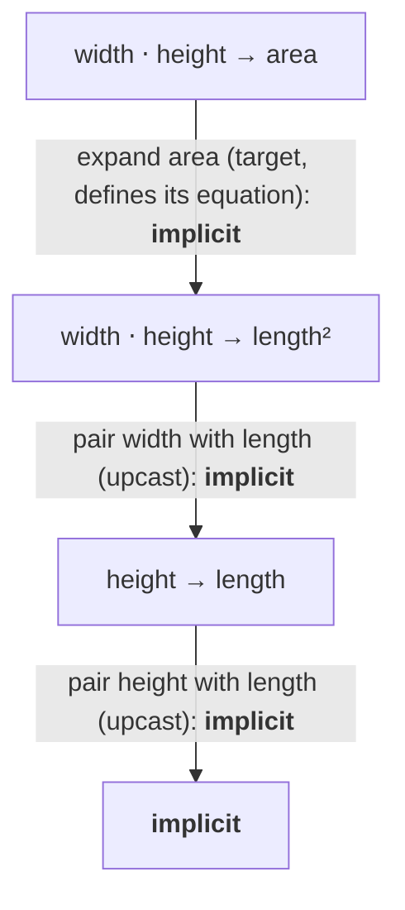

```cpp
static_assert($implicitly-convertible$(isq::width * isq::height, isq::area));
```

**`isq::area` to `isq::width * isq::height`: `explicit`.**

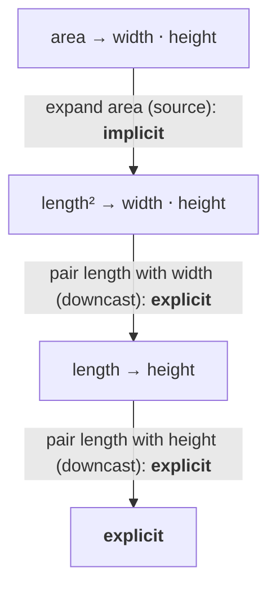

```cpp
static_assert(!$implicitly-convertible$(isq::area, isq::width * isq::height));
static_assert($explicitly-convertible$(isq::area, isq::width * isq::height));
```

**`inverse(isq::time)` to `isq::frequency`: `explicit`.** `isq::time` names `isq::duration`.

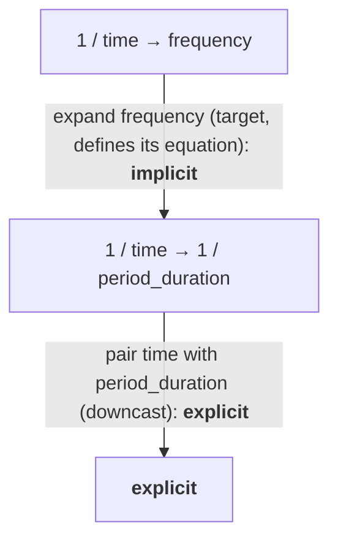

```cpp
static_assert(!$implicitly-convertible$(inverse(isq::time), isq::frequency));
static_assert($explicitly-convertible$(inverse(isq::time), isq::frequency));
```

**`isq::frequency` to `inverse(isq::time)`: `implicit`.**

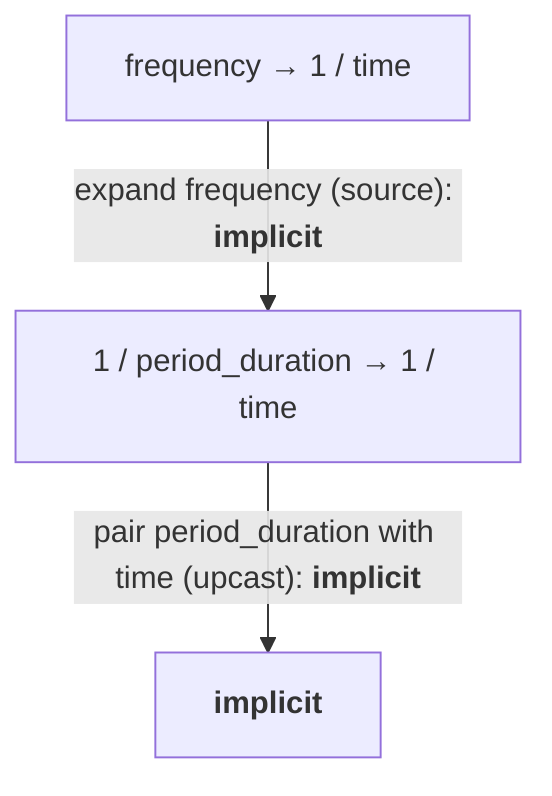

```cpp
static_assert($implicitly-convertible$(isq::frequency, inverse(isq::time)));
```

**`isq::width / isq::duration` to `special_speed`: `explicit`.** An expansion on the target side
is not always `implicit`. _Speed_ defines `isq::length / isq::duration`, so every length per
duration is a _speed_ and converts to it implicitly. `special_speed` only inherits that equation,
and not every _speed_ is a _special speed_. The equation alone cannot make a _special speed_
implicitly, so expanding `special_speed` on the target side ranks `explicit`, like the downcast
from _speed_.

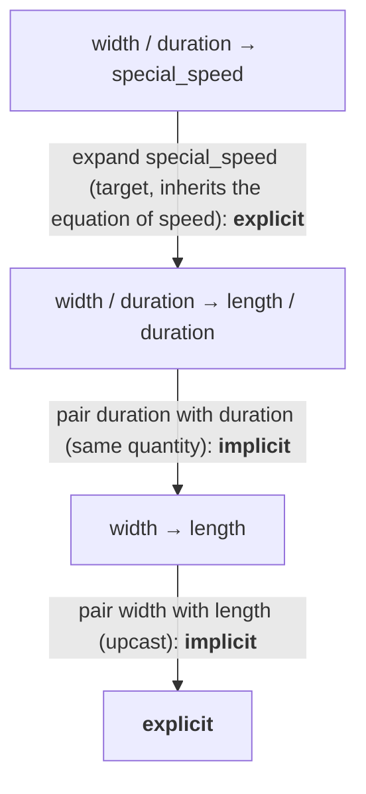

The same conversion to `isq::speed` is `implicit`, because _speed_ defines its equation:

```cpp
static_assert(!$implicitly-convertible$(isq::width / isq::duration, special_speed));
static_assert($explicitly-convertible$(isq::width / isq::duration, special_speed));
static_assert($implicitly-convertible$(isq::width / isq::duration, isq::speed));
```

**`inverse(isq::repetency)` to `isq::height`: `cast`.** _Repetency_ is defined as
`inverse(wavelength)`, and _wavelength_ and _height_ are different branches of the tree of
_length_:

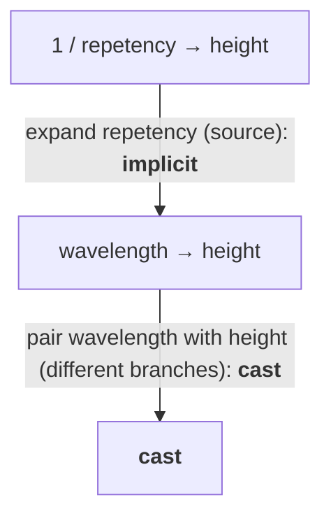

```cpp
static_assert($castable$(inverse(isq::repetency), isq::height));
static_assert(!$explicitly-convertible$(inverse(isq::repetency), isq::height));
```

Flattening both sides to `length` would have ranked this `explicit` and treated a _wavelength_ as a
_height_.

**`isq::angular_velocity * isq::radius / isq::speed` to `dimensionless`: `explicit`.** In the ISQ
_angular velocity_ is `angular_displacement / duration`, and `angular_displacement` names
`rotational_displacement`, which restates the equation `path_length / radius` of _angular
measure_. Every operation is `implicit`, but the source carries _angular measure_ and the target
carries nothing, so the kind boundary makes the conversion `explicit`:

<!-- markdownlint-disable MD013 -->
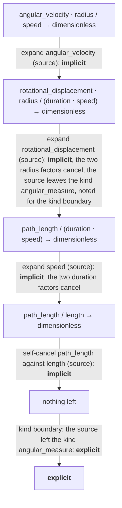
<!-- markdownlint-enable MD013 -->

```cpp
static_assert(!$implicitly-convertible$(isq::angular_velocity * isq::radius / isq::speed, dimensionless));
static_assert($explicitly-convertible$(isq::angular_velocity * isq::radius / isq::speed, dimensionless));
```

**The same divided by `isq::angular_measure`: `implicit`.** The source carries the angle once in
the numerator and once in the denominator, so the carried kinds balance:

<!-- markdownlint-disable MD013 -->
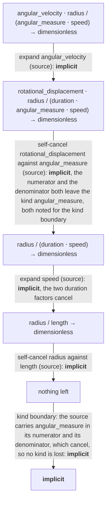
<!-- markdownlint-enable MD013 -->

```cpp
static_assert($implicitly-convertible$(isq::angular_velocity * isq::radius / isq::angular_measure / isq::speed,
                                     dimensionless));
```


### The procedure in order

The process runs in up to three steps. Step 1 picks the rule that applies. Between two single named
quantities, or a named quantity and a kind, the tree rule of [Two named quantities] or the kind
rules of [Kinds] decide the rank on their own. When a derived quantity is involved, the factors
common to both sides cancel first. If a single named quantity is left on each side, the same rules
decide. Otherwise the equation rule of [Derived quantities] continues with steps 2 and 3, with `K`
in place of a kind `kind_of<K>`:

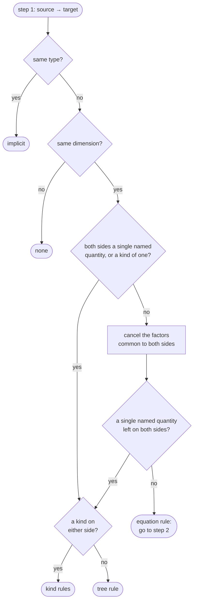

Step 2 makes one operation at a time. After each operation it starts again from the top, until
both sides are the same: both empty, or the same product right after an exact equation:

<!-- markdownlint-disable MD013 -->
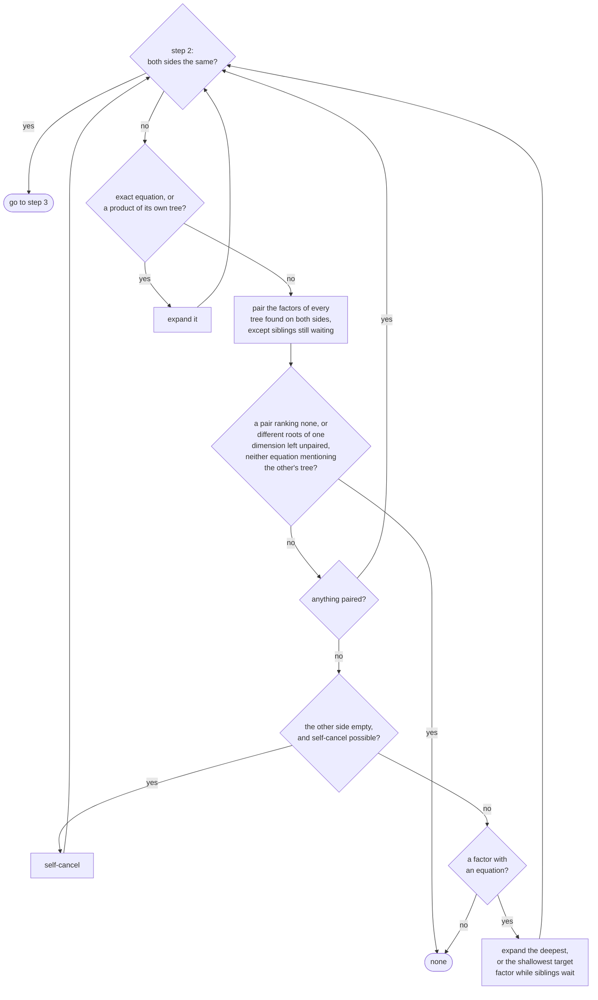
<!-- markdownlint-enable MD013 -->

Step 3 takes the lowest rank of the operations made in step 2, and [The kind boundary] may lower
it:

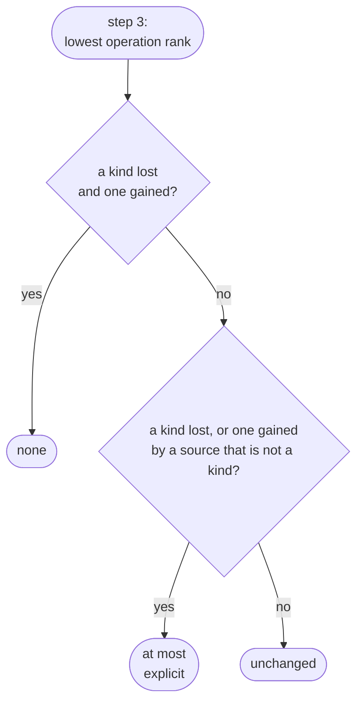

::: ednote
The three flowcharts are the ones in the user's guide. A figure in the style of
`img/quantities_of_energy.svg` could replace them here.
:::


### Consequences

A declared kind is a boundary in both directions. `isq::angular_measure` to
`isq::arc_length / isq::radius` is explicit, and so is the reverse, however the equation is
rearranged: `quantity<isq::arc_length[m]>(angle * r)`, `isq::angular_measure(s / r)`. The same
holds for declared kinds with a dimension, such as the _fluid head_ under _height_ from
[Creating distinct quantity kinds with `subkind`]: convert it with `isq::height(h)` before using it
in a formula.

```cpp
static_assert(!$implicitly-convertible$(isq::angular_measure, isq::arc_length / isq::radius));
static_assert($explicitly-convertible$(isq::angular_measure, isq::arc_length / isq::radius));
```

An earlier design let a declared kind be left and entered implicitly through its exact equation. It
left a hole: `isq::angular_measure[rad]` converted implicitly to
`(isq::arc_length / isq::radius)[rad]`, which converted implicitly to `dimensionless[rad]`, two
implicit steps that leave a declared kind, which one step may not, and the symmetric boundary rules
this out. For conversions, the library thereby treats an angle as if it had a dimension of its own
that only an explicit conversion may strip, while keeping the dimension the ISQ assigns to it. That
is the position of [@BROWNSTEIN] and [@MOHR-PHILLIPS], and [@QUINCEY-BROWN] works out what adopting
it in the SI would cost. The library already refuses to add an angle to a plain `dimensionless`
quantity, and the kind boundary extends that refusal to products and quotients. The note in
[Angular quantities] on making angle a base quantity refers to the same debate.

Distinct roots of one dimension stay apart inside products. `isq::frequency * isq::width` to
`isq::activity * isq::length` is `none`, like `isq::frequency` to `isq::activity`, although both
equations lead into the _time_ tree. Without this rule the two would have been expanded to
`1 / period_duration` and `1 / duration` and related through them.

A factor common to both sides does not change how they relate, and paired factors keep their
relation. `A * X` to `B * X` is decided exactly as `A` to `B` as long as no factor of `X` cancels
against `A` or `B` (`isq::height / isq::width * isq::width` is just `isq::height`), and pairing
comes before the equation, so if `isq::energy` converts to `isq::kinetic_energy` only explicitly,
so does `isq::energy * isq::time / isq::period_duration` to `isq::kinetic_energy`. With
`gravitational_potential_energy` as defined in [Hierarchies of derived quantities],
`isq::mass * isq::acceleration_of_free_fall * isq::width` converts to it only with a cast, since
_width_ meets _height_ sideways. The same holds for reciprocal ratios of plain quantities:
`isq::height / isq::width` to `isq::width / isq::height` is `cast`. Reading `height / width` as a
plain number first would have made it `explicit`. A declared kind is different:
`isq::angular_measure` to `inverse(isq::angular_measure)` is `none`, for the reason given in case 8
of [Special cases].

A kind converts implicitly into sub-kinds of its tree.
`quantity<isq::angular_measure[rad]> angle = 3. * m / (2 * m);` compiles, since `3. * m / (2 * m)`
is a kind of _dimensionless_, as [Kinds] explains.

A named quantity is implicitly convertible from its own equation, but not from a more generic
one. `isq::length / isq::time` converts implicitly to _speed_, and
`inverse(isq::period_duration)` to _frequency_, while `inverse(isq::time)` converts to _frequency_
only explicitly. There are two exceptions: a declared kind is gained implicitly only from a source
kind, and a source kind `kind_of<K>` converts implicitly to anything below `K` that keeps the kinds
`K` carries, so `1. / (2 * s)`, a kind of `inverse(isq::time)`, converts to _frequency_ implicitly.

Plain `isq` rotational mechanics needs an explicit conversion. The ISQ defines _torque_ and
_angular momentum_ without an angle but _angular velocity_ with one, so
`isq::torque * isq::angular_velocity` to `isq::power` and
`isq::moment_of_inertia * pow<2>(isq::angular_velocity)` to `isq::kinetic_energy` are explicit:

```cpp
quantity power = quantity<isq::power[W]>(torque * omega);
quantity energy = quantity<isq::kinetic_energy[J]>(inertia * pow<2>(omega));
```

The conversion names a unit as well, because the call operator and `quantity_cast` accept only a
unit of the target's kind, and `rad / s` carries the angle.

The `isq_angle` system defines _torque_ with the angle, so there the angle cancels and both
conversions stay implicit, provided the quantities use the `angular` units.


### Special cases

The cases below are not obvious from the rules above. Each case quotes the static
test in [@MP-UNITS] that guards it, where one exists.

1. **An upcast between two named quantities consults the kind boundary.** `isq::phase_coefficient`
   is a child of `isq::propagation_coefficient`, and its equation `phase_angle / path_length`
   carries a phase angle that the parent does not. The upcast is `explicit`. With the tree rule
   alone it would be `implicit`, and `isq::propagation_coefficient * isq::path_length` to
   `dimensionless` is `implicit` too, so two implicit steps would shed a declared kind that the
   single step `isq::phase_coefficient * isq::path_length` to `dimensionless` may shed only
   explicitly. The alternative, requiring every child whose equation carries a kind its parent
   lacks to be declared `subkind`, would be a check at definition time. The same rule makes the ISQ
   information quantities that carry _storage capacity_ through _transfer rate_, such as
   `isq::period_of_binary_digits`, upcast to _duration_ only explicitly, as an angle does. Guarded
   in `isq_test.cpp`:

    ```cpp
    static_assert(!$implicitly-convertible$(isq::phase_coefficient, isq::propagation_coefficient));
    static_assert($explicitly-convertible$(isq::phase_coefficient, isq::propagation_coefficient));
    static_assert(!$implicitly-convertible$(isq::phase_coefficient * isq::path_length, dimensionless));
    static_assert(!$implicitly-convertible$(isq::phase_coefficient * isq::mass,
                                          isq::propagation_coefficient * isq::mass));
    ```

2. **Names never decide a tie between equally deep factors.** When several factors of the greatest
   depth sit in the list chosen by [Which operation applies], each one is expanded in turn and the
   best rank is kept. Expanding only the first would make the verdict depend on the order of the
   names: with a user-defined climb rate `height / time`, `isq::speed * climb_rate` to
   `isq::width * isq::height / pow<2>(isq::time)` ranked `explicit` for one spelling of the name
   and `cast` for another. Deferring every pairing below `implicit` while another factor's equation
   mentions the tree also removes the dependence, but it moves many other verdicts to a worse rank,
   because the sides then no longer meet at the most specific common equation. Guarded in
   `isq_test.cpp` by two test-local twins that differ only in their names, one sorting before
   `mp_units::isq` and one after it, and a test-local `width_by_height_rate`:

    ```cpp
    static_assert($explicitly-convertible$(isq::speed * ::aaa_isq_test_climb, width_by_height_rate));
    static_assert(!$implicitly-convertible$(isq::speed * ::aaa_isq_test_climb, width_by_height_rate));
    static_assert($explicitly-convertible$(isq::speed * ::zzz_isq_test_climb, width_by_height_rate));
    static_assert(!$implicitly-convertible$(isq::speed * ::zzz_isq_test_climb, width_by_height_rate));
    ```

3. **`dimensionless` is a named quantity.** Its equation is the empty product, so its depth is 1,
   not 0. Between a named quantity and `dimensionless` the tree rule decides before any factor
   cancels. Only when the equation rule runs is it the empty list of factors, because it is the
   identity of a product. Guarded in `isq_test.cpp`:

    ```cpp
    static_assert($implicitly-convertible$(isq::rotation, dimensionless));
    static_assert(!$implicitly-convertible$(isq::angular_measure, dimensionless));
    static_assert($explicitly-convertible$(isq::angular_measure, dimensionless));
    ```

4. **`pow<N>(Q)` is not a single named quantity.** Only a named quantity with exponent 1 goes to
   the tree rule or the kind rules. `pow<2>(A)` to `pow<2>(B)` goes through the equation rule, so
   its verdict comes from the operations and the kind boundary, not from the tree rule. Guarded in
   `isq_test.cpp`, where the squared pair of _phase coefficient_ and _propagation coefficient_
   stays `explicit` like the bare one:

    ```cpp
    static_assert(!$implicitly-convertible$(pow<2>(isq::phase_coefficient),
                                          pow<2>(isq::propagation_coefficient)));
    ```

5. **A kind of a derived quantity runs the equation rule.** `kind_of<K>` with a derived `K` runs
   the equation rule on `K`, with the source known to be a kind. A downcast from it ranks
   `implicit`, dropping a declared kind stays `explicit`, and a factor that meets the target
   sideways still ranks `cast`. Guarded in `isq_test.cpp`:

    ```cpp
    static_assert($castable$(kind_of<inverse(isq::repetency)>, isq::height));
    static_assert(!$explicitly-convertible$(kind_of<inverse(isq::repetency)>, isq::height));
    ```

6. **Pairing may leave a source factor unpaired.** A source factor may stay unpaired for a later
   self-cancel, as long as the remaining source factors of that tree still outweigh the target
   factors of that tree. The wording allows more choices than [@MP-UNITS] explores, and it takes
   the best rank over all of them.

7. **Siblings wait tree by tree.** [@MP-UNITS] defers the pairing of a whole tree in two cases. It
   waits when the best pairing would be `cast` and a factor of another tree has an equation that
   mentions the tree. From a kind source, it also waits when the best pairing would be `none` and a
   factor of another tree mentions the tree anywhere down its equations. The wording decides pair
   by pair and doesn't follow the equations of a factor transitively, so it doesn't cover the second
   case yet.

   ::: ednote
   The wording is to be aligned with the implementation.
   :::

8. **`none` without "nothing in common".** `isq::angular_measure` to
   `inverse(isq::angular_measure)` and `pow<2>(isq::angular_measure)` to
   `isq::solid_angular_measure` are `none` by design. A declared kind behaves much like a
   dimension and does not convert to its inverse or to its square. Guarded in
   `isq_test.cpp`, and in `quantity_spec_test.cpp` with its test-local `angular_measure`:

    ```cpp
    static_assert(!$castable$(isq::angular_measure, inverse(isq::angular_measure)));
    static_assert(!$castable$(pow<2>(isq::angular_measure), isq::solid_angular_measure));
    static_assert(convertible(inverse(angular_measure), angular_measure) == none);
    ```

9. **The character of a quantity is not consulted yet.** A conversion from a scalar to a vector,
   such as `kind_of<isq::length / isq::time>` to `isq::velocity`, is `implicit` today and is
   expected to become `none` once the character of a quantity takes part in conversions.
   `isq::acceleration * isq::duration` to `special_speed`, `cast` today, has the same problem. The
   examples in this paper avoid both. The current verdicts are recorded in
   `quantity_spec_test.cpp`, with quantities local to that test:

    ```cpp
    static_assert(convertible(kind_of<length / time>, velocity) == implicit);
    static_assert(convertible(acceleration * time, special_speed) == cast);
    ```

10. **The kind boundary nets within a side first.** Each kind's numerator count is netted against
    its denominator count on the same side before the two sides are compared, so
    `isq::angular_velocity * isq::radius / isq::angular_measure / isq::speed` to `dimensionless`
    loses nothing and is `implicit`. Guarded in `isq_test.cpp`:

    ```cpp
    static_assert($implicitly-convertible$(isq::angular_velocity * isq::radius / isq::angular_measure / isq::speed,
                                         dimensionless));
    ```

11. **The kind boundary caps every verdict of the tree rule and of the kind rules.** The tree rule
    does not look at equations. Without the boundary, a kind of _angular velocity_ would reach a
    child defined without the angle implicitly, and two siblings that each carry a declared kind
    the other lacks would be `cast` while their squares, decided by the equation rule, are `none`.
    On a hierarchy edge the boundary lowers the tree rule's rank to `explicit` and never to `none`.
    A declared-kind child defined as `inverse(isq::duration)` under _angular velocity_ gains its
    own kind and lacks the angle, converts to its parent and from it only explicitly, and
    `quantity_cast` between them, in a unit both accept, keeps compiling. The squared pair of such
    a child and its parent still ranks `none`, because the equation rule applies the boundary
    without this exemption. Guarded in `isq_test.cpp`, with quantities local to that test:

    ```cpp
    inline constexpr struct turn_rate : named_quantity_spec<isq::angular_velocity, inverse(isq::duration)> {} turn_rate;
    inline constexpr struct turn_rate_kind :
      named_quantity_spec<isq::angular_velocity, inverse(isq::duration), subkind> {} turn_rate_kind;
    inline constexpr struct angled_ratio :
      named_quantity_spec<dimensionless, isq::angular_measure * isq::length / isq::width> {} angled_ratio;
    inline constexpr struct solid_angled_ratio :
      named_quantity_spec<dimensionless, isq::solid_angular_measure * isq::length / isq::width> {} solid_angled_ratio;

    static_assert(!$implicitly-convertible$(kind_of<isq::angular_velocity>, turn_rate));
    static_assert($explicitly-convertible$(kind_of<isq::angular_velocity>, turn_rate));
    static_assert(!$implicitly-convertible$(kind_of<isq::angular_velocity * isq::mass>, turn_rate * isq::mass));
    static_assert(!$castable$(angled_ratio, solid_angled_ratio));
    static_assert(!$castable$(pow<2>(angled_ratio), pow<2>(solid_angled_ratio)));
    static_assert($explicitly-convertible$(turn_rate_kind, isq::angular_velocity));
    static_assert(!$implicitly-convertible$(turn_rate_kind, isq::angular_velocity));
    static_assert($explicitly-convertible$(isq::angular_velocity, turn_rate_kind));
    ```


### The common quantity specification

When two quantities meet in one expression, the library has to decide which quantity specification
the result has. `width + height` needs one that fits both a _width_ and a _height_, the comparison
`a < b`, `std::common_type`, `fma`, `hypot`, `lerp`, `midpoint`, and the difference of two quantity
points ask the same question. `get_common_quantity_spec(q1, q2)` answers it with the conversion
rules of this chapter: the result is the most specific quantity specification that both operands
convert to implicitly, and the call is ill-formed when there is none. Apart from a
unit's own symbol, which only orders two members of one magnitude inside a `common_unit`, the
result depends on how a quantity or a unit is defined and never on its name in C++.
Over every pair of ISQ quantities and every pair of units of the SI, yard-pound, USC, imperial,
IEC, CGS, HEP, IAU, astronomy and typographic systems the result was checked to be the same for
both argument orders.

A specification `Q` _reaches_ `C` when `$implicitly-convertible$(Q, C)` holds. Two specifications are
_interconvertible_ when each reaches the other. The candidates considered are the operands
themselves, every ancestor of a named operand, the kind root of each operand as a committed
specification (one that isn't a `kind_of<>`), which is `speed` for `special_speed` and
`length / time` for `height / duration`, and the _join_ of two forms, at most one of them named,
sharing a factor to an integer power: the shared factor is canceled, the common specification of the
remainders is found, and the shared factor is multiplied back in. The result is the most specific
candidate both operands reach.

With three or more operands the call is evaluated from the left, and every operand has to reach the
result: `isq::frequency` and `inverse(isq::time)` meet at `inverse(isq::time)`, whose common
specification with `isq::activity` is `isq::activity`, which a frequency never reaches, so
`get_common_quantity_spec(isq::frequency, inverse(isq::time), isq::activity)` is ill-formed.

```cpp
static_assert(get_common_quantity_spec(isq::width, isq::height) == isq::length);
static_assert(get_common_quantity_spec(kind_of<isq::length>, isq::width) == isq::width);
static_assert(get_common_quantity_spec(isq::frequency, inverse(isq::time)) == inverse(isq::time));
static_assert(get_common_quantity_spec(isq::width / isq::period_duration, isq::height / isq::period_duration) ==
              isq::length / isq::period_duration);
```

`isq::frequency` is defined over `isq::period_duration`, a child of `isq::time`, so it reaches
`1 / time` but not the reverse, and the less specific form is the result. The two ratios share
`period_duration`, and the join keeps it, while the kind roots alone would have given
`length / time`.

When the most specific candidates are interconvertible, one of them has to be chosen, and the
preference is, in this order:

1. a committed specification over a kind (`length` over `kind_of<length>`),
2. a named quantity over a derived form, also when the named one is not an operand (`speed` over
   `length / time`; `special_speed` with `length / time` gives `speed`), and a power of one named
   quantity next (`pow<2>(speed)` over `length² / time²`),
3. two derived forms fold toward each other: whenever one side contains the equation of a named
   factor present on the other side (a factor that defines its own equation and is not a declared
   kind), that part is replaced by the factor, until nothing folds. When both sides end identical,
   that form is the result, and it can be more composed than either operand (`area * length³` with
   `length² * volume` gives `area * volume`),
4. when the packagings are incompatible, the more composed operand: the greater sum of factor
   depths, then the fewer factors (`area * speed` over `volume / time`),
5. otherwise the expansion of either side.

`isq::angular_measure` and `dimensionless` have no common specification (see [Consequences]). Two
quantities of different trees have none either, `isq::energy` and `isq::torque`.
The common specification of two point specifications is the point of the common specification of
their scales, so `get_common_quantity_spec(point<isq::height>, point<isq::width>)` is
`point<isq::length>`, and a point and a delta have no common specification.

### Wording and interface

The normative wording in the companion wording document follows this chapter: the vocabulary above
is defined there with the same names, the ranks are an exposition-only enumeration whose enumerator
`explicit_only` is the rank written `explicit` here, and the procedure follows the order of
[The procedure in order]. The public interface is the predicate `interconvertible` and
`get_common_quantity_spec`, which the library uses to find the quantity specification two operands
have in common, for example in addition and comparison. The other three predicates are
exposition-only.


## Quantity references

_Note: We know that probably the term "reference" will not survive too long in the Committee,
but we couldn't find a better name for it in the [@MP-UNITS] library
(<https://github.com/mpusz/mp-units/issues/486>)._

[@ISO-GUIDE] says:

> **quantity** - property of a phenomenon, body, or substance, where the property has a magnitude
> that can be expressed as a number and a reference. ...
> A reference can be a measurement unit, a measurement procedure, a reference material, or
> a combination of such.

In the library a quantity reference represents all the domain-specific meta-data about the quantity
besides its representation type and its value. A
[`quantity_reference`](#quantity_reference-concept) concept is satisfied by either of:

- an associated unit (e.g., `si::metre`) other than an offset one,
- a delta reference, the type of `QS[U]`, explicitly specifying the quantity type and its
  unit, or of `delta<U>`, the delta of a unit,
- a point reference, the type of `point<R, PO>` (see [The affine space]).

A delta reference is implicitly created as a result of the following expression:

```cpp
constexpr quantity_reference auto distance = isq::distance[m];
```

The above example defines a delta reference that binds `isq::distance` with `si::metre`.

A delta reference also exposes an arithmetic interface similar to the one that we have already
discussed in case of units and quantity types. It forwards the operation to its quantity type
and unit and normalizes the result: when the quantity specification is the kind associated with
the unit, the result is the unit alone (`kind_of<isq::length>[m] * s` is the unit `m * s`).

```cpp
constexpr quantity_reference_of<isq::speed> auto speed = distance / si::second;
```

As a result we get a delta reference binding
`derived_quantity_spec<distance, $per$<kind_of_<duration>>>` with `derived_unit<metre, $per$<second>>`.

Similarly to the [`unit`](#unit-concept), such a reference can be used to construct a quantity,
and it is also the construction helper of a delta in it:

```cpp
quantity_of<isq::speed> auto s1 = 60 * speed;
quantity_of<isq::speed> auto s2 = speed(60);
```

A unit that is the scale of a point (`si::kelvin`, `si::degree_Celsius`, `usc::degree_Fahrenheit`,
and their scaled versions) is not a reference on its own: a value in such a unit does not say
whether a difference of temperatures or a temperature measured from the origin of its scale is
meant. `delta<U>` and `point<U>` are its two references, and the same holds for
`isq::thermodynamic_temperature[deg_C]`, which only `delta` and `point` accept (see
[`delta` and `point` creation helpers]). A unit derived from such a unit (`pow<2>(deg_C)`,
`K / s`) is a plain delta reference, as a point has no algebra and every factor of a derived
unit is a delta. Every reference that an equation produces is a delta reference: where the
unit algebra yields the scale of a point, the result is the delta of it
(`delta<K>(6.5) / (1000 * m) * (500 * m)` is a `quantity<delta<K>>`).

`delta<U>` is the reference of the delta of `U` for every unit, so `delta<m>(42)` creates a delta
the way `point<m>(42)` creates a point. For a unit other than an offset one the wrapper is kept only
where the user spells it as a type (`quantity<delta<m>>`): `delta<m>(42)` is a `quantity<m, int>`,
and `delta<m> * m` is `pow<2>(m)`.

### Bikeshedding `reference`

The term `reference` is highly overloaded in the C++ domain, which is why the concepts are
`quantity_reference` and `quantity_reference_of`. The types themselves need no name a user would
type: users obtain the reference of a delta through `QS[U]` or `delta<U>`, and the reference of a
point through `point<R, PO>`, and the types are exposition-only. An implementation chooses their
spellings, and the shorter they are, the easier compiler error messages are to grasp.


## Quantities

The `quantity` class template is a workhorse of the library. It can be considered a generalization
of `std::chrono::duration`, but is not directly compatible with it.

Based on the ISO definition provided in the [Quantity references] chapter, the `quantity` class
template has the following signature:

```cpp
template<quantity_reference auto R, representation_of<get_quantity_spec(R)> Rep = double>
class quantity;
```

It stores only one data member of `Rep` type. Unfortunately, this data member has to be publicly
exposed to satisfy the C++ language requirements for
[structural types](https://eel.is/c++draft/temp.param#def:type,structural). Hopefully, the language
rules for structural types will improve with time before this library gets standardized.


### Multiply syntax commutativity

As of today, the multiply syntax that creates quantities is not commutative:

```cpp
quantity q1 = 1 * m;  // OK
quantity q2 = m * 1;  // Compile-time error
```

We decided to go this way to increase the readability of the code and limit possible confusion
with this syntax. After a while, we extended it to support also the following:

```cpp
quantity q3 = 1 * m / s;    // OK
quantity q4 = 1 * m * m;    // OK
quantity q5 = 1 / s * m;    // OK
quantity q6 = s / 2;        // Compile-time error
quantity q7 = m * (1 / s);  // Compile-time error
quantity q8 = m * (1 * m);  // Compile-time error
```

However, [@MP-UNITS] users [requested the following use case](https://github.com/mpusz/mp-units/issues/621):

```cpp
if(num < Unit / 1'000'000'000'000) {
  quantity<si::femto<Unit>, double> n{num};
  out << n;
} else if(num < Unit / 1'000'000'000) {
  quantity<si::pico<Unit>, double> n{num};
  out << n;
} else // ...
```

Today, this does not compile. Should we extend the multiply syntax to support such use cases and
with this have entire commutative property?


### Why don't we use UDLs to create quantities?

[Quantity construction] chapter describes and explains why we introduced
the multiply syntax as a construction helper for quantities. Many people ask why we chose
this approach over battle-proven User Defined Literals (UDLs) that work well for the
`std::chrono` library.

It turns out that many reasons make UDLs a poor choice for a physical units library:

1. UDLs work only with literals (compile-time known values). Our observation is that besides
   the unit tests, only a few compile-time known quantity values are used in the production
   code. Please note that for [Physical constants], we recommend using units rather than
   compile-time constants.
2. Typical implementations of UDLs tend to always use the widest representation type available.
   In the case of `std::chrono::duration` in libstdc++, the following is true:

    ```cpp
    using namespace std::chrono_literals;
    auto d1 = 42s;
    auto d2 = 42.s;
    static_assert(std::is_same_v<decltype(d1)::rep, std::int64_t>);
    static_assert(std::is_same_v<decltype(d2)::rep, long double>);
    ```

   When such UDL is intermixed in arithmetics with any quantity type of a shorter representation
   type, it will always expand it to the longest one. In other words, such long type spreads until
   all types use it everywhere.

3. While increasing the coverage for the [@MP-UNITS] library, we learned that many unit symbols
   conflict with built-in types or numeric extensions. A few of those are: `F` (farad), `J` (joule),
   `W` (watt), `K` (kelvin), `d` (day), `l` or `L` (litre), `erg`, `ergps`. Using the `'_'` prefix
   would make it work for [@MP-UNITS], but if the library is standardized, those naming
   collisions would be a big issue. This is why we came up with the `_q_` prefix that would become
   `q_` after standardization (e.g., `42q_s`), which is not that nice anymore.

4. UDLs with the same identifiers defined in different namespace can't be disambiguated in the
   literal syntax. If both SI and CGS systems define `q_s` UDL for a second unit, then it would not
   be possible to specify which one to use in case both namespaces are "imported" with using
   directives.

5. Another bad property of UDLs is that they do not compose. A coherent unit of angular momentum
   would have a UDL specified as `q_kg_m2_per_s`. Now imagine that we want to make every possible
   user happy. How many variations of that unit would we predefine for differently scaled versions
   of all unit ingredients?

6. UDLs are also really expensive to define and specify. Typically, for each unit, we need two
   definitions. One for integral and another one for floating-point representation. In version
   0.8.0 of the [@MP-UNITS] library, the coherent unit of angular momentum was defined as:

    ```cpp
    constexpr auto operator"" _q_kg_m2_per_s(unsigned long long l)
    {
      gsl_ExpectsAudit(std::in_range<std::int64_t>(l));
      return angular_momentum<kilogram_metre_sq_per_second, std::int64_t>(static_cast<std::int64_t>(l));
    }

    constexpr auto operator"" _q_kg_m2_per_s(long double l)
    {
      return angular_momentum<kilogram_metre_sq_per_second, long double>(l);
    }
    ```

The multiply syntax that we chose for this library does not have issues 1, 2, 5, and 6, and its
unit symbols can always be qualified (e.g., `si::unit_symbols::min`) when names clash.


### Special values of a quantity

`quantity` class template, similarly to `std::chrono::duration`, exposes some special values as
`static` member functions:

- `min()`,
- `max()`,
- `zero()`.

Also, similarly to `std::chrono::duration` those functions are implemented in terms of a type
trait:

```cpp
template<typename Rep>
struct representation_values : chrono::duration_values<Rep> {
  static constexpr Rep one() noexcept
    requires constructible_from<Rep, int>
 {
    return Rep(1);
 }
};
```

An additional `one()` function in `representation_values` is provided for use with the multiply
syntax when constructing quantities. Users can create a quantity with numerical value of one using:
`representation_values<double>::one() * si::metre`. This function is not exposed as a static member
of `quantity` because `one()` is not a true multiplicative identity for dimensional quantities. For
example, `pow<2>(quantity<si::metre>::one())` would change the dimension from _length_ to _area_.

Please also note that in C++26, `std::chrono::duration_values` is not a part of the freestanding
library.


### Quantity arithmetics

#### `quantity` is a numeric wrapper

If we think about it, the `quantity` class template is just a "smart" numeric wrapper. It exposes
properly constrained set of arithmetic operations on one or two operands.

Every single arithmetic operator is exposed by the `quantity` class template only if
the underlying representation type provides it as well and its implementation has proper
semantics (e.g., returns a reasonable type).

For example, in the following code, `-a` will compile only if `MyInt` exposes such an operation
as well:

```cpp
quantity a = MyInt{42} * m;
quantity b = -a;
```

Assuming that:

- `q` is our quantity,
- `qq` is a quantity implicitly convertible to `q`,
- `q2` is any other quantity,
- `kind` is a quantity of the same kind as `q`,
- `one` is a quantity of `dimension_one` with the unit `one`,
- `number` is a value of a type "compatible" with `q`'s representation type,

here is the list of all the supported operators:

|                      Unary                       |                                        Compound assignment                                        |                                                             Binary                                                             |    Ordering & comparison    |
|:------------------------------------------------:|:-------------------------------------------------------------------------------------------------:|:------------------------------------------------------------------------------------------------------------------------------:|:---------------------------:|
| `+q`<br>`-q`<br>`++q`<br>`q++`<br>`--q`<br>`q--` | `q += qq`<br>`q -= qq`<br>`q %= qq`<br>`q *= number`<br>`q *= one`<br>`q /= number`<br>`q /= one` | `q + kind`<br>`q - kind`<br>`q % kind`<br>`q * q2`<br>`q * number`<br>`number * q`<br>`q / q2`<br>`q / number`<br>`number / q` | `q == kind`<br>`q <=> kind` |

As we can see, there are plenty of operations one can do on a value of a `quantity` type. As most
of them are obvious, in the following chapters, we will discuss only the most important or non-trivial
aspects of quantity arithmetics.

#### Addition and subtraction

Quantities can easily be added or subtracted from each other:

```cpp
static_assert(1 * m + 1 * m == 2 * m);
static_assert(2 * m - 1 * m == 1 * m);
static_assert(isq::height(1 * m) + isq::height(1 * m) == isq::height(2 * m));
static_assert(isq::height(2 * m) - isq::height(1 * m) == isq::height(1 * m));
```

The above uses the same types for LHS, RHS, and the result, but in general, we can add, subtract,
or compare the values of any quantity type as long as both quantities are of the same kind.
The result of addition and subtraction will be the common type of the arguments:

```cpp
static_assert(1 * km + 1.5 * m == 1001.5 * m);
static_assert(isq::height(1 * m) + isq::width(1 * m) == isq::length(2 * m));
static_assert(isq::height(2 * m) - isq::distance(0.5 * m) == 1.5 * m);
static_assert(isq::radius(1 * m) - 0.5 * m == isq::radius(0.5 * m));
```

Please note that for the compound assignment operators, we always need to end up with the
left-hand-side argument type:

```cpp
quantity q1 = 1 * m;
q1 += 1 * km;                   // 1001 m
quantity q2 = isq::length(1 * m);
q2 += isq::height(1 * m);       // isq::length(2 * m)
quantity q3 = isq::height(1.5 * m);
q3 -= 1 * m;                    // isq::height(0.5 * m)
```

If we break those rules, the code will not compile:

```cpp
quantity q1 = 1 * m;
q1 -= 0.5 * m;                    // Compile-time error (1)
quantity q2 = 1 * km;
q2 += 1 * m;                      // Compile-time error (2)
quantity q3 = isq::height(1 * m);
q3 += isq::length(1 * m);         // Compile-time error (3)
```

`(1)` Conversions of the floating-point to integral representation type is considered narrowing.

`(2)` Conversion of quantity with integral representation type from a unit of a higher resolution to
the one with a lower resolution is considered narrowing.

`(3)` Conversion from a more generic quantity type to a more specific one is considered unsafe.

Please note that all the above operations either preserved the input representation types or
returned a common type if those were different for both arguments. This is not the case for
irrational conversion factors. In such cases, the library will force the user to use at least
one floating-point representation type to prevent truncation:

```cpp
template<typename... Ts>
consteval bool invalid_arithmetic(Ts... ts)
{
  return !requires { (... + ts); } && !requires { (... - ts); };
}

static_assert(invalid_arithmetic(1 * rad, 1 * deg));
static_assert(is_of_type<1. * rad + 1 * deg, quantity<common_unit<deg, rad>{}, double>>);
static_assert(is_of_type<1 * rad + 1. * deg, quantity<common_unit<deg, rad>{}, double>>);
static_assert(is_of_type<1. * rad + 1. * deg, quantity<common_unit<deg, rad>{}, double>>);
```

#### Multiplication and division

Multiplying or dividing a quantity by a number does not change its quantity type or unit. However,
its representation type may change. For example:

```cpp
static_assert(isq::height(3 * m) * 0.5 == isq::height(1.5 * m));
```

Unless we use a compound assignment operator, in which case we always have to result with
the type of the left-hand-side argument. This, together with the fact that this library
tries to prevent truncation of a quantity value means, that the following does not compile:

```cpp
quantity q = isq::height(3 * m);
q *= 0.5;  // Compile-time error
```

However, suppose we multiply or divide quantities of the same or different types, or we divide a raw
number by a quantity. In that case, we most probably will end up in a quantity of yet another type:

```cpp
static_assert(120 * km / (2 * h) == 60 * km / h);
static_assert(isq::width(2 * m) * isq::length(2 * m) == isq::area(4 * m2));
static_assert(50 / isq::time(1 * s) == isq::frequency(50 * Hz));
```

An exception from the above rule happens when one of the arguments is a dimensionless quantity.
If we multiply or divide by such a quantity, the quantity type will not change. If such a quantity
has a unit `one`, also the unit of a quantity will not change:

```cpp
static_assert(120 * m / (2 * one) == 60 * m);
```

An interesting special case happens when we divide the same quantity kinds or multiply a quantity
by its inverted type. In such a case, we end up with a dimensionless quantity.

```cpp
static_assert(isq::height(4 * m) / isq::width(2 * m) == 2 * one); // (1)
static_assert(5 * h / (120 * min) == 0 * one);                    // (2)
static_assert(5. * h / (120 * min) == 2.5 * one);
```

`(1)` The resulting quantity type of the LHS is `isq::height / isq::width`, which is a quantity of the
dimensionless kind.

`(2)` The resulting quantity of the LHS is `0 * dimensionless[h / min]`. To be consistent with the division
of different quantity types, we do not convert quantity values to a common unit before the division.

##### Beware of integral division

The physical units library can't do any runtime branching logic for the division operator.
All logic has to be done at compile-time when the actual values are not known, and the quantity types
can't change at runtime.

If we expect `120 * km / (2 * h)` to return `60 km/h`, we have to agree with the fact that
`5 * km / (24 * h)` returns `0 km/h`. We can't do a range check at runtime to dynamically adjust scales
and types based on the values of provided function arguments.

This is why we often prefer floating-point representation types when dealing with units.
Some popular physical units libraries even
[forbid integer division of quantities whose units differ](https://aurora-opensource.github.io/au/main/troubleshooting/#integer-division-forbidden).

#### Modulo

Now that we know how addition, subtraction, multiplication, and division work, it is time to talk about
modulo. What would we expect to be returned from the following quantity equation?

```cpp
auto q = 5 * h % (120 * min);
```

Most of us would probably expect to see `1 h` or `60 min` as a result. And this is where the problems
start.

The C++ language defines its `/` and `%` operators with the [quotient-remainder theorem](https://eel.is/c++draft/expr.mul#4):

```text
q = a / b;
r = a % b;
q * b + r == a;
```

The important property of the modulo operator is that it only works for integral representation
types (the built-in `%` is ill-formed for floating-point operands, and `fmod()` and `remainder()`
cover them). However, as we saw in the
previous chapter, integral types are tricky because they often truncate the value.

From the quotient-remainder theorem, the result of modulo operation is `r = a - q * b`.
Let's see what we get from such a quantity equation on integral representation types:

```cpp
quantity a = 5 * h;
quantity b = 120 * min;
quantity q = a / b;
quantity r = a - q * b;

std::cout << "reminder: " << r << "\n";
```

The above code outputs:

```text
reminder: 5 h
```

And now, a tough question needs an answer. Do we really want modulo operator on physical units
to be consistent with the quotient-remainder theorem and return `5 h` for `5 * h % (120 * min)`?

This is exactly why we decided not to follow this hugely surprising path in this library.
The selected approach was also consistent with the feedback from C++ experts. For example,
this is what Richard Smith said about this issue:

<blockquote>

I think the quotient-remainder property is a less important motivation here than other factors
-- the constraints on `%` and `/` are quite different, so they lack the inherent connection they
have for integers. In particular, I would expect that `A / B` works for all quantities `A` and `B`,
whereas `A % B` is only meaningful when `A` and `B` have the same dimension. It seems like
a nice-to-have for the property to apply in the case where both `/` and `%` are defined,
but internal consistency of `/` across all cases seems much more important to me.

I would expect `61 min % 1 h` to be `1 min`, and `1 h % 59 min` to also be `1 min`, so my
intuition tells me that the result type of `A % B`, where `A` and `B` have the same dimension,
should have the smaller unit of `A` and `B` (and if the smaller one doesn't divide
the larger one, we should either use the `gcd / std::common_type` of the units of
`A` and `B` or perhaps just produce an error). I think any other behavior for `%` is hard to
defend.

On the other hand, for division it seems to me that the choice of unit should probably not affect
the result, and so if we want that `5 mm / 120 min = 0 mm/min`, then `5 h / 120 min == 0 hc`
(where `hc` is a dimensionless "hexaconta", or `60x`, unit). I don't like the idea of taking
SI base units into account; that seems arbitrary and like it would do the wrong thing as often
as it does the right thing, especially when the units have a multiplier that is very large or
small. We could special-case the situation of a dimensionless quantity, but that could lead to
problematic overflow pretty easily: a calculation such as `10 s * 5 GHz * 2 uW` would overflow
an `int` if it produces a dimensionless quantity for `10 s * 5 GHz`, but it could equally
produce `50 G * 2 uW = 100 kW` without any overflow, and presumably would if the terms were merely
reordered.

If people want to use integer-valued quantities, I think it's fundamental that you need
to know what the units of the result of an operation will be, and take that into account in how you
express computations; the simplest rule for heterogeneous operators like `*` or `/` seems to be that
the units of the result are determined by applying the operator to the units of the operands
-- and for homogeneous operators like `+` or `%`, it seems like the only reasonable option is
that you get the `std::common_type` of the units of the operands.

</blockquote>

To summarize, the modulo operator on physical units has more in common with addition and
division operators than with the quotient-remainder theorem. To avoid surprising results, the
operation uses a common unit to do the calculation and provide its result:

```cpp
static_assert(5 * h / (120 * min) == 0 * one);
static_assert(5 * h % (120 * min) == 60 * min);
static_assert(61 * min % (1 * h) == 1 * min);
static_assert(1 * h % (59 * min) == 1 * min);
```

#### Comparison against zero

Zero is special.  It is the only number that unambiguously defines the value of a delta of any kind,
regardless of its units: zero inches and zero meters and zero miles are all identical. For this
reason, it's very common to compare the value of a quantity against zero. For example, when checking
the sign of a quantity, or when making sure that it's nonzero.

We could implement such checks in the following way:

```cpp
if(q1 / q2 != 0 * m / s)
  // ...
```

The above would work (assuming we are dealing with the quantity of _speed_), but it's not ideal. If
the result of `q1 / q2` is not expressed in `m / s`, we'll incur an extra unit conversion.
Even if it is in `m / s`, it's cumbersome to repeat the unit in a context where it makes no difference.

We could avoid repeating the unit, and guarantee there won't be an extra conversion, by writing:

```cpp
if(auto q = q1 / q2; q != q.zero())
  // ...
```

But that is a bit inconvenient, and inexperienced users could be unaware of this technique and its
rationale.

For the above reasons, the library provides special support for comparisons against zero.
Only this one value has elevated privileges and does not have to state the
unit, as the numerical value zero is common to all scaled units of any kind.

Thanks to that, to save typing and not pay for unneeded conversions, our check could be
implemented as follows:

```cpp
if (q1 / q2 != 0)
  // ...
```

All six comparison operators support comparison against zero without specifying a unit.
This works with any representation type `rep` for which `representation_values<rep>::zero()`
is provided.

Only a compile-time zero is accepted: a constant expression of an integer or floating-point type
whose value is zero (e.g., `0`, `0u`, `0.`, `0.f`, `0LL`). A non-zero value or a runtime variable,
even one whose value happens to be zero, is rejected at compile time. A requires-expression that
probes such a comparison doesn't see this check, and a literal `0` passed through a function
isn't a compile-time zero ([@ZERO-CMP] discusses both, together with alternative designs).


#### Other maths

This chapter scoped only on the `quantity` type's operators. However, there are many named math
functions provided in the [@MP-UNITS] library. Among others, we can find there the following:

- `pow()`, `sqrt()`, `cbrt()`,
- `exp()`,
- `abs()`,
- `epsilon()`,
- `fma()`, `fmod()`, `remainder()`,
- `isfinite()`, `isinf()`, `isnan()`,
- `floor()`, `ceil()`, `round()`,
- `inverse()`,
- `hypot()`,
- `sin()`, `cos()`, `tan()`,
- `asin()`, `acos()`, `atan()`, `atan2()`.

In the library, we can also find the `<mp-units/utility/random.h>` header file with quantity
versions of all the random number distributions.

We plan to provide a separate paper on those in the future.


### Dimensionless quantities

The quantities we discussed so far always had some specific type and physical dimension.
However, this is not always the case. While performing various computations, we sometimes end up with
so-called "dimensionless" quantities, which [@ISO-GUIDE] correctly defines as quantities of dimension
one:

> - Quantity for which all the exponents of the factors corresponding to the base quantities in
>   its quantity dimension are zero.
> - The measurement units and values of quantities of dimension one are numbers, but such quantities
>   convey more information than a number.
> - Some quantities of dimension one are defined as the ratios of two quantities of the same kind.
> - Numbers of entities are quantities of dimension one.


#### Dividing two quantities of the same kind

Dividing two quantities of the same kind always results in a quantity of dimension one. However,
depending on what type of quantities we divide or what their units are, we may end up with slightly
different types.

Dividing two quantities of the same dimension always results in a quantity with the dimension being
`dimension_one`. This is often different for other physical units libraries, which may return a raw
representation type for such cases. A raw value is also always returned from the division of two
`std::chrono::duration` values.

In the initial design of the [@MP-UNITS] library, the resulting type of division of two quantities
was their common representation type (just like `std::chrono::duration`):

```cpp
static_assert(std::is_same_v<decltype(10 * km / (5 * km)), int>);
```

The reasoning behind it was not providing a false impression of a strong `quantity` type for
something that looks and feels like a regular number. Also, all of the mathematic and trigonometric
functions were working fine out of the box with such representation types, so we did not have to rewrite
`sin()`, `cos()`, `exp()`, and others.

However, the feedback we got from the production usage was that such an approach is really bad for
generic programming. It is hard to handle the result of the two quantities' division (or multiplication)
as it might be either a quantity or a fundamental type. If we want to raise such a result to some power,
we must use `units::pow` or `std::pow` depending on the resulting type
(`units::pow` takes the power as template arguments).
Those are only a few issues
related to such an approach.

Moreover, suppose we divide quantities of the same dimension, but with units of significantly different
magnitudes. In such case, we may end up with a really small or a huge floating-point value, which
may result in losing lots of precision. Returning a dimensionless quantity from such cases allows
us to benefit from all the properties of scaled units and is consistent with the rest of the library.

##### Dividing quantities of the same type

First, let's analyze what happens if we divide two quantities of the same type:

```cpp
constexpr quantity_of<dimensionless> auto q = isq::height(200 * m) / isq::height(50 * m);
```

In such a case, we end up with a dimensionless quantity that has the following properties:

```cpp
static_assert(q.quantity_spec == dimensionless);
static_assert(q.dimension == dimension_one);
static_assert(q.unit == one);
```

In case we would like to print its value, we would see a raw value of `4` in the output with no unit
being printed.

##### Dividing quantities of different types

We can divide quantities of the same dimension and unit but of different quantity types:

```cpp
constexpr quantity_of<dimensionless> auto q = isq::work(200 * J) / isq::heat(50 * J);
```

Again we end up with `dimension_one` and `one`, but this time:

```cpp
static_assert(q.quantity_spec == isq::work / isq::heat);
```

As shown above, the result is not of a `dimensionless` type anymore. Instead, we get a quantity type
derived from the performed quantity equation. According to the [@ISO80000], _work_ divided by _heat_
is the recipe for the _thermodynamic efficiency_ quantity, thus:

```cpp
static_assert($implicitly-convertible$(q.quantity_spec, isq::thermodynamic_efficiency));
```

Please note that the quantity of `isq::thermodynamic_efficiency` is of a kind `dimensionless`,
so it is implicitly convertible to `dimensionless` and satisfies the
[`quantity_of<dimensionless>`](#quantity_of-concept) concept.

##### Dividing quantities of different units

Now, let's see what happens when we divide two quantities of the same type but different units:

```cpp
constexpr quantity_of<dimensionless> auto q = isq::height(4 * km) / isq::height(2 * m);
```

This time we get a quantity of `dimensionless` type with a `dimension_one` as its dimension.
However, the resulting unit is not `one` anymore:

```cpp
static_assert($equivalent$(q.unit, mag_power<10, 3> * one));
```

In case we would print the text output of this quantity, we would not see a raw value of `2000`,
but `2 km/m`.

First, it may look surprising, but this is actually consistent with the division of quantities
of different dimensions. For example, if we divide `4 * km / (2 * s)`, we do not expect `km` to be
"expanded" to `m` before the division, right? We would expect the result of `2 * (km / s)`, which is
exactly what we get when we divide quantities of the same kind.

This is a compelling feature that allows us to express huge or tiny ratios without the need
for big and expensive representation types. With this, we can easily define things like
a [Hubble's constant](https://en.wikipedia.org/wiki/Hubble%27s_law#Dimensionless_Hubble_constant)
that uses a unit that is proportional to the ratio of kilometers per megaparsecs, which are both
units of length:

```cpp
inline constexpr struct hubble_constant :
    named_constant<{u8"H₀", "H_0"}, mag_ratio<701, 10> * si::kilo<si::metre> / si::second / si::mega<parsec>> {
} hubble_constant;
```

#### Counts of things

Another important use case for dimensionless quantities is to provide strong types for counts
of things. For example:

- [@ISO80000] (part 3) provides a _rotation_ quantity defined as the number of revolutions,
- [@ISO80000] (part 6) provides a _number of turns in a winding_ quantity,
- [@ISO80000] (part 13) provides a _Hamming distance_ quantity defined as the number of digit positions
  in which the corresponding digits of two words of the same length are different.

Thanks to assigning strong names to such quantities, they can be used in the quantity equation of
other quantities. For example, _rotational frequency_ is defined by `rotation / duration`.

#### Predefined units of the dimensionless quantity

As we observed above, the most common unit for dimensionless quantities is `one`. It has the
ratio of `1` and does not output any textual symbol.

A unit `one` is special in the entire type system of units as it is considered to be an identity
operand in the unit symbolic expressions. This means that, for example:

```cpp
static_assert(one * one == one);
static_assert(one * si::metre == si::metre);
static_assert(si::metre / si::metre == one);
```

The same is also true for `dimension_one` and `dimensionless` in the domains of dimensions
and quantity specifications, respectively.

Besides the unit `one`, there are a few other scaled units predefined in the library for usage
with dimensionless quantities:

```cpp
inline constexpr struct percent : named_unit<"%", mag_ratio<1, 100> * one> {} percent;
inline constexpr struct per_mille : named_unit<{u8"‰", "%o"}, mag_ratio<1, 1000> * one> {} per_mille;
inline constexpr struct parts_per_million : named_unit<"ppm", mag_ratio<1, 1'000'000> * one> {} parts_per_million;
inline constexpr auto ppm = parts_per_million;

inline constexpr struct pi : named_constant<symbol_text{u8"π" /* U+03C0 GREEK SMALL LETTER PI */, "pi"}, mag<$pi-c$> * one> {} pi;
inline constexpr auto π /* U+03C0 GREEK SMALL LETTER PI */ = pi;
```

##### Superpowers of the unit `one`

Quantities implicitly convertible to `dimensionless` with the unit equivalent to `one` are the only
ones that are:

- implicitly constructible from the raw value,
- explicitly convertible to a raw value,
- comparable to any raw value (every delta compares against a compile-time zero, see
  [Comparison against zero]).

```cpp
quantity<one> inc(quantity<one> q) { return q + 1; }
void legacy(double) { /* ... */ }

if (auto q = inc(42); q != 0)
  legacy(static_cast<int>(q));
```

This property also expands to usual arithmetic operators.

Please note that those rules do not apply to all the dimensionless quantities. It would be unsafe
and misleading to allow such operations on units with a magnitude different than `1`
(e.g., `percent`) or for quantities that are not implicitly convertible to `dimensionless`
(e.g., `angular_measure`).


#### Angular quantities

Special, often controversial, examples of dimensionless quantities are the _angular measure_
and _solid angular measure_ quantities that are defined in [@ISO80000] (part 3) to be the result of
a division of `arc_length / radius` and `area / pow<2>(radius)` respectively.
Moreover, [@ISO80000] also explicitly states that both can be expressed in the unit `one`.
This means that both `isq::angular_measure` and `isq::solid_angular_measure` should be of
a kind of `dimensionless`.

On the other hand, [@ISO80000] also specifies that the unit `radian` can be used for
_angular measure_, and the unit `steradian` can be used for _solid angular measure_.
Those should not be mixed or used to express other types of dimensionless quantities.
We should not be able to measure:

- basic dimensionless quantity in radians or steradians,
- _angular measure_ in steradians,
- _solid angular measure_ in radians.

This means that both `isq::angular_measure` and `isq::solid_angular_measure` should also be
quantity kinds by themselves.

_Note: [@SI] defines an angle as the ratio of an arc length to a radius, which makes it a quantity
of dimension one. Several authors argue that an angle should be a base quantity and `rad` a base
unit [@BROWNSTEIN; @MOHR-PHILLIPS]. The library supports the current definition and keeps angles a
distinct kind, so `arc_length / radius` converts to an angle explicitly._

##### Radians and degrees support

Thanks to the usage of magnitudes the library provides efficient strong types for all angular
types. This means that with the built-in support for magnitudes of $\pi$ we can provide accurate
conversions between radians and degrees. The library also provides common trigonometric functions
for angular quantities:

```cpp
quantity speed = 110 * km / h;
quantity rate_of_climb = -0.63657 * m / s;
quantity glide_ratio = speed / -rate_of_climb;
quantity glide_angle = angular::asin(1 / glide_ratio);

std::println("Glide ratio: {::N[.1f]}", glide_ratio.in(one));
std::println("Glide angle:");
std::println(" - {::N[.4f]}", glide_angle);
std::println(" - {::N[.2f]}", glide_angle.in(angular::degree));
std::println(" - {::N[.2f]}", glide_angle.in(angular::gradian));
```

The above program prints:

```text
Glide ratio: 48.0
Glide angle:
 - 0.0208 rad
 - 1.19°
 - 1.33ᵍ
```

#### Nested quantity kinds

Angular quantities are not the only ones with such a "strange" behavior. A similar
case is the _storage capacity_ quantity specified in [@ISO80000] (part 13) that again allows
expressing it in both `one` and `bit` units.

Those cases make dimensionless quantities an exceptional tree in the library. This quantity
hierarchy contains more than one quantity kind and more than one unit in its tree:

{.figure}

_Dotted lines denote `subkind` relationships, where a child quantity forms a distinct kind
incompatible with quantities of the same parent._

To provide such support in the library, we provided a `subkind` specifier that can be appended
to the quantity specification:

```cpp
inline constexpr struct angular_measure : named_quantity_spec<dimensionless, arc_length / radius, subkind> {} angular_measure;
inline constexpr struct solid_angular_measure :
  named_quantity_spec<dimensionless, area / pow<2>(radius), subkind> {} solid_angular_measure;
inline constexpr struct storage_capacity : named_quantity_spec<dimensionless, subkind> {} storage_capacity;
```

With the above, we can constrain `radian`, `steradian`, and `bit` to be allowed for usage with
specific quantity kinds only:

```cpp
inline constexpr struct radian : named_unit<"rad", metre / metre, kind_of<isq::angular_measure>> {} radian;
inline constexpr struct steradian : named_unit<"sr", square(metre) / square(metre), kind_of<isq::solid_angular_measure>> {} steradian;
inline constexpr struct bit : named_unit<"bit", one, kind_of<storage_capacity>> {} bit;
```

This still allows the usage of `one` (possibly scaled) for such quantities which is exactly what
we wanted to achieve.

It is worth mentioning here that converting up the hierarchy beyond a subkind requires an explicit
conversion. For example:

```cpp
static_assert($implicitly-convertible$(isq::rotation, dimensionless));
static_assert(!$implicitly-convertible$(isq::angular_measure, dimensionless));
static_assert($explicitly-convertible$(isq::angular_measure, dimensionless));
```

This increases type safety and prevents accidental quantities with invalid units. For example,
a result of a conversion from `isq::angular_measure[rad]` to `dimensionless` would be
a reference of `dimensionless[rad]`, which contains an incorrect unit for a `dimensionless`
quantity. Such a conversion must be explicit and be preceded by an explicit unit conversion:

```cpp
quantity q1 = isq::angular_measure(42. * rad);
quantity<dimensionless[one]> q2 = dimensionless(q1.in(one));
```


### Value conversions

[Truncation prevention] and [Unit safety] chapters describe the motivation, usage,
and safety benefits of the `value_cast` and `in` value conversion functions.

#### `template` disambiguation concerns

Initially **mp-units** library allowed changing of the `quantity` representation type only via
the `value_cast` non-member function. Introducing such a functionality to the `in` member
function would mandate the usage of the `template` disambiguator in generic contexts
that we encourage with [Generic interfaces].

After bringing those concerns to LEWGI in St. Louis, the room agreed that we should provide
this functionality for member functions as well. It is really useful and user-friendly in
non-generic contexts and for the cases where we deal with a dependent name, we should leave
`value_cast` even if it is an always conversion-forcing operation.

#### Value conversions summary

A conversion that the framework considers truncating takes a **rounding policy** as its last
argument. The policy is what enables such a conversion, and it states which of the neighboring
representable values the caller wants. In the table below, `x` is a `quantity`, either a delta
or a point, and `p` is one of `truncated`, `rounded`, `rounded_down`, and `rounded_up`:

| Truncating | Representation | Unit | Member function | Non-member function                                  |
|:----------:|:--------------:|:----:|-----------------|------------------------------------------------------|
|     No     |      Same      | `u`  | `x.in(u)`       |                                                      |
|     No     |      `T`       | Same | `x.in<T>()`     |                                                      |
|     No     |      `T`       | `u`  | `x.in<T>(u)`    |                                                      |
|    Yes     |      Same      | `u`  | `x.in(u, p)`    | `value_cast<u>(x, p)`                                |
|    Yes     |      `T`       | Same | `x.in<T>(p)`    | `value_cast<T>(x, p)`                                |
|    Yes     |      `T`       | `u`  | `x.in<T>(u, p)` | `value_cast<u, T>(x, p)` or `value_cast<T, u>(x, p)` |

The non-member functions also accept no policy, in which case they keep `static_cast`-like
truncating semantics.

#### Rounding policies

Before adopting the above, [@MP-UNITS] spelled a truncating conversion `x.force_in(u)`, with
`x.force_numerical_value_in(u)` for the numerical value. That name was never satisfying:
`force_in` is ambiguous in a quantities and units library, as writing `x.force_in(s)` reads as
being about _force_ rather than a quantity of _time_, and the C++ standard does not use "force"
to describe a conversion anywhere.

A long search for a better name (`x.forced_into(u)`, `x.unsafe_in(u)`, `x.lossy_in(u)`,
`x.narrow_in(u)`, `x.unchecked_in(u)`, `x.coerce_in(u)` as in [@AU], `x.cast_to(u)`) kept
stalling on the same two obstacles. First, whichever prefix wins has to compose with a family
that keeps growing: `in(u)`, `in<T>()`, `in<T>(u)`, and `numerical_value_in(u)`, on deltas
and points alike. No prefix reads well across all of it, which is what the choice
between `cast_numerical_value_to` and `numerical_value_cast_to` demonstrated. Second, and more
importantly, a name cannot say _which_ of the two neighboring representable values the result
should be, and that is what a caller most often needs to state.

The override therefore moved from the name into an argument:

```cpp
quantity q1 = (1234 * m).in(km, truncated);        // 1 km, towards zero
quantity q2 = (1567 * m).in(km, rounded);          // 2 km, nearest, ties to even
quantity q3 = (-1234 * m).in(km, rounded_down);    // -2 km, towards negative infinity
quantity q4 = (1.23 * s).in<int>(ms, rounded_up);  // 1230 ms
```

We chose an argument for the following reasons:

- One policy slot serves `in`, `numerical_value_in`, `value_cast`, and `scale_by_magnitude` alike,
  on both deltas and points, which brings the member interface down from six spellings to three and
  gives every future accessor its truncating variant without inventing a new name.
- The policy names the consequence the caller accepts and the value they get.
- Tag dispatch keeps the decision at compile time, so a policy can be constrained on, branched
  on, and rejected with a dedicated diagnostic where the requested rounding cannot be delivered.
  It is also established standard-library vocabulary: `std::nothrow`, `std::in_place`,
  `std::from_range`, `std::sorted_unique`.
- The argument position leaves room to grow. A future saturating or checked conversion can be
  added as another policy.

The four policies map onto the `std::chrono` conversion functions:

| Policy         | Rounds towards                    | `std::chrono` counterpart |
|----------------|-----------------------------------|---------------------------|
| `truncated`    | zero                              | `duration_cast`           |
| `rounded`      | nearest, to even in halfway cases | `round`                   |
| `rounded_down` | negative infinity                 | `floor`                   |
| `rounded_up`   | positive infinity                 | `ceil`                    |

This also puts the difference between `truncated` and `rounded_down` for negative values at the
call site instead of leaving it as a default to be surprised by, which is the trap that made
`std::chrono` retrofit `floor`, `ceil`, and `round` after shipping the truncating
`duration_cast`. The `floor`, `ceil`, and `round` function templates listed in [Other maths] keep
their own, different meaning: they round to an integral multiple of the provided unit even when
the representation holds the exact value, while a policy never adjusts a value that the
destination type represents exactly. The two coincide for integral representations.

`x.force_in(u)` and `x.force_numerical_value_in(u)` are deprecated in [@MP-UNITS] and delegate
to the new functions, with `x.in(u, truncated)` as their exact replacement.

[@AU] arrived at the same mechanism independently. It now takes a policy
argument, spelled `q.as(u, ignore(TRUNCATION_RISK))`, and is deprecating its `coerce_as` and
`coerce_in` functions in favour of it. Two libraries converging on "keep one verb and pass the
override as an argument" supports this choice.

The vocabularies differ for the following reason. [@AU]'s compile-time overflow check is an
aggressive heuristic that produces false positives by design, so the caller has to be able to
name the risk being waived. The [@MP-UNITS] check fires only when the conversion is guaranteed
to overflow every non-zero value, so there is no false positive to waive.
What is left for the caller to state is the value loss they accept, which is what these policies
describe.

#### Order of the template parameters of `quantity` { #quantity-parameter-order }

The class template is `quantity<R, Rep>`, while its constructor takes the number first:
`quantity{40, si::second}`. We keep the reference first for three reasons:

- `Rep` defaults to `double`, and a template parameter with a default has to come after those
  without one. `quantity<si::second>` is a complete type, and `quantity<double, si::second>`
  would need the representation spelled every time.
- The reference is what varies between quantity types and what a reader looks for first. In a
  signature like `quantity<isq::speed[km / h], int>`, it says what the value means, and the
  representation says how it is stored.
- Written as a type, `quantity<si::second>` reads like what it holds, a quantity in seconds. The
  constructor follows the order of a written value, number first.

`std::chrono::duration<Rep, Period>` puts the representation first and gives it no default. LEWG may
prefer to follow that precedent, which would also mean dropping the default `double`.

#### Bikeshedding `quantity::rep`

[@MP-UNITS] initially tried to be compatible with `std::chrono::duration`. This is why we chose
`rep` as the name for a public member type exposed from `quantity` to denote its representation
type. This is consistent but may not be the best name.

First, we use `q.numerical_value_in()` to get the underlying value which is already inconsistent
with `std::chrono::duration::count()`. Also, as we mentioned already,
[`quantity` is a numeric wrapper]. To provide compatibility between different numeric types
maybe we should set a policy that those should expose `value_type` or `element_type`? Both
seem to be valid choices here as well.

### Binary operators

Binary operators for delta and point quantities should take both arguments as template
parameters. Implementing them in terms of implicit convertibility leads to invalid resulting
types. Let's see the following example:

```cpp
static_assert(std::convertible_to<quantity<isq::speed[m/s], int>,
                                  quantity<(isq::length / isq::time)[m/s], double>>);
static_assert(!std::convertible_to<quantity<(isq::length / isq::time)[m/s], double>,
                                   quantity<isq::speed[m/s], int>>);
```

As we see above, `quantity<isq::speed[m/s], int>` converts to
`quantity<(isq::length / isq::time)[m/s], double>`, but this is not the case in the other direction.
This is caused by the fact that conversion from `double` to `int` is considered truncating. If we
would implement the operators in terms of the implicit conversion then we would end up with the
quantity of `isq::length / isq::time` as a result, which is suboptimal. We prefer `isq::speed` in
this case:

```cpp
quantity q1 = isq::speed(1 * m/s);
quantity q2 = isq::length(1. * m) / isq::time(1. * s);
static_assert(is_of_type<q1 + q2, quantity<isq::speed[m/s], double>>);
```

In the following example, we consistently use floating-point representation types and both quantities
are interconvertible:

```cpp
static_assert(std::convertible_to<quantity<(isq::mass * pow<2>(isq::length / isq::time))[J], double>,
                                  quantity<isq::energy[kg*m2/s2], double>>);
static_assert(std::convertible_to<quantity<isq::energy[kg*m2/s2], double>,
                                  quantity<(isq::mass * pow<2>(isq::length / isq::time))[J], double>>);
```

We could think that the problem is gone, and we can use implicit conversions. However,
depending on how we implement it, this might lead to an ambiguous overload resolution or lack of
substitutability of addition. Even if we somehow solve those issues, none of the types would be
perfect as a return type. While forming a resulting type `isq::energy` should have a priority over
`isq::mass * pow<2>(isq::length / isq::time)` and `J` should have a priority over `kg*m2/s2`:

```cpp
quantity q1 = (isq::mass(1 * kg) * pow<2>(isq::length(1 * m) / isq::time(1 * s))).in(J);
quantity q2 = isq::energy(1 * kg*m2/s2);
static_assert(is_of_type<q1 + q2, quantity<isq::energy[J], int>>);
```

It is also worth noting that this approach is compatible with
[binary operators for `std::chrono::duration`](https://eel.is/c++draft/time.duration.nonmember).
As we can read in the [Interoperability with the `std::chrono` abstractions] chapter,
`std::chrono::duration` is interconvertible with the quantity. Nevertheless, with the above,
we always need to explicitly convert the argument to a proper entity before doing any arithmetic:

```cpp
static_assert(1 * s + 1s == 2 * s); // does not compile
static_assert(1 * s + quantity{1s} == 2 * s); // OK
```

This prevents ambiguity with `std::chrono::duration` operators and works the same for any
user-defined quantity-like type or any other type that is convertible to a `quantity`.


## Quantity Points

### `delta` and `point` creation helpers

The features described in this chapter directly solve an issue raised on
[std-proposals reflector](https://lists.isocpp.org/std-proposals/2024/06/10118.php). As it was
reported, the code below may look correct, but it provides an invalid result:

```cpp
quantity Volume = 1.0 * m3;
quantity Temperature = 28.0 * deg_C;
quantity n_ = 0.04401 * kg / mol;
quantity R_boltzman = 8.314 * N * m / (K * mol);
quantity mass = 40.0 * kg;
quantity Pressure = R_boltzman * Temperature.in(K) * mass / n_ / Volume;
std::cout << Pressure << "\n";
```

The problem is related to the accidental usage of a delta rather than a point for
`Temperature`. This means that after conversion to kelvins, we will get `28 K` instead of
the expected `301.15 K`, corrupting all further calculations.

A correct code should use a point:

```cpp
quantity<point<deg_C>> Temperature = point<deg_C>(28.0);
```

This might be an obvious thing for domain experts, but new users of the library may not be aware
of the affine space abstractions and how they influence temperature handling.

After a lengthy discussion on handling such scenarios, we decided to:

- make the above code ill-formed,
- provide an alternative way to create deltas and points with the `delta` and `point`
  construction helpers respectively.

Here are the main points of this new design:

1. All references/units that specify point origin in their definition (i.e., `si::kelvin`,
   `si::degree_Celsius`, and `usc::degree_Fahrenheit`) are excluded from the multiply syntax.
2. A new `delta` quantity construction helper is introduced:

    - `delta<m>(42)` results with a `quantity<si::metre, int>`,
    - `delta<deg_C>(5)` results with a `quantity<delta<si::degree_Celsius>, int>`, as a bare
      `si::degree_Celsius` is not a reference.

3. A new `point` construction helper is introduced:

    - `point<m>(42)` results with a `quantity<point<si::metre>, int>`, measured from
      `natural_point_origin<kind_of<isq::length>>`,
    - `point<deg_C>(5)` results with a `quantity<point<si::degree_Celsius>, int>`, measured from
      `si::ice_point`.

Please note that `si::kelvin` is also excluded from the multiply syntax to prevent the
following surprising issues:

::: cmptable

#### Before

```cpp
quantity q(300 * K);
quantity<point<K>> qp(300 * K);
static_assert(q.in(deg_C) != qp.in(deg_C).delta_from_zero());
```

#### Now

```cpp
constexpr quantity q = delta<K>(300.);
constexpr quantity qp = point<K>(300.);
static_assert(q.in(deg_C) != qp.in(deg_C).delta_from_zero());
```

:::

We believe that the code enforced with new utilities makes it much easier to understand what
happens here.

With such changes to the interface design, the offending code will not compile as initially written.
Users will be forced to think more about what they write. To enable the compilation, the users have
to create explicitly:

- a point (the intended abstraction in this example) with any of the below syntaxes:

    ```cpp
    quantity Temperature = point<deg_C>(28.0);
    auto Temperature = point<deg_C>(28.0);
    quantity<point<deg_C>> Temperature(delta<deg_C>(28.0));
    ```

- a delta (an incorrect abstraction in this example) with:

    ```cpp
    quantity Temperature = delta<deg_C>(28.0);
    auto Temperature = delta<deg_C>(28.0);
    ```

Thanks to the new design, we can immediately see what happens here and why the result might be
incorrect in the second case.


### `default_point_origin(R)`, `delta_from_zero()`, and `natural_point_origin<QuantitySpec>` {#default-point-origin}

`default_point_origin(R)`, `delta_from_zero()`, and `natural_point_origin<QuantitySpec>`
are introduced to simplify the usage of:

- temperature (and quantities with similar units) points where each unit has its own origin,
- quantity points for domains with one unquestionable "zero" origin and for which we do not have
  other predefined origins known at compile time.

In theory, those abstractions are not needed, and in this chapter, we will describe how the API and
use cases would look like without it.

Let's try to reimplement parts of our room AC temperature controller from the [Temperature support] chapter:

```cpp
constexpr struct room_reference_temp : relative_point_origin<si::ice_point + delta<deg_C>(21)> {} room_reference_temp;
using room_temp = quantity<point<isq::thermodynamic_temperature[deg_C], room_reference_temp>>;

room_temp room_ref{};

std::println("Room reference temperature: {} ({}, {::N[.2f]})\n",
             room_ref.delta_from(si::ice_point).in(deg_C),
             room_ref.delta_from(usc::fahrenheit_zero).in(deg_F),
             room_ref.delta_from(si::absolute_zero).in(K));
// prints: Room reference temperature: 21 °C (69.8 °F, 294.15 K)
```

Now let's compare it to the implementation using the currently proposed design:

```cpp
constexpr struct room_reference_temp : relative_point_origin<point<deg_C>(21)> {} room_reference_temp;
using room_temp = quantity<point<isq::thermodynamic_temperature[deg_C], room_reference_temp>>;

room_temp room_ref{};

std::println("Room reference temperature: {} ({}, {::N[.2f]})\n",
             room_ref.delta_from(default_point_origin(deg_C)).in(deg_C),
             room_ref.delta_from(default_point_origin(deg_F)).in(deg_F),
             room_ref.delta_from(default_point_origin(K)).in(K));
// prints: Room reference temperature: 21 °C (69.8 °F, 294.15 K)
```

First, removing those features also renders `point<deg_C>(21)` impossible to implement. Second,
`default_point_origin(unit)` always gives the correct standard origin for the current unit, so
if someone changes the unit, no origin name needs updating.

For points already at their unit's default origin (the common case for directly constructed
temperature points), text output works directly and `delta_from_zero()` returns the delta from
that origin:

```cpp
quantity temp = point<deg_C>(21.);  // PO = default_point_origin(deg_C) = ice_point

std::println("{} ({}) ({::N[.2f]})", temp, temp.in(deg_F), temp.in(K));
// prints: 21 °C (69.8 °F) (294.15 K)

auto delta_C = temp.delta_from_zero();        // 21 °C — from ice_point
auto delta_K = temp.in(K).delta_from_zero();  // 294.15 K — from absolute_zero
```

`.delta_from_zero()` is constrained to `PO == default_point_origin(R)`, matching `zero()`.
For points at custom origins (such as `room_ref` above), use
`delta_from(default_point_origin(unit))` to obtain the delta from the standard origin.

To extract the raw number at a program boundary (serialization, hardware registers, a legacy API),
a point provides `numerical_value_in(unit)`, the exact inverse of `point<unit>(value)`.
It reads the point on the scale of the requested unit, re-anchoring across offset units so that
the value always matches the one a `point<unit>(value)` constructor would round-trip:

```cpp
double celsius = temp.numerical_value_in(deg_C);  // 21   — same number passed to point<deg_C>(21.)
double kelvin  = temp.numerical_value_in(K);      // 294.15 — re-anchored to absolute_zero
```

A policy-taking overload, `numerical_value_in(unit, policy)`, is provided for conversions that
`numerical_value_in(unit)` rejects as non-value-preserving (for example an integer representation
scaled to a coarser unit), mirroring the same pair of overloads on a delta (see
[Rounding policies]). Both are constrained to `PO == default_point_origin(R)` (the same
condition as `delta_from_zero()` and text output), because a point at a custom origin has no
unique numerical representation. For such points, request the value from an explicit origin
instead:

```cpp
double from_ice = room_ref.delta_from(default_point_origin(deg_C)).numerical_value_in(deg_C);  // 21
```


## Interoperability with other libraries

It is easy to cooperate with similar entities of other libraries. No matter if we want to provide
interoperability with a simple home-grown strongly typed wrapper type (e.g., `Meter`,
`Timestamp`, ...) or with a feature-rich quantities and units library, we have to provide a
specialization of `quantity_like_traits` with:

- a delta reference (e.g., a unit) for an external delta-like type,
- a point reference `point<R, PO>` for an external point-like type.

The framework names a type adapted this way, other than a `quantity` itself, with the
exposition-only concept `$QuantityLike$`.

### Specifying a conversion kind

Before we delve into the template specialization details, let's first decide if we want the
conversions to happen implicitly or if explicit ones would be a better choice. Or maybe the
conversion should be implicit in one direction only (e.g., into abstractions in this library)
while the explicit conversions in the other direction should be preferred?

There is no one unified answer to the above questions. Everything depends on the use case.

Typically, in the C++ language, the implicit conversions are allowed in cases where:

- both abstractions mean exactly the same, and interchanging them in the code should not change
  its logic,
- there is no significant runtime overhead introduced by such a conversion (e.g., no need for
  dynamic allocation or copying of huge internal buffers),
- the target type of the conversion provides the same or better safety to the users,
- we prefer the simplicity of implicit conversions over safety during the (hopefully short)
  transition period of refactoring our code base from the usage of one library to the other.

In all other scenarios, we should probably enforce explicit conversions.

The kinds of inter-library conversions can be easily configured in specializations
of conversion traits in the **mp-units** library. Conversion traits should provide
a `static constexpr bool` data member. If the value is `true`, then the conversion is
`explicit`. Otherwise, if the value is `false`, implicit conversions will be allowed.
The names of the flags are as follows:

- `explicit_import` to describe conversion from the external entity to the one in this
  library (import case),
- `explicit_export` to describe conversion from the entity in this library to the external one
  (export case).

### Quantities conversions

For example, let's assume that some company has its own `Meter` strong-type wrapper:

```cpp
struct Meter {
  int value;
};
```

As every usage of `Meter` is at least as good and safe as the usage of `quantity<si::metre, int>`,
and as there is no significant runtime performance penalty, we would like to allow the conversion
to `std::quantity` to happen implicitly.

On the other hand, the `quantity` type is much safer than the `Meter`, and that is why we would
prefer to see the opposite conversions stated explicitly in our code.

To enable such interoperability, we must define a specialization of the `quantity_like_traits<T>`
type trait. Such specialization should provide:

- `reference` static data member that provides the quantity reference (e.g., unit),
- `rep` type that specifies the underlying storage type and matches `representation_of` with the
  character of `reference`,
- `explicit_import` static data member of type `bool` that specifies that the conversion
  from `T` to a `quantity` type should happen explicitly (if `true`),
- `explicit_export` static data member of type `bool` that specifies that the conversion
  from a `quantity` type to `T` should happen explicitly (if `true`),
- `to_numerical_value(T)` static member function returning a quantity's raw value of `rep` type,
- `from_numerical_value(rep)` static member function returning `T`.

For example, for our `Meter` type, we could provide the following:

```cpp
template<>
struct std::quantity_like_traits<Meter> {
  static constexpr auto reference = si::metre;
  static constexpr bool explicit_import = false;
  static constexpr bool explicit_export = false;
  using rep = decltype(Meter::value);
  static constexpr rep to_numerical_value(Meter m) { return m.value; }
  static constexpr Meter from_numerical_value(rep v) { return Meter{v}; }
};
```

After that, we can check that a `quantity` is constructible from `Meter`, which is what the traits
provide:

```cpp
static_assert(std::constructible_from<quantity<si::metre>, Meter>);
```

and we can write the following:

```cpp
void print(Meter m) { std::cout << m.value << " m\n"; }

int main()
{
  using namespace std::si::unit_symbols;

  Meter height{42};

  // implicit conversions
  std::quantity h1 = height;
  std::quantity<std::isq::height[m], int> h2 = height;

  std::cout << h1 << "\n";
  std::cout << h2 << "\n";

  // explicit conversions
  print(Meter(h1));
  print(Meter(h2));
}
```

No matter if we decide to use implicit or explicit conversions, the library's framework will not
allow unsafe operations to happen.

If we extend the above example with unsafe conversions, the code will not compile, and we will
have to fix the issues first before the conversion may be performed:

::: cmptable

#### Unsafe

```cpp
quantity<isq::height[m]> h3 = height;
quantity<isq::height[mm], int> h4 = height;
quantity<isq::height[km], int> h5 = height;  // Error (1)

std::cout << h3 << "\n";
std::cout << h4 << "\n";
std::cout << h5 << "\n";

print(Meter(h3));                            // Error (2)
print(Meter(h4));                            // Error (3)
print(Meter(h5));
```

#### Fixed

```cpp
quantity<isq::height[m]> h3 = height;
quantity<isq::height[mm], int> h4 = height;
quantity<isq::height[km], int> h5 = quantity{height}.in(km, truncated);

std::cout << h3 << "\n";
std::cout << h4 << "\n";
std::cout << h5 << "\n";

print(Meter(value_cast<int>(h3)));
print(Meter(h4.in(m, truncated)));
print(Meter(h5));
```

:::

`(1)` Truncation of value while converting from meters to kilometers.

`(2)` Conversion of `double` to `int` is not value-preserving.

`(3)` Truncation of value while converting from millimeters to meters.


### Quantity points conversions

To play with quantity point conversions, let's assume that we have a `Timestamp` strong type in our
codebase, and we would like to start using this library to work with this abstraction.

```cpp
struct Timestamp {
  int seconds;
};
```

As we described in [The Affine Space] chapter, timestamps should be modeled as quantity points
rather than deltas.

To allow the conversion between our custom `Timestamp` type and a point `quantity`, we need to
provide the following in the specialization of the same `quantity_like_traits<T>` type trait, this
time with a point reference:

- `reference` static data member that provides the point reference `point<R, PO>`, which names
  both the unit and the origin of our measurement scale,
- `rep` type that specifies the underlying storage type,
- `explicit_import` static data member of type `bool` that specifies that the conversion
  from `T` to a `quantity` type should happen explicitly (if `true`),
- `explicit_export` static data member of type `bool` that specifies that the conversion
  from a `quantity` type to `T` should happen explicitly (if `true`),
- `to_numerical_value(T)` static member function returning a raw value of the `quantity` being
  the offset of the point from the origin,
- `from_numerical_value(rep)` static member function returning `T`.

For example, for our `Timestamp` type, we could provide the following:

```cpp
template<>
struct std::quantity_like_traits<Timestamp> {
  static constexpr auto reference = point<si::second>;
  static constexpr bool explicit_import = false;
  static constexpr bool explicit_export = false;
  using rep = decltype(Timestamp::seconds);
  static constexpr rep to_numerical_value(Timestamp ts) { return ts.seconds; }
  static constexpr Timestamp from_numerical_value(rep v) { return Timestamp(v); }
};
```

After that, we can check that a point is constructible from `Timestamp`, which is what the
traits provide:

```cpp
static_assert(std::constructible_from<std::quantity<std::point<std::si::second>>, Timestamp>);
```

and we can write the following:


```cpp
void print(Timestamp ts) { std::cout << ts.seconds << " s\n"; }

int main()
{
  Timestamp ts{42};

  // implicit conversion
  std::quantity qp = ts;

  std::cout << qp << "\n";

  // explicit conversion
  print(Timestamp(qp));
}
```

### Interoperability with the `std::chrono` abstractions

In the C++ standard library, we have two types that handle quantities and model the affine space.
Those are:

- [`std::chrono::duration`](https://en.cppreference.com/w/cpp/chrono/duration) - specifies
  quantities of time,
- [`std::chrono::time_point`](https://en.cppreference.com/w/cpp/chrono/time_point) - specifies
  quantity points of time.

This library comes with built-in interoperability with those types thanks to:

- specializations of `quantity_like_traits` (for deltas and for points) that provide support
  for implicit conversions between types in both directions,
- `chrono_point_origin<Clock>` point origin for `std` clocks,
- `to_chrono_duration` and `to_chrono_time_point` dedicated conversion functions that result
  in types exactly representing this library's abstractions.

The specialization for `std::chrono::duration` provides a delta reference:

```cpp
template<typename Rep, typename Period>
struct quantity_like_traits<chrono::duration<Rep, Period>> {
  static constexpr auto reference = $time-unit-from-chrono-period$<Period>();
  static constexpr bool explicit_import = false;
  static constexpr bool explicit_export = false;
  using rep = Rep;
  using T = chrono::duration<Rep, Period>;

  [[nodiscard]] static constexpr rep to_numerical_value(const T& q) noexcept(
    is_nothrow_copy_constructible_v<rep>)
  {
    return q.count();
  }

  [[nodiscard]] static constexpr T from_numerical_value(const rep& v) noexcept(
    is_nothrow_copy_constructible_v<rep>)
  {
    return T(v);
  }
};

quantity q = 42s;
std::chrono::seconds dur = 42 * s;
```

A `std::chrono::time_point` is a point, so its traits provide a point reference:

```cpp
template<typename C, typename Rep, typename Period>
struct quantity_like_traits<chrono::time_point<C, chrono::duration<Rep, Period>>> {
  static constexpr auto reference = point<$time-unit-from-chrono-period$<Period>(), chrono_point_origin<C>>;
  static constexpr bool explicit_import = false;
  static constexpr bool explicit_export = false;
  using rep = Rep;
  using T = chrono::time_point<C, chrono::duration<Rep, Period>>;

  [[nodiscard]] static constexpr rep to_numerical_value(const T& tp) noexcept(is_nothrow_copy_constructible_v<rep>)
  {
    return tp.time_since_epoch().count();
  }

  [[nodiscard]] static constexpr T from_numerical_value(const rep& v) noexcept(
    is_nothrow_copy_constructible_v<rep>)
  {
    return T(chrono::duration<Rep, Period>(v));
  }
};

quantity qp = time_point_cast<std::chrono::seconds>(std::chrono::system_clock::now());
std::chrono::sys_seconds q = qp + 42 * s;
```

It is important to note here that only a point that uses `chrono_point_origin<Clock>` as its
origin can be converted to the `std::chrono` abstractions:

```cpp
inline constexpr struct ts_origin : relative_point_origin<chrono_point_origin<system_clock> + 1 * h> {} ts_origin;
inline constexpr struct my_origin : absolute_point_origin<isq::time> {} my_origin;

quantity qp1 = sys_seconds{1s};
auto tp1 = to_chrono_time_point(qp1);  // OK

quantity qp2 = chrono_point_origin<system_clock> + 1 * s;
auto tp2 = to_chrono_time_point(qp2);  // OK

quantity qp3 = ts_origin + 1 * s;
auto tp3 = to_chrono_time_point(qp3);  // OK

quantity qp4 = my_origin + 1 * s;
auto tp4 = to_chrono_time_point(qp4);  // Compile-time Error (1)

quantity qp5 = point<s>(1);
auto tp5 = to_chrono_time_point(qp5);  // Compile-time Error (2)
```

`(1)` `my_origin` is not defined in terms of `chrono_point_origin<Clock>`.

`(2)` `natural_point_origin` is not defined in terms of `chrono_point_origin<Clock>`.

Here is an example of how interoperability described in this chapter can be used in practice:

```cpp
using namespace std::chrono;

sys_seconds ts_now = floor<seconds>(system_clock::now());

quantity start_time = ts_now;
quantity speed = 925. * km / h;
quantity distance = 8111. * km;
quantity flight_time = distance / speed;
quantity exp_end_time = start_time + flight_time;

sys_seconds ts_end = value_cast<sys_seconds::rep>(exp_end_time.in(s));

auto curr_time = zoned_time(current_zone(), ts_now);
auto mst_time = zoned_time("America/Denver", ts_end);

std::cout << "Takeoff: " << curr_time << "\n";
std::cout << "Landing: " << mst_time << "\n";
```

The above may print the following output:

```cpp
Takeoff: 2023-11-18 13:20:54 UTC
Landing: 2023-11-18 15:07:01 MST
```

As mentioned above, conversions between entities in this and `std::chrono` libraries are
implicit in both directions when the representation conversion preserves every value. This
simplifies many scenarios. However, with such rules,
`common_type_t<chrono::seconds, quantity<si::second, chrono::seconds::rep>>` and the ternary
operator on such arguments don't work. If this concerns LEWG, we may consider implicit conversion
in only one direction. However, it is not easy to decide which one to choose.


# Teachability

Through the last years [@MP-UNITS] library proved to be very intuitive to both novices in
the domain and non-C++ experts. Thanks to the user-friendly multiply syntax, support for CTAD,
excellent readability of generated types in compiler error messages, and simplicity of systems
definitions, this library makes it easy to do the first steps in the dimensional analysis domain.

## Target audiences

Following the practice suggested in [@P1700R0], we identify four distinct user populations for
this library, each with different needs and interactions:

<!-- markdownlint-disable MD013 -->

| Audience                   | Population        | Roles and skills                                                                                                                                                                                                                                                                                                                                                                                                                                              |
|----------------------------|-------------------|---------------------------------------------------------------------------------------------------------------------------------------------------------------------------------------------------------------------------------------------------------------------------------------------------------------------------------------------------------------------------------------------------------------------------------------------------------------|
| **Application Developers** | millions          | Write application code using pre-defined quantities, units, and systems. Perform arithmetic with automatic dimensional analysis and compile-time unit safety. Use `quantity` for deltas and points (temperature, GPS, timestamps). Write generic interfaces constrained with `quantity_of`. Interoperate with `std::chrono`. Modernise existing codebases by replacing raw numeric types with strongly-typed quantities.                                      |
| **Unit Authors**           | tens of thousands | Add named or scaled units to existing quantity types: standard-system extensions (imperial, binary prefixes) and derived combinations. Work entirely within the provided ISQ hierarchy; no new dimensions or quantity specifications required.                                                                                                                                                                                                                |
| **Domain Modelers**        | thousands         | Properly model a new domain: define quantity systems (ISQ-like hierarchies), dimensions, quantity specifications, quantity kind hierarchies, and units. Design domain frameworks (physics engines, geodesy libraries, robotics toolkits) with correct ISQ-style structure. Require domain knowledge and familiarity with the quantity type system; deep C++ metaprogramming is not needed.                                                                    |
| **Deep Integrators**       | hundreds          | Bridge custom or legacy types into the quantity system via `quantity_like_traits`. Implement custom representation types with specialised scaling behaviour. Require template metaprogramming expertise and understanding of library internals; domain-specific quantity modelling is not needed.                                                                                                                                                             |

<!-- markdownlint-enable MD013 -->

The vast majority of users (Application Developers) can be productive with minimal learning, and
expert users can still extend the library.

### Feature mapping by audience

The following table maps library features to their primary target audiences:

<!-- markdownlint-disable MD013 -->

| Feature                                               | Application Developers | Unit Authors | Domain Modelers | Deep Integrators |
|-------------------------------------------------------|:----------------------:|:------------:|:---------------:|:----------------:|
| Multiply syntax (`42 * m`)                            |           ✓            |      ✓       |        ✓        |        ✓         |
| CTAD for quantities                                   |           ✓            |      ✓       |        ✓        |        ✓         |
| Arithmetic operations (`+`, `-`, `*`, `/`)            |           ✓            |      ✓       |        ✓        |        ✓         |
| Unit conversions (`.in(unit)`)                        |           ✓            |      ✓       |        ✓        |        ✓         |
| Comparison operators                                  |           ✓            |      ✓       |        ✓        |        ✓         |
| Standard units (`si::metre`, `usc::foot`)             |           ✓            |      ✓       |        ✓        |        ✓         |
| Text formatting with `std::format`                    |           ✓            |      ✓       |        ✓        |        ✓         |
| Extracting numerical values (`.numerical_value_in()`) |           ✓            |      ✓       |        ✓        |        ✓         |
| `std::chrono` interop                                 |           ✓            |      ✓       |        ✓        |        ✓         |
| Deltas vs points (basic usage)                        |           ✓            |      ✓       |        ✓        |        ✓         |
| Generic interfaces (`quantity_of<isq::length>`)       |           ✓            |      ✓       |        ✓        |        ✓         |
| Defining custom units (`named_unit`)                  |                        |      ✓       |        ✓        |        ✓         |
| Unit prefixes (SI and binary)                         |                        |      ✓       |        ✓        |        ✓         |
| Scaled units (`mag<N> * unit`, `mag_constant`)        |                        |      ✓       |        ✓        |        ✓         |
| Systems of quantities (ISQ-like hierarchies)          |                        |              |        ✓        |                  |
| Defining quantity types (`named_quantity_spec`)       |                        |              |        ✓        |                  |
| Custom dimensions (`derived_dimension`)               |                        |              |        ✓        |                  |
| Quantity kind hierarchies (`subkind`)                 |                        |              |        ✓        |                  |
| Custom point origins                                  |                        |              |        ✓        |                  |
| Representation type constraints (`representation_of`) |                        |              |        ✓        |        ✓         |
| Symbolic expression templates                         |                        |              |                 |        ✓         |
| Magnitude framework (`mag_power`)                     |                        |              |                 |        ✓         |
| Custom `quantity_like_traits`                         |                        |              |                 |        ✓         |
| Custom representation types                           |                        |              |                 |        ✓         |

<!-- markdownlint-enable MD013 -->

Application Developers need only the first eleven rows, the core usage features. Unit Authors
additionally define named and scaled units within the existing ISQ hierarchy. Domain Modelers
and Deep Integrators are largely disjoint audiences: Domain Modelers bring domain expertise to
define quantity systems, dimensions, and specifications, while Deep Integrators bring C++
metaprogramming expertise to extend the library's type machinery. Both groups build on Unit
Author skills.

## Prerequisites and target audience

Students should have basic familiarity with:

- C++ fundamentals (variables, functions, basic templates)
- Basic physics concepts (_distance_, _time_, _speed_) for motivation

The library is suitable for:

- introductory programming courses, where it teaches type safety early with intuitive physical
  examples,
- scientific computing courses, where it provides practical dimensional analysis tools,
- software engineering courses, where it demonstrates modern C++ library design and compile-time
  safety,
- physics and engineering courses, where it replaces error-prone raw numeric computations.

No prior knowledge of template metaprogramming or dimensional analysis is required for basic usage.

## Motivation through real-world disasters

Real failures help students understand why strong typing matters:

- [@MARS_ORBITER] - Lost in 1999 because ground software produced pound-force-seconds while the
  navigation system expected newton-seconds ($125M loss)
- [@GIMLI_GLIDER] - Air Canada Flight 143 ran out of fuel mid-flight in 1983 after the load was
  calculated in pounds instead of kilograms
- [@COLUMBUS] - Mixed up the Arabic mile and the Roman mile while preparing his voyage, badly
  underestimating the size of the equator and his expected travel distance
- [@ARIANE] - Ariane 5 rocket destroyed in 1996 by an overflow when converting a 64-bit
  floating-point value to a 16-bit signed integer ($370M loss)

See [Safety concerns] for more examples and a deeper discussion of why these errors happen.

These examples demonstrate that unit and conversion errors are costly and can slip through code
review and testing. A short comparison of untyped and typed code:

```cpp
// Unsafe - compiles but crashes spacecraft
double orbital_velocity(double radius, double period)
{
  return 2 * 3.14159 * radius / period;
}
auto v = orbital_velocity(6'771'000, 5'561);  // What units? Which one is length? Compiler can't tell!

// Safe - units enforced at compile time
quantity<si::metre / si::second> orbital_velocity(quantity<si::metre> radius, quantity<si::second> period)
{
  return 2 * pi * radius / period;
}
quantity v = orbital_velocity(6'771 * km, 92.68 * min);  // OK: 7651 m/s
```

## Learning path for beginners

### Step 1: Basic quantities

If someone is new to the domain, a concise introduction of [Systems of units], the [@SI], and
the US Customary System (and how it relates to SI) might be needed.

After that, every new user, even a C++ newbie, should have no problems with understanding the topics
of the [Quantity construction] chapter and should be able to start using the
library successfully. At least as long as they keep operating in the safety zone using
floating-point representation types.

Start with the multiply syntax for creating quantities:

```cpp
import std;

int main()
{
  using namespace std::si::unit_symbols;

  std::quantity distance = 100.0 * m;
  std::quantity time = 9.58 * s;
  std::quantity speed = distance / time;

  std::println("Usain Bolt's speed: {::N[.2f]}", speed);  // 10.44 m/s
}
```

Key teaching points:

- Natural syntax: `100.0 * m` reads like physics notation
- Automatic unit propagation: `m / s` derived from division
- Type safety: Cannot accidentally add `distance + time`
- CTAD eliminates verbose type spelling

### Step 2: Unit conversions and safety

Eventually, the library will stand in the way, disallowing "unsafe" conversions. This would be
a perfect place to mention the importance of providing safe interfaces at compile-time and describe
why narrowing conversions are unwelcome and what the side effects of those might be. After that,
the rounding policies that enable lossy conversions should be presented.

Demonstrate safe conversions:

```cpp
quantity<m> race_distance = 100. * m;
quantity<km> trip_distance = race_distance.in(km);  // Safe: 0.1 km

quantity<m, int> d1 = 5 * m;          // OK
quantity<m, int> d2 = 5.5 * m;        // Error: narrowing conversion
quantity<m, int> d3 = (5.5 * m).in<int>(truncated);  // Explicit truncation

quantity<km, int> d4 = 1500 * m;      // Error: truncation in conversion
quantity<km, int> d5 = (1500 * m).in(km, truncated);  // Explicit: d5 == 1 km
```

This introduces:

- The `.in(unit)` member function for safe conversions
- Why the library prevents narrowing (data loss, bugs)
- An explicit rounding policy (`.in(unit, truncated)`) for intentional lossy conversions
- Difference between representation narrowing and unit conversion narrowing

### Step 3: Interacting with legacy code

In case a target audience needs to interact with legacy interfaces that take raw numeric values,
[Safe quantity numerical value getters] chapter should be introduced. In such a case, it is
important to warn students of why this operation is unsafe and what are the potential
maintainability issues.

```cpp
// Legacy API
void legacy_api(double distance_in_meters);

// Modern code
quantity dist = 5 * km;
legacy_api(dist.numerical_value_in(m));  // Explicit: I know this is in meters
```

Emphasize the dangers: the compiler cannot verify that `distance_in_meters` actually expects
meters rather than feet or kilometers. You must manually ensure the unit in `.numerical_value_in()`
matches the legacy API's expectations, which may be undocumented or ambiguous.

### Step 4: Custom units and extensions

Next, we could show how easy extending the library with custom units is. A simple and funny
example like the below could be a great exercise here:

```cpp
import std;

inline constexpr struct smoot : std::named_unit<"smoot", std::mag<67> * std::usc::inch> {} smoot;

int main()
{
  constexpr std::quantity dist = 364.4 * smoot;
  std::println("Harvard Bridge length = {::N[.5]} ({::N[.5]}, {::N[.5]}) ± 1 εar",
               dist, dist.in(std::usc::foot), dist.in(std::si::metre));
}
```

This demonstrates that the library is extensible and students can define domain-specific units
(e.g., furlongs per fortnight, pixels for graphics).

### Step 5: Temperature and affine spaces

After a while, we can also introduce students to [The affine space] abstractions and discuss
the [Temperature support].

This introduces the distinction between deltas (`delta<deg_C>`) and points (`point<deg_C>`),
both modeled with `quantity`, using temperature as the most intuitive example:

```cpp
quantity temp_diff = delta<deg_C>(20);      // Temperature difference
quantity temp = point<deg_C>(20);           // Absolute temperature

quantity diff = temp - point<deg_C>(0);     // OK: difference between points
// auto sum = temp + point<deg_C>(10);      // Error: can't add points
```

With the above, we have learned enough for most users' needs and do not need to delve into
more details. The library is intuitive and turns most unit and affine-space mistakes into
compile-time errors.

## Advanced topics

For more advanced classes, groups, or use cases, we can introduce [Generic Interfaces] and
[Systems of quantities] but we don't have to describe every detail and corner cases of quantity
types design and their convertibility. It is good to start here with
[Why do we need typed quantities?], followed by [Quantities of the same kind] and
[System of quantities is not only about kinds].

### Type system and quantity hierarchies

According to our experience, the most common pitfall in using quantity types might be related to
the names chosen for them by the [@ISO80000] (e.g., _length_). It might be good to describe what
_length_ means when we say "every _height_ is a _length_" and what it means when we describe
a box of _length_, _width_, and _height_ dimensions. In the latter case, _length_ will not restrict
us to the horizontal dimension only. This is how the ISQ is defined, and we should accept this.
However, we should present a way to define _horizontal length_ as presented in the
[Comparing, adding, and subtracting quantities of the same kind] and describe its rationale.

Advanced students can explore:

- Generic programming with quantity concepts (`quantity_of<isq::length>`)
- Defining custom quantity types (e.g., `horizontal_length`, `gravitational_potential_energy`)
- Interoperability with `std::chrono::duration` and other libraries
- Vector and tensor quantities for mechanics and graphics

## Compiler diagnostics and debugging

When students make mistakes, the library gives them readable compiler errors:

```cpp
quantity d = 100. * m;
quantity t = 50. * s;
quantity wrong = d + t;  // Error
```

Type names in errors remain close to the source code:
`quantity<si::metre, double>` rather than expanded template instantiations.

A debugger shows the unit as part of the type next to the value.
Print formatting with `std::print` produces human-readable output
without custom formatters.

## Exercises and assessment

Suggested exercises for different skill levels:

Beginner:

1. Convert recipe measurements between metric and imperial units
2. Calculate _speed_ from _distance_ and _time_ (e.g., average speed for a road trip)
3. Compute area and volume (rectangle, box) with mixed units

Intermediate:

1. Implement projectile motion calculator (initial _velocity_, _angle_, _range_, max _height_)
2. Energy and power calculations (_kinetic energy_, _potential energy_, _power consumption_ over _time_)
3. _Pressure_, _volume_, and _temperature_ conversions (ideal gas law scenarios)

Advanced:

1. Implement generic numeric algorithms (linear interpolation, integration) that work with quantities
2. Design a domain-specific unit system (e.g., astronomical units, parsecs, light-years)
3. Integrate existing strongly-typed wrappers with the library using `quantity_like_traits`

## Common mistakes and misconceptions

Based on teaching experience with [@MP-UNITS]:

1. **Using integer representation types**: Leads to narrowing and overflow errors
   - Example: `quantity d = 1500 * m; quantity km_val = d.in(km);` fails (truncation)
   - Example: `quantity<nm, int> small = 5 * m;` compiles but overflows at run time (the
     compile-time overflow check rejects only a conversion that overflows every non-zero value)
   - Solution: Use floating-point for most cases, an explicit rounding policy
     (e.g., `.in(km, truncated)`) when integer truncation is intentional

2. **Operator precedence with unit literals**: Forgetting parentheses in expressions
   - Example: `quantity frequency = 1. / 2 * s;` gives `0.5 s`, not `0.5 1/s`
   - Correct: `quantity frequency = 1. / (2 * s);` or
     `quantity period = 2. * s; auto frequency = 1 / period;`
   - Solution: Use parentheses or intermediate variables for clarity

3. **Confusing deltas and points**: Attempting invalid affine space operations
   - Example: `auto result = point<deg_C>(20) + point<deg_C>(30);` fails (two points can't be added)
   - Solution: Understand the difference between deltas (`delta<deg_C>`) and points (`point<deg_C>`)

4. **Forgetting namespace qualification**: Writing `42 * m` without importing unit symbols
   - Solution: Add `using namespace std::si::unit_symbols;` or use qualified names

5. **Overusing `.numerical_value_in()`**: Extracting raw values unnecessarily
   - Problem: Defeats type safety, makes refactoring harder
   - Solution: Keep quantities typed as long as possible, extract only at boundaries

## Integration with curricula

This library can be used in existing courses:

In CS1/CS2 (introductory programming):

- Introduce alongside basic types as motivation for type safety
- Use in physics-based programming exercises (projectile motion, etc.)
- Teaches good habits early: explicit units, compile-time verification

In numerical methods and scientific computing:

- Replace raw `double` arrays with typed quantities
- Demonstrate that abstraction doesn't hurt performance
- Real-world applications: simulation, data analysis

In software engineering:

- Case study in modern C++ library design
- Example of zero-overhead abstractions
- Unit testing with dimensional analysis

In physics and engineering computation:

- Drop-in replacement for manual unit tracking
- Lets students focus on the problem
- Prevents unit-mismatch bugs

## Teaching impact beyond C++

The previous sections focus on teaching the library itself. A standardized quantities and units
library can also be used to teach units and quantities in general, beyond computer science: in
physics and engineering courses and in primary education.

### Enabling interdisciplinary education

Physics teachers can build hands-on computational exercises where students implement
real physics equations (projectile motion, circuit analysis, thermodynamics) with compile-time
verification that their dimensional analysis is correct. Engineering instructors can create
laboratory exercises where sensor data is processed with proper unit handling from the start,
mirroring professional practice. Chemistry educators can teach stoichiometry and gas laws with
students writing code that keeps moles, grams, litres, and atmospheres apart.

A student learning physics implements the formulas, and the compiler
checks the dimensional relationships in them.

### Supporting faculty with limited programming experience

Many science and engineering faculty have computational needs but limited software engineering
expertise. The library's intuitive multiply syntax (`distance = 50 * km`) requires minimal C++
knowledge while providing significant safety benefits. Faculty can create course materials using
straightforward code that reads like mathematical notation, lowering the barrier to incorporating
computation into their curriculum. The library's compile-time errors also point at dimensional
analysis mistakes that indicate conceptual misunderstandings.

### Enriching K-12 and informal education

Computing education increasingly begins in primary and secondary schools. Robotics programs provide
rich opportunities to introduce quantities and units naturally. A middle school robotics team
programming their robot to navigate a course benefits from using `speed = 30 * cm / s` instead of
raw numbers. The units in the code tell young programmers what each number means.

When students can write `if (distance < 50 * cm) { stop(); }` the connection between their physical
robot and their code becomes clearer. The compiler stops them from comparing a distance with a
time.

Similarly, informal education settings (science museums, summer camps, maker spaces) can use
the library in interactive exhibits and workshops.

### Preparing students for professional practice

With a standard library, what students learn about units handling in C++ transfers directly to
professional software development. Students who learn to write `quantity area = width * height;`
where `width` and `height` are quantities develop habits that prevent real-world errors in
safety-critical systems.

This is particularly important for students entering industries where C++ dominates: aerospace,
automotive, embedded systems, robotics, quantitative finance, and game development. A graduate who
has used quantities and units throughout their coursework arrives at their first job already
familiar with dimensional analysis in code.

Without a standard, each company uses incompatible internal libraries or ad-hoc approaches, and
new graduates relearn concepts they should already know.


# Synopsis

<!--
Scope rule for anyone (human or agent) who regenerates this synopsis from the mp-units headers:
list only what this paper proposes. Being public in namespace `mp_units` does NOT make an entity
part of this paper. mp-units keeps several public features as candidates for follow-up papers
(e.g., P4185), and they must not be added here, even if a header scan finds them:

- non-negative quantity specifications: `non_negative`, `possibly_negative`, `is_non_negative`
- bounds and overflow policies of point origins: `check_in_range`, `clamp_to_range`,
  `wrap_to_range`, `reflect_in_range`, `check_non_negative`, `clamp_non_negative`,
  `exclusive_bound`, `constraint_violation_handler`, and the bounds queries, the static
  member functions `is_within_bounds` and `try_make` of a point, and `bounds_violation`
- runtime frame projections: `frame_projection`
- component access for vector quantities: `component_vectors`, `vector_axes`
- uncertainty of measured constants: `standard_uncertainty`, `relative_standard_uncertainty`,
  `get_standard_uncertainty`, `get_relative_standard_uncertainty`, `measured_constant`
- the `unit_for`, `reference_for`, and `rep_for` traits
- anything in `mp_units::utility`, `mp_units::detail`, or the `ext/` headers, and anything
  deprecated in mp-units

When in doubt, ask the author instead of adding it. The adjustments listed below say the same
for readers; this comment exists so that the next scan does not undo them.

Naming rule for the types of variable templates and wrappers (`delta_`, `point_`, `kind_of_`, the
prefixed-unit templates such as `kilo_`, and similar): show them as exposition-only names
(`$delta-t$`, `$point-t$`, `$kind-of-t$`, ...), never with the trailing underscore of the
implementation. Rationale, agreed with the author:

- A trailing underscore has no precedent in the standard library and reads as a private-member
  convention.
- `_t` has precedent for the type of a variable template (`in_place_type<T>` /
  `in_place_type_t<T>`, `nullopt` / `nullopt_t`), but a public name makes the type an API: its
  arity, argument order, and normalization would be frozen and reviewed as an interface.
- Users never spell these types; they write the variable templates and observe the result
  through concepts and `get_quantity_spec` / `get_unit`. Exposition-only keeps the naming out of
  the interface and leaves implementations free to use short names, which matters for the
  readability of diagnostics.
- Moving them into a `detail`-like namespace instead would lengthen every diagnostic.
- Consistency across implementations comes from the "Recommended practice" note in the
  adjustments below, not from a public name; diagnostics differ between vendors even for public
  names (`std::__1::vector` versus `std::vector<T, std::allocator<T>>`), and the informative part
  of these types, their arguments, is standard names either way.

A type gets a public `_t` name only when users must write it themselves (e.g., to specialize on
it). Keep this rule when regenerating the synopsis.
-->

This chapter lists the declarations of the proposed framework so that its scope and exact
interfaces can be reviewed in one place. It does not specify any semantics. It also does not
cover systems of quantities and units, math utilities, or any other part of [@MP-UNITS] that
this paper does not propose. Where a declaration says `@_see below_@`, the definition is not
given here.

The declarations are taken from the headers of [@MP-UNITS] at commit `b8f68c4889` of the
`version-3` branch, ahead of the 3.0.0 release. They include the changes of the `master` branch
from pull requests #858 to #864, and the prototype commits `f9b279106c` (the quantity concepts
match only specializations of `quantity`) and `28bd40056c` (which changes no declaration shown
here). The following adjustments apply:

- Everything is shown in namespace `std`, as proposed in [Library namespace]. Names are kept
  as in [@MP-UNITS], including those that [Names that need a decision] leaves open, except that
  the customization point objects are shown in the nested namespace `std::math` and `$per$` and
  `$power$` are exposition-only.
- The types of the wrapper variable templates (`delta`, `point`, `kind_of`, and the unit
  prefixes) are exposition-only: users write the variable templates, never the types, so the
  types need no public name and stay out of the interface. _Recommended practice_:
  implementations should name these types as shown here, so that diagnostics read the same
  across vendors.
- Entities deprecated in [@MP-UNITS] are omitted.
- Workarounds for current compiler limitations are replaced with the form intended for
  standardization (e.g., a single `pow` with a defaulted `Den` template parameter, and
  `named_quantity_spec` defined without CRTP using an explicit object parameter). Disjuncts
  that exist in constraints only to improve diagnostics are removed.
- Features of [@MP-UNITS] that this paper does not propose are omitted: uncertainty of
  measured constants, bounds and overflow policies of point origins and constraint violation
  handlers ([@BOUNDS]), frame projections, non-negative quantity specifications ([@NON-NEG]),
  component access for vector quantities and their construction from components
  ([@COMPONENT-VECTORS]), the `unit_for`, `reference_for`, and `rep_for` traits, and the observers
  of unit magnitudes (e.g., `get_value`) used internally by the scaling engine.
- Names that the implementation does not expose, most of them kept in a `detail` namespace,
  appear in italics as exposition-only names, and their definitions are not given. The
  exceptions are the types whose members or base classes are part of the interface:
  `$quantity-spec-interface$` provides the subscript and call operators of every quantity
  specification, `$delta-t$` is the type of `QS[U]` and of `delta` (the reference of a delta),
  `$point-t$` is the type of `point` (a quantity specification for `point<QS>` and a reference
  for `point<R, PO>`), `$reference-interface$` provides the call operator and the observers
  shared by the two references,
  `$quantity-point-members$` provides the members that only a point has, the base classes
  listed below provide the hidden friends, and
  `$natural-point-origin-t$` and `$kind-of-t$` are the types of `natural_point_origin` and
  `kind_of`. The definitions of the exposition-only concepts `$QuantityLike$` and
  `$RoundingPolicy$` are given, as they say which types the framework accepts.
  `$QuantityLikeTraits$<T>` checks that `quantity_like_traits<T>` provides the members listed in
  [Interoperability with other libraries]. Public data members that exist only to
  make a type structural are shown as exposition-only too.
- The static data members of dimensions, quantity specifications, units, magnitude
  constants, point origins, and point references are implementation details and are not
  shown.
- Hidden friends are shown as friend declarations in the class that defines them, so they are
  found by argument-dependent lookup only. Those of `$delta-t$` and `$point-t$` take the class
  itself and are shown in it. The others don't depend on the template arguments of the classes
  they serve, so a definition in a class template would be repeated by every specialization.
  They are shown in exposition-only non-template base classes, where each one is defined only
  once: `$dimension-interface$`, `$quantity-spec-interface$`, `$unit-magnitude-interface$`,
  `$unit-interface$`, `$reference-interface$`, `$point-origin-interface$`,
  `$symbol-text-interface$`, and `$quantity-interface$`.
- Inside `quantity` and `$quantity-point-members$`, the concepts `quantity_spec`, `dimension`,
  `unit`, and `point_origin` are qualified with `std::`, as members of the same names would
  hide them.
- Facilities marked as `// hosted` (stream insertion operators and `std::formatter`
  specializations) are provided only by hosted implementations.


## Symbol text

```cpp
namespace std {

enum class character_set {
  unicode,  // µs; m³;  L²MT⁻³
  basic     // us; m^3; L^2MT^-3
};

template<size_t N, size_t M>
class symbol_text;

struct $symbol-text-interface$ {  // exposition only
  // concatenation
  template<size_t N1, size_t M1, size_t N2, size_t M2>
  friend constexpr symbol_text<N1 + N2, M1 + M2> operator+(const symbol_text<N1, M1>& lhs,
                                                           const symbol_text<N2, M2>& rhs);

  // comparison
  template<size_t N1, size_t M1, size_t N2, size_t M2>
  friend constexpr auto operator<=>(const symbol_text<N1, M1>& lhs,
                                    const symbol_text<N2, M2>& rhs) noexcept;
  template<size_t N1, size_t M1, size_t N2, size_t M2>
  friend constexpr bool operator==(const symbol_text<N1, M1>& lhs,
                                   const symbol_text<N2, M2>& rhs) noexcept;

  template<size_t N1, size_t M1>
  friend constexpr bool operator==(const symbol_text<N1, M1>& lhs, char rhs) noexcept
    requires requires { symbol_text<N1, M1>(rhs); };
  template<size_t N1, size_t M1>
  friend constexpr auto operator<=>(const symbol_text<N1, M1>& lhs, char rhs) noexcept
    requires requires { symbol_text<N1, M1>(rhs); };

  template<size_t N1, size_t M1, size_t N2>
  friend consteval bool operator==(const symbol_text<N1, M1>& lhs, const char (&rhs)[N2])
    requires requires { symbol_text<N1, M1>(rhs); };
  template<size_t N1, size_t M1, size_t N2>
  friend consteval auto operator<=>(const symbol_text<N1, M1>& lhs, const char (&rhs)[N2])
    requires requires { symbol_text<N1, M1>(rhs); };
};

template<size_t N, size_t M>
class symbol_text : public $symbol-text-interface$ {
public:
  fixed_u8string<N> $utf8-symbol$;     // exposition only
  fixed_string<M> $portable-symbol$;   // exposition only

  // constructors
  constexpr explicit(false) symbol_text(char ch);
  consteval explicit(false) symbol_text(const char (&txt)[N + 1]);
  constexpr explicit(false) symbol_text(const fixed_string<N>& txt);
  consteval symbol_text(const char8_t (&u)[N + 1], const char (&a)[M + 1]);
  constexpr symbol_text(const fixed_u8string<N>& utf8, const fixed_string<M>& portable);

  // observers
  constexpr const auto& utf8() const;
  constexpr const auto& portable() const;
  constexpr bool empty() const;
};

symbol_text(char) -> symbol_text<1, 1>;

template<size_t N>
symbol_text(const char (&)[N]) -> symbol_text<N - 1, N - 1>;

template<size_t N>
symbol_text(const fixed_string<N>&) -> symbol_text<N, N>;

template<size_t N, size_t M>
symbol_text(const char8_t (&)[N], const char (&)[M]) -> symbol_text<N - 1, M - 1>;

template<size_t N, size_t M>
symbol_text(const fixed_u8string<N>&, const fixed_string<M>&) -> symbol_text<N, M>;

}
```

## Symbolic expressions

```cpp
namespace std {

template<$SymbolicArg$ T, $SymbolicArg$... Ts>
struct $per$ final {};  // exposition only

template<$SymbolicArg$ F, int Num, int... Den>
  requires($valid-ratio$<Num, Den...> && $positive-ratio$<Num, Den...> &&
           !$ratio-one$<Num, Den...>)
struct $power$ final {};  // exposition only

}
```

_Note: Users never name `$per$` and `$power$`. These types come from `*`, `/`, `inverse`, `pow`,
`sqrt`, `cbrt`, `square`, and `cubic`, so the standard does not reserve their names. An
implementation chooses reserved spellings, for example `__per` and `__power`, and the resulting
types keep the structure specified here._

## Dimensions

```cpp
namespace std {

struct $dimension-interface$;  // exposition only

template<symbol_text Symbol>
struct base_dimension;

// concepts
template<typename T>
concept dimension = derived_from<T, $dimension-interface$> && $SymbolicConstant$<T> &&
                    !$is-specialization-of$<remove_const_t<T>, base_dimension>;

struct $dimension-interface$ {  // exposition only
  template<dimension Lhs, dimension Rhs>
  friend consteval dimension auto operator*(Lhs, Rhs);

  template<dimension Lhs, dimension Rhs>
  friend consteval dimension auto operator/(Lhs, Rhs);

  template<dimension Lhs, dimension Rhs>
  friend consteval bool operator==(Lhs, Rhs);

  friend consteval dimension auto inverse(dimension auto d);

  template<intmax_t Num, intmax_t Den = 1, dimension D>
    requires(Den != 0)
  friend consteval dimension auto pow(D d);

  friend consteval dimension auto sqrt(dimension auto d);

  friend consteval dimension auto cbrt(dimension auto d);
};

// dimensions
template<symbol_text Symbol>
struct base_dimension : $dimension-interface$ {};

template<$SymbolicTerm$... Expr>
struct derived_dimension final : $dimension-interface$ {};

inline constexpr struct dimension_one final : $dimension-interface$ {
} dimension_one;

// symbol text
struct dimension_symbol_formatting {
  character_set char_set = character_set::unicode;
};

template<typename CharT = char, output_iterator<CharT> Out, dimension D>
constexpr Out dimension_symbol_to(Out out, D d,
                                  const dimension_symbol_formatting& fmt =
                                    dimension_symbol_formatting{});

template<dimension_symbol_formatting fmt = dimension_symbol_formatting{}, typename CharT = char,
         dimension D>
consteval basic_string_view<CharT> dimension_symbol(D);

}
```

```cpp
// hosted
namespace std {

template<typename CharT, typename Traits, dimension D>
basic_ostream<CharT, Traits>& operator<<(basic_ostream<CharT, Traits>& os, D d);

template<typename D, typename Char>
  requires dimension<D>
class formatter<D, Char> {
public:
  constexpr auto parse(basic_format_parse_context<Char>& ctx) -> decltype(ctx.begin());

  template<typename FormatContext>
  constexpr auto format(const D& d, FormatContext& ctx) const -> decltype(ctx.out());
};

}
```

## Quantity specifications

```cpp
namespace std {

template<auto...>
struct named_quantity_spec;

struct $quantity-spec-interface$;  // exposition only

// concepts
template<typename T>
concept quantity_spec = derived_from<T, $quantity-spec-interface$> && $SymbolicConstant$<T> &&
                        !$is-specialization-of$<remove_const_t<T>, named_quantity_spec>;

template<typename T, auto V>
concept quantity_spec_of =
  quantity_spec<T> &&
  ((quantity_spec<decltype(V)> && $implicitly-convertible$(T{}, V)) ||
   ($CharacterValue$<V> &&
    $overlaps$($admitted-character$(T{}).order, $character-constraint$<V>().order) &&
    $overlaps$($admitted-character$(T{}).field, $character-constraint$<V>().field)));

// quantity character
enum class quantity_tensor_order { scalar, vector, tensor };
enum class quantity_field { real, complex };

struct quantity_character {
  quantity_tensor_order order = quantity_tensor_order::scalar;
  quantity_field field = quantity_field::real;

  consteval quantity_character() = default;
  consteval quantity_character(quantity_tensor_order tensor_order, quantity_field numeric_field);
  consteval quantity_character(quantity_tensor_order tensor_order);
  consteval quantity_character(quantity_field numeric_field);
};

// quantity specification properties
inline constexpr struct subkind {
} subkind;

// quantity specification interface
struct $quantity-spec-interface$ {  // exposition only
  // a reference, or for an offset unit the exposition-only $delta-or-point$<Self, U>, which only
  // delta and point accept
  template<typename Self, unit_of<Self{}> U>
  consteval auto operator[](this Self, U);

  template<typename Self, typename FwdQ, delta_quantity Q = remove_cvref_t<FwdQ>>
    requires($explicitly-convertible$(Q::quantity_spec, Self{})) &&
            requires { typename quantity<$make-reference$(Self{}, Q::unit), typename Q::rep>; }
  constexpr delta_quantity auto operator()(this Self, FwdQ&& q);

  template<typename Self, typename FwdQP, point_quantity QP = remove_cvref_t<FwdQP>>
    requires($explicitly-convertible$(QP::quantity_spec, $as-point$(Self{}))) &&
            point_origin_for<decltype(QP::point_origin), $remove-point$(Self{})> && requires {
              typename quantity<$make-point-reference$($remove-point$(Self{}), QP::unit, QP::point_origin),
                                typename QP::rep>;
            }
  constexpr point_quantity auto operator()(this Self, FwdQP&& qp);

  template<typename Self, typename FwdValue,
           representation_of<Self{}> Value = remove_cvref_t<FwdValue>>
    requires($explicitly-convertible-to-dimensionless$(Self{}))
  constexpr delta_quantity auto operator()(this Self, FwdValue&& val);

  // operations
  template<quantity_spec Lhs, quantity_spec Rhs>
    requires(!$PointQuantitySpec$<Lhs>) && (!$PointQuantitySpec$<Rhs>)
  friend consteval quantity_spec auto operator*(Lhs lhs, Rhs rhs);

  template<quantity_spec Lhs, quantity_spec Rhs>
    requires(!$PointQuantitySpec$<Lhs>) && (!$PointQuantitySpec$<Rhs>)
  friend consteval quantity_spec auto operator/(Lhs lhs, Rhs rhs);

  template<quantity_spec Lhs, quantity_spec Rhs>
  friend consteval bool operator==(Lhs, Rhs);

  template<quantity_spec Q>
    requires(!$PointQuantitySpec$<Q>)
  friend consteval quantity_spec auto inverse(Q q);

  template<intmax_t Num, intmax_t Den = 1, quantity_spec Q>
    requires(Den != 0) && (!$PointQuantitySpec$<Q>)
  friend consteval quantity_spec auto pow(Q q);

  template<quantity_spec Q>
    requires(!$PointQuantitySpec$<Q>)
  friend consteval quantity_spec auto sqrt(Q q);

  template<quantity_spec Q>
    requires(!$PointQuantitySpec$<Q>)
  friend consteval quantity_spec auto cbrt(Q q);

  // observers
  template<quantity_spec QS>
  friend consteval dimension auto get_dimension(QS qs);
};

// quantity specifications
template<$BaseDimension$ auto Dim, $QSProperty$ auto... Args>
struct named_quantity_spec<Dim, Args...> : $quantity-spec-interface$ {};

template<$DerivedQuantitySpec$ auto Eq, $QSProperty$ auto... Args>
struct named_quantity_spec<Eq, Args...> : $quantity-spec-interface$ {};

template<$NamedQuantitySpec$ auto QS, $QSProperty$ auto... Args>
struct named_quantity_spec<QS, Args...> : $quantity-spec-interface$ {};

template<$NamedQuantitySpec$ auto QS, $DerivedQuantitySpec$ auto Eq, $QSProperty$ auto... Args>
  requires($explicitly-convertible$(Eq, QS))
struct named_quantity_spec<QS, Eq, Args...> : $quantity-spec-interface$ {};

template<$SymbolicTerm$... Expr>
struct derived_quantity_spec : $quantity-spec-interface$ {};

inline constexpr struct dimensionless : named_quantity_spec<derived_quantity_spec<>{}> {
} dimensionless;

template<typename Q>
struct $kind-of-t$;

template<quantity_spec Q>
  requires $SymbolicArg$<Q> && (!$QuantityKindSpec$<Q>) && (!$PointQuantitySpec$<Q>) &&
           ($get-kind-tree-root$(Q{}) == Q{})
struct $kind-of-t$<Q> : @_see below_@ {};

template<quantity_spec auto Q>
  requires(!$PointQuantitySpec$<decltype(Q)>) && requires { typename $kind-of-t$<decltype(Q)>; }
constexpr $kind-of-t$<decltype(Q)> kind_of;

// quantity specifications of points
template<typename...>
struct $point-t$;

template<quantity_spec Q>
  requires $SymbolicArg$<Q> && (!$PointQuantitySpec$<Q>)
struct $point-t$<Q> : $quantity-spec-interface$ {};

// observers

template<quantity_spec Q>
consteval quantity_spec auto get_kind(Q);

// conversions
template<quantity_spec From, quantity_spec To>
consteval bool $implicitly-convertible$(From from, To to);  // exposition only

template<quantity_spec From, quantity_spec To>
consteval bool $explicitly-convertible$(From from, To to);  // exposition only

template<quantity_spec From, quantity_spec To>
consteval bool $castable$(From from, To to);  // exposition only

template<quantity_spec QS1, quantity_spec QS2>
consteval bool interconvertible(QS1 qs1, QS2 qs2);

// common quantity specification
consteval quantity_spec auto get_common_quantity_spec(quantity_spec auto q);

template<quantity_spec Q1, quantity_spec Q2>
  requires($have-common-quantity-spec$(Q1{}, Q2{}))
consteval quantity_spec auto get_common_quantity_spec(Q1, Q2);

consteval quantity_spec auto get_common_quantity_spec(quantity_spec auto q1,
                                                      quantity_spec auto q2,
                                                      quantity_spec auto q3,
                                                      quantity_spec auto... rest)
  requires requires { get_common_quantity_spec(get_common_quantity_spec(q1, q2), q3, rest...); };

}
```


## Unit magnitudes

```cpp
namespace std {

template<auto... Ms>
struct $unit-magnitude$;  // exposition only

// concepts
template<typename T>
concept unit_magnitude = $is-specialization-of$<remove_const_t<T>, $unit-magnitude$>;

struct $unit-magnitude-interface$ {  // exposition only
  template<unit_magnitude M>
  friend consteval unit_magnitude auto operator-(M m);

  template<unit_magnitude Lhs, unit_magnitude Rhs>
  friend consteval unit_magnitude auto operator*(Lhs lhs, Rhs rhs);

  template<unit_magnitude Lhs, unit_magnitude Rhs>
  friend consteval auto operator/(Lhs lhs, Rhs rhs);

  template<unit_magnitude Lhs, unit_magnitude Rhs>
  friend consteval bool operator==(Lhs, Rhs);

  template<int Num, int Den = 1, unit_magnitude M>
  friend consteval auto pow(M m);
};

template<auto... Ms>
struct $unit-magnitude$ : $unit-magnitude-interface$ {};  // exposition only

// magnitude constants
template<symbol_text Symbol, long double Value>
  requires(Value > 0)
struct mag_constant {};

inline constexpr struct $pi-c$ final :  // exposition only
    mag_constant<symbol_text{u8"π", "pi"}, numbers::pi_v<long double>> {} $pi-c$;

// magnitude factories
template<$MagArg$ auto V>
  requires $is-nonzero-mag-arg$<V>
constexpr unit_magnitude auto mag = @_see below_@;

template<intmax_t N, intmax_t D>
  requires(N != 0)
constexpr unit_magnitude auto mag_ratio = @_see below_@;

template<$MagArg$ auto Base, int Num, int Den = 1>
  requires $is-positive-mag-arg$<Base>
constexpr unit_magnitude auto mag_power = pow<Num, Den>(mag<Base>);

}
```

## Units

### Concepts

```cpp
namespace std {

struct $unit-interface$;  // exposition only

template<symbol_text Symbol, auto...>
struct named_unit;

template<typename T>
concept unit = derived_from<T, $unit-interface$> && $SymbolicConstant$<T> &&
               !$is-specialization-of$<remove_const_t<T>, named_unit> &&
               !$is-specialization-of-prefixed-unit$<remove_const_t<T>>;

template<typename T>
concept prefixable_unit = unit<T> && $is-derived-from-specialization-of$<T, named_unit>;

template<typename U, auto QS>
concept unit_of = unit<U> && quantity_spec<decltype(QS)> &&
                  $implicitly-convertible$(get_quantity_spec(U{}), $remove-point$(QS));

}
```

### Unit types

```cpp
namespace std {

struct $unit-interface$ {  // exposition only
  // operations
  template<unit_magnitude M, unit U>
  friend consteval unit auto operator*(M, U u);
  friend consteval unit auto operator*(unit auto, unit_magnitude auto) = delete;
  template<unit_magnitude M, unit U>
  friend consteval unit auto operator/(M m, U u);

  template<unit Lhs, unit Rhs>
  friend consteval unit auto operator*(Lhs lhs, Rhs rhs);
  template<unit Lhs, unit Rhs>
  friend consteval unit auto operator/(Lhs lhs, Rhs rhs);

  template<unit Lhs, unit Rhs>
  friend consteval bool operator==(Lhs, Rhs);
  template<unit Lhs, unit Rhs>
  friend consteval bool $equivalent$(Lhs lhs, Rhs rhs);  // exposition only

  template<intmax_t Num, intmax_t Den = 1, unit U>
    requires(Den != 0)
  friend consteval unit auto pow(U u);
  friend consteval unit auto sqrt(unit auto u);
  friend consteval unit auto cbrt(unit auto u);
  friend consteval unit auto square(unit auto u);
  friend consteval unit auto cubic(unit auto u);
  friend consteval unit auto inverse(unit auto u);

  // observers
  template<unit Self>
  friend consteval Self get_unit(Self self);
  template<unit U>
  friend consteval quantity_spec auto get_quantity_spec(U);
};

// scaled_unit
template<unit_magnitude auto M, unit U>
  requires(M != mag<1>) && $SymbolicArg$<U>
struct scaled_unit final : $unit-interface$ {};

// named_unit
template<symbol_text Symbol, auto...>
struct named_unit;

template<symbol_text Symbol, $QuantityKindSpec$ auto QS>
  requires(!Symbol.empty()) &&
          ($BaseDimension$<decltype(get_dimension(QS))> || $remove-kind$(QS) == dimensionless)
struct named_unit<Symbol, QS> : $unit-interface$ {};

template<symbol_text Symbol, $QuantityKindSpec$ auto QS, point_origin auto PO>
  requires(!Symbol.empty()) &&
          ($BaseDimension$<decltype(get_dimension(QS))> || $remove-kind$(QS) == dimensionless)
struct named_unit<Symbol, QS, PO> : $unit-interface$ {};

template<symbol_text Symbol, unit auto U>
  requires(!Symbol.empty()) && $is-positive-canonical-unit-mag$<U>
struct named_unit<Symbol, U> : $unit-interface$ {};

template<symbol_text Symbol, unit auto U, point_origin auto PO>
  requires(!Symbol.empty()) && $is-positive-canonical-unit-mag$<U>
struct named_unit<Symbol, U, PO> : $unit-interface$ {};

template<symbol_text Symbol, unit auto U, $QuantityKindSpec$ auto QS>
  requires(!Symbol.empty()) &&
          (get_dimension(QS) == get_dimension($get-associated-quantity$(U))) &&
          $is-positive-canonical-unit-mag$<U>
struct named_unit<Symbol, U, QS> : $unit-interface$ {};

template<symbol_text Symbol, unit auto U, $QuantityKindSpec$ auto QS, point_origin auto PO>
  requires(!Symbol.empty()) &&
          (get_dimension(QS) == get_dimension($get-associated-quantity$(U))) &&
          $is-positive-canonical-unit-mag$<U>
struct named_unit<Symbol, U, QS, PO> : $unit-interface$ {};

// named_constant
template<symbol_text Symbol, unit auto U>
  requires(!Symbol.empty())
struct named_constant : $unit-interface$ {};

// prefixed_unit
template<symbol_text Symbol, unit_magnitude auto M, prefixable_unit auto U>
  requires(!Symbol.empty() && M != mag<1>)
struct prefixed_unit : $unit-interface$ {};

// common_unit
template<unit U1, unit U2, unit... Rest>
  requires $SymbolicArg$<U1> && $SymbolicArg$<U2> && (... && $SymbolicArg$<Rest>)
struct common_unit final : $unit-interface$ {};

// derived_unit
template<$SymbolicTerm$... Expr>
struct derived_unit final : $unit-interface$ {};

// one
inline constexpr struct one final : $unit-interface$ {} one;

}
```

### Dimensionless units and constants

```cpp
namespace std {

inline constexpr struct percent final :
    named_unit<"%", mag_ratio<1, 100> * one> {} percent;
inline constexpr struct per_mille final :
    named_unit<symbol_text{u8"‰", "%o"}, mag_ratio<1, 1000> * one> {} per_mille;
inline constexpr struct parts_per_million final :
    named_unit<"ppm", mag_ratio<1, 1'000'000> * one> {} parts_per_million;
inline constexpr auto ppm = parts_per_million;

inline constexpr struct pi final :
    named_constant<symbol_text{u8"π", "pi"}, mag<$pi-c$> * one> {} pi;
inline constexpr auto π = pi;

}
```

### Observers

```cpp
namespace std {

consteval auto get_canonical_unit(unit auto u);

// common unit
consteval unit auto get_common_unit(unit auto u);

template<unit U1, $UnitConvertibleTo$<U1{}> U2>
consteval unit auto get_common_unit(U1 u1, U2 u2);

template<unit... Us, $UnitConvertibleTo$<common_unit<Us...>{}> NewUnit>
consteval unit auto get_common_unit(common_unit<Us...>, NewUnit);

template<unit... Us, $UnitConvertibleTo$<common_unit<Us...>{}> NewUnit>
consteval unit auto get_common_unit(NewUnit nu, common_unit<Us...> cu);

template<unit Front, unit... Rest, unit... Us>
  requires($UnitConvertibleTo$<common_unit<Front, Rest...>, common_unit<Us...>{}>)
consteval unit auto get_common_unit(common_unit<Front, Rest...>, common_unit<Us...>);

consteval unit auto get_common_unit(unit auto u1, unit auto u2, unit auto u3, unit auto... rest)
  requires requires { get_common_unit(get_common_unit(u1, u2), u3, rest...); };

}
```

## Unit symbols

```cpp
namespace std {

enum class unit_symbol_solidus {
  one_denominator,  // m/s;   kg m⁻¹ s⁻¹
  always,           // m/s;   kg/(m s)
  never             // m s⁻¹; kg m⁻¹ s⁻¹
};

enum class unit_symbol_separator {
  space,         // kg m²/s²
  half_high_dot  // kg⋅m²/s²  (valid only for the `unicode` character set)
};

struct unit_symbol_formatting {
  character_set char_set = character_set::unicode;
  unit_symbol_solidus solidus = unit_symbol_solidus::one_denominator;
  unit_symbol_separator separator = unit_symbol_separator::space;
};

template<unit auto U>
constexpr bool space_before_unit_symbol = true;

template<>
inline constexpr bool space_before_unit_symbol<one> = false;

template<typename CharT = char, output_iterator<CharT> Out, unit U>
constexpr Out unit_symbol_to(Out out, U u,
                             const unit_symbol_formatting& fmt = unit_symbol_formatting{});

template<unit_symbol_formatting fmt = unit_symbol_formatting{}, typename CharT = char, unit U>
consteval basic_string_view<CharT> unit_symbol(U);

}
```

```cpp
// hosted
namespace std {

template<typename CharT, typename Traits, unit U>
basic_ostream<CharT, Traits>& operator<<(basic_ostream<CharT, Traits>& os, U u);

template<typename U, typename Char>
  requires unit<U>
class formatter<U, Char> {
public:
  constexpr auto parse(basic_format_parse_context<Char>& ctx) -> decltype(ctx.begin());

  template<typename FormatContext>
  constexpr auto format(const U& u, FormatContext& ctx) const -> decltype(ctx.out());
};

}
```

## References

```cpp
namespace std {

// concepts
template<typename T>
concept quantity_reference = $LinearReference$<remove_const_t<T>> || $PointReference$<T>;

template<typename T, auto QS>
concept quantity_reference_of =
  quantity_reference<T> && quantity_spec_of<decltype(get_quantity_spec(T{})), QS>;

// the interface shared by the references of a delta and of a point
struct $reference-interface$ {  // exposition only
  template<typename Self, typename FwdRep, representation_of<get_quantity_spec(Self{})> Rep = remove_cvref_t<FwdRep>>
  constexpr quantity<@_see below_@, Rep> operator()(this Self, FwdRep&& value);

  // observers
  template<$WrappingReference$ R>
  friend consteval quantity_spec auto get_quantity_spec(R);
  template<$WrappingReference$ R>
  friend consteval unit auto get_unit(R);
};

// class template $delta-t$, the reference of a delta
template<typename...>
struct $delta-t$;

// $delta-t$<U> for a unit, $delta-t$<QS, U> for the quantity specification of a delta and a unit
template<typename... Args>
  requires $delta-arguments$<Args...>
struct $delta-t$<Args...> : $reference-interface$ {
  template<typename... Args2>
  friend consteval bool operator==($delta-t$, $delta-t$<Args2...>);
  template<unit U2>
  friend consteval bool operator==($delta-t$, U2 u2);

  template<typename... Args2>
  friend consteval quantity_reference auto operator*($delta-t$, $delta-t$<Args2...>);
  template<unit U2>
  friend consteval quantity_reference auto operator*($delta-t$, U2);
  template<unit U1>
  friend consteval quantity_reference auto operator*(U1, $delta-t$);

  template<typename... Args2>
  friend consteval quantity_reference auto operator/($delta-t$, $delta-t$<Args2...>);
  template<unit U2>
  friend consteval quantity_reference auto operator/($delta-t$, U2);
  template<unit U1>
  friend consteval quantity_reference auto operator/(U1, $delta-t$);

  friend consteval quantity_reference auto inverse($delta-t$);

  template<intmax_t Num, intmax_t Den = 1>
    requires(Den != 0)
  friend consteval quantity_reference auto pow($delta-t$);
  friend consteval quantity_reference auto sqrt($delta-t$);
  friend consteval quantity_reference auto cbrt($delta-t$);
};

// delta<U> is the reference $delta-t$<decltype(U)>, delta<R> of a delta reference R is R, and
// delta<QS[U]> of an offset unit is the $delta-t$ that QS[U] is for any other unit
template<auto R>
  requires $DeltaArgument$<decltype(R)>
constexpr quantity_reference auto delta = @_see below_@;

// creating quantities
template<typename FwdRep, $LinearReference$ R,
         representation_of<get_quantity_spec(R{})> Rep = remove_cvref_t<FwdRep>>
  requires(!$OffsetUnit$<decltype(get_unit(R{}))>)
constexpr quantity<R{}, Rep> operator*(FwdRep&& lhs, R r);
template<typename FwdRep, $LinearReference$ R,
         representation_of<get_quantity_spec(R{})> Rep = remove_cvref_t<FwdRep>>
  requires(!$OffsetUnit$<decltype(get_unit(R{}))>)
constexpr delta_quantity auto operator/(FwdRep&& lhs, R);

template<$LinearReference$ R, typename Rep>
  requires representation_of<remove_cvref_t<Rep>, get_quantity_spec(R{})>
constexpr auto operator*(R, Rep&&) = delete;
template<$LinearReference$ R, typename Rep>
  requires representation_of<remove_cvref_t<Rep>, get_quantity_spec(R{})>
constexpr auto operator/(R, Rep&&) = delete;

// changing the reference of a quantity
template<typename FwdQ, $LinearReference$ R, delta_quantity Q = remove_cvref_t<FwdQ>>
constexpr delta_quantity auto operator*(FwdQ&& q, R);
template<typename FwdQ, $LinearReference$ R, delta_quantity Q = remove_cvref_t<FwdQ>>
constexpr delta_quantity auto operator/(FwdQ&& q, R);

template<$LinearReference$ R, typename Q>
  requires delta_quantity<remove_cvref_t<Q>>
constexpr auto operator*(R, Q&& q) = delete;
template<$LinearReference$ R, typename Q>
  requires delta_quantity<remove_cvref_t<Q>>
constexpr auto operator/(R, Q&& q) = delete;

// common reference
consteval unit auto get_common_reference(unit auto u1, unit auto u2, unit auto... rest)
  requires requires {
    get_common_quantity_spec(get_quantity_spec(u1), get_quantity_spec(u2),
                             get_quantity_spec(rest)...);
    get_common_unit(u1, u2, rest...);
  };

template<$LinearReference$ R1, $LinearReference$ R2, $LinearReference$... Rest>
consteval quantity_reference auto get_common_reference(R1 r1, R2 r2, Rest... rest)
  requires(!(unit<R1> && unit<R2> && (... && unit<Rest>))) && requires {
    get_common_quantity_spec(get_quantity_spec(r1), get_quantity_spec(r2),
                             get_quantity_spec(rest)...);
    get_common_unit(get_unit(r1), get_unit(r2), get_unit(rest)...);
  };

}
```

## Point origins

```cpp
namespace std {

struct $point-origin-interface$;  // exposition only

// concepts
template<typename T>
concept point_origin =
  derived_from<T, $point-origin-interface$> && $SymbolicConstant$<T> &&
  !$is-specialization-of-absolute-point-origin$<remove_const_t<T>> &&
  !$is-specialization-of-relative-point-origin$<remove_const_t<T>>;

template<typename T, auto QS>
concept point_origin_for =
  point_origin<T> &&
  quantity_spec_of<decltype($remove-point$(QS)), $remove-point$(T::$quantity-spec$)>;

// point origins
template<quantity_spec auto QS>
struct absolute_point_origin;

template<point_quantity auto QP>
struct relative_point_origin;

struct $point-origin-interface$ {  // exposition only
  template<point_origin PO>
  friend consteval quantity_spec auto get_quantity_spec(PO po);

  template<point_origin PO1, $SameAbsolutePointOriginAs$<PO1{}> PO2>
    requires(point_origin_for<PO2, get_quantity_spec(PO1{})> ||
             point_origin_for<PO1, get_quantity_spec(PO2{})>) &&
            ($is-derived-from-specialization-of$<PO1, relative_point_origin> ||
             $is-derived-from-specialization-of$<PO2, relative_point_origin>)
  friend constexpr delta_quantity auto operator-(PO1, PO2);

  template<point_origin PO1, point_origin PO2>
  friend consteval bool operator==(PO1 po1, PO2 po2);
};

template<quantity_spec auto QS>
struct absolute_point_origin : $point-origin-interface$ {};

template<point_quantity auto QP>
struct relative_point_origin : $point-origin-interface$ {};

template<quantity_spec auto QS>
  requires(!$PointQuantitySpec$<decltype(QS)>)
struct $natural-point-origin-t$ final : absolute_point_origin<QS> {};

template<quantity_spec auto QS>
constexpr $natural-point-origin-t$<$remove-point$(QS)> natural_point_origin;

}
```

## Point references

```cpp
namespace std {

// a unit, optionally preceded by the quantity specification of the scale and followed by the
// origin the point is measured from: $point-t$<U>, $point-t$<QS, U>, $point-t$<U, PO>, $point-t$<QS, U, PO>
template<typename... Args>
  requires $point-reference-arguments$<Args...>
struct $point-t$<Args...> : $reference-interface$ {
  template<typename... Args2>
    requires $PointReference$<$point-t$<Args2...>>
  friend consteval bool operator==($point-t$, $point-t$<Args2...>);
  template<$LinearReference$ R2>
  friend consteval bool operator==($point-t$, R2);
};

// the origin of the unit of R (si::ice_point for si::degree_Celsius), or the natural point
// origin of its quantity specification
template<$DeltaArgument$ R>
consteval point_origin_for<get_quantity_spec(R{})> auto default_point_origin(R);

// point<QS> is the quantity specification $point-t$<decltype(QS)>
// point<R> and point<R, PO> are the reference of a point measured from PO or from
// default_point_origin(R), spelled with the unit of R, preceded by the quantity specification of R
// when it is not the kind associated with the unit, and followed by PO when it is not the default
template<auto Arg, auto... Rest>
  requires $PointArguments$<Arg, Rest...>
constexpr auto point = @_see below_@;

}
```


## Representation types

### Traits

```cpp
namespace std {

// representation_underlying_type
template<typename T>
struct representation_underlying_type {};

template<typename T>
struct representation_underlying_type<const T> : representation_underlying_type<T> {};

template<typename T>
  requires is_scoped_enum_v<T>
struct representation_underlying_type<T> {
  using type = underlying_type_t<T>;
};

template<$has-value-type-member$ T>
struct representation_underlying_type<T> : $cond-underlying-type$<typename T::value_type> {};

template<$has-element-type-member$ T>
struct representation_underlying_type<T> : $cond-underlying-type$<typename T::element_type> {};

template<$has-value-type-member$ T>
  requires $has-element-type-member$<T>
struct representation_underlying_type<T> {};

template<$has-value-type-member$ T>
  requires $has-element-type-member$<T> &&
           same_as<remove_cv_t<typename T::value_type>, remove_cv_t<typename T::element_type>>
struct representation_underlying_type<T> : $cond-underlying-type$<typename T::value_type> {};

template<typename T>
  requires requires { typename representation_underlying_type<T>::type; }
using representation_underlying_type_t = typename representation_underlying_type<T>::type;

// representation_canonical_type
template<typename T>
struct representation_canonical_type {
  using type = T;
};

template<typename T>
struct representation_canonical_type<const T> : representation_canonical_type<T> {};

template<typename T>
struct representation_canonical_type<T&> : representation_canonical_type<T> {};

template<typename T>
struct representation_canonical_type<T&&> : representation_canonical_type<T> {};

template<typename T>
using representation_canonical_type_t = typename representation_canonical_type<T>::type;

// tensor_order
template<typename T>
constexpr $unspecified-t$ tensor_order;

template<typename T>
  requires(!$has-ambiguous-order$<T>)
constexpr size_t tensor_order<T> = @_see below_@;

// numeric_field
template<typename T>
constexpr $unspecified-t$ numeric_field;

template<typename T>
  requires $field-consistent$<T>
constexpr quantity_field numeric_field<T> = @_see below_@;

// disable_representation
template<typename T>
constexpr bool disable_representation = @_see below_@;

template<>
inline constexpr bool disable_representation<bool> = true;
template<>
inline constexpr bool disable_representation<char> = true;
template<>
inline constexpr bool disable_representation<wchar_t> = true;
template<>
inline constexpr bool disable_representation<char8_t> = true;
template<>
inline constexpr bool disable_representation<char16_t> = true;
template<>
inline constexpr bool disable_representation<char32_t> = true;

template<$SymbolicConstant$ T>
inline constexpr bool disable_representation<T> = true;

// treat_as_floating_point
template<typename Rep>
constexpr bool treat_as_floating_point = @_see below_@;

// representation_values
template<typename Rep>
struct representation_values : chrono::duration_values<Rep> {
  // freestanding: not derived from chrono::duration_values<Rep>; instead declares
  //   static constexpr Rep zero() noexcept
  //     requires constructible_from<Rep, int>;
  //   static constexpr Rep min() noexcept
  //     requires numeric_limits<Rep>::is_specialized && requires {
  //       { numeric_limits<Rep>::lowest() } -> same_as<Rep>;
  //     };
  //   static constexpr Rep max() noexcept
  //     requires numeric_limits<Rep>::is_specialized && requires {
  //       { numeric_limits<Rep>::max() } -> same_as<Rep>;
  //     };
  static constexpr Rep one() noexcept
    requires constructible_from<Rep, int>;
};

// interoperability with external quantity-like types
template<typename T>
struct quantity_like_traits;

}
```

### Customization point objects

```cpp
namespace std {

namespace math {
  inline namespace @_unspecified_@ {
    inline constexpr @_unspecified_@ real = @_unspecified_@;
    inline constexpr @_unspecified_@ imag = @_unspecified_@;
    inline constexpr @_unspecified_@ modulus = @_unspecified_@;
    inline constexpr @_unspecified_@ magnitude = @_unspecified_@;
  }
}

}
```

### Concepts

```cpp
namespace std {

template<typename T, auto V>
concept representation_of =
  $SomeRepresentation$<T> && $CharacterConstraint$<V> &&
  $overlaps$($representable-character$<T>.order, $character-constraint$<V>().order) &&
  $overlaps$($representable-character$<T>.field, $character-constraint$<V>().field);

}
```

### Rounding policies

```cpp
namespace std {

struct truncated_t {
  explicit truncated_t() = default;
};

struct rounded_t {
  explicit rounded_t() = default;
};

struct rounded_down_t {
  explicit rounded_down_t() = default;
};

struct rounded_up_t {
  explicit rounded_up_t() = default;
};

inline constexpr truncated_t truncated{};
inline constexpr rounded_t rounded{};
inline constexpr rounded_down_t rounded_down{};
inline constexpr rounded_up_t rounded_up{};

template<typename T>
concept $RoundingPolicy$ =  // exposition only
  $contains$<T, truncated_t, rounded_t, rounded_down_t, rounded_up_t>();

}
```

### Scaling

```cpp
namespace std {

// implicit scaling
consteval bool is_integral_scaling(unit auto from, unit auto to);

// $integer-rank-preserving$<From, To> (exposition only) is true unless From and To are both
// integer types, To is not the type that From promotes to, and either their signedness differs or
// To has a lower integer conversion rank than From
template<unit auto FromUnit, typename FromRep, unit auto ToUnit, typename ToRep>
constexpr bool implicitly_scalable =
  treat_as_floating_point<ToRep> ||
  (!treat_as_floating_point<FromRep> && is_integral_scaling(FromUnit, ToUnit) &&
   $integer-rank-preserving$<FromRep, ToRep>);

// scale_by_magnitude
template<typename To, unit_magnitude M, typename From>
  requires $UnitMagnitudeScalable$<From>
constexpr auto scale_by_magnitude(M m, const From& value);
template<typename To, unit_magnitude M, typename From, $RoundingPolicy$ Policy>
  requires $UnitMagnitudeScalable$<From>
constexpr auto scale_by_magnitude(M m, const From& value, Policy);

}
```


## Quantity

### Concepts

```cpp
namespace std {

template<quantity_reference auto R, representation_of<get_quantity_spec(R)> Rep>
class quantity;

// a possibly cv-qualified specialization of quantity, not a reference
template<typename T>
concept $Quantity$ = $is-specialization-of$<remove_cv_t<T>, quantity>;  // exposition only

template<typename T>
concept delta_quantity = $Quantity$<T> &&
                         !$PointReference$<remove_const_t<decltype(remove_cv_t<T>::reference)>>;

template<typename T>
concept point_quantity = $Quantity$<T> &&
                         $PointReference$<remove_const_t<decltype(remove_cv_t<T>::reference)>>;

template<typename Q, auto V>
concept quantity_of =
  (delta_quantity<Q> &&
   ((quantity_spec<decltype(V)> && quantity_reference_of<decltype(remove_cv_t<Q>::reference), V>) ||
    ($CharacterValue$<V> && quantity_spec_of<decltype(remove_cv_t<Q>::quantity_spec), V> &&
     representation_of<typename remove_cv_t<Q>::rep, V>))) ||
  (point_quantity<Q> &&
   ((quantity_spec<decltype(V)> && quantity_reference_of<decltype(remove_cv_t<Q>::reference), V>) ||
    $SameAbsolutePointOriginAs$<decltype(remove_cv_t<Q>::absolute_point_origin), V> ||
    ($CharacterValue$<V> && quantity_spec_of<decltype(remove_cv_t<Q>::quantity_spec), V> &&
     representation_of<typename remove_cv_t<Q>::rep, V>)));

template<typename T>
concept $QuantityLike$ =  // exposition only
  !$Quantity$<T> && $QuantityLikeTraits$<T> && requires {
    typename quantity<quantity_like_traits<T>::reference, typename quantity_like_traits<T>::rep>;
  };

}
```

### Class template `quantity`

```cpp
namespace std {

template<auto R, typename Rep>
struct $quantity-point-members$ {};  // exposition only

template<auto R, typename Rep>
  requires $PointRef$<R>
struct $quantity-point-members$<R, Rep> {  // exposition only
  static constexpr std::point_origin auto point_origin = $point-origin-of$<R>;
  static constexpr std::point_origin auto absolute_point_origin = $absolute-point-origin-of$<R>;
  using quantity_type = $quantity-type-t$<R, Rep>;
};

struct $quantity-interface$ {  // exposition only
  // binary operators
  template<auto R1, typename Rep1, auto R2, typename Rep2>
    requires $CommonlyInvocableQuantities$<plus<>, quantity<R1, Rep1>, quantity<R2, Rep2>>
  friend constexpr delta_quantity auto operator+(const quantity<R1, Rep1>& lhs,
                                                 const quantity<R2, Rep2>& rhs);
  template<auto R1, typename Rep1, representation_of<get_quantity_spec(R1)> Value>
    requires $ImplicitFromNumber$<R1> &&
             $InvokeResultOf$<get_quantity_spec(R1), plus<>, Rep1, const Value&>
  friend constexpr delta_quantity auto operator+(const quantity<R1, Rep1>& lhs, const Value& rhs);
  template<auto R1, typename Rep1, representation_of<get_quantity_spec(R1)> Value>
    requires $ImplicitFromNumber$<R1> &&
             $InvokeResultOf$<get_quantity_spec(R1), plus<>, Rep1, const Value&>
  friend constexpr delta_quantity auto operator+(const Value& lhs, const quantity<R1, Rep1>& rhs);

  template<auto R1, typename Rep1, auto R2, typename Rep2>
    requires $CommonlyInvocableQuantities$<minus<>, quantity<R1, Rep1>, quantity<R2, Rep2>>
  friend constexpr delta_quantity auto operator-(const quantity<R1, Rep1>& lhs,
                                                 const quantity<R2, Rep2>& rhs);
  template<auto R1, typename Rep1, representation_of<get_quantity_spec(R1)> Value>
    requires $ImplicitFromNumber$<R1> &&
             $InvokeResultOf$<get_quantity_spec(R1), minus<>, Rep1, const Value&>
  friend constexpr delta_quantity auto operator-(const quantity<R1, Rep1>& lhs, const Value& rhs);
  template<auto R1, typename Rep1, representation_of<get_quantity_spec(R1)> Value>
    requires $ImplicitFromNumber$<R1> &&
             $InvokeResultOf$<get_quantity_spec(R1), minus<>, Rep1, const Value&>
  friend constexpr delta_quantity auto operator-(const Value& lhs, const quantity<R1, Rep1>& rhs);

  template<auto R1, typename Rep1, auto R2, typename Rep2>
    requires(!treat_as_floating_point<Rep1>) && (!treat_as_floating_point<Rep2>) &&
            $CommonlyInvocableQuantities$<modulus<>, quantity<R1, Rep1>, quantity<R2, Rep2>>
  friend constexpr delta_quantity auto operator%(const quantity<R1, Rep1>& lhs,
                                                 const quantity<R2, Rep2>& rhs);
  template<auto R1, typename Rep1, representation_of<get_quantity_spec(R1)> Value>
    requires $ImplicitFromNumber$<R1> &&
             $InvokeResultOf$<get_quantity_spec(R1), modulus<>, Rep1, const Value&>
  friend constexpr delta_quantity auto operator%(const quantity<R1, Rep1>& lhs, const Value& rhs);
  template<auto R1, typename Rep1, representation_of<get_quantity_spec(R1)> Value>
    requires $ImplicitFromNumber$<R1> &&
             $InvokeResultOf$<get_quantity_spec(R1), modulus<>, Rep1, const Value&>
  friend constexpr delta_quantity auto operator%(const Value& lhs, const quantity<R1, Rep1>& rhs);

  template<auto R1, typename Rep1, auto R2, typename Rep2>
    requires $InvocableQuantities$<multiplies<>, quantity<R1, Rep1>, quantity<R2, Rep2>>
  friend constexpr delta_quantity auto operator*(const quantity<R1, Rep1>& lhs,
                                                 const quantity<R2, Rep2>& rhs);
  template<auto R1, typename Rep1, typename Value>
    requires(!$PointRef$<R1>) && (!delta_quantity<Value>) && (!quantity_reference<Value>) &&
            $ScalableResultOf$<get_quantity_spec(R1), multiplies<>, Rep1, const Value&>
  friend constexpr delta_quantity auto operator*(const quantity<R1, Rep1>& q, const Value& val);
  template<typename Value, auto R1, typename Rep1>
    requires(!$PointRef$<R1>) && (!delta_quantity<Value>) && (!quantity_reference<Value>) &&
            $ScalableResultOf$<get_quantity_spec(R1), multiplies<>, const Value&, Rep1>
  friend constexpr delta_quantity auto operator*(const Value& val, const quantity<R1, Rep1>& q);

  template<auto R1, typename Rep1, auto R2, typename Rep2>
    requires $InvocableQuantities$<divides<>, quantity<R1, Rep1>, quantity<R2, Rep2>>
  friend constexpr delta_quantity auto operator/(const quantity<R1, Rep1>& lhs,
                                                 const quantity<R2, Rep2>& rhs);
  template<auto R1, typename Rep1, typename Value>
    requires(!$PointRef$<R1>) && (!delta_quantity<Value>) && (!quantity_reference<Value>) &&
            $InvokeResultOf$<get_quantity_spec(R1), divides<>, Rep1, const Value&>
  friend constexpr quantity_of<get_quantity_spec(R1)> auto operator/(const quantity<R1, Rep1>& q,
                                                                     const Value& val);
  template<typename Value, auto R1, typename Rep1>
    requires(!$PointRef$<R1>) && (!delta_quantity<Value>) && (!quantity_reference<Value>) &&
            $ScalableResultOf$<get_quantity_spec(one / R1), divides<>, const Value&, Rep1>
  friend constexpr delta_quantity auto operator/(const Value& val, const quantity<R1, Rep1>& q);

  // comparison
  template<auto R1, typename Rep1, auto R2, typename Rep2>
    requires $CommonlyComparableQuantities$<quantity<R1, Rep1>, quantity<R2, Rep2>> &&
             equality_comparable<
               typename common_type_t<quantity<R1, Rep1>, quantity<R2, Rep2>>::rep>
  friend constexpr bool operator==(const quantity<R1, Rep1>& lhs, const quantity<R2, Rep2>& rhs);
  template<auto R1, typename Rep1, representation_of<get_quantity_spec(R1)> Value>
    requires $ImplicitFromNumber$<R1> && equality_comparable_with<Rep1, Value>
  friend constexpr bool operator==(const quantity<R1, Rep1>& lhs, const Value& rhs);
  template<auto R1, typename Rep1>
    requires(!$PointRef$<R1>) && equality_comparable<Rep1> &&
            requires { representation_values<Rep1>::zero(); }
  friend constexpr bool operator==(const quantity<R1, Rep1>& lhs, $zero$);

  template<auto R1, typename Rep1, auto R2, typename Rep2>
    requires $CommonlyComparableQuantities$<quantity<R1, Rep1>, quantity<R2, Rep2>> &&
             three_way_comparable<
               typename common_type_t<quantity<R1, Rep1>, quantity<R2, Rep2>>::rep>
  friend constexpr auto operator<=>(const quantity<R1, Rep1>& lhs, const quantity<R2, Rep2>& rhs);
  template<auto R1, typename Rep1, representation_of<get_quantity_spec(R1)> Value>
    requires $ImplicitFromNumber$<R1> && three_way_comparable_with<Rep1, Value>
  friend constexpr auto operator<=>(const quantity<R1, Rep1>& lhs, const Value& rhs);
  template<auto R1, typename Rep1>
    requires(!$PointRef$<R1>) && three_way_comparable<Rep1> &&
            requires { representation_values<Rep1>::zero(); }
  friend constexpr auto operator<=>(const quantity<R1, Rep1>& lhs, $zero$);

  // affine space operators
  template<auto R1, typename Rep1, auto R2, typename Rep2>
    requires $PointRef$<R1> && (!$PointRef$<R2>) &&
             point_origin_for<decltype($point-origin-of$<R1>), get_quantity_spec(R2)> &&
             requires(const quantity<R1, Rep1>& qp, const quantity<R2, Rep2>& q) {
               qp.delta_from(qp.point_origin) + q;
             }
  friend constexpr point_quantity auto operator+(const quantity<R1, Rep1>& qp,
                                                 const quantity<R2, Rep2>& q);
  template<auto R1, typename Rep1, auto R2, typename Rep2>
    requires(!$PointRef$<R1>) && $PointRef$<R2> &&
            point_origin_for<decltype($point-origin-of$<R2>), get_quantity_spec(R1)> &&
            requires(const quantity<R1, Rep1>& q, const quantity<R2, Rep2>& qp) {
              q + qp.delta_from(qp.point_origin);
            }
  friend constexpr point_quantity auto operator+(const quantity<R1, Rep1>& q,
                                                 const quantity<R2, Rep2>& qp);
  template<std::point_origin PO, typename FwdQ, delta_quantity Q = remove_cvref_t<FwdQ>>
    requires point_origin_for<PO, Q::quantity_spec>
  friend constexpr point_quantity auto operator+(PO po, FwdQ&& q);
  template<typename FwdQ, std::point_origin PO, delta_quantity Q = remove_cvref_t<FwdQ>>
    requires point_origin_for<PO, Q::quantity_spec>
  friend constexpr point_quantity auto operator+(FwdQ&& q, PO po);

  template<auto R1, typename Rep1, auto R2, typename Rep2>
    requires $PointRef$<R1> && (!$PointRef$<R2>) &&
             point_origin_for<decltype($point-origin-of$<R1>), get_quantity_spec(R2)> &&
             requires(const quantity<R1, Rep1>& qp, const quantity<R2, Rep2>& q) {
               qp.delta_from(qp.point_origin) - q;
             }
  friend constexpr point_quantity auto operator-(const quantity<R1, Rep1>& qp,
                                                 const quantity<R2, Rep2>& q);
  template<std::point_origin PO, auto R2, typename Rep2>
    requires(!$PointRef$<R2>) && point_origin_for<PO, get_quantity_spec(R2)> &&
            requires(const quantity<R2, Rep2>& q) { -q; }
  friend constexpr point_quantity auto operator-(PO po, const quantity<R2, Rep2>& q);
  template<auto R1, typename Rep1, quantity_of<quantity<R1, Rep1>::absolute_point_origin> QP2>
    requires $PointRef$<R1>
  friend constexpr delta_quantity auto operator-(const quantity<R1, Rep1>& lhs, const QP2& rhs)
    requires requires {
      lhs.delta_from(lhs.point_origin) - rhs.delta_from(QP2::point_origin);
    };
  template<auto R1, typename Rep1, std::point_origin PO2>
    requires $PointRef$<R1> && quantity_of<quantity<R1, Rep1>, PO2{}> &&
             quantity_reference_of<decltype(R1), get_quantity_spec(PO2{})>
  friend constexpr delta_quantity auto operator-(const quantity<R1, Rep1>& qp, PO2 po);
  template<std::point_origin PO1, auto R2, typename Rep2>
    requires $PointRef$<R2> && quantity_of<quantity<R2, Rep2>, PO1{}> &&
             quantity_reference_of<decltype(R2), get_quantity_spec(PO1{})>
  friend constexpr delta_quantity auto operator-(PO1 po, const quantity<R2, Rep2>& qp);

  template<auto R1, typename Rep1, quantity_of<quantity<R1, Rep1>::absolute_point_origin> QP2>
    requires $PointRef$<R1> &&
             equality_comparable_with<typename quantity<R1, Rep1>::quantity_type,
                                      typename QP2::quantity_type> &&
             ((quantity<R1, Rep1>::point_origin == QP2::point_origin) ||
              requires(const quantity<R1, Rep1>& lhs, const QP2& rhs) {
                lhs - lhs.absolute_point_origin == rhs - rhs.absolute_point_origin;
              })
  friend constexpr bool operator==(const quantity<R1, Rep1>& lhs, const QP2& rhs);
  template<auto R1, typename Rep1, quantity_of<quantity<R1, Rep1>::absolute_point_origin> QP2>
    requires $PointRef$<R1> &&
             three_way_comparable_with<typename quantity<R1, Rep1>::quantity_type,
                                       typename QP2::quantity_type> &&
             ((quantity<R1, Rep1>::point_origin == QP2::point_origin) ||
              requires(const quantity<R1, Rep1>& lhs, const QP2& rhs) {
                lhs - lhs.absolute_point_origin <=> rhs - rhs.absolute_point_origin;
              })
  friend constexpr auto operator<=>(const quantity<R1, Rep1>& lhs, const QP2& rhs);

  // text output (hosted)
  template<typename CharT, typename Traits, auto R, typename Rep>
    requires((!$PointRef$<R>) || $DefaultOriginPointRef$<R>)
  friend basic_ostream<CharT, Traits>& operator<<(basic_ostream<CharT, Traits>& os,
                                                  const quantity<R, Rep>& q)
    requires requires { os << q.numerical_value_ref_in(q.unit); };
};

template<quantity_reference auto R, representation_of<get_quantity_spec(R)> Rep = double>
class quantity : public $quantity-interface$, public $quantity-point-members$<R, Rep> {
public:
  Rep $numerical-value$;  // exposition only

  // member types and values
  static constexpr quantity_reference auto reference = R;
  static constexpr std::quantity_spec auto quantity_spec = get_quantity_spec(reference);
  static constexpr std::dimension auto dimension = get_dimension(quantity_spec);
  static constexpr std::unit auto unit = get_unit(reference);
  using rep = Rep;

  // static member functions
  static constexpr quantity zero() noexcept
    requires requires { representation_values<rep>::zero(); } &&
             ((!$PointRef$<R>) || $DefaultOriginPointRef$<R>);
  static constexpr quantity min() noexcept
    requires requires { representation_values<rep>::min(); };
  static constexpr quantity max() noexcept
    requires requires { representation_values<rep>::max(); };

  // construction and assignment
  quantity() = default;

  template<quantity_reference R2>
    requires($equivalent$(unit, get_unit(R2{}))) && $SameKindReference$<R2, R>
  constexpr quantity(rep val, R2);
  template<typename Value, quantity_reference R2>
    requires($equivalent$(unit, get_unit(R2{}))) && $SameKindReference$<R2, R> &&
            (!$RepConstructibleFrom$<rep, Value>)
  constexpr quantity(Value val, R2) = delete;
  template<typename FwdValue, quantity_reference R2>
    requires(!$equivalent$(unit, get_unit(R2{}))) && (!$PointReference$<R2>) &&
            $QuantityConstructibleFrom$<quantity, quantity<R2{}, remove_cvref_t<FwdValue>>>
  constexpr quantity(FwdValue&& val, R2);

  constexpr explicit(!$implicitly-convertible$(quantity_spec, dimensionless)) quantity(rep val)
    requires $ExplicitFromNumber$<reference>;
  template<typename Value>
    requires $ExplicitFromNumber$<reference> && $RepConstructibleFrom$<rep, Value> &&
             (!convertible_to<Value, rep>)
  constexpr explicit quantity(Value val);
  template<typename Value>
    requires $ExplicitFromNumber$<reference> && (!$RepConstructibleFrom$<rep, Value>)
  constexpr explicit(!convertible_to<Value, rep> ||
                     !$implicitly-convertible$(quantity_spec, dimensionless)) quantity(Value val)
    = delete;

  template<auto R2, typename Rep2>
    requires $QuantityConstructibleFrom$<quantity, quantity<R2, Rep2>> &&
             ($equivalent$(unit, get_unit(R2)))
  constexpr explicit(!convertible_to<Rep2, rep> ||
                     !$implicitly-convertible$(get_quantity_spec(R2), quantity_spec) ||
                     !implicitly_scalable<get_unit(R2), Rep2, unit, rep>)
    quantity(const quantity<R2, Rep2>& q);
  template<auto R2, typename Rep2>
    requires $QuantityConstructibleFrom$<quantity, quantity<R2, Rep2>> &&
             (!$equivalent$(unit, get_unit(R2)))
  constexpr explicit(!convertible_to<Rep2, rep> ||
                     !$implicitly-convertible$(get_quantity_spec(R2), quantity_spec) ||
                     !implicitly_scalable<get_unit(R2), Rep2, unit, rep>)
    quantity(const quantity<R2, Rep2>& q);

  template<$QuantityLike$ Q>
    requires(point_quantity<$quantity-like-type$<Q>> == $PointRef$<R>) &&
            constructible_from<quantity, $quantity-like-type$<Q>>
  constexpr explicit(quantity_like_traits<Q>::explicit_import ||
                     !convertible_to<$quantity-like-type$<Q>, quantity>) quantity(const Q& q);

  template<typename FwdValue>
    requires $ImplicitFromNumber$<reference> && $RepAssignableFrom$<rep, FwdValue>
  constexpr quantity& operator=(FwdValue&& val);

  // construction of a point
  template<typename FwdQ, quantity_of<$remove-point$(quantity_spec)> Q = remove_cvref_t<FwdQ>>
    requires $DefaultOriginPointRef$<R> && constructible_from<$quantity-type-t$<R, Rep>, FwdQ>
  constexpr explicit quantity(FwdQ&& q);

  template<typename FwdQ, std::point_origin PO2, delta_quantity Q = remove_cvref_t<FwdQ>>
    requires $PointRef$<R> && point_origin_for<PO2, Q::quantity_spec> &&
             constructible_from<$quantity-type-t$<R, Rep>, FwdQ> &&
             $SameAbsolutePointOriginAs$<PO2, $point-origin-of$<R>>
  constexpr quantity(FwdQ&& q, PO2);

  template<auto R2, typename Rep2>
    requires $PointRef$<R> && quantity_of<quantity<R2, Rep2>, $absolute-point-origin-of$<R>> &&
             constructible_from<$quantity-type-t$<R, Rep>,
                                typename quantity<R2, Rep2>::quantity_type>
  constexpr explicit(
    !convertible_to<typename quantity<R2, Rep2>::quantity_type, $quantity-type-t$<R, Rep>>)
    quantity(const quantity<R2, Rep2>& qp);

  // conversions
  template<unit_of<quantity_spec> ToU>
    requires $ConvertibleOrigin$<R, Rep, ToU{}> &&
             $ImplicitScaling$<$conversion-source-unit$<R, Rep, ToU{}>(), ToU{}, rep>
  constexpr quantity_of<quantity_spec> auto in(ToU) const;
  template<representation_of<quantity_spec> ToRep>
    requires $RepConstructibleFrom$<ToRep, rep>
  constexpr quantity_of<quantity_spec> auto in() const;
  template<representation_of<quantity_spec> ToRep, unit_of<quantity_spec> ToU>
    requires $RepConstructibleFrom$<ToRep, rep> && $ConvertibleOrigin$<R, Rep, ToU{}> &&
             $ImplicitConversion$<$conversion-source-unit$<R, Rep, ToU{}>(), rep, ToU{}, ToRep>
  constexpr quantity_of<quantity_spec> auto in(ToU) const;
  template<unit_of<quantity_spec> ToU, $RoundingPolicy$ Policy>
    requires $ConvertibleOrigin$<R, Rep, ToU{}> &&
             $ExplicitlyCastable$<$conversion-source-unit$<R, Rep, ToU{}>(), ToU{}, rep> &&
             $ValidRoundingPolicyFor$<Policy, rep, rep>
  constexpr quantity_of<quantity_spec> auto in(ToU, Policy policy) const;
  template<representation_of<quantity_spec> ToRep, $RoundingPolicy$ Policy>
    requires constructible_from<ToRep, rep> && $ValidRoundingPolicyFor$<Policy, rep, ToRep>
  constexpr quantity_of<quantity_spec> auto in(Policy policy) const;
  template<representation_of<quantity_spec> ToRep, unit_of<quantity_spec> ToU,
           $RoundingPolicy$ Policy>
    requires constructible_from<ToRep, rep> && $ConvertibleOrigin$<R, Rep, ToU{}> &&
             $ExplicitlyCastable$<$conversion-source-unit$<R, Rep, ToU{}>(), ToU{}, ToRep> &&
             $ValidRoundingPolicyFor$<Policy, rep, ToRep>
  constexpr quantity_of<quantity_spec> auto in(ToU, Policy policy) const;

  constexpr delta_quantity auto magnitude() const
    requires(!$PointRef$<R>) &&
            (quantity_of<quantity, quantity_tensor_order::vector> ||
             quantity_of<quantity, quantity_tensor_order::tensor>) &&
            $HasMagnitude$<rep>;

  // data access
  template<unit_of<quantity_spec> U>
    requires(!$PointRef$<R>) && ($equivalent$(U{}, unit))
  constexpr rep& numerical_value_ref_in(U) & noexcept;
  template<unit_of<quantity_spec> U>
    requires((!$PointRef$<R>) || $DefaultOriginPointRef$<R>) && ($equivalent$(U{}, unit))
  constexpr const rep& numerical_value_ref_in(U) const& noexcept;
  template<unit_of<quantity_spec> U>
    requires($equivalent$(U{}, unit))
  constexpr const rep&& numerical_value_ref_in(U) const&& noexcept = delete;

  template<unit_of<quantity_spec> U>
    requires((!$PointRef$<R>) || $DefaultOriginPointRef$<R>) &&
            requires(const quantity q) { q.in(U{}); }
  constexpr representation_of<quantity_spec> auto numerical_value_in(U) const noexcept;
  template<unit_of<quantity_spec> U, $RoundingPolicy$ Policy>
    requires((!$PointRef$<R>) || $DefaultOriginPointRef$<R>) &&
            requires(const quantity q, Policy p) { q.in(U{}, p); }
  constexpr representation_of<quantity_spec> auto numerical_value_in(U, Policy policy) const
    noexcept;

  // point data access
  template<std::point_origin PO2>
    requires $PointRef$<R> && requires(const quantity qp) { qp - PO2{}; }
  constexpr delta_quantity auto delta_from(PO2) const&;
  template<std::point_origin PO2>
    requires $PointRef$<R> && requires(const quantity qp) { qp - PO2{}; }
  constexpr delta_quantity auto delta_from(PO2) &&;
  template<quantity_of<$absolute-point-origin-of$<R>> QP>
    requires $PointRef$<R>
  constexpr delta_quantity auto delta_from(const QP& qp) const;

  constexpr delta_quantity auto delta_from_zero() const
    requires $DefaultOriginPointRef$<R>;

  // origin change
  template<std::point_origin NewPO>
    requires $PointRef$<R> && $SameAbsolutePointOriginAs$<NewPO, $absolute-point-origin-of$<R>>
  constexpr quantity_of<(NewPO{})> auto point_for(NewPO new_origin) const;

  // conversion operators
  template<typename V_, constructible_from<rep> Value = remove_cvref_t<V_>>
    requires $ExplicitFromNumber$<reference>
  explicit constexpr operator V_() const& noexcept;

  template<typename Q_, $QuantityLike$ Q = remove_cvref_t<Q_>>
    requires(point_quantity<$quantity-like-type$<Q>> == $PointRef$<R>) &&
            constructible_from<$quantity-like-type$<Q>, quantity>
  explicit(quantity_like_traits<Q>::explicit_export ||
           !convertible_to<quantity, $quantity-like-type$<Q>>) constexpr
  operator Q_() const
    noexcept(noexcept(quantity_like_traits<Q>::from_numerical_value($numerical-value$)) &&
             is_nothrow_copy_constructible_v<rep>);

  // member unary operators
  constexpr quantity_of<quantity_spec> auto operator+() const
    requires(!$PointRef$<R>) && requires(const rep v) {
      { +v } -> common_with<rep>;
    };
  constexpr quantity_of<quantity_spec> auto operator-() const
    requires(!$PointRef$<R>) && requires(const rep v) {
      { -v } -> common_with<rep>;
    };

  constexpr quantity& operator++() &
    requires requires(rep& v) {
      { ++v } -> same_as<rep&>;
    };
  constexpr quantity_of<quantity_spec> auto operator++(int)
    requires requires(rep& v) {
      { v++ } -> common_with<rep>;
    };
  constexpr quantity& operator--() &
    requires requires(rep& v) {
      { --v } -> same_as<rep&>;
    };
  constexpr quantity_of<quantity_spec> auto operator--(int)
    requires requires(rep& v) {
      { v-- } -> common_with<rep>;
    };

  // compound assignment operators
  template<auto R2, typename Rep2>
    requires(!$PointRef$<R2>) &&
            ($implicitly-convertible$(get_quantity_spec(R2), $remove-point$(quantity_spec))) &&
            $ImplicitConversion$<get_unit(R2), Rep2, unit, rep> && requires(rep& a, const Rep2 b) {
              { a += b } -> same_as<rep&>;
            }
  constexpr quantity& operator+=(const quantity<R2, Rep2>& other) &;
  template<auto R2, typename Rep2>
    requires(!$PointRef$<R2>) &&
            ($implicitly-convertible$(get_quantity_spec(R2), $remove-point$(quantity_spec))) &&
            $ImplicitConversion$<get_unit(R2), Rep2, unit, rep> && requires(rep& a, const Rep2 b) {
              { a -= b } -> same_as<rep&>;
            }
  constexpr quantity& operator-=(const quantity<R2, Rep2>& other) &;
  template<auto R2, typename Rep2>
    requires(!$PointRef$<R>) && (!$PointRef$<R2>) && (!treat_as_floating_point<rep>) &&
            ($implicitly-convertible$(get_quantity_spec(R2), quantity_spec)) &&
            $ImplicitConversion$<get_unit(R2), Rep2, unit, rep> && requires(rep& a, const Rep2 b) {
              { a %= b } -> same_as<rep&>;
            }
  constexpr quantity& operator%=(const quantity<R2, Rep2>& other) &;

  template<$ScalarRepConvertible$<rep> Value>
    requires(!$PointRef$<R>) && requires(rep& a, const Value b) {
      { a *= b } -> same_as<rep&>;
    }
  constexpr quantity& operator*=(const Value& val) &;
  template<$ImplicitFromNumberQuantity$ Q2>
    requires(!$PointRef$<R>) && $ScalarRepConvertible$<typename Q2::rep, rep> &&
            requires(rep& a, const Q2::rep b) {
              { a *= b } -> same_as<rep&>;
            }
  constexpr quantity& operator*=(const Q2& other) &;

  template<$ScalarRepConvertible$<rep> Value>
    requires(!$PointRef$<R>) && requires(rep& a, const Value b) {
      { a /= b } -> same_as<rep&>;
    }
  constexpr quantity& operator/=(const Value& val) &;
  template<$ImplicitFromNumberQuantity$ Q2>
    requires(!$PointRef$<R>) && $ScalarRepConvertible$<typename Q2::rep, rep> &&
            requires(rep& a, const Q2::rep b) {
              { a /= b } -> same_as<rep&>;
            }
  constexpr quantity& operator/=(const Q2& rhs) &;
};

// deduction guides
template<quantity_reference R, typename Value>
  requires representation_of<representation_canonical_type_t<Value>, get_quantity_spec(R{})>
quantity(Value v, R) -> quantity<R{}, representation_canonical_type_t<Value>>;

template<quantity_reference auto R = one, typename Value>
  requires representation_of<representation_canonical_type_t<Value>, get_quantity_spec(R)>
quantity(Value) -> quantity<R, representation_canonical_type_t<Value>>;

template<$QuantityLike$ Q>
quantity(Q) -> quantity<quantity_like_traits<Q>::reference, typename quantity_like_traits<Q>::rep>;

template<delta_quantity Q, point_origin_for<Q::quantity_spec> PO>
quantity(Q q, PO) -> quantity<point<Q::reference, PO{}>, typename Q::rep>;

}
```

### Non-member conversions

```cpp
namespace std {

// quantity_cast
template<quantity_spec auto ToQS, typename FwdQ, delta_quantity Q = remove_cvref_t<FwdQ>>
  requires($castable$(Q::quantity_spec, ToQS)) &&
          requires { typename quantity<$make-reference$(ToQS, Q::unit), typename Q::rep>; }
constexpr delta_quantity auto quantity_cast(FwdQ&& q);

template<quantity_spec auto ToQS, typename FwdQP, point_quantity QP = remove_cvref_t<FwdQP>>
  requires($castable$(QP::quantity_spec, ToQS)) && requires {
    typename quantity<$make-point-reference$($remove-point$(ToQS), QP::unit, QP::point_origin),
                      typename QP::rep>;
  }
constexpr point_quantity auto quantity_cast(FwdQP&& qp);

// value_cast
template<auto ToU, typename FwdQ, $RoundingPolicy$ Policy = truncated_t,
         delta_quantity Q = remove_cvref_t<FwdQ>>
  requires unit_of<decltype(ToU), Q::quantity_spec> &&
           $ExplicitlyCastable$<Q::unit, ToU, typename Q::rep> &&
           $ValidRoundingPolicyFor$<Policy, typename Q::rep, typename Q::rep>
constexpr delta_quantity auto value_cast(FwdQ&& q, Policy = Policy{});

template<typename ToRep, typename FwdQ, $RoundingPolicy$ Policy = truncated_t,
         delta_quantity Q = remove_cvref_t<FwdQ>>
  requires representation_of<ToRep, Q::quantity_spec> &&
           constructible_from<ToRep, typename Q::rep> &&
           $ValidRoundingPolicyFor$<Policy, typename Q::rep, ToRep>
constexpr quantity<Q::reference, ToRep> value_cast(FwdQ&& q, Policy = Policy{});

template<unit auto ToU, typename ToRep, typename FwdQ, $RoundingPolicy$ Policy = truncated_t,
         delta_quantity Q = remove_cvref_t<FwdQ>>
  requires unit_of<decltype(ToU), Q::quantity_spec> &&
           representation_of<ToRep, Q::quantity_spec> &&
           constructible_from<ToRep, typename Q::rep> &&
           $ExplicitlyCastable$<Q::unit, ToU, ToRep> &&
           $ValidRoundingPolicyFor$<Policy, typename Q::rep, ToRep>
constexpr delta_quantity auto value_cast(FwdQ&& q, Policy = Policy{});

template<typename ToRep, unit auto ToU, typename FwdQ, $RoundingPolicy$ Policy = truncated_t,
         delta_quantity Q = remove_cvref_t<FwdQ>>
  requires unit_of<decltype(ToU), Q::quantity_spec> &&
           representation_of<ToRep, Q::quantity_spec> &&
           constructible_from<ToRep, typename Q::rep> &&
           $ExplicitlyCastable$<Q::unit, ToU, ToRep> &&
           $ValidRoundingPolicyFor$<Policy, typename Q::rep, ToRep>
constexpr delta_quantity auto value_cast(FwdQ&& q, Policy policy = Policy{});

template<delta_quantity ToQ, typename FwdQ, $RoundingPolicy$ Policy = truncated_t,
         delta_quantity Q = remove_cvref_t<FwdQ>>
  requires(ToQ::quantity_spec == Q::quantity_spec) &&
          unit_of<decltype(ToQ::unit), Q::quantity_spec> &&
          constructible_from<typename ToQ::rep, typename Q::rep> &&
          $ExplicitlyCastable$<Q::unit, ToQ::unit, typename ToQ::rep> &&
          $ValidRoundingPolicyFor$<Policy, typename Q::rep, typename ToQ::rep>
constexpr delta_quantity auto value_cast(FwdQ&& q, Policy = Policy{});

template<unit auto ToU, typename FwdQP, $RoundingPolicy$ Policy = truncated_t,
         point_quantity QP = remove_cvref_t<FwdQP>>
  requires unit_of<decltype(ToU), QP::quantity_spec> &&
           $ExplicitlyCastable$<QP::unit, ToU, typename QP::rep> &&
           $ValidRoundingPolicyFor$<Policy, typename QP::rep, typename QP::rep>
constexpr point_quantity auto value_cast(FwdQP&& qp, Policy policy = Policy{});

template<typename ToRep, typename FwdQP, $RoundingPolicy$ Policy = truncated_t,
         point_quantity QP = remove_cvref_t<FwdQP>>
  requires representation_of<ToRep, QP::quantity_spec> &&
           constructible_from<ToRep, typename QP::rep> &&
           $ValidRoundingPolicyFor$<Policy, typename QP::rep, ToRep>
constexpr quantity<QP::reference, ToRep> value_cast(FwdQP&& qp, Policy policy = Policy{});

template<unit auto ToU, typename ToRep, typename FwdQP, $RoundingPolicy$ Policy = truncated_t,
         point_quantity QP = remove_cvref_t<FwdQP>>
  requires unit_of<decltype(ToU), QP::quantity_spec> &&
           representation_of<ToRep, QP::quantity_spec> &&
           constructible_from<ToRep, typename QP::rep> &&
           $ExplicitlyCastable$<QP::unit, ToU, ToRep> &&
           $ValidRoundingPolicyFor$<Policy, typename QP::rep, ToRep>
constexpr point_quantity auto value_cast(FwdQP&& qp, Policy policy = Policy{});

template<typename ToRep, unit auto ToU, typename FwdQP, $RoundingPolicy$ Policy = truncated_t,
         point_quantity QP = remove_cvref_t<FwdQP>>
  requires unit_of<decltype(ToU), QP::quantity_spec> &&
           representation_of<ToRep, QP::quantity_spec> &&
           constructible_from<ToRep, typename QP::rep> &&
           $ExplicitlyCastable$<QP::unit, ToU, ToRep> &&
           $ValidRoundingPolicyFor$<Policy, typename QP::rep, ToRep>
constexpr point_quantity auto value_cast(FwdQP&& qp, Policy policy = Policy{});

template<delta_quantity ToQ, typename FwdQP, $RoundingPolicy$ Policy = truncated_t,
         point_quantity QP = remove_cvref_t<FwdQP>>
  requires(ToQ::quantity_spec == QP::quantity_type::quantity_spec) &&
          unit_of<decltype(ToQ::unit), QP::quantity_spec> &&
          constructible_from<typename ToQ::rep, typename QP::rep> &&
          $ExplicitlyCastable$<QP::unit, ToQ::unit, typename ToQ::rep> &&
          $ValidRoundingPolicyFor$<Policy, typename QP::rep, typename ToQ::rep>
constexpr point_quantity auto value_cast(FwdQP&& qp, Policy policy = Policy{});

template<point_quantity ToQP, typename FwdQP, $RoundingPolicy$ Policy = truncated_t,
         point_quantity QP = remove_cvref_t<FwdQP>>
  requires(ToQP::quantity_spec == QP::quantity_spec) &&
          unit_of<decltype(ToQP::unit), QP::quantity_spec> &&
          ($same-absolute-point-origins$(ToQP::point_origin, QP::point_origin)) &&
          constructible_from<typename ToQP::rep, typename QP::rep> &&
          $ExplicitlyCastable$<QP::unit, ToQP::unit, typename ToQP::rep> &&
          $ValidRoundingPolicyFor$<Policy, typename QP::rep, typename ToQP::rep>
constexpr point_quantity auto value_cast(FwdQP&& qp, Policy = Policy{});

}
```

### `std::common_type` specializations

```cpp
namespace std {

template<auto R1, typename Rep1, auto R2, typename Rep2>
  requires requires {
    { get_common_reference(R1, R2) } -> quantity_reference;
    typename common_type_t<Rep1, Rep2>;
    requires(!$overflows-non-zero-common-values$<common_type_t<Rep1, Rep2>>(get_unit(R1),
                                                                            get_unit(R2)));
    requires representation_of<common_type_t<Rep1, Rep2>,
                               get_common_quantity_spec(get_quantity_spec(R1),
                                                        get_quantity_spec(R2))>;
  }
struct common_type<quantity<R1, Rep1>, quantity<R2, Rep2>> {
  using type = quantity<get_common_reference(R1, R2), common_type_t<Rep1, Rep2>>;
};

template<auto R, typename Rep, representation_of<get_quantity_spec(R)> Value>
  requires(!$PointRef$<R>) && (get_unit(R) == one) &&
          requires { typename quantity<R, common_type_t<Rep, Value>>; }
struct common_type<quantity<R, Rep>, Value> {
  using type = quantity<R, common_type_t<Rep, Value>>;
};

template<auto R, typename Rep, representation_of<get_quantity_spec(R)> Value>
  requires requires { typename common_type<quantity<R, Rep>, Value>; }
struct common_type<Value, quantity<R, Rep>> : common_type<quantity<R, Rep>, Value> {};

}
```

### `std::numeric_limits` specialization

```cpp
namespace std {

template<auto R, typename Rep>
  requires numeric_limits<Rep>::is_specialized
class numeric_limits<quantity<R, Rep>> : public numeric_limits<Rep> {
public:
  static constexpr quantity<R, Rep> min() noexcept
    requires requires { quantity<R, Rep>::min(); };
  static constexpr quantity<R, Rep> max() noexcept
    requires requires { quantity<R, Rep>::max(); };
  static constexpr quantity<R, Rep> lowest() noexcept
    requires requires { quantity<R, Rep>::min(); };  // returns min()
  static constexpr quantity<R, Rep> epsilon() noexcept
    requires requires { numeric_limits<Rep>::epsilon(); };
  static constexpr quantity<R, Rep> round_error() noexcept
    requires requires { numeric_limits<Rep>::round_error(); };
  static constexpr quantity<R, Rep> infinity() noexcept
    requires requires { numeric_limits<Rep>::infinity(); };
  static constexpr quantity<R, Rep> quiet_NaN() noexcept
    requires requires { numeric_limits<Rep>::quiet_NaN(); };
  static constexpr quantity<R, Rep> signaling_NaN() noexcept
    requires requires { numeric_limits<Rep>::signaling_NaN(); };
  static constexpr quantity<R, Rep> denorm_min() noexcept
    requires requires { numeric_limits<Rep>::denorm_min(); };
};

}
```

For a point whose origin, or an ancestor of it, has bounds, [@BOUNDS] removes `epsilon()`,
`round_error()`, `infinity()`, `quiet_NaN()`, `signaling_NaN()`, and `denorm_min()`, and makes
`has_infinity`, `has_quiet_NaN`, `has_signaling_NaN`, and `is_iec559` `false`.

### Text output

```cpp
// hosted
namespace std {

template<auto R, typename Char, formattable<Char> Rep>
  requires(!$PointRef$<R>) || $DefaultOriginPointRef$<R>
class formatter<quantity<R, Rep>, Char> {
public:
  constexpr auto parse(basic_format_parse_context<Char>& ctx) -> decltype(ctx.begin());

  template<typename FormatContext>
  auto format(const quantity<R, Rep>& q, FormatContext& ctx) const;
};

}
```


# Acknowledgements

Special thanks and recognition goes to [The C++ Alliance](https://cppalliance.org) for supporting
Mateusz's membership in the ISO C++ Committee and the production of this proposal.

We would also like to thank:

- Peter Sommerlad for providing valuable feedback that helped us shape the final version of this document,
- Michael Hordijk for discovering typos and improving the flow of some confusing passages,
- Florian Tatzel and J.C. van Winkel (SG20 chairs) for the insightful suggestion to highlight the library's
  broader impact on teaching units and quantities beyond C++ education and a need to assign the skills
  required for different target audiences.

<!-- markdownlint-disable -->

---
references:
- id: ARIANE
  citation-label: Ariane flight V88
  title: "Ariane flight V88"
  URL: <https://en.wikipedia.org/wiki/Ariane_flight_V88>
- id: AU
  citation-label: Au
  title: "The Au Units library"
  URL: <https://aurora-opensource.github.io/au>
- id: BIPM-VIM
  citation-label: JCGM 200:2012
  title: "International vocabulary of metrology - Basic and general concepts and associated terms (VIM) (JCGM 200:2012, 3rd edition)"
  URL: <https://jcgm.bipm.org/vim/en>
- id: BOOST-UNITS
  citation-label: Boost.Units
  author:
    - family: Schabel
      given: Matthias C.
    - family: Watanabe
      given: Steven
  title: "Boost.Units"
  URL: <https://www.boost.org/doc/libs/1_83_0/doc/html/boost_units.html>
- id: BROWNSTEIN
  citation-label: Brownstein 1997
  author:
    - family: Brownstein
      given: K. R.
  title: "Angles—Let's treat them squarely"
  container-title: "American Journal of Physics"
  volume: 65
  issue: 7
  page: 605-614
  issued:
    year: 1997
  URL: <https://doi.org/10.1119/1.18616>
- id: CHEP98
  citation-label: CHEP'98
  author:
    - family: Brown
      given: Walter E.
  title: "Introduction to the SI Library of Unit-Based Computation"
  URL: <https://digital.library.unt.edu/ark:/67531/metadc668099>
- id: CLARENCE
  citation-label: Clarence
  author:
    - family: Chawkins
      given: Steve
  title: "Mismeasure for Measure"
  URL: <https://www.latimes.com/archives/la-xpm-2001-feb-09-me-23253-story.html>
- id: COLUMBUS
  citation-label: Columbus
  title: "Christopher Columbus"
  URL: <https://en.wikipedia.org/wiki/Christopher_Columbus>
- id: DISNEY
  citation-label: Disney
  title: "Cause of the Space Mountain Incident Determined at Tokyo Disneyland Park"
  URL: <https://web.archive.org/web/20040209033827/http://www.olc.co.jp/news/20040121_01en.html>
- id: FLIGHT_6316
  citation-label: Flight 6316
  title: "Korean Air Flight 6316 MD-11, Shanghai, China - April 15, 1999"
  URL: <https://web.archive.org/web/20210917190721/https://www.ntsb.gov/news/press-releases/Pages/Korean_Air_Flight_6316_MD-11_Shanghai_China_-_April_15_1999.aspx>
- id: GIMLI_GLIDER
  citation-label: Gimli Glider
  title: "Gimli Glider"
  URL: <https://en.wikipedia.org/wiki/Gimli_Glider>
- id: HOCHRHEINBRÜCKE
  citation-label: Hochrheinbrücke
  title: "An embarrassing discovery during the construction of a bridge"
  URL: <https://www.normaalamsterdamspeil.nl/wp-content/uploads/2015/03/website_bridge.pdf>
- id: COMPOSE-FMT
  citation-label: P4413R0
  author:
    - family: Pusz
      given: Mateusz
  title: "Composing formatters: redirecting a format context and narrowing a parse context"
  URL: <https://wg21.link/p4413>
- id: DIGIT-GROUP
  citation-label: P4410R0
  author:
    - family: Pusz
      given: Mateusz
  title: "Locale-independent digit grouping in std::format"
  URL: <https://wg21.link/p4410>
- id: INT-REP-CONV
  citation-label: P4408R0
  author:
    - family: Pusz
      given: Mateusz
  title: "Implicit Conversions Between Integer Representation Types"
  URL: <https://wg21.link/p4408>
- id: ISO-GUIDE
  citation-label: ISO/IEC Guide 99
  title: "ISO/IEC Guide 99: International vocabulary of metrology — Basic and general concepts and associated terms (VIM)"
  URL: <https://www.iso.org/obp/ui#iso:std:iso-iec:guide:99>
- id: ISO80000
  citation-label: ISO/IEC 80000
  title: "ISO/IEC 80000: Quantities and units"
  URL: <https://www.iso.org/standard/76921.html>
- id: JSR-385
  citation-label: JSR 385
  title: "Units of Measurement"
  URL: <https://unitsofmeasurement.github.io/indriya>
- id: LK8000
  citation-label: LK8000
  title: "LK8000 - Tactical Flight Computer"
  URL: <http://lk8000.it>
- id: MARS_ORBITER
  citation-label: Mars Orbiter
  title: "Mars Climate Orbiter"
  URL: <https://en.wikipedia.org/wiki/Mars_Climate_Orbiter>
- id: MEDICATION_DOSE_ERRORS
  citation-label: Medication dose errors
  author:
    - family: Mulac
      given: Alma
    - family: Hagesaether
      given: Ellen
    - family: Granas
      given: Anne Gerd
  title: "Medication dose calculation errors and other numeracy mishaps in hospitals: Analysis of the nature and enablers of incident reports"
  URL: <https://onlinelibrary.wiley.com/doi/10.1111/jan.15072>
- id: MISRA_CPP
  citation-label: MISRA C++
  title: "MISRA C++:2008 Guidelines for the use of the C++ language in critical systems"
  URL: <https://misra.org.uk/misra-c-plus-plus/>
- id: MOHR-PHILLIPS
  citation-label: Mohr & Phillips 2015
  author:
    - family: Mohr
      given: Peter J.
    - family: Phillips
      given: William D.
  title: "Dimensionless units in the SI"
  container-title: "Metrologia"
  volume: 52
  issue: 1
  page: 40-47
  issued:
    year: 2015
  URL: <https://doi.org/10.1088/0026-1394/52/1/40>
- id: MP-UNITS-LOG
  citation-label: mp-units logarithmic
  author:
    - family: Pusz
      given: Mateusz
  title: "Introducing Logarithmic Quantities and Units"
  issued:
    year: 2026
  URL: <https://mpusz.github.io/mp-units/latest/blog/2026/07/24/introducing-logarithmic-quantities-and-units>
- id: MP-UNITS-SAFETY
  citation-label: mp-units quantity safety
  author:
    - family: Pusz
      given: Mateusz
  title: "Bringing Quantity-Safety To The Next Level"
  issued:
    year: 2025
  URL: <https://mpusz.github.io/mp-units/latest/blog/2025/01/15/bringing-quantity-safety-to-the-next-level>
- id: MP-UNITS
  citation-label: mp-units
  title: "mp-units - A Physical Quantities and Units library for C++"
  URL: <https://mpusz.github.io/mp-units>
- id: MSRMT_DATA
  citation-label: Measurement Data
  author:
    - family: Kent
      given: William
    - family: Leichner Janowski
      given: Stephanie
    - family: Hamilton
      given: Bruce
    - family: Hepner
      given: Dan
  title: "Measurement Data (Archive Report)"
  URL: <https://www.bkent.net/Doc/mdarchiv.pdf>
- id: NHOLTHAUS-UNITS
  citation-label: nholthaus/units
  title: "UNITS - A compile-time, header-only, dimensional analysis and unit conversion library built on c++14 with no dependencies."
  URL: <https://github.com/nholthaus/units>
- id: PINT
  citation-label: Pint
  title: "Pint: makes units easy"
  URL: <https://pint.readthedocs.io/en/stable/index.html>
- id: PSSIMPLESAFEINT
  citation-label: PSsimplesafeint
  author:
    - family: Sommerlad
      given: Peter
  title: "PSsimplesafeint: A C++20 implementation of safe (wrap around) integers following MISRA C++ rules"
  URL: <https://github.com/PeterSommerlad/PSsimplesafeint>
- id: QUINCEY-BROWN
  citation-label: Quincey & Brown 2016
  author:
    - family: Quincey
      given: Paul
    - family: Brown
      given: Richard J. C.
  title: "Implications of adopting plane angle as a base quantity in the SI"
  container-title: "Metrologia"
  volume: 53
  issue: 3
  page: 998-1002
  issued:
    year: 2016
  URL: <https://doi.org/10.1088/0026-1394/53/3/998>
- id: BOUNDS
  citation-label: P4412R0
  author:
    - family: Pusz
      given: Mateusz
  title: "Range-Validated Quantity Points"
  URL: <https://wg21.link/p4412>
- id: COMPONENT-VECTORS
  citation-label: P4407R0
  author:
    - family: Pusz
      given: Mateusz
  title: "Component Vectors of Vector Quantities"
  URL: <https://wg21.link/p4407>
- id: INT-DIV
  citation-label: P4409R0
  author:
    - family: Pusz
      given: Mateusz
  title: "Integer Division in a Quantities Library"
  URL: <https://wg21.link/p4409>
- id: NON-NEG
  citation-label: P4411R0
  author:
    - family: Pusz
      given: Mateusz
  title: "Non-Negative Quantity Specifications"
  URL: <https://wg21.link/p4411>
- id: ZERO-CMP
  citation-label: P4406R0
  author:
    - family: Pusz
      given: Mateusz
  title: "Comparing Quantities Against Zero"
  URL: <https://wg21.link/p4406>
- id: P4185R2_PRE
  citation-label: P4185R2
  author:
    - family: Pusz
      given: Mateusz
  title: "Completing the Mathematical Model for C++ Quantities and Units"
  URL: <https://wg21.link/p4185r2>
- id: SI
  citation-label: SI
  title: "SI Brochure: The International System of Units (SI)"
  URL: <https://www.bipm.org/en/publications/si-brochure>
- id: SI_LIB
  citation-label: SI library
  title: SI - Type safety for physical units"
  URL: <https://si.dominikberner.ch/doc>
- id: STONEHENGE
  citation-label: Stonehenge
  author:
    - family: Robey
      given: Tim
  title: "Tiny stones, giant laughs: the story behind Spinal Tap's Stonehenge"
  URL: <https://www.telegraph.co.uk/films/2020/05/01/tiny-stones-giant-laughs-story-behind-spinal-taps-stonehenge>
- id: THE_GUARDIAN
  citation-label: The Guardian
  author:
    - family: Pensulo
      given: Charles
  title: "Record Heat: Malawi swelters with temperatures nearly 68F above average"
  URL: <https://randomascii.wordpress.com/2023/10/17/localization-failure-temperature-is-hard>
- id: VASA
  citation-label: Vasa
  author:
    - family: Chatterjee
      given: Rhitu
    - family: Mullins
      given: Lisa
  title: "New Clues Emerge in Centuries-Old Swedish Shipwreck"
  URL: <https://theworld.org/stories/2012-02-23/new-clues-emerge-centuries-old-swedish-shipwreck>
- id: VCINL
  citation-label: Value Category Is Not Lifetime
  author:
    - family: O’Dwyer
      given: Arthur
  title: "Value Category Is Not Lifetime"
  URL: <https://quuxplusone.github.io/blog/2019/03/11/value-category-is-not-lifetime/>
- id: WILD_RICE
  citation-label: Wild Rice
  title: "Manufacturers, exporters think metric"
  URL: <https://www.bizjournals.com/eastbay/stories/2001/07/09/focus3.html>
---
