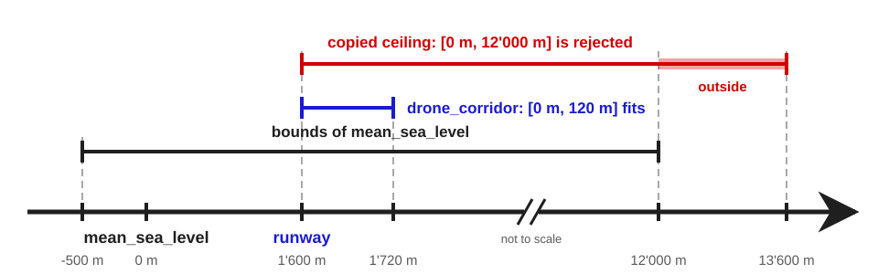

# Revision history

## R0

Initial revision. The design was presented as Section 8 "Range-validated quantity points" of
[@P4185R1]. At Brno 2026, SG6 took the following poll:

**POLL:** _Encourage a split of Section 8 "Range validated quantity points" in P4185R1 into
its own paper so that we can forward it to LEWG. SG6 believes this approach is likely to
increase consensus of P3045R8 "Quantities and units library"_

| SF | F | N | A | SA |
|:--:|:-:|:-:|:-:|:--:|
| 3  | 5 | 1 | 1 | 0  |

**Outcome:** Consensus in favour

Changes since that section:

- written against [@P3045R10_PRE] and its `quantity<point<R, PO>, Rep>` spelling (see
  [Proposed interface](#interface)),
- [Feedback from Brno 2026](#brno-feedback) answered, with worked examples of user-defined
  policies and of a hierarchy of bounded origins,
- [Checking and adjusting policies](#policy-kinds) told apart by the return type of the call
  operator,
- [NaN and infinity](#nan) handling stated for every policy,
- `exclusive_bound` added (see [Excluded ends](#exclusive-bound)),
- [Contract semantics](#contracts) specified: a rejected value is a contract violation by
  default, and `constraint_violation_handler<Rep>` is the opt-in to a wide contract,
- `is_within_bounds` and `try_make` added, for a delta and an origin and for a point of
  another type (see [Validating a value before construction](#bounds-query)),
- exactness rule for bounds and offsets added (see [Bounds the point can hold](#exactness)),
- a point is default-constructible only where its origin lies within its range (see
  [Where the bounds apply](#where)),
- `numeric_limits` at a bounded origin limited to what the bounds define (see
  [`min()`, `max()`, and `numeric_limits`](#limits)), and a point origin takes at most one
  argument after the quantity specification or the origin point, a bounds policy (see
  [Bounds on an origin](#origin-bounds)),
- nesting rule extended across origins without bounds, and a child must bound every side its
  ancestor bounds (see [Bounds of their own](#hierarchy)),
- `min()` and `max()` of a point whose origin has no bounds of its own report the bounds of the
  nearest bounded ancestor (see [`min()`, `max()`, and `numeric_limits`](#limits)),
- [Open questions](#open-questions) added,
- the automatic check on the natural origin of a non-negative quantity moved to [@NON-NEG]
  (see [Interaction with non-negative quantities](#non-negative)).


# Introduction

A _latitude_ lies in $[-90°, 90°]$, a _longitude_ wraps around at $±180°$, a drone may fly
up to $120\ \mathrm{m}$ above the ground, and a clinical thermometer that reports
$51\ \mathrm{°C}$ is broken and its reading must not reach the code that doses a drug.

[@P3045R10_PRE] models each of these values as a point in an affine space, measured from an
origin. It checks dimensions, units, and quantity kinds at compile time. It
doesn't check that a value lies in the domain of its origin, so every function that receives
one has to check it.

This paper attaches a bounds policy to a point origin. The library applies the policy to
the values stored at that origin: on construction, on conversion to another unit,
representation, or origin, on `++` and `--`, and on `+=` and `-=`. A policy either checks the
value or brings it into the range:

```cpp
inline constexpr struct geo_longitude : named_quantity_spec<isq::angular_measure> {} geo_longitude;

inline constexpr struct prime_meridian
  : absolute_point_origin<geo_longitude, wrap_to_range{-180. * deg, 180. * deg}> {} prime_meridian;

template<typename T = double>
using longitude = quantity<point<geo_longitude[deg], prime_meridian>, T>;

longitude<> lon = prime_meridian + 270. * deg;   // stored as -90°
```

The feature is an addition to [@P3045R10_PRE]. An origin without a bounds policy behaves as
it does there.


# Motivation {#motivation}

## A bounded representation type can't see the unit {#rep-bounds}

One way to bound a point is to delegate bounds to the representation: a numeric type whose
constructor rejects a value outside the range. The representation doesn't know the unit, so
the bounds mean nothing once the unit changes. A `bounded<double, 0, 360>` meant for a bearing in
degrees accepts 7 when the same bearing is stored in radians, and 7 rad is about 401°.

A representation can be taught to rescale its bounds with the unit, as the example of
magnitude-aware scaling in [@P3045R10_PRE] shows. It still can't follow a change of origin.
Converting a point to another origin adds an offset to the value. The representation never
sees that offset, so its bounds stay where they were. The bounds also become part of
the representation type: they are restated wherever the type is named, and nothing stops two
representations with different bounds from being used at the same origin.

## Checks at the call site are repeated and forgotten {#call-site-checks}

Another way to bound a point is to check every value where it is used. Here, a trim angle is
measured from an origin `trim_zero` that has no bounds:

```cpp
inline constexpr struct trim_zero : absolute_point_origin<isq::angular_measure> {} trim_zero;

void set_trim(quantity<point<deg, trim_zero>> trim)
{
  const quantity a = trim.delta_from(trim_zero);
  if (a < -10. * deg || a > 10. * deg) throw std::out_of_range("trim angle");
  // ...
}
```

The comparison converts both sides to a common unit, so unlike a bounded representation it
stays correct if `trim` is stored in radians. The other problems remain. The bounds are
written again in every function that takes a trim angle. A caller can't tell whether its value
was validated already, so it checks again or doesn't check at all. For a cyclic domain, every
operation that produces a new value needs its own modulo reduction: turning a bearing by a
given angle, in either direction, can leave $[0°, 360°)$.

## The range belongs to the origin {#bounds-on-origin}

Whether a value is in range depends on the origin it is measured from. An altitude above
mean sea level may lie in $[-500\ \mathrm{m}, 12\,000\ \mathrm{m}]$, and the altitude of a
drone above a runway in $[0\ \mathrm{m}, 120\ \mathrm{m}]$. Both are altitudes in meters,
but they are measured from different origins, and this is why we put the bounds on the
origin:

- different origins of the same quantity may have different bounds,
- converting a point to another origin checks it against the bounds of the target,
- a point type is constrained or unconstrained depending only on its origin,
- the bounds are written once, where the origin is defined.

[Alternatives considered](#alternatives) explains why the bounds are not a parameter of the
point type and not a property of a quantity specification.


# Design {#design}

## Bounds on an origin {#origin-bounds}

`absolute_point_origin` and `relative_point_origin` take an optional bounds policy after the
quantity specification or the origin point. The library recognizes it by its `min` or `max` data
member ([Writing a policy](#writing-a-policy) lists the rest of the requirements), and any other
argument is ill-formed:

```cpp
inline constexpr struct equator
  : absolute_point_origin<geo_latitude, check_in_range{-90. * deg, 90. * deg}> {} equator;

inline constexpr struct ice_point_sensor
  : relative_point_origin<si::ice_point + delta<deg_C>(0.),
                          check_in_range{delta<deg_C>(-40.), delta<deg_C>(85.)}> {} ice_point_sensor;
```

The bounds are deltas from the origin they are attached to, not points. They are
written in any unit, and the policy converts them to the unit and
representation of the value it tests. Bounds given in degrees work for a point stored in
radians:

```cpp
quantity<point<geo_longitude[rad], prime_meridian>> lon{4. * rad, prime_meridian};
// 4 rad is about 229.2°, so the stored value is about -130.8°, or -2.283 rad
```

The trim angle of [Checks at the call site are repeated and forgotten](#call-site-checks) gets its
range the same way, and the check moves from `set_trim` into the construction of the point.
The later examples that name `trim_zero` use this definition:

```cpp
inline constexpr struct trim_zero
  : absolute_point_origin<isq::angular_measure, check_in_range{-10. * deg, 10. * deg}> {} trim_zero;
```

A bounds policy is a template argument, so it adds no storage to the point. The point type
`quantity<point<R, PO>, Rep>` is as large as `Rep`, and it stays trivially copyable whenever
`Rep` is.

## Where the bounds apply {#where}

The library applies the policy of the origin to the values it stores:

- on construction from a delta, with or without the origin,
- on construction from another point, which covers a change of unit, of representation, and
  of origin (`in()`, `point_for()`, and the converting constructors),
- on `++` and `--`, in both forms, and on `+=` and `-=`.

The binary operators `point + quantity`, `point - quantity`, `origin + quantity`, and
`origin - quantity` construct their result, so the result is checked as well. The result of
`point - point` or of `delta_from()` is a delta, not a point, and isn't checked.

Value-initialization, as in `T{}` and `std::vector<T>(n)`, stores a zero delta, which is the origin
itself, without applying the policy. We propose that a point be default-constructible only where its
origin lies within the range of the policy that construction applies. As in the nesting rule of
[Bounds of their own](#hierarchy), the range is that of the policy's `min` and `max`, with the `max`
of `wrap_to_range` always excluded, so the answer is known at compile time for every policy. A
user-defined policy whose test is narrower than its `min` and `max`, as in
[the bands example](#bands), can still reject or move the zero delta when zero falls in a gap of its
domain. At an origin with `check_in_range{10. * m, 20. * m}`, the point type isn't
`std::default_initializable`: `std::vector<T>(n)`, `resize(n)`, and `std::map::operator[]` don't
compile for it, while `std::vector<T>(n, value)` and `resize(n, value)` do. An origin with
`check_in_range{0. * m, 10. * m}`, a wrapping origin such as `prime_meridian`, and, under
[@NON-NEG], the natural origin of a non-negative quantity keep the default constructor.
Default-initialization, `T t;`, leaves the value indeterminate, as it does for the representation.

## Checking and adjusting policies {#policy-kinds}

The return type of a policy's call operator decides what the library does with the result:

- A **checking** policy returns exactly `bool`. It tells whether the value lies in the
  domain, and the library stores the value unchanged or reports the violation (see
  [Contract semantics](#contracts)).
- An **adjusting** policy returns a delta, the value to store. It brings a value into the
  domain, and the library reports no violation for it.

Any other return type is ill-formed. A `bool` is neither a quantity nor a valid
representation of one, so the two kinds can't be confused.

The paper proposes six policies:

| Policy               | Kind      | Range                         | Behavior                       |
|----------------------|-----------|-------------------------------|--------------------------------|
| `check_in_range`     | checking  | `[min, max]`, ends excludable | rejects a value outside        |
| `check_non_negative` | checking  | `[0, +∞]`                     | rejects a negative value       |
| `clamp_to_range`     | adjusting | `[min, max]`                  | stores the nearest end         |
| `clamp_non_negative` | adjusting | `[0, +∞]`                     | stores zero for a negative one |
| `wrap_to_range`      | adjusting | `[min, max)`                  | wraps around, e.g. angles      |
| `reflect_in_range`   | adjusting | `[min, max]`                  | folds back at both ends        |

`check_non_negative` and `clamp_non_negative` exist because many domains are bounded on one
side only, and $[0, +∞]$ is the most common one. They need no argument. A half-line has no
period to wrap around, so there is no `wrap_non_negative`. Reflecting at zero would be `abs()`,
and no `reflect_non_negative` is proposed.

A domain that isn't an interval, or a response the library doesn't offer, takes a
user-defined policy. [Writing a policy](#writing-a-policy) shows several.

## Excluded ends {#exclusive-bound}

A plain quantity given as `min` or `max` is included in the range. `exclusive_bound{q}`
excludes it:

```cpp
inline constexpr struct north
  : absolute_point_origin<geo_bearing, check_in_range{0. * deg, exclusive_bound{360. * deg}}> {} north;
```

`check_in_range` accepts `exclusive_bound` at either end. `wrap_to_range` never produces its
`max`, so its `max` is excluded whether or not it is written as `exclusive_bound`. However,
wrapping can produce `min`, and an excluded `min` is ill-formed there. `clamp_to_range` and
`reflect_in_range` need a value at each end to clamp to or reflect at. This is why they reject
`exclusive_bound` at compile time.

In namespace `std` the name has to say what it qualifies. `exclusive`, `open`, and `excluded`
are too generic, and `std::open` reads as an I/O function.

## Bounds the point can hold {#exactness}

A policy compares the value with each bound in the type of the value: the policy converts the bound
to the quantity type of the point and compares there. It doesn't compare in a common type, because
two quantity types need not compare with each other: a quantity with the `constrained<double>`
representation of [@MP-UNITS] doesn't compare with a bound stored as `double`. Without the rule
proposed below, a bound that the point's quantity type can't hold would therefore be moved before it
is compared, and the range would be checked somewhere else than declared:

```cpp
inline constexpr struct tape_start
  : absolute_point_origin<isq::length, check_in_range{16'777'217 * m, 20'000'000 * m}> {} tape_start;

quantity<point<isq::length[m], tape_start>, float> p{16'777'216.f * m, tape_start};
// as a float, the lower bound is 16'777'216 m, so a value below the declared one passes
```

A relative origin has the same problem with its offset. A point measured from a relative origin
without bounds of its own is translated by the offset into the frame of the ancestor whose
bounds apply. With an integral representation, an offset of `0.5 * m` becomes 0 m, and an
offset of `1'500 * m` becomes 1 km in a point stored in `int` kilometers.

We propose that every constant the check uses be exact in the type the check runs in:

1. Each bound converts to the point's quantity type, translated into the frame of the origin
   whose bounds apply, without changing its value.
2. With a representation that isn't a floating-point one, the offset into that frame converts to
   the point's quantity type without changing its value.

A point that breaks the rule offers no constructor from a delta, no `is_within_bounds`, no
`try_make`, no `min()`, and no `max()`. These functions reject it through their constraints, so
a generic algorithm can test for it. Other operations on such a point, such as a conversion from
another point or `+=`, are ill-formed when used. The `min` and `max` members of a user-defined
policy are subject to the same rule.

A floating-point representation is treated differently in two places:

- Unit scaling of a bound rounds and is accepted. A bound written in feet and checked in
  a point stored in meters is multiplied by 0.3048, which has no exact binary form. Requiring
  exactness there would make a bound in most other units ill-formed for a floating-point point.
  Only the conversion of the representation, in the bound's own unit, has to be exact.
- An offset rounds and is accepted, for the same reason. That is the rounding the nesting
  rule of [Bounds of their own](#hierarchy) already allows for.

The rule has a cost for a `float` point. `0.1 * m` is a `double`, and the `double` value of
`0.1` isn't a `float` value, so this origin can't be used with a `float` point:

```cpp
inline constexpr struct tape_end
  : absolute_point_origin<isq::length, check_in_range{0.1 * m, 10. * m}> {} tape_end;
inline constexpr struct tape_end_f
  : absolute_point_origin<isq::length, check_in_range{0.1f * m, 10.f * m}> {} tape_end_f;

quantity<point<isq::length[m], tape_end>> a{0.5 * m, tape_end};               // OK
quantity<point<isq::length[m], tape_end_f>, float> b{0.5f * m, tape_end_f};   // OK
// quantity<point<isq::length[m], tape_end>, float> c{0.5f * m, tape_end};    // ill-formed
```

The `float` point needs an origin with bounds written as `float`, such as `tape_end_f`. A bound
with a small integral value, such as `-90. * deg`, is exact in `float`, which holds every
integer up to $2^{24}$.

Author preference is this rule. It rejects code that combines a `float` point with
`double` bounds, and SG6 may prefer to accept rounding for floating-point points altogether. The
options are discussed in [Exactness for floating-point points](#exactness-question).

## NaN and infinity {#nan}

A floating-point value can be NaN or infinite. Each policy states what it does with them:

| Policy                              | NaN           | ±∞                           |
|-------------------------------------|---------------|------------------------------|
| `check_in_range`                    | rejected      | rejected                     |
| `check_non_negative`                | rejected      | `+∞` accepted, `-∞` rejected |
| `clamp_to_range`                    | stored as NaN | nearest end                  |
| `clamp_non_negative`                | stored as NaN | `+∞` stored, `-∞` gives 0    |
| `wrap_to_range`, `reflect_in_range` | stored as NaN | stored as NaN                |

The checking policies are written as a positive test, `min <= v && v <= max`, so a value that
compares unordered with the bounds fails it. A NaN never passes a check. `check_non_negative`
has no upper bound to compare with, so it accepts `+∞`. The clamping policies compare
`v < min` and `v > max`, both false for NaN, so NaN passes through them unchanged. An infinite
value has no position after it is wrapped or reflected, so the wrapping and reflecting
policies return NaN for an infinite or NaN input.

`wrap_to_range` and `reflect_in_range` bring any finite value into the range, however far outside it
lies. For an integral representation they take the exact remainder, provided that the period fits in
the representation. For a floating-point one they subtract multiples of the period that double in
size, so a value far outside the range doesn't need a step per period. A wrapped value never equals
`max`: a floating-point result that rounds onto `max` is stored as `min`, which is the same point of
the circle.

## Contract semantics {#contracts}

What happens to a value that a checking policy rejects depends on the representation type.

### A precondition by default {#precondition}

By default, the operations that store a value have a narrow contract. A value that the
applied checking policy rejects violates the precondition of the operation that stores it.
This applies to every operation listed in [Where the bounds apply](#where). For the
constructor from a value and an origin:

```cpp
template<quantity_reference auto R, representation_of<get_quantity_spec(R)> Rep>
class quantity {
public:
  // a member of a point only, where R is point<R2, PO>
  template<typename FwdQ>
  constexpr quantity(FwdQ&& q, decltype(PO) origin)
    pre(/* q satisfies the checking policy applied at PO,
           unless constraint_violation_handler<Rep> is specialized */);
  // ...
};
```

We propose that the precondition be a contract assertion [@P2900R14], so that violating it
has the behavior of the evaluation semantic and isn't undefined behavior:

- with _ignore_, the predicate isn't evaluated and the value is stored,
- with _observe_, the contract-violation handler is called and, if it returns, the value is
  stored,
- with _enforce_, the handler is called and the program is terminated if it returns,
- with _quick-enforce_, the program is terminated without calling the handler.

A program that validates its inputs elsewhere can turn the checks off to avoid any overhead, while a
safety-critical build can enforce them. A plain _Preconditions_ element wouldn't give this behavior,
because violating it is undefined behavior. A hardened precondition [@P3471R4] wouldn't either,
because only a hardened implementation checks it. How the wording spells the contract assertion is
for LEWG to decide.

An adjusting policy places no precondition on the value, and neither does an origin without
bounds. Operations on such a point have a wide contract. Their behavior doesn't depend on the
evaluation semantic, unless the policy contains an assertion of its own (see
[Rounding noise and real errors](#tolerance)).

### A wide contract with a handler {#handler}

Some code needs the check in every build, for example a control loop that must not run on a
corrupted value. For it, a representation type can specialize `constraint_violation_handler`:

```cpp
class checked_double { /* ... */ };

template<>
struct std::constraint_violation_handler<checked_double> {
  static void on_violation(std::string_view msg) { throw std::domain_error(std::string(msg)); }
};
```

When the specialization exists, the operations that store a value at a point with that
representation have no precondition on the value. The library calls `on_violation` for every
value a checking policy rejects, whatever the evaluation semantic. It does so before the value
is stored, so a handler that throws leaves the point unchanged. The handler may throw,
terminate, or log and return. If it returns, the value is stored unchanged.

The handler is chosen by the representation, not by the origin. With the origin `trim_zero`
of [Bounds on an origin](#origin-bounds), a front end that must never
store an invalid value can use `quantity<point<deg, trim_zero>, checked_double>`, and a solver
can use `quantity<point<deg, trim_zero>, double>` with the checks turned off. Both share the origin,
its bounds, and the conversions between them.

[@MP-UNITS] also provides `constrained<T, ErrorPolicy>`, a wrapper that specializes the
handler for any `T`, with a `throw_policy` and a `terminate_policy`. It isn't proposed here.
It is a convenience that can be proposed later on top of the customization point.

### During constant evaluation {#constexpr}

Every proposed policy and every operation that applies one is usable in constant expressions.
Without a handler, a violation during constant evaluation follows the evaluation semantic that the
implementation chooses for that evaluation ([basic.contract.eval]{.sref}). With a terminating
semantic, a violation in a manifestly constant-evaluated context, such as the initializer of a
`constexpr` variable, makes the program ill-formed. With _observe_ the implementation issues a
diagnostic, and with _ignore_ the value is accepted:

```cpp
// 11° is outside [-10°, 10°]: ill-formed under enforce or quick-enforce
constexpr quantity<point<deg, trim_zero>> trim{11. * deg, trim_zero};
```

With a handler, a `constexpr` variable initialized from a rejected value is ill-formed unless
the handler is usable in constant expressions and returns.

## Validating a value before construction {#bounds-query}

A value that comes from outside the program, such as a sensor reading or a field of a
message, has to be tested and rejected without stopping the program. Neither path above
returns the outcome to the caller: a precondition isn't meant to be violated, and a handler
reports through an exception or not at all. Without help, the caller reads the bounds back and
writes the comparison by hand.

The paper proposes two static member functions of the point type, a query, `is_within_bounds`,
and `try_make`, built on it:

```cpp
using trim_angle = quantity<point<deg, trim_zero>>;

std::optional<trim_angle> parse_trim(quantity<deg> raw)
{
  if (!trim_angle::is_within_bounds(raw, trim_zero)) return std::nullopt;
  return trim_angle{raw, trim_zero};
}

std::expected<trim_angle, bounds_violation> make_trim(quantity<deg> raw)
{
  return trim_angle::try_make(raw, trim_zero);
}
```

`is_within_bounds` returns `true` when constructing the point from the same arguments would not
report a violation. It doesn't construct the point it is asked about. It converts the value to the
point's quantity type and calls the predicate of the policy that construction applies, so it also
works with a user-defined checking policy. With the proposed checking policies, it returns `false`
for NaN.

`try_make` returns the point, or a `bounds_violation`, which has no data members. It tests the value
once. A rejected value is never stored, and a value that passes is stored without being tested
again. The outcome therefore doesn't depend on a handler or on the evaluation semantic. It is the
wide-contract counterpart of the constructor. A user can write the same function over
`std::optional` or an in-house error type from `is_within_bounds` and the constructor, as
`parse_trim` does. However, the constructor then tests the value a second time.

`is_within_bounds` and `try_make` are offered when the policy that construction applies is a
checking one, and for a point without bounds, where `is_within_bounds` always returns `true`. An
adjusting policy accepts every value but may store it changed, so `true` wouldn't say whether the
point stores the value it is given. Neither is offered for a point that breaks the rule of [Bounds
the point can hold](#exactness).

A value can also arrive as a point of another type: measured from another origin with the same
absolute origin, stored in another unit or representation, or imported from a type that
`quantity_like_traits` describes as a point with the same absolute origin. Both functions also take
such a point, and test the conversion that constructing the point from it performs. Here a
`trim_angle` is converted to a point measured from a narrower origin:

```cpp
inline constexpr struct takeoff_trim
  : relative_point_origin<trim_zero + 0. * deg, check_in_range{-5. * deg, 5. * deg}> {} takeoff_trim;

using takeoff_angle = quantity<point<deg, takeoff_trim>>;

std::expected<takeoff_angle, bounds_violation> for_takeoff(trim_angle trim)
{
  return takeoff_angle::try_make(trim);
}
```

Both functions are members of the point type and not functions in namespace `std`. A free
`std::try_make<T>(args...)` reads as the fallible construction of any `T`, a facility that has
nothing to do with quantities, and taking that name for points would block it. A free
`std::is_within_bounds<T>(args...)` reads just as generically. Neither can be a hidden friend,
because the point type appears only as an explicit template argument, which doesn't take part in
argument-dependent lookup. As members, they still let the caller name the point type once, as
with `min()` and `max()`, which are static members of the point type already. `try_from` was
considered and rejected: it names a conversion, while `try_make` constructs a point, as the
constructor it wraps does.

## `min()`, `max()`, and `numeric_limits` {#limits}

A bounded point type reports its bounds through its static `min()` and `max()` and through
`std::numeric_limits`, instead of the limits of its representation. For a point, `min()` and
`lowest()` of `numeric_limits` both return the lower bound:

```cpp
static_assert(longitude<>::min().delta_from(prime_meridian) == -180. * deg);
static_assert(std::numeric_limits<longitude<>>::lowest() == longitude<>::min());
// longitude<>::max() doesn't exist: the max of wrap_to_range is excluded
```

An excluded end has no value in the range, so neither the point type nor `numeric_limits`
provides `min()` for an excluded lower end or `max()` for an excluded upper end. Neither is
provided for a point that breaks the rule of [Bounds the point can hold](#exactness).

A point whose origin has no bounds of its own reports the bounds of its nearest bounded
ancestor, translated into its own frame. With a floating-point representation the translation
rounds, and the rounded value may be one that the ancestor rejects:

```cpp
inline constexpr struct strip_start
  : absolute_point_origin<isq::length, check_in_range{0.1 * m, 0.9 * m}> {} strip_start;
inline constexpr struct strip_mark : relative_point_origin<strip_start + 0.7 * m> {} strip_mark;

using strip_point = quantity<point<isq::length[m], strip_mark>>;

// 0.1 m - 0.7 m = -0.6 m, but -0.6 m + 0.7 m rounds to 0.09999999999999998 m
static_assert(strip_point::min().delta_from(strip_mark) == -0.5999999999999999 * m);
static_assert(strip_point::max().delta_from(strip_mark) == 0.2000000000000001 * m);
// one step above 0.9 m - 0.7 m still translates back to 0.9 m
```

We propose to specify `min()` by what it guarantees: it returns the lowest value of the point
type that, translated as construction translates it, isn't below the lower bound of the
ancestor, and `max()` the highest that isn't above its upper bound. The translated bound as
computed, -0.6 m here, is below the ancestor's lower bound once it is translated back.
[@MP-UNITS] translates the bound once, from the ancestor that declares it, and then moves the
result by one representable value at a time until it is the extreme one that the policy
accepts. With an integral representation the translation is exact and no step is taken.

The other members of `numeric_limits`, `epsilon()`, `round_error()`, `infinity()`, `quiet_NaN()`,
`signaling_NaN()`, and `denorm_min()`, construct a point from a value of the representation. At an
origin with bounds, its own or inherited, the policy would check or change that value. At an origin
with `check_in_range`, `quiet_NaN()` would violate the precondition in a `noexcept` function, and at
an origin with `clamp_to_range{10. * deg, 20. * deg}`, `infinity()` would return 20° and `epsilon()`
10°. We propose that `numeric_limits` not provide these members for a point whose origin has bounds,
even where a policy accepts the value, and that `has_infinity`, `has_quiet_NaN`,
`has_signaling_NaN`, and `is_iec559` be `false` there.

## Relative origins {#relative}

### Inheriting the bounds of an ancestor {#inherit}

A `relative_point_origin` without bounds of its own is checked against the bounds of its
nearest bounded ancestor. The library translates the value into the frame of that ancestor,
applies its policy there, and translates the result back. When an adjusting policy changes
nothing, the original value is stored, so that a round trip through a floating-point offset
can't change it. With a representation that isn't a floating-point one, the offset has to be
exact in it (see [Bounds the point can hold](#exactness)):

```cpp
inline constexpr struct mean_sea_level
  : absolute_point_origin<isq::altitude, check_in_range{-500. * m, 12'000. * m}> {} mean_sea_level;

inline constexpr struct runway : relative_point_origin<mean_sea_level + 1'600. * m> {} runway;

quantity<point<isq::altitude[m], runway>> a{8'000. * m, runway};   // OK: 9'600 m above sea level
quantity<point<isq::altitude[m], runway>> b{11'000. * m, runway};  // violation: 12'600 m
```

The policy runs once, on one translated value, however many origins lie between the point
and the ancestor. The offset is computed at compile time.

### Bounds of their own {#hierarchy}

A relative origin may also declare bounds of its own, usually because it describes something
more restricted than its parent, for example a drone corridor above a runway, or a room
inside a building whose HVAC system covers a wider range. Then only the child's policy is
applied, again once. That is sound only if every value inside the child's bounds is also
inside the bounds of every origin above it, so the library checks this at compile time:

```cpp
inline constexpr struct drone_corridor
  : relative_point_origin<runway + 0. * m, check_in_range{0. * m, 120. * m}> {} drone_corridor;
// [1'600 m, 1'720 m] above sea level fits in [-500 m, 12'000 m]
```

The check catches a mistake like this one, where a maintainer copies the ceiling of the
sea-level frame into the corridor:

```cpp
inline constexpr struct drone_corridor
  : relative_point_origin<runway + 0. * m, check_in_range{0. * m, 12'000. * m}> {} drone_corridor;
```

This corridor ends 13'600 m above sea level, and a point at 11'000 m above the runway,
12'600 m above sea level, would pass its check. Without the nesting rule, the error surfaces
at runtime, as a value that is
valid for one origin and invalid for the other. With it, the program is ill-formed:

```text
error: static assertion failed: relative origin upper bound violates the bounds of an origin above it
```

<!-- markdownlint-disable-next-line MD013 MD033 -->


The rule is this. Let `B` be a relative origin with bounds of its own, and `A` the nearest
origin above `B` that has bounds. Origins without bounds between them are skipped. Then:

1. The bounds of `B`, translated into the frame of `A`, lie within the bounds of `A`.
2. If `A` bounds a side, `B` bounds it too. A corridor with only `check_non_negative{}` is
   rejected, because nothing would check its upper side against the sea-level ceiling.
3. The ends are compared through the `min` and `max` members of the two policies, by value
   and by whether each end is excluded. Where `A` excludes an end that `B` includes, the end
   of `B` lies strictly inside the range of `A`.

Rule 3 catches a mistake that is harder to see than the copied ceiling. The western half of the
compass, measured from south, ends where `north` of [Excluded ends](#exclusive-bound) ends:

```cpp
inline constexpr struct western_half
  : relative_point_origin<north + 180. * deg, check_in_range{0. * deg, 180. * deg}> {} western_half;
```

Both ranges end at 360° from `north`, but `western_half` includes that value, and `north`
excludes it. Using `western_half` is ill-formed, with the same error as the copied ceiling.
`check_in_range{0. * deg, exclusive_bound{180. * deg}}` is accepted, and so is an included end
inside the range of `north`, such as `179.9 * deg`.

Every bounded origin is checked against its nearest bounded ancestor, and that ancestor
against its own, so a value inside the bounds of `B` lies between the `min` and `max` of every
bounded origin above it. With floating-point offsets this holds up to the rounding of the
translation. Two cases fall outside the guarantee. A policy whose test is narrower than
`[min, max]`, such as [the bands example](#bands), may reject a value the child accepts. And a
child policy that lets NaN through, such as `clamp_to_range`, can store a NaN that the
ancestor's check would reject when the point is converted to the ancestor's origin.

The check runs when the bounds of the origin are first used: on construction of a point, in
arithmetic, in `is_within_bounds`, `try_make`, `min()`, and `max()`. Defining the origin or
naming a point type doesn't trigger it. The check costs nothing at runtime.

For the user, the rule is short: a child's range must fit inside the range of its nearest bounded
ancestor. The compile-time check lets the library apply only one policy at runtime. The alternative,
applying every policy up the chain on every store, costs a check per level and needs a rule for
which policy wins when they disagree, for example when a child clamps and its parent rejects.

## Interaction with non-negative quantities {#non-negative}

[@NON-NEG] proposes a `non_negative` property of a quantity specification. With it, the
natural origin of a non-negative quantity gets `check_non_negative` automatically:

```cpp
quantity d1 = point<isq::distance[m]>(5.);   // OK
quantity d2 = point<isq::distance[m]>(-1.);  // contract violation
```

The automatic check applies only to `natural_point_origin<QS>`. A user-defined origin
chooses its own policy, or none, because it may represent a calibrated offset or a tare where
negative values are expected. A point of a quantity kind, such as `point<m>(5.)`, isn't
checked, because `kind_of<isq::length>` covers signed quantities too.

Nothing in this paper depends on [@NON-NEG]. Without it, a user attaches `check_non_negative`
to an origin explicitly, and the automatic attachment is the only thing missing.


# Writing a policy {#writing-a-policy}

A policy is a structural type with:

- a `min` data member, a `max` data member, or both, which declare the extent of its domain
  and feed `min()`, `max()`, `numeric_limits`, and the nesting rule,
- a `const` call operator, usually a template over the quantity type `V` it receives, which
  is the delta from the origin that owns the policy, in the unit and representation of
  the point,
- a return type of `bool` for a checking policy or a delta for an adjusting one.

Every example below was compiled and run against [@MP-UNITS] master, respelled to its
`quantity_point<R, PO, Rep>`. The one that uses `contract_assert` needs GCC 16 with
`-fcontracts`.

## A domain that isn't an interval {#bands}

A transmitter may be tuned only inside its licensed bands. The domain is a union of two
intervals, which `check_in_range` can't express:

```cpp
struct vhf_uhf_bands {
  quantity<MHz> min = 144 * MHz;
  quantity<MHz> max = 440 * MHz;

  template<delta_quantity V>
  constexpr bool operator()(const V& f) const
  {
    return (f >= V{144 * MHz} && f <= V{148 * MHz}) || (f >= V{430 * MHz} && f <= V{440 * MHz});
  }
};

inline constexpr struct carrier_zero
  : absolute_point_origin<isq::frequency, vhf_uhf_bands{}> {} carrier_zero;

using carrier = quantity<point<kHz, carrier_zero>>;

static_assert(carrier::min().delta_from(carrier_zero) == 144 * MHz);
bool ok = carrier::is_within_bounds(435. * MHz, carrier_zero);   // true
bool no = carrier::is_within_bounds(200. * MHz, carrier_zero);   // false
```

`min` and `max` declare the extent of the domain, not every gap in it. A relative origin under
`carrier_zero` in the hierarchy without bounds of its own is checked with the band test itself. One
with bounds of its own is compared by the nesting rule against the extent,
$[144, 440]\ \mathrm{MHz}$, so the rule accepts a child range that covers the gap between the bands.
A value in that gap stored at such a child isn't tested against the bands.

## NaN for a value outside the physics {#nan-policy}

A value outside what the physics allows can be stored as NaN instead of being rejected. That
is an adjusting policy:

```cpp
template<delta_quantity Q>
struct nan_outside_range {
  Q min;
  Q max;

  template<delta_quantity V>
    requires std::numeric_limits<typename V::rep>::has_quiet_NaN
  constexpr V operator()(const V& v) const
  {
    if (v >= V{min} && v <= V{max}) return v;
    return std::numeric_limits<V>::quiet_NaN();
  }
};

inline constexpr struct ambient_zero
  : relative_point_origin<si::ice_point + delta<deg_C>(0.),
                          nan_outside_range{delta<deg_C>(-60.), delta<deg_C>(60.)}> {} ambient_zero;

quantity t = ambient_zero + delta<deg_C>(85.);  // stored as NaN
```

The `requires` clause rejects an integral representation, which has no NaN to store. A NaN
input fails the test and is stored as NaN again.

## Rounding noise and real errors {#tolerance}

A value in a non-negative domain often comes out slightly negative because of rounding.
`clamp_non_negative` hides that, and it also hides a value that is negative because of a bug. A
policy can tell the two apart:

```cpp
template<delta_quantity Q>
struct snap_within_tolerance {
  Q min;
  Q max;
  Q tolerance;

  template<delta_quantity V>
  constexpr V operator()(const V& v) const
  {
    contract_assert(v >= V{min - tolerance} && v <= V{max + tolerance});
    if (v < V{min}) return V{min};
    if (v > V{max}) return V{max};
    return v;
  }
};

inline constexpr struct tank_bottom
  : absolute_point_origin<isq::height, snap_within_tolerance{0. * m, 2. * m, 1e-9 * m}> {} tank_bottom;

quantity l1 = tank_bottom - 1e-12 * m;  // stored as 0 m
quantity l2 = tank_bottom - 0.1 * m;    // contract violation in the policy
```

As this policy is an adjusting one, the storing operation has no precondition, and
`is_within_bounds` isn't offered. The violation is reported by the policy's own
`contract_assert`, which follows the evaluation semantic like any other assertion.

## State in a policy {#stateful}

A policy is a template argument, so its non-static data members are compile-time constants. Any
mutable state it uses has static or thread storage duration: a static member or local variable, or
an object the policy points or refers to. Such state behaves as a global does, and every point
checked by the policy shares it: at the origin, at the origins that inherit its bounds, and at any
other origin that uses the same policy. This paper doesn't propose per-object state:

- State stored in the point makes `sizeof(quantity<point<R, PO>, Rep>)` larger than
  `sizeof(Rep)`, for every point at the origin.
- Bounds known only at runtime can't be checked by the nesting rule and can't be reported by
  `min()`, `max()`, and `numeric_limits`, which are static.
- Two points at the same origin could hold different state. Assigning, comparing, or adding
  them needs a rule for which state wins, the problem that allocators have and that
  [A policy parameter of the point type](#policy-in-type) argues against.

State of one value can live in its representation type. The handler of
[A wide contract with a handler](#handler) is chosen by the representation, and a
representation can carry per-value data of its own.

## Measurement uncertainty {#uncertainty}

A measurement is an observed value and an error distribution, and the distribution may extend
past the bounds. A policy sees the value that is about to be
stored, in the representation of the point. For `double`, that is the estimate, and the policy
decides about the estimate alone.

A measured mass of $-0.2 ± 0.5\ \mathrm{kg}$ is a valid output of an estimator, even though no
mass is negative. Storing it at an origin that checks non-negativity is a violation. The program
keeps it as a plain quantity, or at an origin without bounds, and constructs the checked
point once it has decided which value to use.

A representation that carries an uncertainty, such as `uncertain<T>` of [@MP-UNITS], can be used
with a user-defined checking policy that receives the whole value and tests, for example, whether
the interval of one standard uncertainty around the estimate overlaps the domain:

```cpp
template<delta_quantity Q>
struct overlaps_range {
  Q min;
  Q max;
  template<delta_quantity V>
  constexpr bool operator()(const V& v) const
  {
    const auto& m = v.numerical_value_ref_in(V::unit);
    return m.upper_bound() >= min.numerical_value_in(V::unit) &&
           m.lower_bound() <= max.numerical_value_in(V::unit);
  }
};

inline constexpr struct scale_zero
  : absolute_point_origin<isq::mass, overlaps_range{0. * kg, 1000. * kg}> {} scale_zero;

using reading = quantity<point<isq::mass[kg], scale_zero>, uncertain<double>>;

static_assert(reading::is_within_bounds(uncertain{-0.2, 0.5} * kg, scale_zero));
static_assert(!reading::is_within_bounds(uncertain{-0.9, 0.5} * kg, scale_zero));
```

The point type still reports 0 kg and 1000 kg as its `min()` and `max()`, so the estimate of an
accepted value may lie outside them.

The proposed checking policies compare the value with each bound in the order of the
representation. The order of `uncertain<T>` compares the estimates only, so
`check_in_range{0. * kg, 1000. * kg}` accepts $1000 ± 0.5\ \mathrm{kg}$, as it accepts
$0 ± 0.5\ \mathrm{kg}$, and it rejects $-0.2 ± 0.5\ \mathrm{kg}$. If the order also compared
the uncertainties, as a defaulted `operator<=>` does, both $0 ± 0.5\ \mathrm{kg}$ and
$1000 ± 0.5\ \mathrm{kg}$ would compare greater than the bound they lie on. The first would be
accepted and the second rejected.


# Feedback from Brno 2026 {#brno-feedback}

SG6 reviewed Section 8 of [@P4185R1] at Brno 2026.

| Feedback                                                    | Source            | Answer                                |
|-------------------------------------------------------------|-------------------|---------------------------------------|
| Write examples of a checker                                 | Action item       | [Writing a policy]                    |
| Can an out-of-physics value be stored as NaN?               | Participant       | [NaN for a value outside the physics] |
| Can a checker carry state, like an allocator, not a global? | Participant       | [State in a policy]                   |
| Must bounds be part of the library, or can they be layered? | Participant       | [Alternatives considered]             |
| A measurement's error distribution may exceed the bounds    | Participant       | [Measurement uncertainty]             |
| Rounding can push a non-negative value below zero           | Participant       | [Rounding noise and real errors]      |
| Hierarchical bounds look too complex, add an example        | Participant       | [Bounds of their own]                 |
| Split the section into its own paper                        | Participant, poll | this paper                            |
| The section isn't ready, explore more                       | Against vote      | [Open questions]                      |

Earlier reviews raised the same subject. At Sofia 2025, a participant asked for runtime bounds
checking, and another pointed out that preconditions are checks that HPC code can turn off. At
Croydon 2026, a participant asked that the response to a negative value of a non-negative
quantity be customizable, and another asked to see the possible error policies with their
consequences and a recommendation. The recommendation of this paper is a precondition by default,
with the evaluation semantic deciding what a violation does (see [Contract semantics](#contracts)).
An adjusting policy serves a domain where a value should be corrected, and a handler serves code
where a check must run in every build.


# Alternatives considered {#alternatives}

## A policy parameter of the point type {#policy-in-type}

The policy could be a template parameter of the point type, so that one origin could be used
with different policies in different parts of a program. Two points that differ only in their
policy would then be distinct types. Assigning one to another, comparing them, or passing them
to generic code would need conversions, the same burden that `std::vector<T, Alloc>` imposes
when two allocators differ. The bounds describe the frame of measurement, so they are
declared where the frame is defined. What happens to a rejected value, which may reasonably
differ between two parts of one program, is chosen by the representation and by the
evaluation semantic.

## Bounded variants as distinct quantities {#bounds-no-hierarchy}

`altitude_msl` and `altitude_agl` could be siblings in the quantity hierarchy, each with its
own bounds. This fails on several counts:

1. Altitude is measured from mean sea level, the ground, the WGS 84 ellipsoid, the geoid, a
   pressure surface, and more. Every constraint would add a name for the same quantity.
2. Converting `altitude_agl` to `altitude_msl` needs the elevation of the ground. Conversions
   in the quantity hierarchy are the same for every value, while each runway or site has its
   own elevation. A relative origin per site holds it. An elevation known only at runtime
   is out of scope for both designs.
3. Subtracting two points of one variant must yield the same delta quantity for both variants.
   If it does, `altitude_msl - altitude_agl` also yields that delta and silently ignores
   the offset between the frames. Separate deltas per variant fix that and break every
   algorithm written for the shared delta. With origins, subtracting two points measured from
   related origins applies the offset between them, and points measured from unrelated
   origins can't be subtracted at all.
4. The ISQ defines _altitude_ without a range. The range of a particular coordinate system or
   regulation isn't part of the physical quantity, and it changes without the physics
   changing.

## Bounds layered on top of the library {#layered}

Bounds could be layered on top of the library instead of being part of it. A wrapper type around a
point can check its own constructor. It can't make the library's operations check the result: `+=`,
`in()`, `point_for()`, and `point + quantity` on the wrapped point produce unchecked values, and the
wrapper has to re-implement each of them. It also can't give a relative origin the bounds of its
parent, because the library converts between origins and the wrapper never sees that conversion.

## Coupled constraints {#coupled}

Some domains couple several values. Reflecting a latitude at a pole also moves the longitude
by 180°, and polar coordinates couple $r ≥ 0$ with the range of the angle. A policy sees one
value and can't express that. A type that holds both coordinates enforces the coupled rule in
its constructor, as `geographic.h` in the examples of [@MP-UNITS] does. This paper doesn't
propose support for it.


# Proposed interface {#interface}

This section lists the declarations the paper adds to [@P3045R10_PRE], in the style of its
synopsis. Wording follows once SG6 and LEWG confirm the design.

```cpp
namespace std {

// point origins: Args is empty or a single bounds policy
template<quantity_spec auto QS, auto... Args>
struct absolute_point_origin : @$point-origin-interface$@ {};

template<point_quantity auto QP, auto... Args>
struct relative_point_origin : @$point-origin-interface$@ {};

// excluded end of a range
template<delta_quantity Q>
struct exclusive_bound {
  Q value;
};

// checking policies
template<@$range-bound$@ Lo, @$range-bound$@ Hi>
struct check_in_range {
  Lo min;
  Hi max;
  template<delta_quantity V>
  constexpr bool operator()(const V& v) const;
};

struct check_non_negative {
  @$zero-bound$@ min;
  template<delta_quantity V>
  constexpr bool operator()(const V& v) const;
};

// adjusting policies
template<delta_quantity Q>
struct clamp_to_range {
  Q min;
  Q max;
  template<delta_quantity V>
  constexpr V operator()(V v) const;
};

struct clamp_non_negative {
  @$zero-bound$@ min;
  template<delta_quantity V>
  constexpr V operator()(V v) const;
};

template<delta_quantity Q>
struct wrap_to_range {
  Q min;
  exclusive_bound<Q> max;
  constexpr wrap_to_range(Q min, Q max);
  constexpr wrap_to_range(Q min, exclusive_bound<Q> max);
  template<delta_quantity V>
  constexpr V operator()(V v) const;
};

template<delta_quantity Q>
struct reflect_in_range {
  Q min;
  Q max;
  template<delta_quantity V>
  constexpr V operator()(V v) const;
};

// opt-in to a wide contract; a specialization provides
// static void on_violation(string_view msg) and is declared before the point type is used
template<typename Rep>
struct constraint_violation_handler;  // not defined

// validation before construction
struct bounds_violation {
  friend constexpr bool operator==(const bounds_violation&, const bounds_violation&) = default;
};

template<quantity_reference auto R, representation_of<get_quantity_spec(R)> Rep>
class quantity {
public:
  // ...
  // members of a point only, where R is point<R2, PO>
  quantity() requires @_see below_@ = default;
  template<typename FwdQ>
    static constexpr bool is_within_bounds(FwdQ&& q, decltype(PO) po);
  template<typename FwdQ>
    static constexpr bool is_within_bounds(FwdQ&& q);  // PO == default_point_origin(R2)
  template<typename QP>
    static constexpr bool is_within_bounds(const QP& qp);
  template<typename FwdQ>
    static constexpr expected<quantity, bounds_violation> try_make(FwdQ&& q, decltype(PO) po);
  template<typename FwdQ>
    static constexpr expected<quantity, bounds_violation> try_make(FwdQ&& q);  // PO == default_point_origin(R2)
  template<typename QP>
    static constexpr expected<quantity, bounds_violation> try_make(const QP& qp);
};

}
```

`Args` of a point origin is empty or a single bounds policy. The default constructor of a point is
offered only where its origin lies within its range, as described in
[Where the bounds apply](#where). `$range-bound$` is satisfied by a delta and by a specialization of
`exclusive_bound`. `$zero-bound$` is an exposition-only type that represents zero in any unit. The
deduction guides of `clamp_to_range`, `reflect_in_range`, and `wrap_to_range` reject
`exclusive_bound` where [Excluded ends](#exclusive-bound) says so. The static `min()` and `max()` of
the point type gain the constraints of [`min()`, `max()`, and `numeric_limits`](#limits). The
constructors from a delta, the default constructor, `is_within_bounds`, `try_make`, `min()`, and
`max()` gain the constraint of [Bounds the point can hold](#exactness). `is_within_bounds(qp)` takes
a point of another type with the same absolute origin, or a value whose `quantity_like_traits`
describe such a point, provided that the point type is constructible from it. Each `try_make` is
offered when the `is_within_bounds` overload with the same parameters is.

The `numeric_limits` specialization of [@P3045R10_PRE] changes for a point at a bounded origin:

```cpp
namespace std {

template<auto R, typename Rep>
  requires numeric_limits<Rep>::is_specialized
class numeric_limits<quantity<R, Rep>> : public numeric_limits<Rep> {
public:
  // unchanged: min() and max() return the static min() and max() of the point type,
  // and lowest() returns min()
  static constexpr quantity<R, Rep> min() noexcept
    requires requires { quantity<R, Rep>::min(); };
  static constexpr quantity<R, Rep> max() noexcept
    requires requires { quantity<R, Rep>::max(); };
  static constexpr quantity<R, Rep> lowest() noexcept
    requires requires { quantity<R, Rep>::min(); };

  // changed for a point at a bounded origin
  static constexpr bool has_infinity = !@$bounded-point$@<R> && numeric_limits<Rep>::has_infinity;
  static constexpr bool has_quiet_NaN = !@$bounded-point$@<R> && numeric_limits<Rep>::has_quiet_NaN;
  static constexpr bool has_signaling_NaN =
    !@$bounded-point$@<R> && numeric_limits<Rep>::has_signaling_NaN;
  static constexpr bool is_iec559 = !@$bounded-point$@<R> && numeric_limits<Rep>::is_iec559;

  static constexpr quantity<R, Rep> epsilon() noexcept
    requires (!@$bounded-point$@<R>) && requires { numeric_limits<Rep>::epsilon(); };
  static constexpr quantity<R, Rep> round_error() noexcept
    requires (!@$bounded-point$@<R>) && requires { numeric_limits<Rep>::round_error(); };
  static constexpr quantity<R, Rep> infinity() noexcept
    requires (!@$bounded-point$@<R>) && requires { numeric_limits<Rep>::infinity(); };
  static constexpr quantity<R, Rep> quiet_NaN() noexcept
    requires (!@$bounded-point$@<R>) && requires { numeric_limits<Rep>::quiet_NaN(); };
  static constexpr quantity<R, Rep> signaling_NaN() noexcept
    requires (!@$bounded-point$@<R>) && requires { numeric_limits<Rep>::signaling_NaN(); };
  static constexpr quantity<R, Rep> denorm_min() noexcept
    requires (!@$bounded-point$@<R>) && requires { numeric_limits<Rep>::denorm_min(); };
};

}
```

`$bounded-point$<R>` is `true` when `R` is `point<R2, PO>` and `PO`, or one of its ancestors, has
bounds.


# Implementation experience {#implementation}

The design is implemented in [@MP-UNITS]: on its master branch in the `quantity_point<R, PO, Rep>`
spelling of the 2.x releases, and on its version 3 branch, which implements [@P3045R10_PRE], in
the spelling of this paper. It has been public since April 2026 [@MP-UNITS-BLOG]. It was prompted
by feedback at Croydon 2026 and by a user of geodetic coordinates who found no way to express the
different wrapping rules of latitude and longitude [@MP-UNITS-782].

Compile-time tests cover every policy, the nesting rule, the exactness rule, and `min()`, `max()`,
and `numeric_limits`. Runtime tests cover the handler, `is_within_bounds`, and `try_make`. The
precondition is checked with C++26 contracts where the compiler supports them, and otherwise with an
assertion library, such as gsl-lite, where one is configured. The examples in this paper were
compiled with GCC 15, GCC 16, and Clang 23.


# Open questions {#open-questions}

## Nested cyclic origins {#cyclic-question}

The nesting rule compares ranges as intervals on a line. On a circle that rejects a valid
hierarchy. A heading measured counterclockwise from north is the geometric azimuth, measured
from east, minus 90°, so its origin lies at an azimuth of 90°:

```cpp
inline constexpr struct east
  : absolute_point_origin<geometric_azimuth, wrap_to_range{-180. * deg, 180. * deg}> {} east;

inline constexpr struct north_ccw
  : relative_point_origin<east + 90. * deg, wrap_to_range{-180. * deg, 180. * deg}> {} north_ccw;
```

Translated into the frame of `east`, the range of `north_ccw` is $[-90°, 270°)$, which isn't
inside $[-180°, 180°)$, so the first use of `north_ccw` is ill-formed. On the circle both
ranges are the whole circle, and the definition is correct. Without bounds of its own,
`north_ccw` inherits the wrapping of `east`, but its values are then in $[-270°, 90°)$
instead of $[-180°, 180°)$.

The options are:

- Keep the rule. A user who needs another range for a rotated frame defines an absolute origin
  and converts with an explicit function. The rule stays simple and the example above stays
  ill-formed.
- Let a wrapping policy declare the period of its domain, as `wrap_to_range` would with
  `max - min`, and compare the ranges modulo the period when the ancestor's policy declares one. A
  child whose range covers one full period is then valid under a wrapping ancestor, and so is a
  child whose range crosses the end of the ancestor's range, such as a sector from 170° to 190°
  under `east`, which the current rule rejects too. A user-defined wrapping policy can declare a
  period as well. A value inside the bounds of the child then lies within those of the ancestor
  modulo the period, and the ancestor's policy wraps it when the point is converted to that origin.
  Converted directly to an origin above the wrapping ancestor, the value isn't wrapped first, so a
  checking policy there can reject it and an adjusting one can change it. The requirements of
  [Writing a policy](#writing-a-policy) gain an optional member.

Author preference is the second option. It isn't implemented yet.

## Exactness for floating-point points {#exactness-question}

[Bounds the point can hold](#exactness) requires a bound to be exact in a floating-point
representation, and accepts the rounding of unit scaling and of offsets. The line is drawn
between converting the representation and scaling the unit. SG6 may want it elsewhere. The
options are:

1. Exact representation, rounded scaling (proposed). A `float` point with a `double` bound
   of 0.1 m is ill-formed, and the same bound written in feet for a `double` point in meters
   is accepted.

   The conversion of every bound's representation is exact, and the 16'777'217 m case is
   rejected. However, code that pairs `float` points with `double` literals is ill-formed, and
   the rule has two parts that a user has to learn.
   Scaling to another unit can still round a bound with an integral value:
   `check_in_range{134'221 * m, ...}` passes the rule for a `float` point in millimeters, and
   134'221'000 mm becomes 134'220'992 mm.

2. No exactness for floating point. Only a representation that isn't a floating-point one has to
   hold its bounds and offsets exactly. A floating-point point accepts every bound and rounds it.

   This is a single, simple rule, and no floating-point code is rejected. However, a bound can
   move by up to half a unit in the last place of the point's representation, so 16'777'217 m in
   a `float` point admits 16'777'216 m.

3. Compare in a common type where the representations allow it. A `float` value and a
   `double` bound are compared as `double`, so 0.1 m stays exact, and the bound is converted
   only where the two quantity types don't compare, as with the `constrained<double>`
   representation.

   With it, `0.1 * m` keeps working for a `float` point. However, the comparison type then
   depends on whether the quantity types support a mixed comparison, an
   adjusting policy still has to convert the bound to store it, and a clamped `float` value
   becomes the rounded bound anyway.

Author preference is option 1.


# Straw polls {#polls}

1. _The bounds of a quantity point belong to its point origin, as proposed in P4412R0._
2. _The six policies of P4412R0 (`check_in_range`, `check_non_negative`, `clamp_to_range`,
   `clamp_non_negative`, `wrap_to_range`, `reflect_in_range`) and `exclusive_bound` should be
   the initial vocabulary, with user-defined checking and adjusting policies distinguished by
   the return type of their call operator._
3. _A value that a checking policy rejects should violate a precondition of the operation that
   stores it, as proposed in P4412R0._
4. _`constraint_violation_handler<Rep>` should be provided so that a representation type can
   opt into checks in every build mode._
5. _The static member functions `is_within_bounds` and `try_make` should be provided as
   proposed in P4412R0._
6. _Every bound, and the offset to a bounded ancestor for a representation that isn't a
   floating-point one, should be required to be exact in the quantity type of the point, as
   proposed in P4412R0 (option 1 of "Exactness for floating-point points")._
7. _The bounds of a relative point origin should be required at compile time to lie within the
   bounds of its nearest bounded ancestor, as proposed in P4412R0 (see "Nested cyclic origins"
   for cyclic ancestors)._
8. _Forward P4412R0 to LEWG with the recommendation to adopt it together with
   [@P3045R10_PRE]._


# Acknowledgments

Special thanks and recognition goes to [The C++ Alliance](https://cppalliance.org) for supporting
Mateusz's membership in the ISO C++ Committee and the production of this proposal.

The author also thanks the participants of the Sofia 2025, Croydon 2026, and Brno 2026
reviews for the questions that shaped this paper, and the user who opened [@MP-UNITS-782].

---
references:

- id: P3045R10_PRE
  citation-label: P3045R10
  author:
    - family: Pusz
      given: Mateusz
  title: "Quantities and units library"
  URL: <https://wg21.link/p3045r10>
- id: NON-NEG
  citation-label: P4411R0
  author:
    - family: Pusz
      given: Mateusz
  title: "Non-Negative Quantity Specifications"
  URL: <https://wg21.link/p4411r0>
- id: MP-UNITS
  citation-label: mp-units
  title: "mp-units - A Physical Quantities and Units library for C++"
  URL: <https://mpusz.github.io/mp-units>
- id: MP-UNITS-BLOG
  citation-label: Range-Validated Quantity Points
  author:
    - family: Pusz
      given: Mateusz
  title: "Range-Validated Quantity Points (mp-units blog, 2026-04-06)"
  URL: <https://mpusz.github.io/mp-units/latest/blog/2026/04/06/range-validated-quantity-points/>
- id: MP-UNITS-782
  citation-label: mp-units #782
  title: "How to handle type level difference in coordinate/orientation angle types?"
  URL: <https://github.com/mpusz/mp-units/discussions/782>

---
